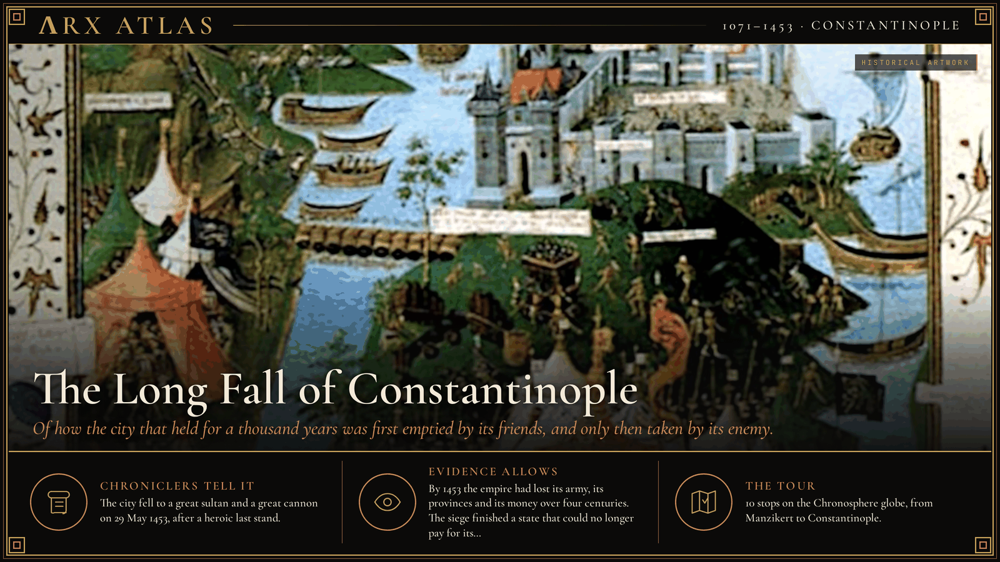
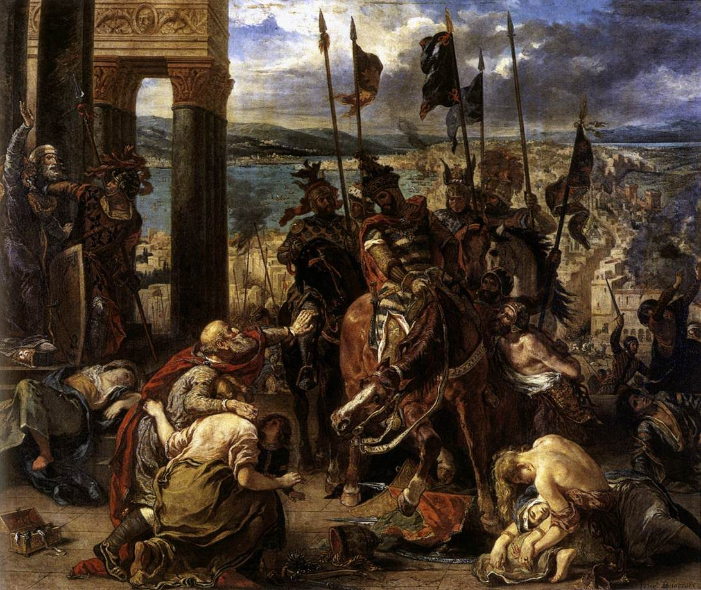
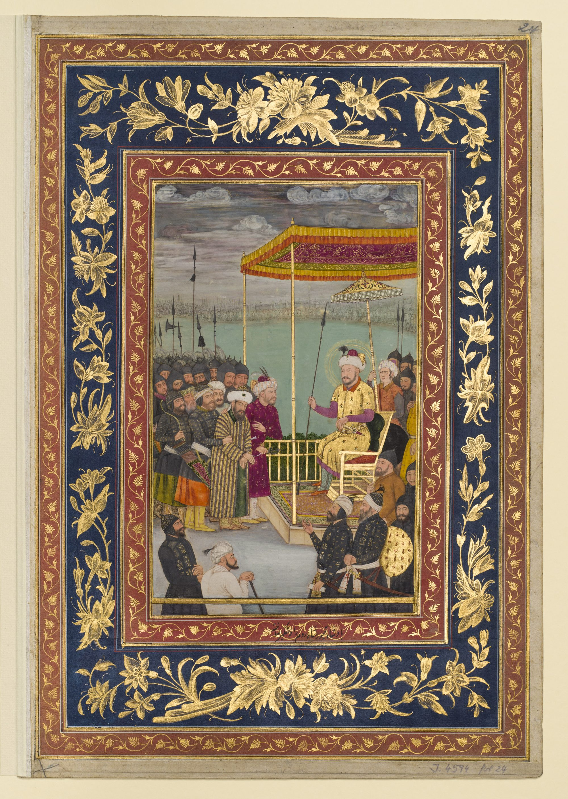
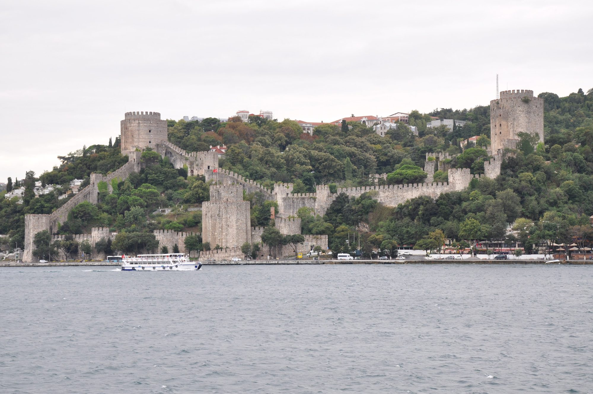

**ΛRX ATLAS** · Entry · 1071–1453 · Constantinople

# The Long Fall of Constantinople

*Of how the city that held for a thousand years was first emptied by its friends, and only then taken by its enemy.*

*Art: [Jean Le Tavernier : Miniature "The siege of Constantinople in 1453" - made in Lille in 145, “Siege of Constantinople BnF MS Fr 9087”, Public domain, via Wikimedia Commons](https://commons.wikimedia.org/wiki/File:Siege_of_Constantinople_BnF_MS_Fr_9087.jpg)*

**[Take the tour →](https://arxcortex.io/chronosphere.html#play/tour/fall-of-constantinople)**

Some time before the siege, a cannon-founder named [Orban](https://en.wikipedia.org/wiki/Orb%C3%A1n_(ironmaster)) offered his services to the Byzantine emperor. The emperor could not find the money to hire him. Orban took his skills to Sultan [Mehmed II](https://en.wikipedia.org/wiki/Mehmed_the_Conqueror) and cast a bombard 8.2 meters long that could throw a 270-kilogram stone more than a mile. The story holds the answer to this tour's question. Why did a city whose walls had held for a thousand years fall in 1453? Over four centuries the empire inside the walls had lost its army, its provinces and its money, much of it to fellow Christians.

## The emperor taken prisoner

The decline begins on 26 August 1071, near [Manzikert](https://en.wikipedia.org/wiki/Battle_of_Manzikert) in eastern Anatolia. The Seljuk sultan [Alp Arslan](https://en.wikipedia.org/wiki/Alp_Arslan) destroyed a Byzantine army and captured Emperor [Romanos IV Diogenes](https://en.wikipedia.org/wiki/Romanos_IV_Diogenes), the first Roman emperor taken alive by an enemy since Valerian eight centuries earlier. The defeat undermined Byzantine authority in Anatolia and opened it to gradual Turkish settlement.

## The call for help

An empire without Anatolia needed soldiers it could not raise itself. In 1095 the envoys of Emperor [Alexios I Komnenos](https://en.wikipedia.org/wiki/Alexios_I_Komnenos) appealed to [Pope Urban II](https://en.wikipedia.org/wiki/Pope_Urban_II) at the Council of Piacenza for help against the Seljuks. At Clermont later that year, Urban called the [First Crusade](https://en.wikipedia.org/wiki/First_Crusade). Byzantium had asked for help and got armies with their own aims. A century later those armies came to the city itself.

## Sacked by Christians

In 1201 the leaders of the [Fourth Crusade](https://en.wikipedia.org/wiki/Fourth_Crusade) contracted with Venice for a fleet to carry them to Egypt. They had overestimated their numbers, and the army that turned up could not pay. Doge [Enrico Dandolo](https://en.wikipedia.org/wiki/Enrico_Dandolo) offered a way out: help Venice take the rebel city of Zara. Some crusaders refused and went home. The rest sacked Zara, a Catholic city, in November 1202, and then followed a Byzantine claimant's promises to Constantinople.

*An 1840 imagining. [Eugène Delacroix, “Eugène Delacroix - The Entry of the Crusaders into Constantinople - WGA6202”, Public domain, via Wikimedia Commons](https://commons.wikimedia.org/wiki/File:Eug%C3%A8ne_Delacroix_-_The_Entry_of_the_Crusaders_into_Constantinople_-_WGA6202.jpg)*

On 9 April 1204 crusader and Venetian forces attacked the walls along the Golden Horn and were driven back. On 12 April they broke in and [sacked the city](https://en.wikipedia.org/wiki/Sack_of_Constantinople), and crowned Baldwin of Flanders emperor of a new [Latin Empire](https://en.wikipedia.org/wiki/Latin_Empire) in [Hagia Sophia](https://en.wikipedia.org/wiki/Hagia_Sophia). A debt to a shipbuilder had become the destruction of Christendom's largest city.

## A city regained, an empire not

The Greeks took it back in 1261. The general [Alexios Strategopoulos](https://en.wikipedia.org/wiki/Alexios_Strategopoulos), sent with 800 men, mostly Cumans, to scout the area, found a way in and recovered the city for Emperor [Michael VIII Palaiologos](https://en.wikipedia.org/wiki/Michael_VIII_Palaiologos), who had allied with Genoa a few months earlier. The empire was restored in name. In fact it was one Greek state among several, with a capital too large for its revenues, and it relied on Italian merchants for its trade.

## Across the strait

On the night of 1–2 March 1354 an earthquake shattered the walls of [Gallipoli](https://en.wikipedia.org/wiki/Gallipoli) on the European shore of the Dardanelles. Within a month the Ottomans took the town. It became their first stronghold in Europe and the base for their advance into the Balkans.

They advanced quickly. On 15 June 1389, on the field of [Kosovo](https://en.wikipedia.org/wiki/Battle_of_Kosovo), Sultan [Murad I](https://en.wikipedia.org/wiki/Murad_I) met Prince [Lazar](https://en.wikipedia.org/wiki/Lazar_of_Serbia), the strongest of the Serbian lords, with a coalition from Bosnia and elsewhere. Both leaders died. Serbian tradition blames the noble Vuk Branković for betraying Lazar; the historical record says he withdrew once the battle was lost. The Ottoman advance went on, and Constantinople was left ringed by Ottoman land.

## The reprieve

By 1402 Sultan [Bayezid I](https://en.wikipedia.org/wiki/Bayezid_I) was blockading Constantinople. Then a greater threat came from the east. The Turco-Mongol conqueror [Timur](https://en.wikipedia.org/wiki/Timur) took a tribute dispute as a personal insult. Bayezid broke off the blockade and marched to meet him. On 28 July 1402, near [Ankara](https://en.wikipedia.org/wiki/Battle_of_Ankara), Timur's larger army won, and Bayezid died in captivity the following March. The Ottoman princes fought each other for a decade. The city gained half a century, but it did not regain the army or the provinces it would need to use that time.

*An early 17th-century illustrated manuscript page showing Bayezid taken captive by Timur. [Unknown author, “The ruler Timur Shah has the Sultan of Rum taken into captivity (Museum of Islamic Art, Ident. No. I 4594, fol. 24 recto)”, Public domain, via Wikimedia Commons](https://commons.wikimedia.org/wiki/File:The_ruler_Timur_Shah_has_the_Sultan_of_Rum_taken_into_captivity_(Museum_of_Islamic_Art,_Ident._No._I_4594,_fol._24_recto).jpg)*

## The last crusade

Western help came once more, and failed. On 10 November 1444, near [Varna](https://en.wikipedia.org/wiki/Battle_of_Varna) on the Black Sea, Sultan [Murad II](https://en.wikipedia.org/wiki/Murad_II) destroyed a crusading army under King [Władysław III](https://en.wikipedia.org/wiki/Władysław_III_of_Poland) of Poland and Hungary and the commander [John Hunyadi](https://en.wikipedia.org/wiki/John_Hunyadi).

## The strait-cutter

In 1451 Mehmed II succeeded his father at the age of 18. He built a fortress on the European bank of the Bosphorus in 1451–52, opposite an older Ottoman fort on the Asian side. The Turks called it [Boğazkesen](https://en.wikipedia.org/wiki/Rumelihisarı), the "strait-cutter." The two forts together could stop any ship bringing help from the Black Sea.

*The fortress today. [Jorge Láscar from Australia, “Rumelihisarı (8393629929)”, CC BY 2.0, via Wikimedia Commons](https://commons.wikimedia.org/wiki/File:Rumelihisar%C4%B1_(8393629929).jpg)*

## The siege

Emperor [Constantine XI Palaiologos](https://en.wikipedia.org/wiki/Constantine_XI_Palaiologos) saw what was coming and asked the West for help. Little came. A cardinal paid by the pope brought 200 archers. The Genoese soldier [Giovanni Giustiniani](https://en.wikipedia.org/wiki/Giovanni_Giustiniani), a specialist in defending walled cities, arrived with 700 men. Venice voted to send a fleet, but it did not sail until April, too late. Seven Italian ships slipped away from the harbor as soon as Giustiniani arrived. Inside the walls the city was now, in the words of one modern account, "a series of walled villages separated by vast fields."

The siege began on 6 April 1453. On 29 May, after 53 days, the city fell. Constantine XI died in the fighting. Mehmed made Constantinople the new Ottoman capital.

## Weighing the evidence

The chroniclers of 1453 wrote as partisans and mourners, and their numbers for armies and dead vary widely. Serbian memory of Kosovo blames a traitor the record does not convict. Even the cannon-founder Orban is a "somewhat mysterious figure" of uncertain nationality. What survives best is the arithmetic of decline: the lost provinces, the hired Italian soldiers, a capital of walled villages. On that the sources agree.

## The long view

Why did the city fall? The young sultan, the great gun and the last stand all happened. The longer story explains why the last stand was so small. Manzikert cost Byzantium its heartland. Its call for help brought crusaders who, steered by Venice's need for payment, sacked the city in 1204. The restored empire was too poor to rebuild its army, and it watched the Ottomans cross into Europe and surround it. Timur bought it fifty years, and it could not use them. When Mehmed came, the emperor could not even pay the man who built the cannon.

**[Take the tour →](https://arxcortex.io/chronosphere.html#play/tour/fall-of-constantinople)**

---

## Sources

**Ancient witnesses**
- Michael Attaleiates, History.
- Geoffrey of Villehardouin, The Conquest of Constantinople.
- George Sphrantzes, Chronicle.
- Doukas, Historia Turco-Byzantina.

**Modern scholarship**
- "Alexios I Komnenos." *Wikipedia*. Accessed October 28, 2026. https://en.wikipedia.org/wiki/Alexios_I_Komnenos.
- "Battle of Ankara." *Wikipedia*. Accessed October 28, 2026. https://en.wikipedia.org/wiki/Battle_of_Ankara.
- "Battle of Kosovo." *Wikipedia*. Accessed October 28, 2026. https://en.wikipedia.org/wiki/Battle_of_Kosovo.
- "Battle of Manzikert." *Wikipedia*. Accessed October 28, 2026. https://en.wikipedia.org/wiki/Battle_of_Manzikert.
- "Battle of Varna." *Wikipedia*. Accessed October 28, 2026. https://en.wikipedia.org/wiki/Battle_of_Varna.
- "Constantine XI Palaiologos." *Wikipedia*. Accessed October 28, 2026. https://en.wikipedia.org/wiki/Constantine_XI_Palaiologos.
- "Fall of Constantinople." *Wikipedia*. Accessed October 28, 2026. https://en.wikipedia.org/wiki/Fall_of_Constantinople.
- "Fourth Crusade." *Wikipedia*. Accessed October 28, 2026. https://en.wikipedia.org/wiki/Fourth_Crusade.
- "Gallipoli." *Wikipedia*. Accessed October 28, 2026. https://en.wikipedia.org/wiki/Gallipoli.
- "Reconquest of Constantinople." *Wikipedia*. Accessed October 28, 2026. https://en.wikipedia.org/wiki/Reconquest_of_Constantinople.
- "Rumelihisarı." *Wikipedia*. Accessed October 28, 2026. https://en.wikipedia.org/wiki/Rumelihisar%C4%B1.
- "Sack of Constantinople." *Wikipedia*. Accessed October 28, 2026. https://en.wikipedia.org/wiki/Sack_of_Constantinople.

*Entered in the ΛRX Atlas · arxcortex.io*
