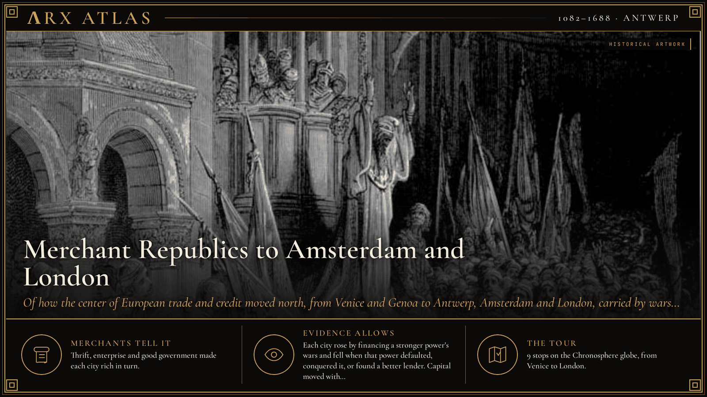
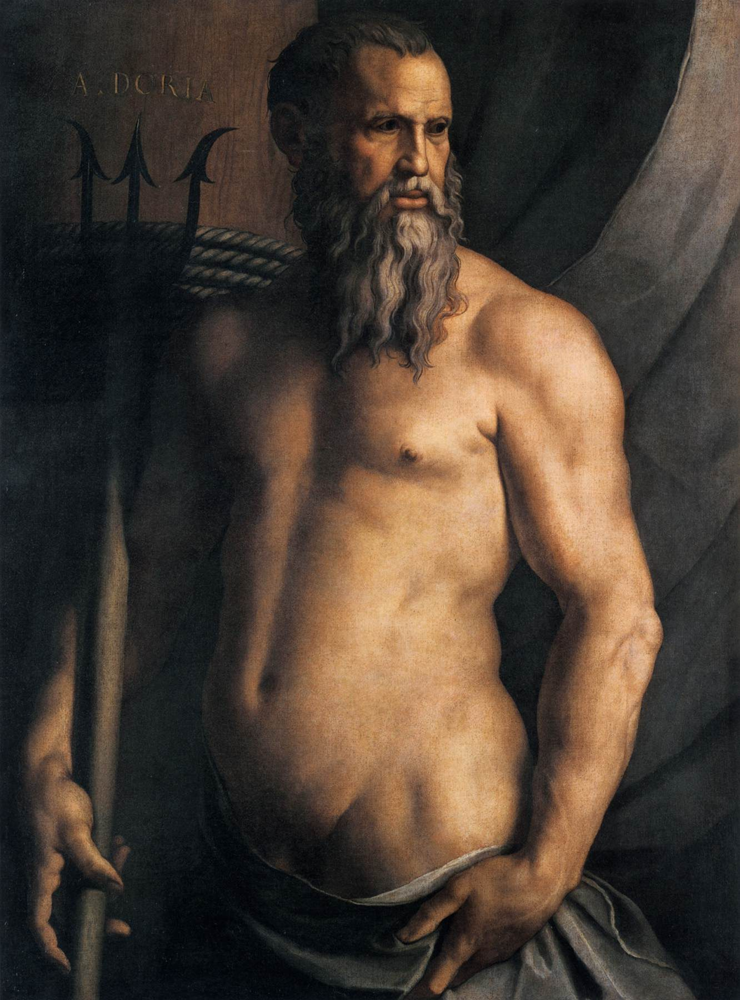
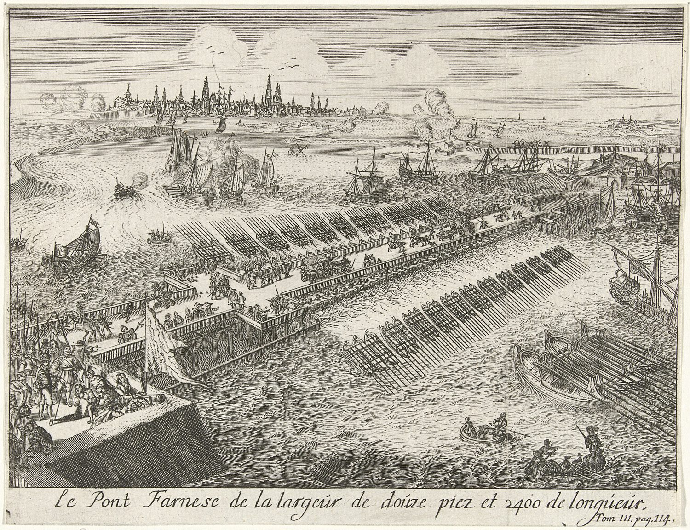
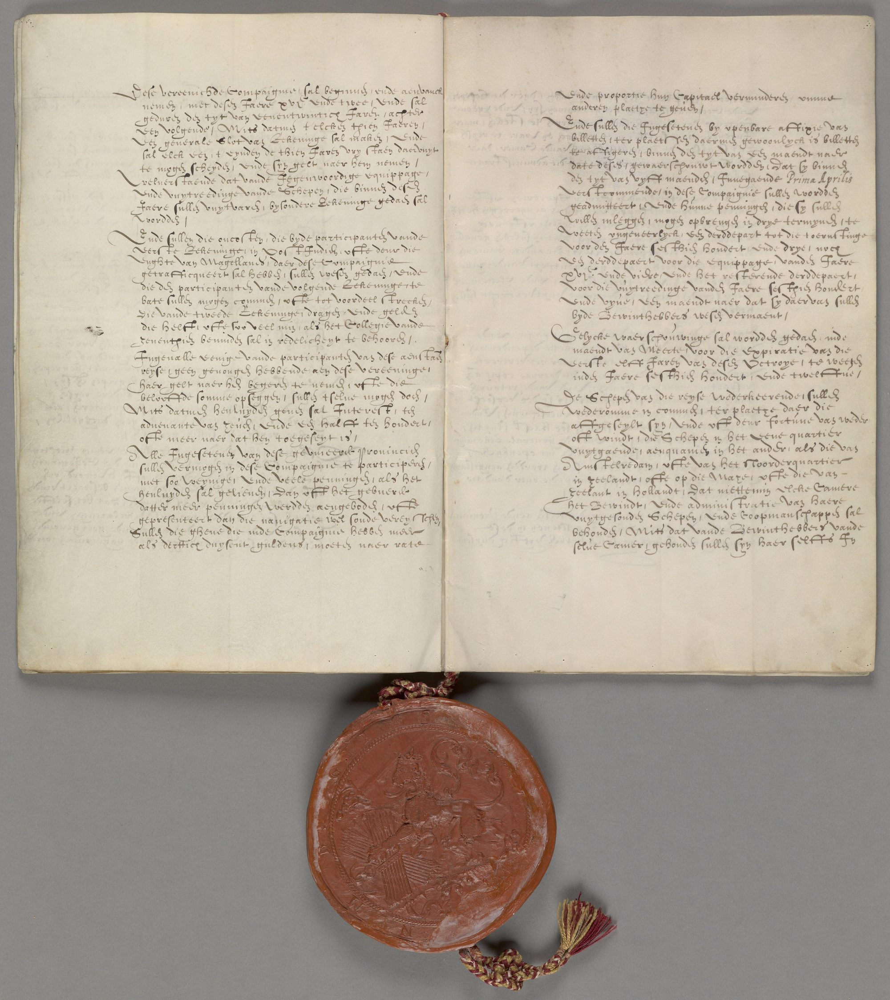
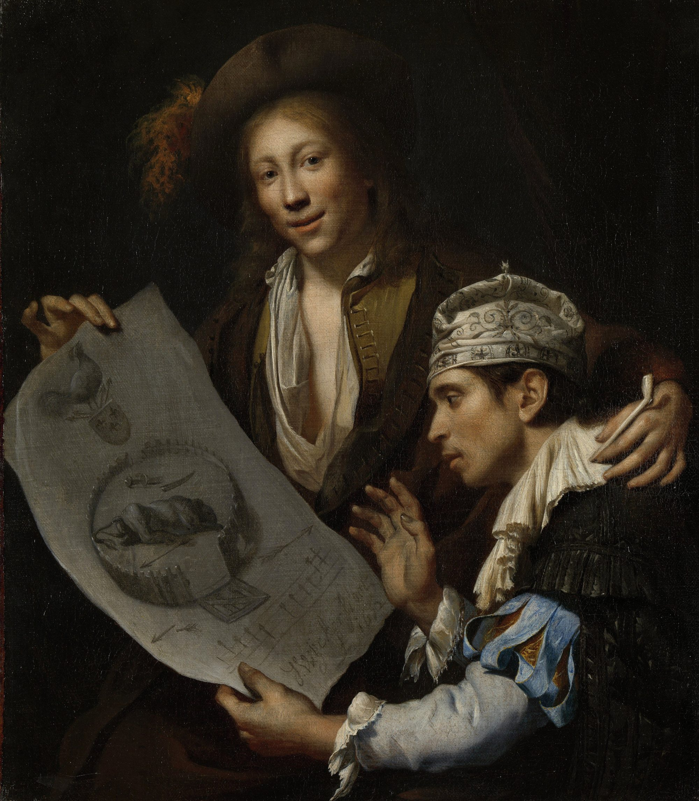
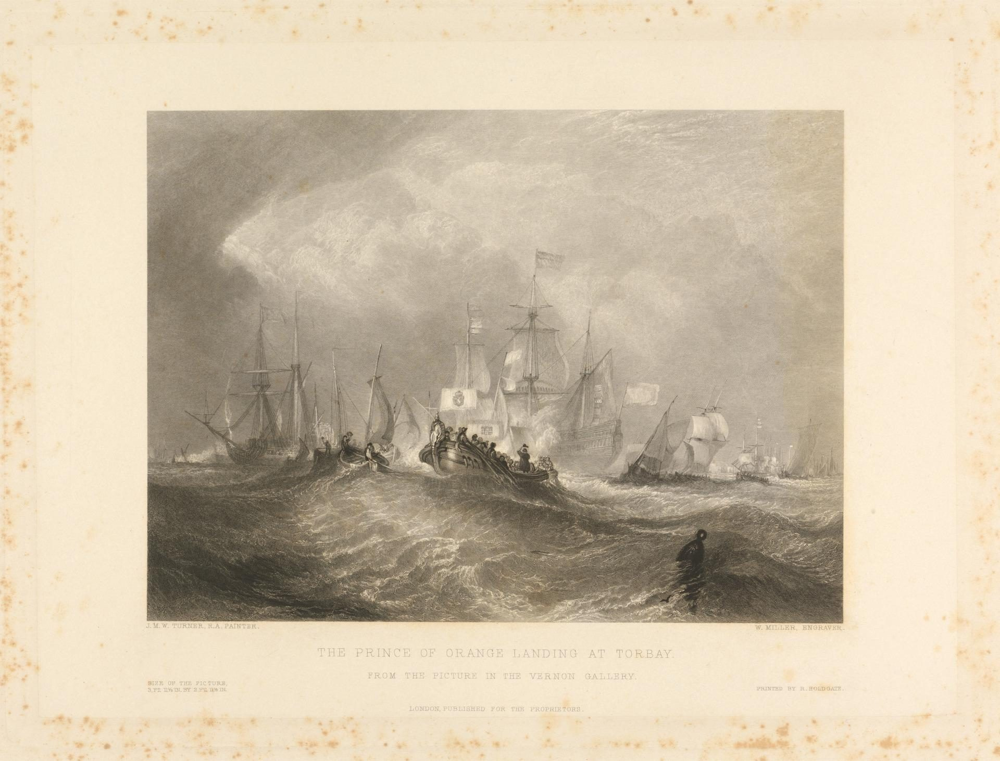

**ΛRX ATLAS** · Entry · 1082–1688 · Antwerp

# Merchant Republics to Amsterdam and London

*Of how the center of European trade and credit moved north, from Venice and Genoa to Antwerp, Amsterdam and London, carried by wars, defaults and refugees.*

*Art: [Gustave Doré, “Gustave Doré - Dandolo Preaching the Crusade”, Public domain, via Wikimedia Commons](https://commons.wikimedia.org/wiki/File:Gustave_Dor%C3%A9_-_Dandolo_Preaching_the_Crusade.jpg)*

**[Take the tour →](https://arxcortex.io/chronosphere.html#play/tour/merchant-republics)**

On 17 August 1585, after a siege of more than a year, Antwerp surrendered to the Spanish general [Alessandro Farnese](https://en.wikipedia.org/wiki/Alexander_Farnese,_Duke_of_Parma). The terms were mild by the standards of the day. The city's Protestants had four years to settle their affairs and leave. Many went north, especially to Amsterdam. Dutch forts then blockaded the Scheldt, Antwerp's river to the sea, and Antwerp's trade suffered for two centuries. In a few years Europe's richest port handed its merchants, money and skills to a rival. The scene repeats through this tour, which asks how the center of European trade and credit moved from the Italian republics to Amsterdam and London.

## The golden bull

The story starts in Constantinople. In 1082 the Byzantine emperor [Alexios I Komnenos](https://en.wikipedia.org/wiki/Alexios_I_Komnenos), fighting Norman invaders, needed a navy. Venice supplied one. In return a golden bull let Venetians trade throughout the empire free of taxes and gave them harbor facilities in the capital. A small lagoon republic now had privileged access to the richest market in Christendom.

## The diversion

A century later Venice used that position against its old patron. In 1201 the leaders of the [Fourth Crusade](https://en.wikipedia.org/wiki/Fourth_Crusade) contracted with Venice for a fleet but could not pay for it. Doge [Enrico Dandolo](https://en.wikipedia.org/wiki/Enrico_Dandolo) steered the crusaders first to Zara and then to Constantinople, which they sacked in 1204. Dandolo, by then in his nineties, died in the conquered city in 1205 and was buried in Hagia Sophia. Venice took a share of the empire and its trade.

## Florence lends to a king

Italian wealth sought borrowers, and the biggest borrowers were kings at war. In the early 1340s [Edward III](https://en.wikipedia.org/wiki/Edward_III_of_England), fighting France, borrowed 900,000 florins from the [Bardi](https://en.wikipedia.org/wiki/Bardi_family) of Florence and 600,000 from the [Peruzzi](https://en.wikipedia.org/wiki/Peruzzi). In 1345 he defaulted, and both firms went bankrupt. Historians now call that explanation too simple: the Peruzzi company had collapsed in 1343 amid wider troubles in Florence and its trade. Either way, lending to a king without security had proved ruinous.

## The admiral's choice

Genoa found a safer partner. In 1528 the admiral [Andrea Doria](https://en.wikipedia.org/wiki/Andrea_Doria) entered the service of Emperor [Charles V](https://en.wikipedia.org/wiki/Charles_V,_Holy_Roman_Emperor) as his grand admiral in the Mediterranean. He used the alliance to protect Genoa's independence and reshaped its constitution, which lasted until 1797. Genoa was now a junior partner of the Spanish Habsburgs, and its bankers began financing the Spanish crown.

*Bronzino's c.1545 portrait of Doria as Neptune. [Bronzino, “Angelo Bronzino - Portrait of Andrea Doria as Neptune - WGA3261”, Public domain, via Wikimedia Commons](https://commons.wikimedia.org/wiki/File:Angelo_Bronzino_-_Portrait_of_Andrea_Doria_as_Neptune_-_WGA3261.jpg)*

## The Spanish default

Spain's wars outran even American silver. [Philip II](https://en.wikipedia.org/wiki/Philip_II_of_Spain) inherited a debt of about 36 million ducats and defaulted in 1557, 1560, 1575 and 1596. His lenders had no means to force him to pay. The 1557 bankruptcy ruined the German banking houses and ended the Fuggers' reign as Spain's financiers. The Genoese took their place. The historian [Fernand Braudel](https://en.wikipedia.org/wiki/Fernand_Braudel) called 1557 to 1627 the "age of the Genoese." But Philip's money was paying for a war in the Netherlands, and that war came to Antwerp.

## The flight north

When Antwerp fell in 1585, its Protestant merchants and craftsmen moved to the cities of the rebel north, above all Amsterdam. The [Dutch Revolt](https://en.wikipedia.org/wiki/Dutch_Revolt) had become a war of the northern provinces, and Amsterdam was out of Spain's reach.

*Parma's bridge blockading the Scheldt during the siege of Antwerp. [Romeyn de Hooghe, “Parma's brug, Antwerpen 1585”, Public domain, via Wikimedia Commons](https://commons.wikimedia.org/wiki/File:Parma%27s_brug,_Antwerpen_1585.JPG)*

## The company

On 20 March 1602 the States General merged existing trading ventures into the [Dutch East India Company](https://en.wikipedia.org/wiki/Dutch_East_India_Company), the VOC, with a 21-year monopoly on trade with Asia. Any citizen could buy its shares, which were traded in open-air markets, one of which became the [Amsterdam Stock Exchange](https://en.wikipedia.org/wiki/Euronext_Amsterdam). The company could wage war, make treaties and found colonies. Amsterdam became the hub of world trade.

*A page from the VOC archive at the Nationaal Archief, The Hague. [Verenigde Oostindische Compagnie, “NL-HaNA 1.04.02 1 17”, Public domain, via Wikimedia Commons](https://commons.wikimedia.org/wiki/File:NL-HaNA_1.04.02_1_17.jpg)*

## The disaster year

Wealth drew enemies. In 1672 France, England and the German bishoprics of Münster and Cologne invaded the Dutch Republic at once. The Dutch remember it as the *[Rampjaar](https://en.wikipedia.org/wiki/Rampjaar)*, the disaster year. The ruling regents under [Johan de Witt](https://en.wikipedia.org/wiki/Johan_de_Witt) lost public support, and [William III of Orange](https://en.wikipedia.org/wiki/William_III_of_England) was made stadtholder and given command of the army. The Dutch flooded their own land to stop the French. William spent the rest of his life fighting Louis XIV.

*Allegory of the French invasion of 1672. [Johannes van Wijckersloot, “Johannes van Wijckersloot - Allegorie op de Franse invasie van 1672”, Public domain, via Wikimedia Commons](https://commons.wikimedia.org/wiki/File:Johannes_van_Wijckersloot_-_Allegorie_op_de_Franse_invasie_van_1672.jpg)*

## The invasion of England

That fight took him to London. In 1688 the Dutch States General and William feared that England's King [James II](https://en.wikipedia.org/wiki/James_II_of_England) would side with France. Answering an invitation from James's English opponents, William landed in Devon with an army on 5 November. James's army fell apart, and he fled to France. William and his wife Mary, James's daughter, took the throne.

*Engraving of William's 1688 landing. [William Miller, “William Miller - The Prince of Orange Landing at Torbay - B1977.14.15059 - Yale Center for British Art”, CC0, via Wikimedia Commons](https://commons.wikimedia.org/wiki/File:William_Miller_-_The_Prince_of_Orange_Landing_at_Torbay_-_B1977.14.15059_-_Yale_Center_for_British_Art.jpg)*

## Weighing the evidence

This is a story with unusually good paperwork: chrysobulls, account books, charters and share registers survive. The causes are harder. The traditional tale that Edward III's default alone sank the Bardi and Peruzzi is now considered simplistic; war and trade disruption in Florence played their part. Fernand Braudel's "age of the Genoese" is one historian's phrase for a power that, he noted, historians long failed to see. And how far Dutch methods shaped London's finances is a matter of degree, not of fact.

## The long view

How did the center of money move north? Not by a slow drift of virtue. Venice rose by serving Byzantium's wars and then turning on it. Florence's bankers lent to a warring king and failed. Genoa financed Spain's wars and profited when Spain's defaults ruined its rivals. Antwerp fell to those same wars, and its people carried their capital to Amsterdam. Amsterdam's wealth made it a target, and the war of 1672 put a Dutch prince on the path to the English throne. After 1688 a [Financial Revolution](https://en.wikipedia.org/wiki/Financial_Revolution), drawing in part on Dutch practice, remade English public finance. Each time, capital moved toward the power that could protect it.

**[Take the tour →](https://arxcortex.io/chronosphere.html#play/tour/merchant-republics)**

---

## Sources

**Ancient witnesses**
- Chrysobull of Alexios I for Venice (1082).
- Account books of the Peruzzi company (1335–1343).
- Terms of surrender of Antwerp (1585).
- Charter of the Dutch East India Company (1602).

**Modern scholarship**
- "Andrea Doria." *Wikipedia*. Accessed October 28, 2026. https://en.wikipedia.org/wiki/Andrea_Doria.
- "Bardi family." *Wikipedia*. Accessed October 28, 2026. https://en.wikipedia.org/wiki/Bardi_family.
- "Byzantine–Venetian treaty of 1082." *Wikipedia*. Accessed October 28, 2026. https://en.wikipedia.org/wiki/Byzantine%E2%80%93Venetian_treaty_of_1082.
- "Dutch East India Company." *Wikipedia*. Accessed October 28, 2026. https://en.wikipedia.org/wiki/Dutch_East_India_Company.
- "Enrico Dandolo." *Wikipedia*. Accessed October 28, 2026. https://en.wikipedia.org/wiki/Enrico_Dandolo.
- "Fall of Antwerp." *Wikipedia*. Accessed October 28, 2026. https://en.wikipedia.org/wiki/Fall_of_Antwerp.
- "Financial Revolution." *Wikipedia*. Accessed October 28, 2026. https://en.wikipedia.org/wiki/Financial_Revolution.
- "Fourth Crusade." *Wikipedia*. Accessed October 28, 2026. https://en.wikipedia.org/wiki/Fourth_Crusade.
- "Glorious Revolution." *Wikipedia*. Accessed October 28, 2026. https://en.wikipedia.org/wiki/Glorious_Revolution.
- "Peruzzi." *Wikipedia*. Accessed October 28, 2026. https://en.wikipedia.org/wiki/Peruzzi.
- "Philip II of Spain." *Wikipedia*. Accessed October 28, 2026. https://en.wikipedia.org/wiki/Philip_II_of_Spain.
- "Rampjaar." *Wikipedia*. Accessed October 28, 2026. https://en.wikipedia.org/wiki/Rampjaar.
- "Republic of Genoa." *Wikipedia*. Accessed October 28, 2026. https://en.wikipedia.org/wiki/Republic_of_Genoa.

*Entered in the ΛRX Atlas · arxcortex.io*
