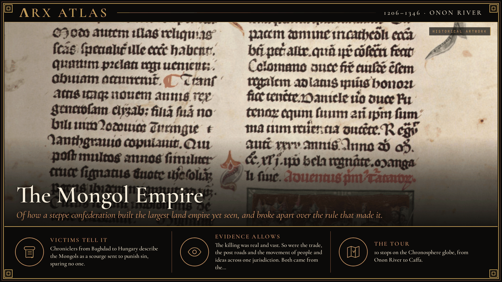
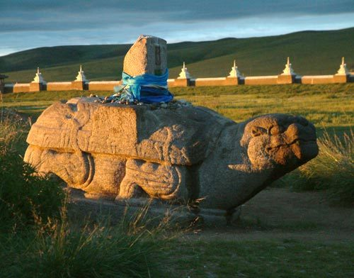
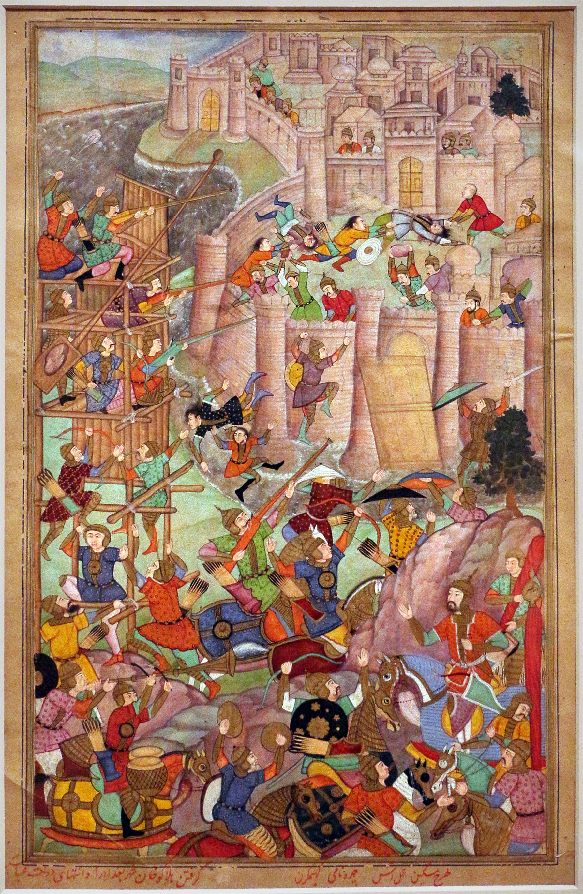
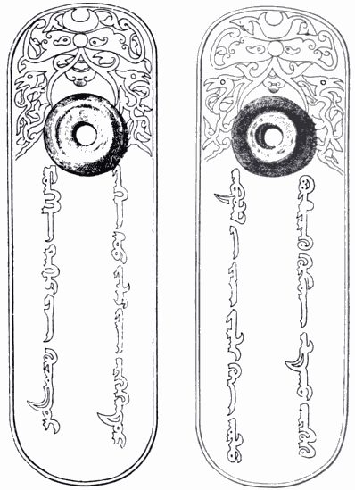

**ΛRX ATLAS** · Entry · 1206–1346 · Onon River

# The Mongol Empire

*Of how a steppe confederation built the largest land empire yet seen, and broke apart over the rule that made it.*

*Art: [Márk Kálti, “Chronicon Pictum 125”, Public domain, via Wikimedia Commons](https://commons.wikimedia.org/wiki/File:Chronicon_Pictum_125.jpg)*

**[Take the tour →](https://arxcortex.io/chronosphere.html#play/tour/mongol-empire)**

In 1218 a large caravan of Mongol merchants reached [Otrar](https://en.wikipedia.org/wiki/Otrar), a frontier city of the [Khwarazmian Empire](https://en.wikipedia.org/wiki/Khwarazmian_dynasty) in Central Asia. Much of the Mongol elite had probably invested in it. The governor, [Inalchuq](https://en.wikipedia.org/wiki/Inalchuq), seized the goods and executed the merchants as spies. When [Genghis Khan](https://en.wikipedia.org/wiki/Genghis_Khan) demanded that the governor be punished, the Shah refused, killed one envoy and humiliated the other two. Within three years Khwarazm was gone. The episode shows the two sides of the empire this tour follows: a state built on trade and plunder, which met insult with destruction. The question is how a confederation of herders built the largest land empire the world had yet seen, and why it broke apart within two generations.

## The khan of all Mongols

Temüjin was born around 1162. After his father was poisoned, his family was abandoned on the steppe. Over decades of war and alliance he united the Mongol tribes, and in 1206 a council, a *[kurultai](https://en.wikipedia.org/wiki/Kurultai)*, proclaimed him ruler of all the Mongols. A confederation held together by victory needed more victories. The richest prize lay south, in the Jin empire of northern China.

## The capital of the Jin

The [war against the Jin](https://en.wikipedia.org/wiki/Mongol_conquest_of_the_Jin_dynasty) began in 1211. The Mongols reached the walls of the Jin capital, Zhongdu, near modern Beijing, and found them too strong. They pillaged the countryside instead. The Jin emperor moved his court south to Kaifeng, and in 1214–15 Zhongdu fell. The war would take 23 years. But by 1218 the khan had wealth to trade, and he sent the caravan west.

## The war for Khwarazm

The insult at Otrar led to invasion. Between 1219 and 1221 Mongol armies under Genghis and his sons overran Khwarazm. Otrar was besieged first. Two generals, Jebe and Subutai, led a raid as far as Georgia and the lands of Rus'. Central Asia's cities were ruined, and the road west lay open.

## A death and an inheritance

In 1227 Genghis died while putting down a revolt in the Tangut kingdom of [Western Xia](https://en.wikipedia.org/wiki/Western_Xia). After a two-year interregnum his third son, [Ögedei](https://en.wikipedia.org/wiki/%C3%96gedei_Khan), succeeded him. The empire had no fixed rule of succession. Each new great khan had to be chosen by a kurultai of the family, and that would matter.

## A city of tents becomes a capital

Ögedei finished the Jin in 1234. In 1235 he made [Karakorum](https://en.wikipedia.org/wiki/Karakorum), until then little more than a town of yurts, the walled capital of the empire. From there he sent armies into China, Persia and Europe at once.

*The stone turtle at Karakorum. [Frithjof Spangenberg, “Turtle-Karakorum”, CC BY-SA 2.5, via Wikimedia Commons](https://commons.wikimedia.org/wiki/File:Turtle-Karakorum.jpg)*

## The road to Vienna

In Europe the Mongols, under Genghis's grandson [Batu](https://en.wikipedia.org/wiki/Batu_Khan), struck in three columns. On 11 April 1241, at [Mohi](https://en.wikipedia.org/wiki/Battle_of_Mohi) on the Sajó River, they destroyed the army of King Béla IV of Hungary. Batu's forces were ready to push on. Then news came that Ögedei had died in December 1241, and the armies turned back. A succession, not a European army, had stopped them.

## The end of the caliphate

Under the next great khan, [Möngke](https://en.wikipedia.org/wiki/M%C3%B6ngke_Khan), the empire turned on the Islamic heartland. His brother [Hulegu](https://en.wikipedia.org/wiki/Hulegu_Khan) moved into Persia, destroyed the Nizari Ismaili fortresses in 1256 and marched on Baghdad. The Abbasid caliph al-Musta'sim refused to send troops and negotiated with arrogance. Hulegu took the eastern wall by 4 February 1258, and the caliph surrendered on 10 February. The city was sacked, and al-Musta'sim was killed. Five centuries of Abbasid rule from Baghdad ended in a few weeks.

*Hulegu's capture of Baghdad in a 1596 Mughal copy of Rashid al-Din's history. [Sailko, “India del nord, periodo mogul, la presa di baghdad da parte di hulagu kahn, da un manoscritto di jami' al tawarikh, 1596, 01”, CC BY 3.0, via Wikimedia Commons](https://commons.wikimedia.org/wiki/File:India_del_nord,_periodo_mogul,_la_presa_di_baghdad_da_parte_di_hulagu_kahn,_da_un_manoscritto_di_jami%27_al_tawarikh,_1596,_01.jpg)*

## The check at Ain Jalut

Hulegu sent envoys to Cairo demanding surrender. The Mamluk sultan Qutuz killed them and hung their heads on a city gate. Then, again, a death far away changed everything. Möngke died while campaigning against the Song in China. Hulegu took most of his army back toward Mongolia for the kurultai and left about 10,000 men under [Kitbuqa](https://en.wikipedia.org/wiki/Kitbuqa). On 3 September 1260 the Mamluks met them at [Ain Jalut](https://en.wikipedia.org/wiki/Battle_of_Ain_Jalut) in Galilee and won. It was the first major halt to Mongol expansion.

## Two khans, then four khanates

After Möngke's death, rival kurultais elected two of his brothers, [Kublai](https://en.wikipedia.org/wiki/Kublai_Khan) and [Ariq Böke](https://en.wikipedia.org/wiki/Ariq_B%C3%B6ke), and they went to war. That war and others between the khans broke the great khan's authority. The empire became four khanates: the Golden Horde in eastern Europe, the Chagatai Khanate in Central Asia, the Ilkhanate in Iran and the [Yuan](https://en.wikipedia.org/wiki/Yuan_dynasty) in China. In 1271 Kublai proclaimed the Yuan dynasty in Chinese style.

*A 13th-century Golden Horde paiza, the passport tablet carried by officials on the Mongol post roads. [Unknown author, “Paiza Golden Horde”, Public domain, via Wikimedia Commons](https://commons.wikimedia.org/wiki/File:Paiza_Golden_Horde.jpg)*

## The siege at Caffa

The khanates kept the trade routes running across Eurasia. [Caffa](https://en.wikipedia.org/wiki/Feodosia), on the Crimean coast, was one of their ports, a Genoese colony bought from the Golden Horde in 1266. In the 1340s relations soured, and the Golden Horde khan [Jani Beg](https://en.wikipedia.org/wiki/Jani_Beg) besieged the city, in 1343 and again in 1345–46. The Italian notary Gabriel de Mussis later wrote that the besiegers, struck by plague, catapulted infected corpses over the walls, and that the disease spread from there. Historians treat the story with caution. What is clear is that the [Black Death](https://en.wikipedia.org/wiki/Black_Death) started in the Mongol lands and spread to Europe, and that it devastated the khanates themselves.

## Weighing the evidence

Most of the record was written by the Mongols' victims or their later servants. Persian court historians wrote for Mongol rulers; Christian and Muslim chroniclers wrote as survivors. Casualty figures from the sack of cities are often impossible, and the toll at Baghdad is unknown. The corpse-catapult at Caffa rests on one Italian notary who was not there. What stands up best is the sequence: dated battles, the founding of capitals, and the khans' deaths that turned armies around.

## The long view

How did herders build the largest land empire, and why did it come apart? They built it on a confederation that had to keep winning, and on a ruthless answer to resistance, which Otrar learned first. They held it together while one family agreed on one khan. Twice a khan's death stopped an advance, in Hungary in 1241 and in Syria in 1260, because the princes went home to choose the next one. In the end the princes could not agree, and the empire split four ways. Its last gift to the world it had joined was a plague.

**[Take the tour →](https://arxcortex.io/chronosphere.html#play/tour/mongol-empire)**

---

## Sources

**Ancient witnesses**
- The Secret History of the Mongols.
- Rashid al-Din, Compendium of Chronicles.
- Gabriel de Mussis, account of the siege of Caffa.

**Modern scholarship**
- "Battle of Ain Jalut." *Wikipedia*. Accessed October 28, 2026. https://en.wikipedia.org/wiki/Battle_of_Ain_Jalut.
- "Battle of Mohi." *Wikipedia*. Accessed October 28, 2026. https://en.wikipedia.org/wiki/Battle_of_Mohi.
- "Division of the Mongol Empire." *Wikipedia*. Accessed October 28, 2026. https://en.wikipedia.org/wiki/Division_of_the_Mongol_Empire.
- "Genghis Khan." *Wikipedia*. Accessed October 28, 2026. https://en.wikipedia.org/wiki/Genghis_Khan.
- "Karakorum." *Wikipedia*. Accessed October 28, 2026. https://en.wikipedia.org/wiki/Karakorum.
- "Mongol Empire." *Wikipedia*. Accessed October 28, 2026. https://en.wikipedia.org/wiki/Mongol_Empire.
- "Mongol conquest of the Jin dynasty." *Wikipedia*. Accessed October 28, 2026. https://en.wikipedia.org/wiki/Mongol_conquest_of_the_Jin_dynasty.
- "Mongol invasion of the Khwarazmian Empire." *Wikipedia*. Accessed October 28, 2026. https://en.wikipedia.org/wiki/Mongol_invasion_of_the_Khwarazmian_Empire.
- "Siege of Baghdad (1258)." *Wikipedia*. Accessed October 28, 2026. https://en.wikipedia.org/wiki/Siege_of_Baghdad_(1258).
- "Siege of Caffa." *Wikipedia*. Accessed October 28, 2026. https://en.wikipedia.org/wiki/Siege_of_Caffa.
- "Yuan dynasty." *Wikipedia*. Accessed October 28, 2026. https://en.wikipedia.org/wiki/Yuan_dynasty.

*Entered in the ΛRX Atlas · arxcortex.io*
