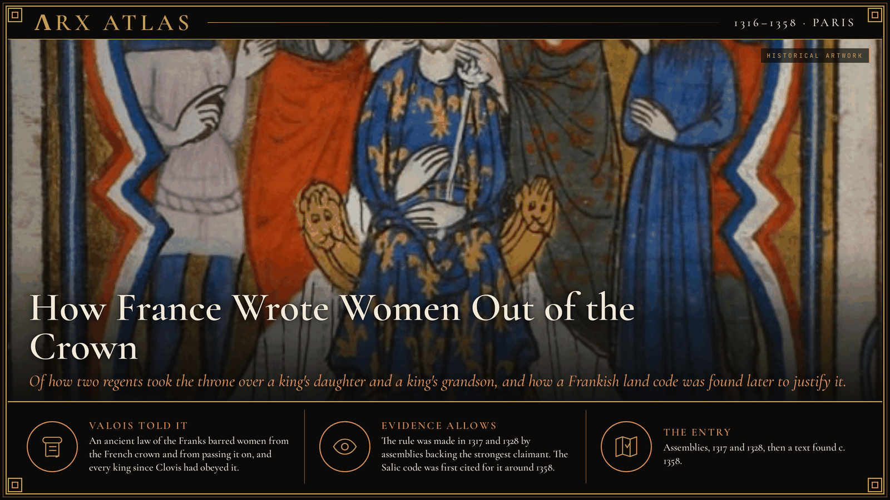
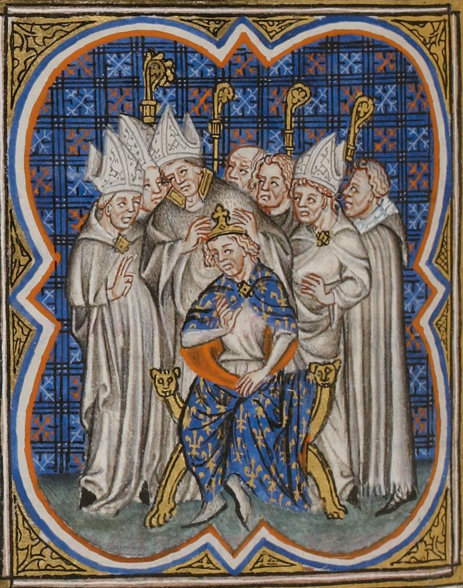
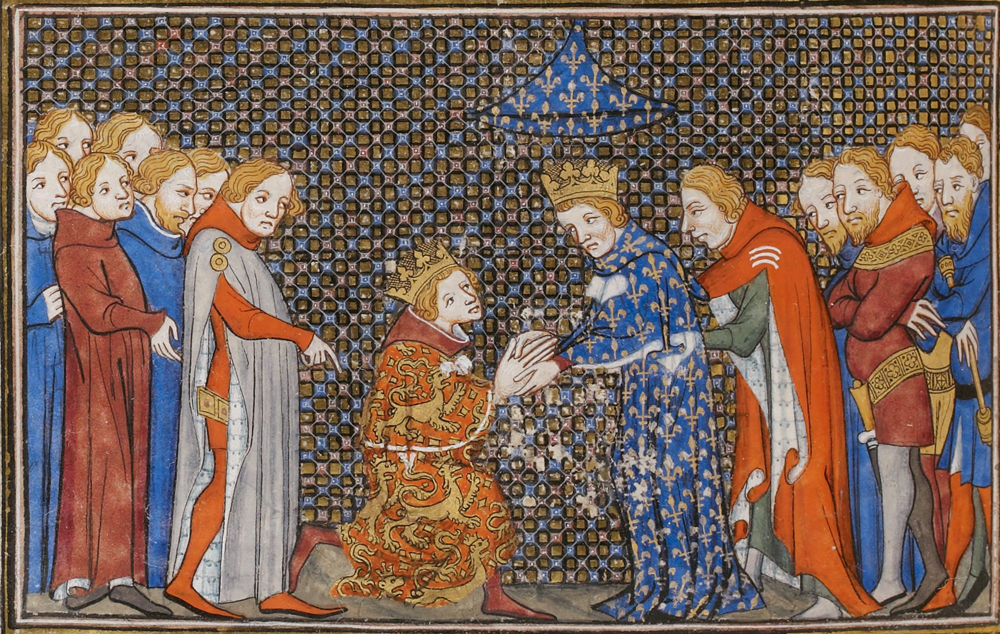
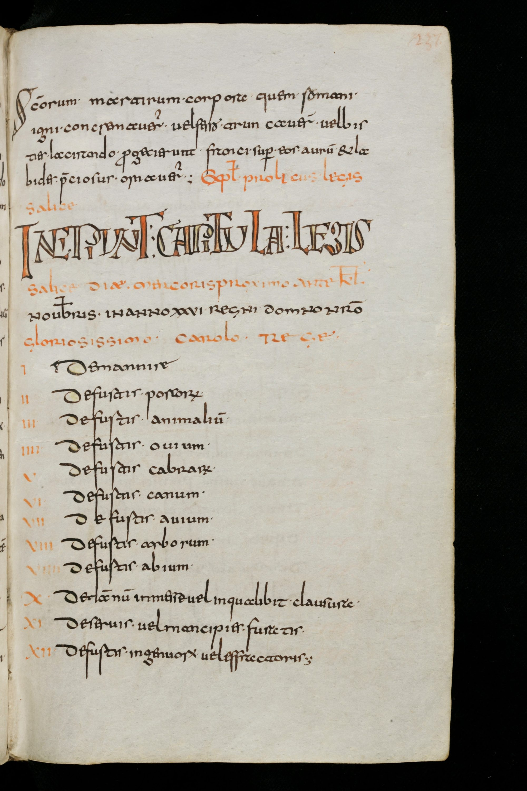

**ΛRX ATLAS** · Entry · 1316–1358 · Paris

# How France Wrote Women Out of the Crown

*Of how two regents took the throne over a king's daughter and a king's grandson, and how a Frankish land code was found later to justify it.*

*Art: [Unknown 14th-c. French artist, "Couronnement de Philippe V le Long". Public domain, via Wikimedia Commons](https://commons.wikimedia.org/wiki/File:Couronnement_de_Philippe_V_le_Long.png)*

In January 1317 Philip, Count of Poitiers, had himself anointed king at Reims. His brother [Louis X](https://en.wikipedia.org/wiki/Louis_X_of_France) had died the previous June, leaving a four-year-old daughter, Joan, and a pregnant widow. The child, a boy, was proclaimed King John I and lived five days. For three centuries the Capetian crown had passed from father to eldest son. Now there was no son, and nobody knew whether a daughter could reign.

## The assembly

*Philip V anointed, from the Grandes Chroniques de France. Image: [Grandes Chroniques de France, "Sacre Philippe5 France 01". Public domain, via Wikimedia Commons](https://commons.wikimedia.org/wiki/File:Sacre_Philippe5_France_01.jpg)*

Joan's grandmother, Agnes of France, called the coronation a usurpation and demanded a hearing before the peers. [Philip V](https://en.wikipedia.org/wiki/Philip_V_of_France) agreed. In February 1317 he gathered prelates, lords, burgesses of Paris and doctors of law and theology, and asked them for an argument in his favour. They gave him one sentence: "Women do not succeed in the kingdom of France." They cited no law. Philip's case rested on his nearness to the dead king, on doubts about Joan's paternity after her mother's [adultery scandal](https://en.wikipedia.org/wiki/Tour_de_Nesle_affair), and on the nobles who stood behind him. Joan's uncle, the Duke of Burgundy, settled in March for a marriage to Philip's daughter and two counties. Joan renounced the throne. She later took [Navarre](https://en.wikipedia.org/wiki/Joan_II_of_Navarre), where no such rule applied.

## The second test

Philip had daughters only. So did his brother [Charles IV](https://en.wikipedia.org/wiki/Charles_IV_of_France), who died in 1328. This time the nearest male heir was foreign. [Edward III of England](https://en.wikipedia.org/wiki/Edward_III_of_England) was the dead king's nephew, son of his sister Isabella. The French magnates answered that "women cannot transmit a right which they do not possess." They chose a cousin through the male line, [Philip of Valois](https://en.wikipedia.org/wiki/Philip_VI_of_France), crowned at Reims on 29 May 1328. In June 1329, at Amiens, Edward knelt to him for Aquitaine in words chosen to leave room for later disputes. When Philip moved to confiscate Gascony in 1337, Edward revived his claim, and the [Hundred Years' War](https://en.wikipedia.org/wiki/Hundred_Years%27_War) began.

*Edward III does homage to Philip VI, from Froissart's Chronicles. Image: [Jean Froissart, "Homage d'Edouard III". Public domain, via Wikimedia Commons](https://commons.wikimedia.org/wiki/File:Homage_d%27Edouard_III.jpg)*

## Finding the law

*A page of the Lex Salica, Wandalgarius manuscript. Image: [Abbey library of St. Gallen, "Lex Salica Wandalgarius 03". Public domain, via Wikimedia Commons](https://commons.wikimedia.org/wiki/File:Lex_Salica_Wandalgarius_03.jpg)*

The rule had been made twice. It still had no text behind it. Around 1358 Richard Lescot, a monk of Saint-Denis, supplied one. He pointed to the [Lex Salica](https://en.wikipedia.org/wiki/Salic_law), the code compiled for Clovis around 507–511, whose title on allodial land says that "of Salic land no portion of the inheritance shall come to a woman." Lescot used it against another claimant through a woman, Charles II of Navarre, Joan's son. Valois lawyers took the argument up, and it hardened into a doctrine.

## Weighing the evidence

The sources agree on the order of events. The Salic code governed private land among the Franks and said nothing about crowns. A Merovingian king amended it around 570 to let daughters inherit land when there were no sons. No one cited it in 1316 or 1328, as far as the record shows. The principle came first, out of two contested successions. The ancient law was found to fit it a generation later. Later still, during the wars of religion, Philip II of Spain told his agents to suggest that the Salic law was "a pure invention," because it barred his daughter from France.

## The long view

The rule outlived the men who made it. Valois appanages copied it. Spain, Savoy and many German houses later adopted their own forms of it. In 1837 it parted Hanover from Britain when Victoria took the British throne. It began as a way to settle who would rule France, and only afterwards became a principle.

---

## Sources

**Ancient witnesses**
- Lex Salica, title 59, "De alodis" (c. 507–511).
- Declaration of the assembly of February 1317.
- Richard Lescot, chronicle of Saint-Denis (c. 1358).

**Modern scholarship**
- "Hundred Years' War." *Wikipedia*. Accessed October 29, 2026. https://en.wikipedia.org/wiki/Hundred_Years%27_War.
- "Joan II of Navarre." *Wikipedia*. Accessed October 29, 2026. https://en.wikipedia.org/wiki/Joan_II_of_Navarre.
- "Philip V of France." *Wikipedia*. Accessed October 29, 2026. https://en.wikipedia.org/wiki/Philip_V_of_France.
- "Philip VI of France." *Wikipedia*. Accessed October 29, 2026. https://en.wikipedia.org/wiki/Philip_VI_of_France.
- "Salic law." *Wikipedia*. Accessed October 29, 2026. https://en.wikipedia.org/wiki/Salic_law.

*Entered in the ΛRX Atlas · arxcortex.io*
