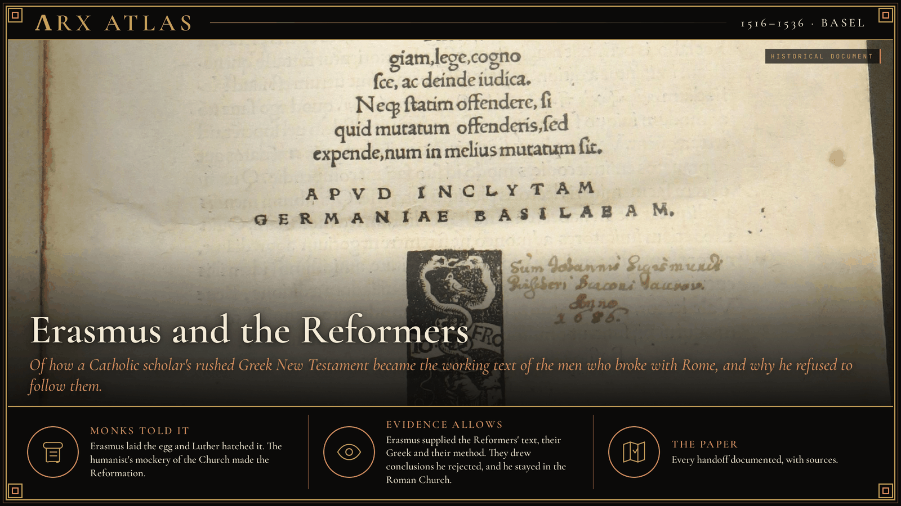
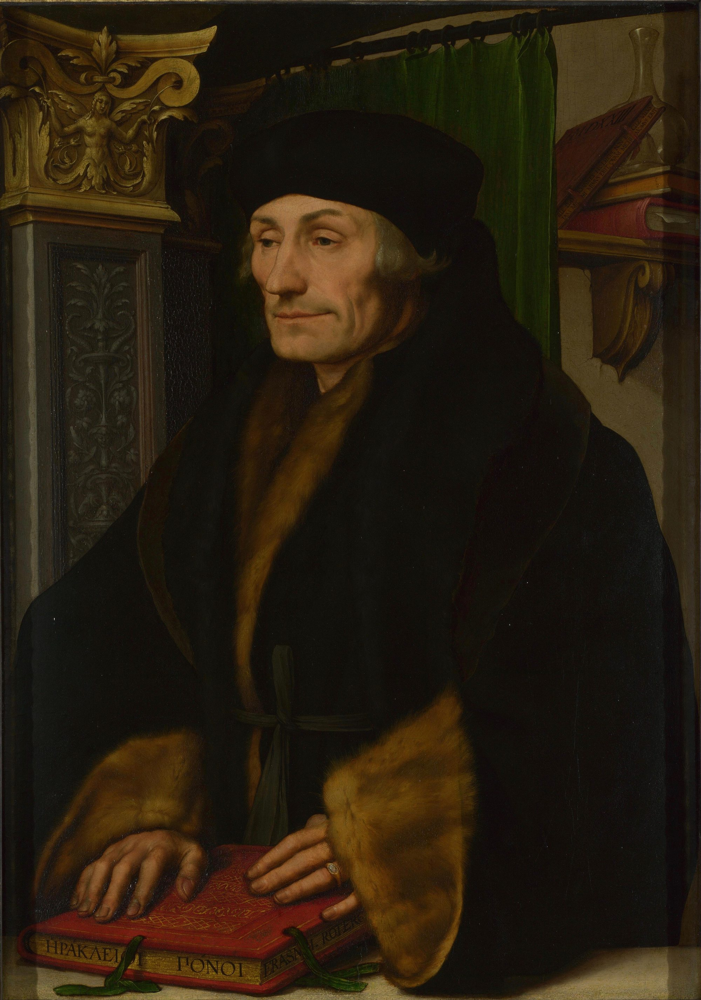
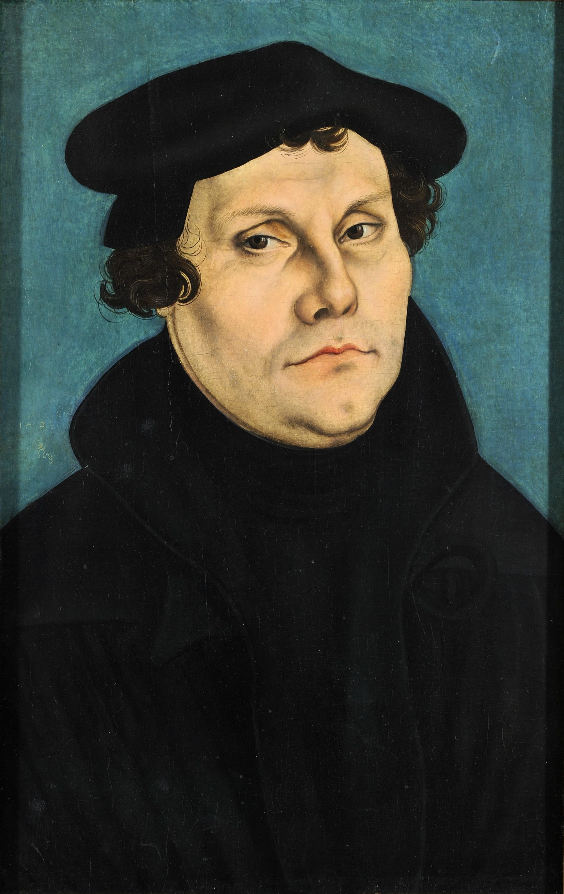
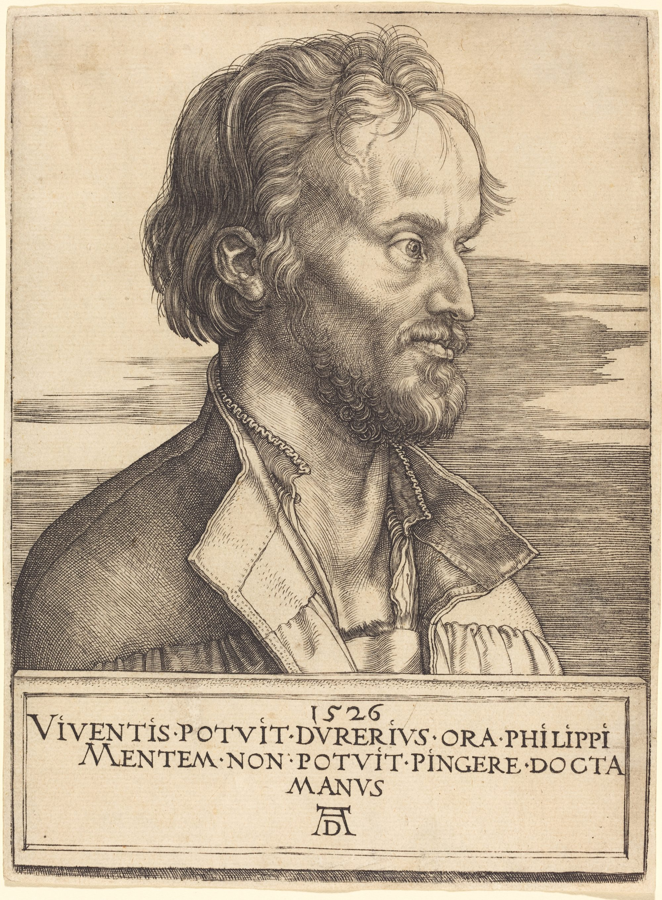
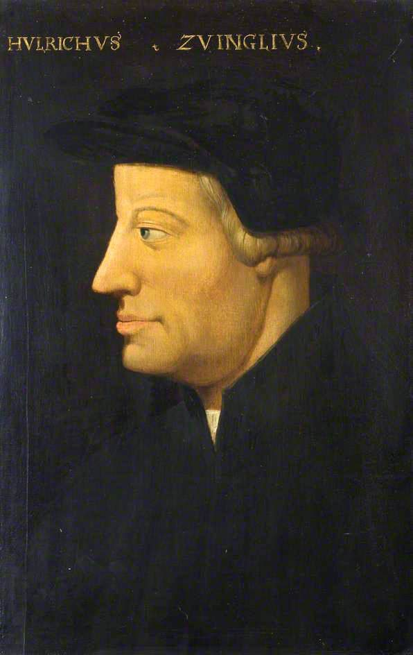
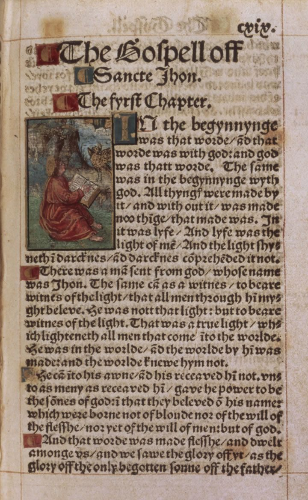
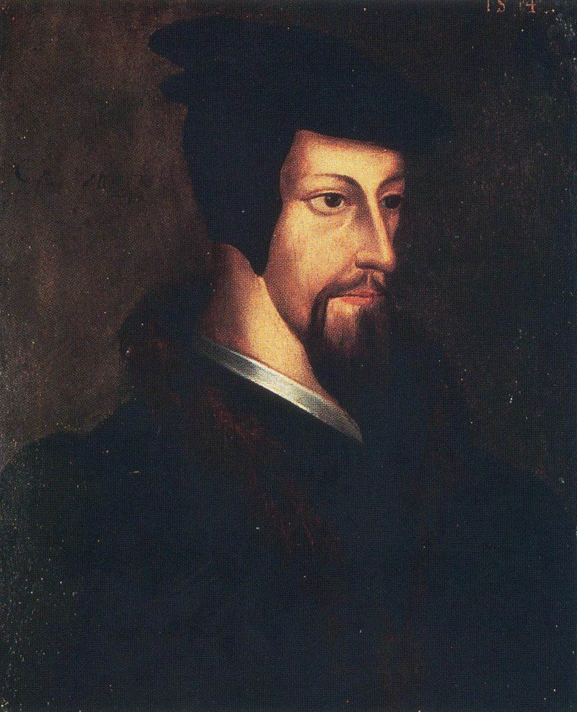

**ΛRX ATLAS** · Entry · 1516–1536 · Basel

# Erasmus and the Reformers

*Of how a Catholic scholar's rushed Greek New Testament became the working text of the men who broke with Rome, and why he refused to follow them.*

*Art: [Concord, "Erasmus 1516 title page". CC BY-SA 3.0, via Wikimedia Commons](https://commons.wikimedia.org/wiki/File:Erasmus_1516_title_page.JPG)*

**[Explore Renaissance humanism in the Memeplex →](https://arxcortex.io/memeplex.html)**

In 1516 Erasmus rushed out a Greek New Testament. The men who broke with Rome worked from it. Monks said Erasmus laid the egg and Luther hatched it. Erasmus said Luther hatched a different bird entirely.

*Holbein's 1523 portrait of Erasmus. Image: [Hans Holbein the Younger, "Holbein, Hans (II) - Erasmus - National Gallery". Public domain, via Wikimedia Commons](https://commons.wikimedia.org/wiki/File:Holbein,_Hans_(II)_-_Erasmus_-_National_Gallery.jpg)*

On 1 March 1516 the presses of [Johann Froben](https://en.wikipedia.org/wiki/Novum_Instrumentum_omne) in Basel finished a book that had been started only five months before. It printed the Greek New Testament beside a corrected Latin text, with notes, and it was the first printed Greek New Testament to be published. Its editor, [Desiderius Erasmus](https://en.wikipedia.org/wiki/Erasmus) of Rotterdam, dedicated it to Pope Leo X. Within a decade, the men who split the Western Church were reading it, preaching from it and translating it. Hostile monk-theologians soon had a phrase for this: "[Erasmus laid the egg, and Luther hatched it](https://en.wikipedia.org/wiki/Erasmus)." This entry follows the book from hand to hand and asks what that charge got right.

## The fountain-head

Erasmus was among the most influential scholars of the Northern Renaissance, a Catholic priest and a priest's son who lived by patrons and printers. His program was the humanists' cry *ad fontes*, back to the sources. In his dedication he wrote that the teaching of salvation was "[much purer and more lively](https://en.wikipedia.org/wiki/Novum_Instrumentum_omne)" if "sought at the fountain-head and drawn from the actual sources than from pools and runnels." The young scholar Johannes Oecolampadius served as his editorial assistant and Hebrew consultant. The rush, possibly driven by fear that the Spanish Complutensian Polyglot would appear first, left hundreds of errors. Erasmus admitted the first edition was "precipitated rather than published." He kept correcting it through four more editions.

## The Wittenberg reader

*Cranach's 1528 portrait of Luther. Image: [Lucas Cranach the Elder, "Lucas Cranach d.Ä. - Martin Luther, 1528 (Veste Coburg)". Public domain, via Wikimedia Commons](https://commons.wikimedia.org/wiki/File:Lucas_Cranach_d.%C3%84._-_Martin_Luther,_1528_(Veste_Coburg).jpg)*

At Wittenberg, an Augustinian friar and professor, [Martin Luther](https://en.wikipedia.org/wiki/Martin_Luther), was lecturing on the Psalms, Romans and Galatians. He worked partly with Erasmus's annotated translation, and came to read the Church's words for penance and righteousness in new ways. When Luther was hidden in the Wartburg in 1521 after his condemnation at Worms, he translated the New Testament from Greek into German. The Greek he used was Erasmus's [1519 second edition](https://en.wikipedia.org/wiki/Novum_Instrumentum_omne).

## The professor of Greek

*Dürer's 1526 engraving of Melanchthon. Image: [Albrecht Dürer, "Albrecht Dürer, Philip Melanchthon, 1526, NGA 6670". CC0, via Wikimedia Commons](https://commons.wikimedia.org/wiki/File:Albrecht_D%C3%BCrer,_Philip_Melanchthon,_1526,_NGA_6670.jpg)*

Luther needed Greek, and in 1518 Wittenberg hired a 21-year-old prodigy to teach it. [Philip Melanchthon](https://en.wikipedia.org/wiki/Philip_Melanchthon) had been formed by his great-uncle, the Hebraist Johann Reuchlin, and, under the influence of Reuchlin and Erasmus, had decided that true Christianity differed from the scholasticism of the universities. He became Luther's partner in translating the Bible and the Reformation's first systematic theologian. Erasmus kept up a friendly correspondence with him.

## The Zurich preacher

*Zwingli by Hans Asper. Image: [Hans Asper, "Ulrich Zwingli by Asper". Public domain, via Wikimedia Commons](https://commons.wikimedia.org/wiki/File:Ulrich_Zwingli_by_Asper.jpg)*

In Switzerland the debt was personal. [Huldrych Zwingli](https://en.wikipedia.org/wiki/Huldrych_Zwingli), a parish priest at Glarus and then Einsiedeln, studied Erasmus's writings and met him at Basel between 1514 and 1516. On 1 January 1519 Zwingli gave his first sermon at Zurich's Grossmünster. Instead of preaching on the set lesson of the day, he began, "using Erasmus' New Testament as a guide," to read straight through the Gospel of Matthew. His turn toward pacifism has also been traced to Erasmus. Scholars disagree on how far Zwingli remained an Erasmian.

## The English translator

*the opening of John in Tyndale's 1526 Worms New Testament. Image: [Peter Schöffer (printer); William Tyndale, "Tyndale Bible - Gospel of John". Public domain, via Wikimedia Commons](https://commons.wikimedia.org/wiki/File:Tyndale_Bible_-_Gospel_of_John.jpg)*

[William Tyndale](https://en.wikipedia.org/wiki/William_Tyndale) wanted the New Testament in English. In 1523 he sought the patronage of the Bishop of London, Cuthbert Tunstall, a humanist who had helped Erasmus with his second edition. Tunstall turned him away. Tyndale went abroad, and in 1526 Peter Schöffer printed his complete New Testament at Worms. Erasmus's Greek text underlies it, as it later underlay the King James Version. Copies were smuggled into England between the pages of other books. In 1536 Tyndale was strangled and burned for heresy near Brussels.

## The lawyer

*16th-century Flemish portrait of the young Calvin. Image: [Flemish school (UnknownUnknown ), "John Calvin - Young". Public domain, via Wikimedia Commons](https://commons.wikimedia.org/wiki/File:John_Calvin_-_Young.jpg)*

[John Calvin](https://en.wikipedia.org/wiki/John_Calvin) came to theology through law. He trained as a humanist lawyer at Bourges, where he learned Greek, and in 1532 he published, at his own expense, a commentary on Seneca's *De Clementia*. It showed him, in one modern summary, "a humanist in the tradition of Erasmus." Calvin broke with Rome around 1530, fled France, and in 1536 published the first edition of his *Institutes* at Basel, the city of Erasmus's printers.

## The quarrel

Erasmus did not follow. In September 1524 he published [*On Free Will*](https://en.wikipedia.org/wiki/De_libero_arbitrio_diatribe_sive_collatio), his first public attack on some of Luther's ideas, against Luther's teaching that everything happens by necessity. Luther replied in December 1525 with [*The Bondage of the Will*](https://en.wikipedia.org/wiki/The_Bondage_of_the_Will), arguing that salvation comes from God alone. Erasmus dismissed the monks' egg charge: Luther had "hatched a different bird entirely." He left Basel for Freiburg in 1529 after iconoclastic riots, and he died in July 1536, loyal to the Roman Church.

## Weighing the evidence

His contemporaries already [considered him a forerunner](https://plato.stanford.edu/entries/erasmus/) of the Reformation. The egg saying, though, is an accusation, attributed to Erasmus's monastic enemies, and Erasmus rejected it. The influence on each Reformer is documented, but of different kinds. Luther and Tyndale used his text. Melanchthon and Zwingli read and admired him. For Calvin the documented link is a shared humanist method, and no personal tie. Even the Catholic Peter Canisius granted the narrower point: "[Certainly there was no lack of eggs](https://en.wikipedia.org/wiki/Erasmus) for Luther to hatch."

## The long view

Erasmus built his authority through institutions: the Froben press, papal dedications and imperial printing privileges, and a network of correspondents. He used them to send Christians back to the Greek. The Reformers took his text and his method into universities, city councils and vernacular presses, and drew conclusions he refused. The scholarship moved from his hands into theirs. Erasmus did not go with it.

**[Explore Renaissance humanism in the Memeplex →](https://arxcortex.io/memeplex.html)**

---

## Sources

**Primary witnesses**
- Erasmus, Desiderius. *Novum Instrumentum omne*. Basel: Johann Froben, 1516. Dedication to Pope Leo X.
- Erasmus, Desiderius. *De libero arbitrio diatribe sive collatio*. Basel, 1524.
- Luther, Martin. *De servo arbitrio*. Wittenberg, 1525.

**Modern scholarship**
- "De libero arbitrio diatribe sive collatio." *Wikipedia*. Accessed October 29, 2026. https://en.wikipedia.org/wiki/De_libero_arbitrio_diatribe_sive_collatio.
- "Erasmus." *Stanford Encyclopedia of Philosophy*. Accessed October 29, 2026. https://plato.stanford.edu/entries/erasmus/.
- "Erasmus." *Wikipedia*. Accessed October 29, 2026. https://en.wikipedia.org/wiki/Erasmus.
- "Huldrych Zwingli." *Wikipedia*. Accessed October 29, 2026. https://en.wikipedia.org/wiki/Huldrych_Zwingli.
- "John Calvin." *Wikipedia*. Accessed October 29, 2026. https://en.wikipedia.org/wiki/John_Calvin.
- "Martin Luther." *Wikipedia*. Accessed October 29, 2026. https://en.wikipedia.org/wiki/Martin_Luther.
- "Novum Instrumentum omne." *Wikipedia*. Accessed October 29, 2026. https://en.wikipedia.org/wiki/Novum_Instrumentum_omne.
- "Philip Melanchthon." *Wikipedia*. Accessed October 29, 2026. https://en.wikipedia.org/wiki/Philip_Melanchthon.
- "The Bondage of the Will." *Wikipedia*. Accessed October 29, 2026. https://en.wikipedia.org/wiki/The_Bondage_of_the_Will.
- "William Tyndale." *Wikipedia*. Accessed October 29, 2026. https://en.wikipedia.org/wiki/William_Tyndale.

*Entered in the ΛRX Atlas · arxcortex.io*
