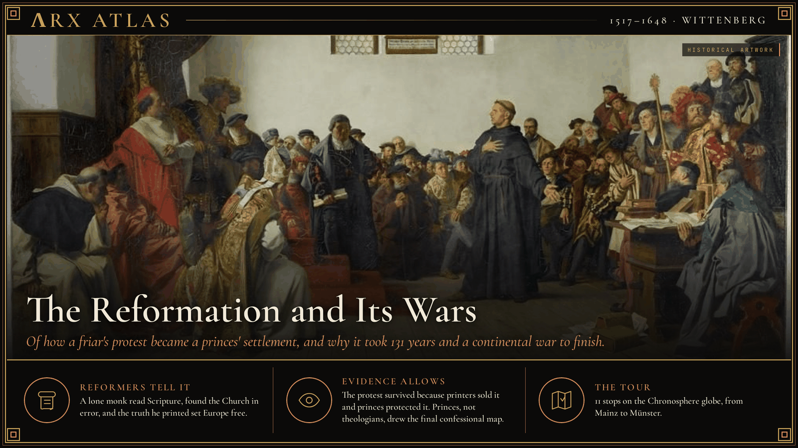
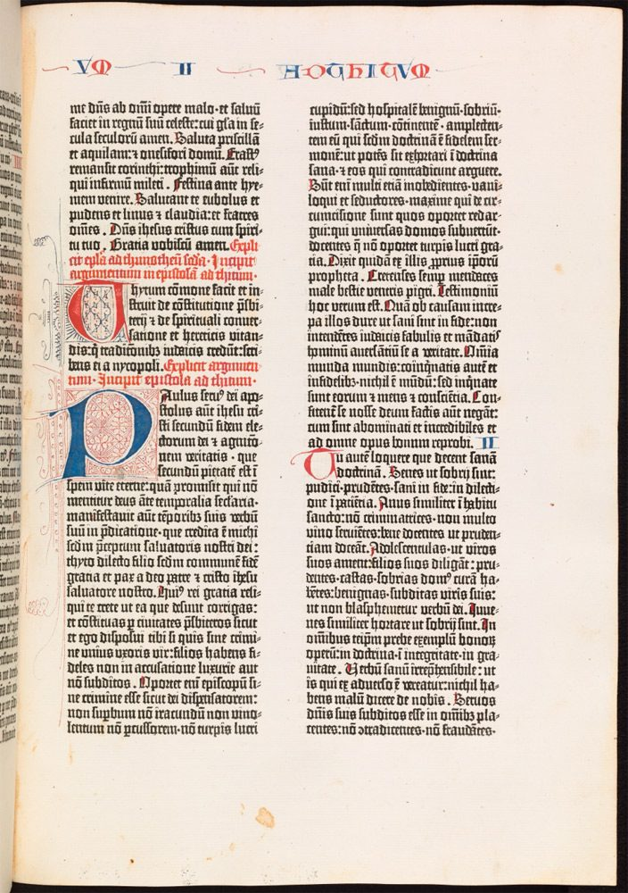
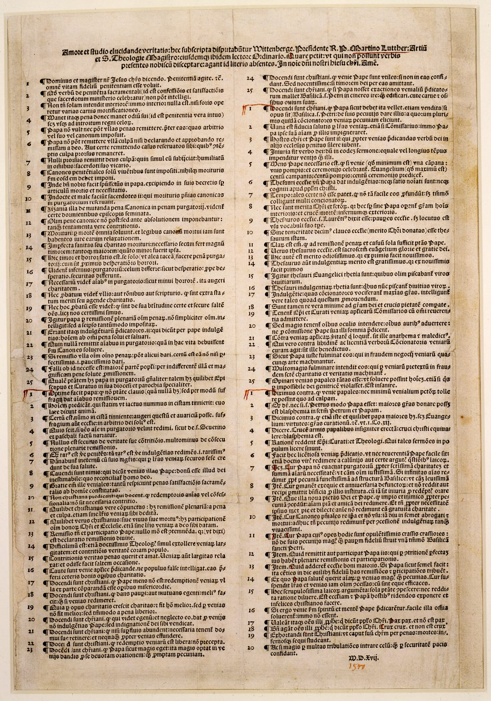
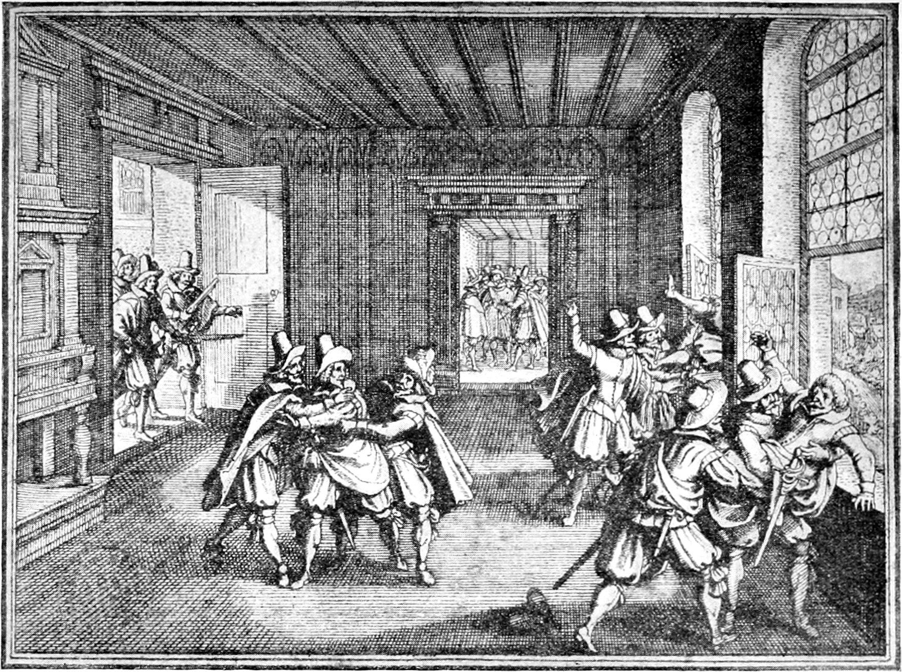
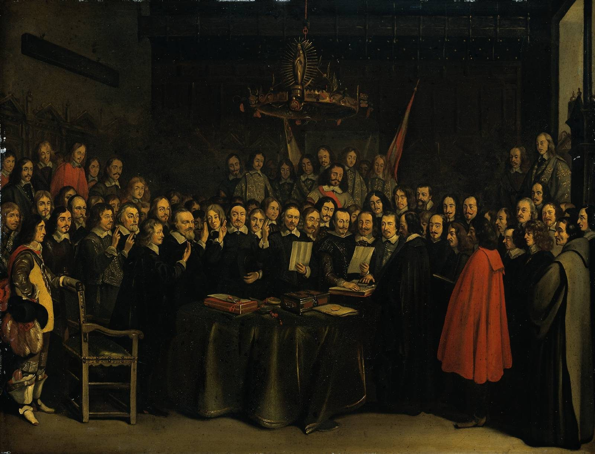

**ΛRX ATLAS** · Entry · 1517–1648 · Wittenberg

# The Reformation and Its Wars

*Of how a friar's protest became a princes' settlement, and why it took 131 years and a continental war to finish.*

*Art: [Anton von Werner, “Luther at the Diet of Worms”, Public domain, via Wikimedia Commons](https://commons.wikimedia.org/wiki/File:Luther_at_the_Diet_of_Worms.jpg)*

**[Take the tour →](https://arxcortex.io/chronosphere.html#play/tour/reformation)**

When Western Christianity broke apart, who decided what ordinary people would believe? The reformers said Scripture decided. The record shows a crowd of other deciders: printers, electors, knights, kings, city councils and, in the end, armies.

## The friar and the market

In 1517 a friar in Wittenberg was angry at his own parishioners. They had crossed into a neighboring territory to buy an [indulgence](https://en.wikipedia.org/wiki/Indulgence) from the preacher [Johann Tetzel](https://en.wikipedia.org/wiki/Johann_Tetzel), and came home believing they no longer needed to repent. Pope [Leo X](https://en.wikipedia.org/wiki/Pope_Leo_X) had granted it in 1515 to pay for rebuilding [St Peter's Basilica](https://en.wikipedia.org/wiki/St._Peter%27s_Basilica) in Rome. [Martin Luther](https://en.wikipedia.org/wiki/Martin_Luther) wrote ninety-five propositions against the way it was being sold, and on or before 31 October he sent them to [Archbishop Albert of Brandenburg](https://en.wikipedia.org/wiki/Albert_of_Brandenburg), the prelate who profited from the campaign.

*Bodleian Library Gutenberg Bible Vol2 563 [Unknown author, “Bodleian Library Gutenberg Bible Vol2 563”, CC BY 4.0, via Wikimedia Commons](https://commons.wikimedia.org/wiki/File:Bodleian_Library_Gutenberg_Bible_Vol2_563.jpg)*

*A 1517 printing of the theses. [Luther, Martin, 1483-1546, “Ninety-Five Theses WDL7497”, Public domain, via Wikimedia Commons](https://commons.wikimedia.org/wiki/File:Ninety-Five_Theses_WDL7497.png)*

Whether Luther also nailed the theses to the church door is still argued. What is certain is what happened next: printers took them up. Some seventy-five years earlier [Johannes Gutenberg](https://en.wikipedia.org/wiki/Johannes_Gutenberg) had built a [movable-type press](https://en.wikipedia.org/wiki/Printing_press) at Mainz, around 1440. By about 1520 Luther was the most published author in Europe, and German printers ran off 291 editions of his works. A university quarrel had become a product, and the product had buyers.

## The prince who hid him

Excommunicated in January 1521, he was summoned to the [Diet of Worms](https://en.wikipedia.org/wiki/Diet_of_Worms) to face the young emperor [Charles V](https://en.wikipedia.org/wiki/Charles_V,_Holy_Roman_Emperor). His own ruler, [Frederick III, Elector of Saxony](https://en.wikipedia.org/wiki/Frederick_III,_Elector_of_Saxony), secured him a safe-conduct. Luther refused to recant. Tradition has him say, "Here I stand, I cannot do otherwise." The emperor's edict branded him "a notorious heretic."

Then Frederick did something no pamphlet could. He had men stage a highway ambush, seize Luther, and hide him in [Wartburg Castle](https://en.wikipedia.org/wiki/Wartburg), disguised as a knight, for almost a year. When Luther came out, the emperor was busy elsewhere and did not press for his arrest. From that moment, the Reformation's survival depended on which princes would shelter it.

## The peasants who read it differently

Not everyone read Luther the way the electors did. In 1524 and 1525 peasants across southern and central Germany rose against their lords, and some of their leaders used the language of Christian freedom. Luther took the lords' side. In *Against the Murderous, Thieving Hordes of Peasants* he called the revolt the devil's work and urged the nobles to crush it. They did, at [Frankenhausen](https://en.wikipedia.org/wiki/Battle_of_Frankenhausen) and elsewhere, killing up to 100,000 of some 300,000 rebels.

Luther's movement survived because princes protected it, and after 1525 it made its alliance with them plain. Radicals who wanted a church without princes, among them the [Anabaptists](https://en.wikipedia.org/wiki/Anabaptism), would be hunted by Catholics and Lutherans alike.

## The princes' confession

The alliance soon had a creed. On 25 June 1530, at the [Diet of Augsburg](https://en.wikipedia.org/wiki/Diet_of_Augsburg), a group of German rulers and free cities presented the emperor with the [Augsburg Confession](https://en.wikipedia.org/wiki/Augsburg_Confession), drafted chiefly by [Philipp Melanchthon](https://en.wikipedia.org/wiki/Philip_Melanchthon). A confession signed by princes was a political platform, and they soon formed the [Schmalkaldic League](https://en.wikipedia.org/wiki/Schmalkaldic_League) to defend it by arms.

Kings outside the Empire drew their own lesson. In 1534 the English Parliament declared [Henry VIII](https://en.wikipedia.org/wiki/Henry_VIII) "the only supreme head on Earth of the Church of England." The act showed that a monarch could take the church, its jurisdiction and its property for the crown.

## The city that trained missionaries

A different model grew in Geneva. In 1541 the city council called [John Calvin](https://en.wikipedia.org/wiki/John_Calvin) back and adopted his [Ecclesiastical Ordinances](https://en.wikipedia.org/wiki/Ecclesiastical_Ordinances). They set up four ministries and a [Consistory](https://en.wikipedia.org/wiki/Consistory_(Protestantism)) of pastors and elders to police doctrine and morals alongside the civil magistrates. Calvin's church did not need a prince. It needed a disciplined council, and Geneva trained pastors for France, Scotland and the Netherlands. That made it harder to contain than Lutheranism.

Rome answered with its own reform. The [Council of Trent](https://en.wikipedia.org/wiki/Council_of_Trent), convoked by [Pope Paul III](https://en.wikipedia.org/wiki/Pope_Paul_III), met in twenty-five sessions between 13 December 1545 and 4 December 1563. It fixed Catholic doctrine against the Protestants and reformed the clergy. Both camps now had clear borders, and neither expected the other to give way.

## Whose realm, his religion

In Germany war came first, in the Schmalkaldic War of 1546–47. The [Peace of Augsburg](https://en.wikipedia.org/wiki/Peace_of_Augsburg) of 1555 settled the matter on the princes' terms. Each ruler in the Empire could make his territory Lutheran or Catholic, a rule later lawyers summed up as *[cuius regio, eius religio](https://en.wikipedia.org/wiki/Cuius_regio,_eius_religio)*: whose realm, his religion.

Faith would be decided territory by territory, by the territory's ruler. But the peace left out Calvinists, and over the next half-century Calvinist princes rose in the Rhineland and Bohemian Protestants grew in strength. The settlement had no place for them.

## The window in Prague

On 23 May 1618 Protestant nobles in Prague, angry at the Catholic Habsburg government, threw two royal governors and their secretary from a high window of [Prague Castle](https://en.wikipedia.org/wiki/Prague_Castle). All three survived a fall of about 21 meters. Catholics said the Virgin Mary caught them. Later Protestant pamphleteers said they landed in a dung heap, a story probably invented. The fall itself started a revolt, and the revolt grew into the [Thirty Years' War](https://en.wikipedia.org/wiki/Thirty_Years%27_War) that drew in most of Europe's powers.

*Merian's 17th-century engraving. [Matthäus Merian, “Story of Prague, Defenestration of Prague in 1618”, Public domain, via Wikimedia Commons](https://commons.wikimedia.org/wiki/File:Story_of_Prague,_Defenestration_of_Prague_in_1618.jpg)*

## Westphalia

The war ended in October 1648 with two treaties, signed at [Münster and Osnabrück](https://en.wikipedia.org/wiki/Peace_of_Westphalia), cities held neutral and demilitarized for the talks. The settlement kept the princes' right to fix their territories' religion and finally gave Calvinism legal recognition alongside Lutheranism and Catholicism.

*The Ratification of the Treaty of Munster, Gerard Ter Borch (1648) [After Gerard ter Borch, “The Ratification of the Treaty of Munster, Gerard Ter Borch (1648)”, Public domain, via Wikimedia Commons](https://commons.wikimedia.org/wiki/File:The_Ratification_of_the_Treaty_of_Munster,_Gerard_Ter_Borch_(1648).jpg)*

## Weighing the evidence

Each side wrote the story it needed. Protestant tradition gave Luther a hammer and a church door; the surviving record shows only that he mailed the theses to his archbishop. Catholics saw the Virgin catch the men thrown from the Prague window; Protestant pamphlets put them in a dung heap that no contemporary mentions. The firmer evidence lies in printers' editions, princes' signatures and treaty texts, and it points the same way each time: to the people who paid for, protected and enforced the new churches.

## The long view

So who decided what Christians would believe? Luther's answer had been conscience bound to Scripture. The settlement's answer was the ruler of each territory, acting within treaties that foreign powers guaranteed. The friar started the argument. Printers spread it, princes adopted it, and the state ended it.

**[Take the tour →](https://arxcortex.io/chronosphere.html#play/tour/reformation)**

---

## Sources

**Ancient witnesses**
- Martin Luther, Ninety-five Theses (1517).
- Martin Luther, Against the Murderous, Thieving Hordes of Peasants (1525).
- The Augsburg Confession (1530).
- The Peace of Augsburg (1555).
- The Treaties of Münster and Osnabrück (1648).

**Modern scholarship**
- "Acts of Supremacy." *Wikipedia*. Accessed October 28, 2026. https://en.wikipedia.org/wiki/Acts_of_Supremacy.
- "Augsburg Confession." *Wikipedia*. Accessed October 28, 2026. https://en.wikipedia.org/wiki/Augsburg_Confession.
- "Council of Trent." *Wikipedia*. Accessed October 28, 2026. https://en.wikipedia.org/wiki/Council_of_Trent.
- "Defenestrations of Prague." *Wikipedia*. Accessed October 28, 2026. https://en.wikipedia.org/wiki/Defenestrations_of_Prague.
- "Diet of Worms." *Wikipedia*. Accessed October 28, 2026. https://en.wikipedia.org/wiki/Diet_of_Worms.
- "Ecclesiastical Ordinances." *Wikipedia*. Accessed October 28, 2026. https://en.wikipedia.org/wiki/Ecclesiastical_Ordinances.
- "German Peasants' War." *Wikipedia*. Accessed October 28, 2026. https://en.wikipedia.org/wiki/German_Peasants'_War.
- "Ninety-five Theses." *Wikipedia*. Accessed October 28, 2026. https://en.wikipedia.org/wiki/Ninety-five_Theses.
- "Peace of Augsburg." *Wikipedia*. Accessed October 28, 2026. https://en.wikipedia.org/wiki/Peace_of_Augsburg.
- "Peace of Westphalia." *Wikipedia*. Accessed October 28, 2026. https://en.wikipedia.org/wiki/Peace_of_Westphalia.
- "Printing press." *Wikipedia*. Accessed October 28, 2026. https://en.wikipedia.org/wiki/Printing_press.

*Entered in the ΛRX Atlas · arxcortex.io*
