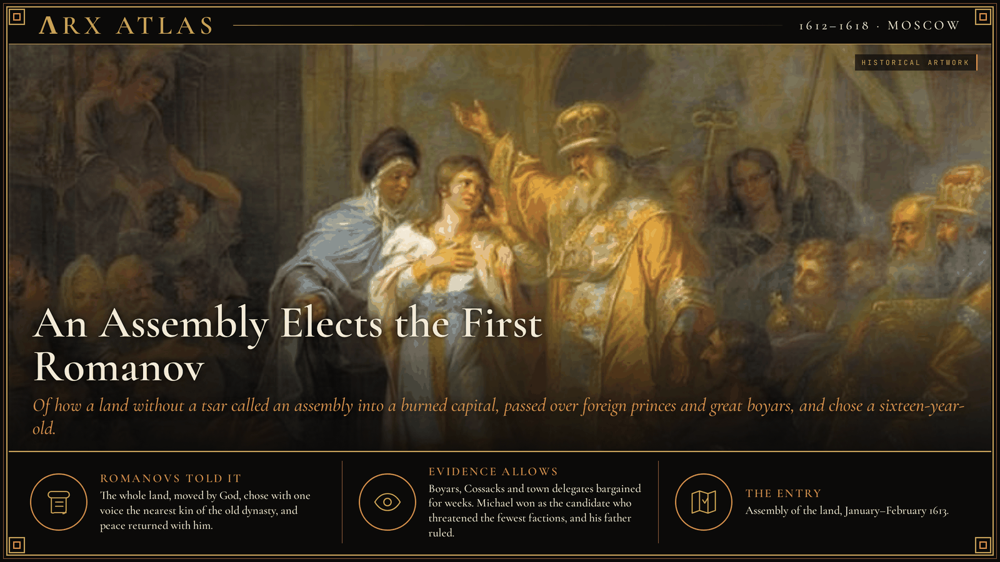
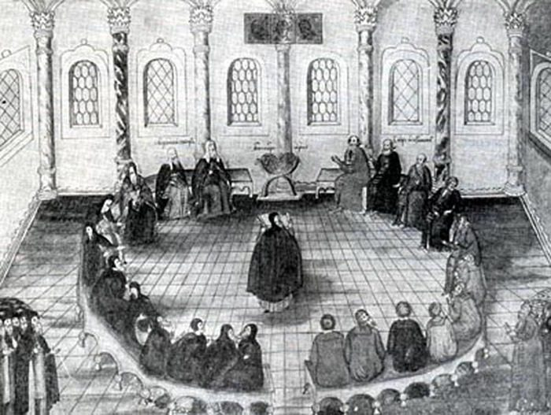
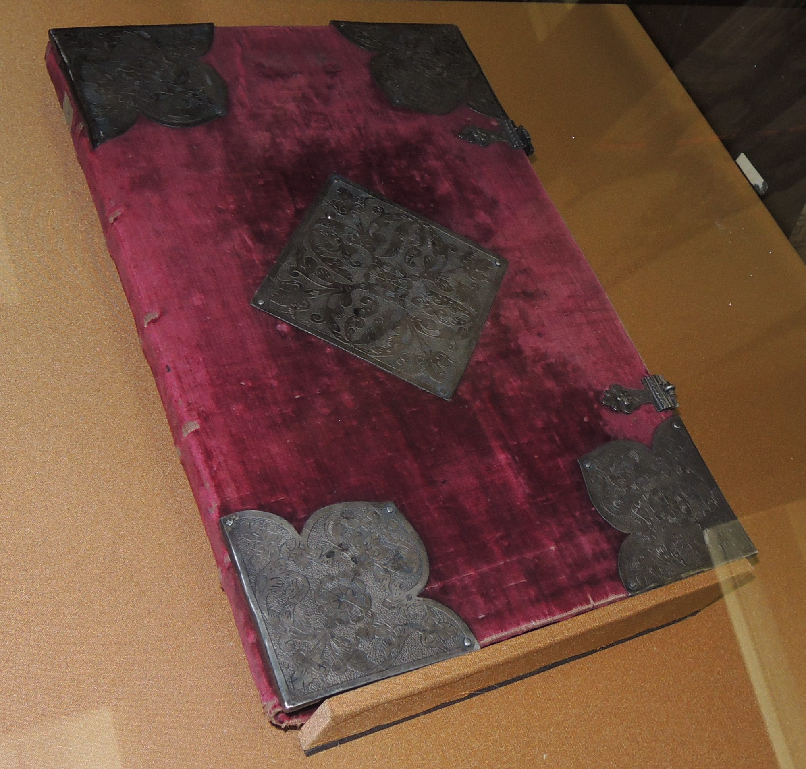
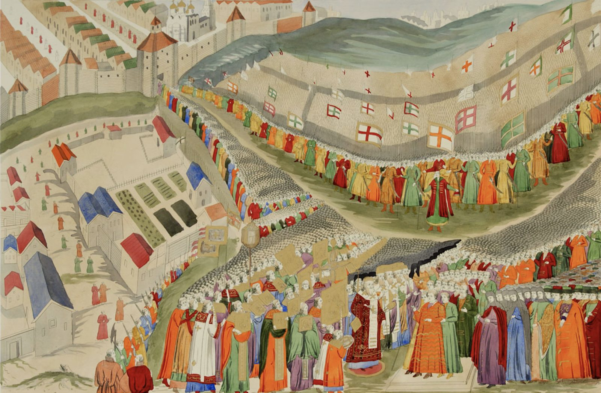

**ΛRX ATLAS** · Entry · 1612–1618 · Moscow

# An Assembly Elects the First Romanov

*Of how a land without a tsar called an assembly into a burned capital, passed over foreign princes and great boyars, and chose a sixteen-year-old.*

*Art: [Grigory Ugryumov, "Vocation of Mikhail Romanov (Grigoriy Ugryumov)". Public domain, via Wikimedia Commons](https://commons.wikimedia.org/wiki/File:Vocation_of_Mikhail_Romanov_(Grigoriy_Ugryumov).jpg)*

In January 1613 several hundred men crowded into the Dormition Cathedral of the Kremlin, the only building left in Moscow large enough to hold them. Estimates of their number run from 700 to 1,500. They had come from towns across a country that had no tsar, no settled government and foreign armies on its soil. Their task was to choose a ruler. Muscovy had never elected a dynasty before.

## The Troubles

The old line had ended in 1598 with [Feodor I](https://en.wikipedia.org/wiki/Feodor_I_of_Russia), the last son of Ivan the Terrible. Fifteen years of the [Time of Troubles](https://en.wikipedia.org/wiki/Time_of_Troubles) followed. Boris Godunov, two pretenders who each claimed to be Ivan's dead son Dmitry, and the boyar Vasily Shuisky all held or claimed the throne. After Shuisky's fall in 1610, a council of seven boyars offered the crown to [Władysław](https://en.wikipedia.org/wiki/W%C5%82adys%C5%82aw_IV_Vasa), son of the Polish king, and a Polish garrison entered the Kremlin. Swedish troops held Novgorod. In 1612 a militia raised in Nizhny Novgorod by the merchant [Kuzma Minin](https://en.wikipedia.org/wiki/Kuzma_Minin) and Prince [Dmitry Pozharsky](https://en.wikipedia.org/wiki/Dmitry_Pozharsky) besieged the capital. The garrison surrendered in November.

## The assembly

*A later depiction of the assembly of 1613. Image: [Unknown author, "Земский собор 1613 года". Public domain, via Wikimedia Commons](https://commons.wikimedia.org/wiki/File:%D0%97%D0%B5%D0%BC%D1%81%D0%BA%D0%B8%D0%B9_%D1%81%D0%BE%D0%B1%D0%BE%D1%80_1613_%D0%B3%D0%BE%D0%B4%D0%B0.jpg)*

Pozharsky and Prince Dmitry Trubetskoy sent letters ordering each town to send delegates. Some sent fifteen men, some one. Some districts, burned out, sent none. The [assembly of the land](https://en.wikipedia.org/wiki/Zemsky_Sobor_of_1613) opened in January. The foreign candidates went first: Władysław, the Swedish prince Carl Philip and a Habsburg archduke. Each was rejected. The great Russian families then blocked each other. Trubetskoy, who commanded the Cossacks, is said to have spent heavily on feasts for them, and lost.

## The candidate

[Michael Romanov](https://en.wikipedia.org/wiki/Michael_of_Russia) was sixteen. His great-aunt Anastasia had been Ivan the Terrible's first wife, which made him a cousin of the last Rurikid tsar. His father, the metropolitan [Filaret](https://en.wikipedia.org/wiki/Patriarch_Filaret_of_Moscow), sat in a Polish prison, which made the family look patriotic. The Cossacks backed him. On 21 February 1613 (Old Style) the assembly chose him. One boyar is said to have remarked, "Let us have Misha Romanov, for he is young and not yet wise; he will suit our purposes." The line comes to us second-hand, and it may have been invented later, but it fits what the assembly did.

*The charter recording the election, with the delegates' signatures and seals. Image: [Shakko, "Zemskiy sobor chart of Election of Michael I". CC BY-SA 3.0, via Wikimedia Commons](https://commons.wikimedia.org/wiki/File:Zemskiy_sobor_chart_of_Election_of_Michael_I.jpg)*

A delegation found Michael and his mother at the Ipatiev Monastery near Kostroma in March. His mother objected that he was too young for such a time. Moscow was so ruined that he waited weeks before entering it, and he was crowned in July.

*Michael Romanov's entry into Moscow in 1613, from an engraving. Image: [Unknown author, "Встреча Михаила Романова в Москве 2 мая 1613 года. Гравер Егор Скотников". Public domain, via Wikimedia Commons](https://commons.wikimedia.org/wiki/File:%D0%92%D1%81%D1%82%D1%80%D0%B5%D1%87%D0%B0_%D0%9C%D0%B8%D1%85%D0%B0%D0%B8%D0%BB%D0%B0_%D0%A0%D0%BE%D0%BC%D0%B0%D0%BD%D0%BE%D0%B2%D0%B0_%D0%B2_%D0%9C%D0%BE%D1%81%D0%BA%D0%B2%D0%B5_2_%D0%BC%D0%B0%D1%8F_1613_%D0%B3%D0%BE%D0%B4%D0%B0._%D0%93%D1%80%D0%B0%D0%B2%D0%B5%D1%80_%D0%95%D0%B3%D0%BE%D1%80_%D0%A1%D0%BA%D0%BE%D1%82%D0%BD%D0%B8%D0%BA%D0%BE%D0%B2.png)*

## Weighing the evidence

The chief witnesses wrote for the new dynasty. The election charter presents the vote as unanimous and inspired. The cellarer Avraamy Palitsyn, who sat in the assembly, wrote a Tale that gives the Trinity monastery a leading role. Later Romanov histories left out awkward facts: the family's ties to both pretenders, its early support for Władysław, and the years Michael spent in the occupied Kremlin with his uncle Ivan, who had worked with the Poles. The [Ivan Susanin](https://en.wikipedia.org/wiki/Ivan_Susanin) story of a peasant who died to save the young tsar is a legend, best known from Glinka's opera.

## The long view

The boyar's prediction came half true. Peace with Sweden in 1617 and a truce with Poland in 1618 brought Filaret home, and he ruled beside his son as "Great Sovereign" until 1633. Assemblies of the land met often in the early reign and then less and less. The last [met in the 1680s](https://en.wikipedia.org/wiki/Zemsky_Sobor). The dynasty they elected ruled for three hundred years and fell in 1917. Its last tsar's family was killed in another Ipatiev house.

---

## Sources

**Ancient witnesses**
- Charter of the Election of Michael Romanov (1613).
- Avraamy Palitsyn, *Skazanie* (Tale), c. 1620.

**Modern scholarship**
- "Michael of Russia." *Wikipedia*. Accessed October 29, 2026. https://en.wikipedia.org/wiki/Michael_of_Russia.
- "Patriarch Filaret of Moscow." *Wikipedia*. Accessed October 29, 2026. https://en.wikipedia.org/wiki/Patriarch_Filaret_of_Moscow.
- "Time of Troubles." *Wikipedia*. Accessed October 29, 2026. https://en.wikipedia.org/wiki/Time_of_Troubles.
- "Zemsky Sobor." *Wikipedia*. Accessed October 29, 2026. https://en.wikipedia.org/wiki/Zemsky_Sobor.
- "Zemsky Sobor of 1613." *Wikipedia*. Accessed October 29, 2026. https://en.wikipedia.org/wiki/Zemsky_Sobor_of_1613.

*Entered in the ΛRX Atlas · arxcortex.io*
