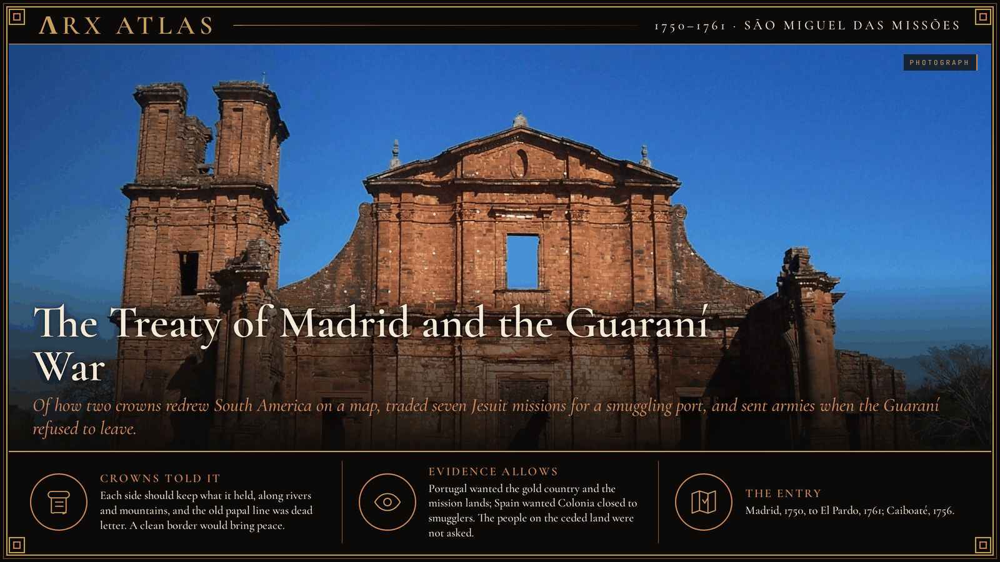
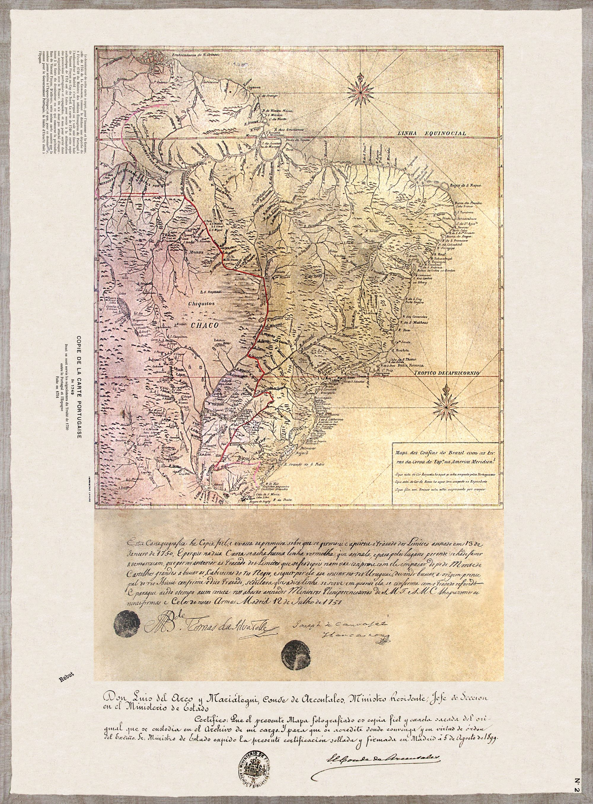
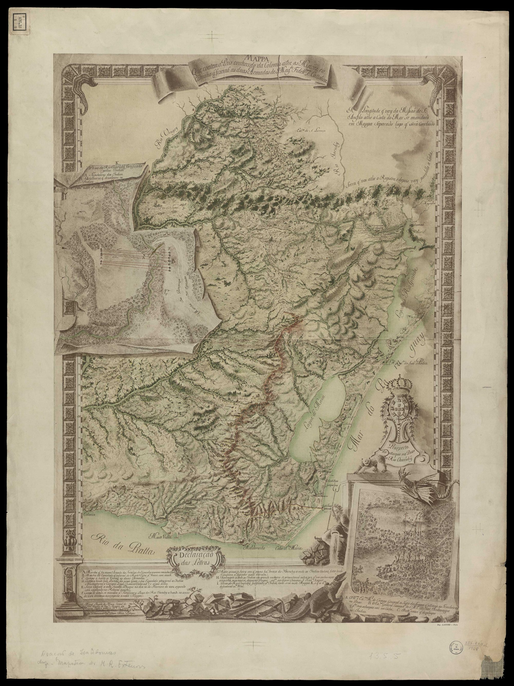
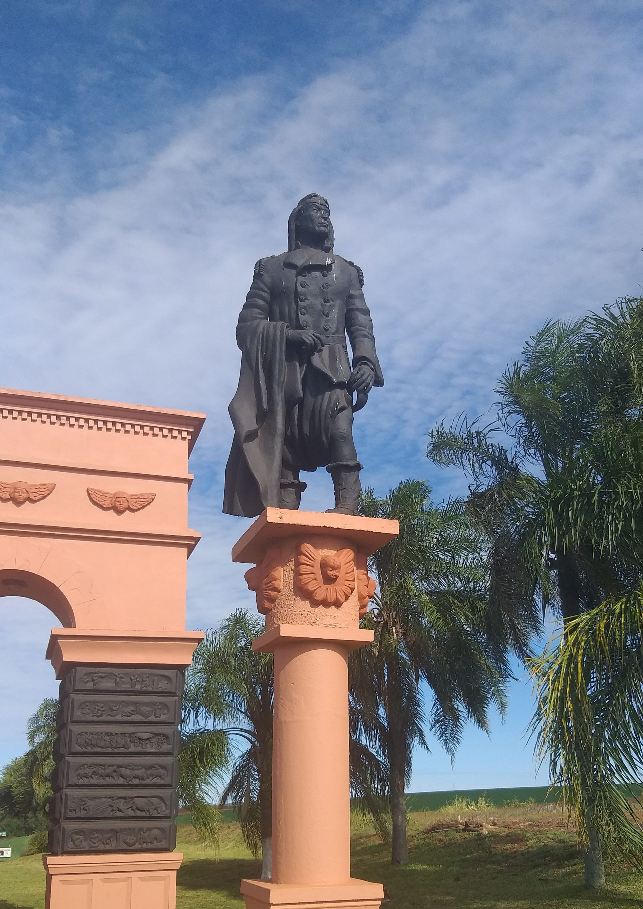

**ΛRX ATLAS** · Entry · 1750–1761 · São Miguel das Missões

# The Treaty of Madrid and the Guaraní War

*Of how two crowns redrew South America on a map, traded seven Jesuit missions for a smuggling port, and sent armies when the Guaraní refused to leave.*

*Art: [Leandro Kibisz (Loco085), "Ruinas-saomiguel1". CC BY-SA 3.0, via Wikimedia Commons](https://commons.wikimedia.org/wiki/File:Ruinas-saomiguel1.jpg)*

On 10 February 1756, on the hill of Caiboaté in what is now southern Brazil, some 3,000 Spanish and Portuguese soldiers met the militia of seven Jesuit missions. By the count in the Wikipedia account, 1,511 Guaraní died and 152 were taken prisoner. The allied armies lost four men. The battle enforced a treaty signed six years earlier in Madrid, between two courts that had never seen the land.

## The map

*The Mapa das Cortes, drawn for the negotiators in 1749. Image: [Alexandre de Gusmão (1749), "Mapa dos confins do Brasil 1749". Public domain, via Wikimedia Commons](https://commons.wikimedia.org/wiki/File:Mapa_dos_confins_do_Brasil_1749.jpg)*

Since 1494 the [Treaty of Tordesillas](https://en.wikipedia.org/wiki/Treaty_of_Tordesillas) had drawn a line through South America, giving Portugal the east and Spain the rest. Portuguese settlers ignored it. Slave-hunting [bandeirantes](https://en.wikipedia.org/wiki/Bandeirantes) from São Paulo pushed west and south, and gold was found in Mato Grosso in 1695. By the 1740s Brazil had captaincies well beyond the old line. The Portuguese diplomat [Alexandre de Gusmão](https://en.wikipedia.org/wiki/Alexandre_de_Gusm%C3%A3o) argued from Roman law: *uti possidetis*, each keeps what it holds. His 1749 map, the Mapa das Cortes, was drawn to make the case. Historians have argued that it placed Portuguese settlements farther east than they were, which made Portugal's gains look smaller.

## The trade

The [Treaty of Madrid](https://en.wikipedia.org/wiki/Treaty_of_Madrid_(13_January_1750)) was signed on 13 January 1750. Spain and Portugal expressly abandoned Tordesillas and the papal bull behind it. Portugal got the gold and diamond districts, much of the Amazon basin and the river routes north. Spain got [Colonia del Sacramento](https://en.wikipedia.org/wiki/Colonia_del_Sacramento), a Portuguese port across the river from Buenos Aires that served as the back door for British and Portuguese contraband into Spanish Peru. The price was the Misiones Orientales, seven Jesuit reductions east of the Uruguay River. A Jesuit census counted 26,362 people in them. The treaty ordered them to move west, onto Spanish ground.

## The refusal

*An eighteenth-century map of the route of the two armies to the missions. Image: [Unknown author, "Mapa Que contém o País conhecido da Colónia até as Missões, e o Caminho que fizeram as duas Armadas de Sua Majestade Fidelíssima, e Católica". Public domain, via Wikimedia Commons](https://commons.wikimedia.org/wiki/File:Mapa_Que_cont%C3%A9m_o_Pa%C3%ADs_conhecido_da_Col%C3%B3nia_at%C3%A9_as_Miss%C3%B5es,_e_o_Caminho_que_fizeram_as_duas_Armadas_de_Sua_Majestade_Fidel%C3%ADssima,_e_Cat%C3%B3lica.jpg)*

The Jesuits gave up control of the missions in 1754. The Guaraní did not leave. For more than a century they had fought the bandeirantes, often as militia for Spain. Now Spain was handing them to the people they had fought. Under [Sepé Tiaraju](https://en.wikipedia.org/wiki/Sep%C3%A9_Tiaraju), a leader from São Luiz Gonzaga, they resisted the first expeditions of 1754, and an armistice followed. In 1756 the combined army returned under José de Andonaegui and Gomes Freire de Andrade. Sepé was killed in a skirmish on 7 February. Caiboaté followed three days later. A 1756 census found 14,284 people in the seven missions, about 15,000 fewer than in 1750.

*A modern statue of Sepé Tiaraju. Image: [Felipe P, "Estátua Sepé Tiaraju". CC BY-SA 4.0, via Wikimedia Commons](https://commons.wikimedia.org/wiki/File:Est%C3%A1tua_Sep%C3%A9_Tiaraju.jpg)*

## Weighing the evidence

The treaty, the maps and the census figures are documents. The Guaraní side survives mostly through others: Jesuit reports, the officers' accounts, and later poetry. The cry attributed to Sepé, "This land has owners!", is a tradition, not a record. Basílio da Gama's epic *O Uraguai* (1769) told the war as a Jesuit plot, which suited the Portuguese minister Pombal, who expelled the Society from Portugal in 1759. Pombal's party said the Jesuits incited the revolt. Their defenders denied it, and historians still argue over how far the priests led or followed.

## The long view

The treaty did not last. In 1759 Spain renounced it, and the [Treaty of El Pardo](https://en.wikipedia.org/wiki/Treaty_of_El_Pardo_(1761)) annulled it in 1761. The missions went back to Spain, but their people had already been scattered. The principle outlived the treaty. *Uti possidetis* shaped the 1777 settlement at San Ildefonso and much of Brazil's later borders. The war also fed the case against the Jesuits, whom the pope [suppressed](https://en.wikipedia.org/wiki/Suppression_of_the_Society_of_Jesus) in 1773.

---

## Sources

**Ancient witnesses**
- Treaty of Madrid, 13 January 1750.
- Alexandre de Gusmão, Mapa das Cortes (1749).
- Basílio da Gama, *O Uraguai* (Lisbon, 1769).

**Modern scholarship**
- "Guaraní War." *Wikipedia*. Accessed October 29, 2026. https://en.wikipedia.org/wiki/Guaran%C3%AD_War.
- "Sepé Tiaraju." *Wikipedia*. Accessed October 29, 2026. https://en.wikipedia.org/wiki/Sep%C3%A9_Tiaraju.
- "Suppression of the Society of Jesus." *Wikipedia*. Accessed October 29, 2026. https://en.wikipedia.org/wiki/Suppression_of_the_Society_of_Jesus.
- "Treaty of Madrid (13 January 1750)." *Wikipedia*. Accessed October 29, 2026. https://en.wikipedia.org/wiki/Treaty_of_Madrid_(13_January_1750).
- "Treaty of Tordesillas." *Wikipedia*. Accessed October 29, 2026. https://en.wikipedia.org/wiki/Treaty_of_Tordesillas.

*Entered in the ΛRX Atlas · arxcortex.io*
