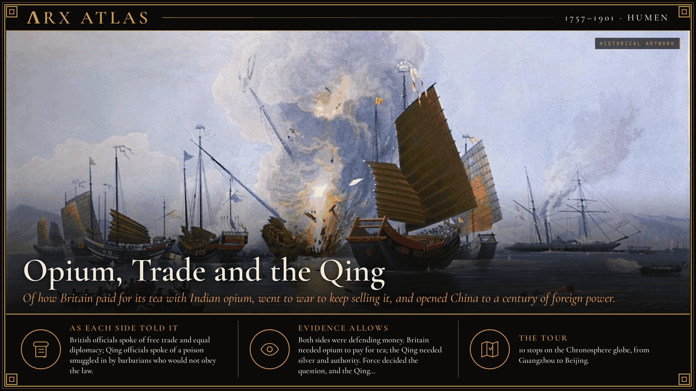
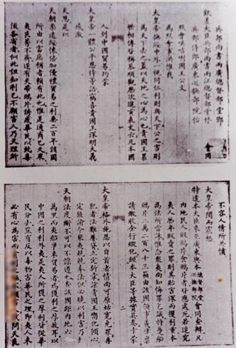
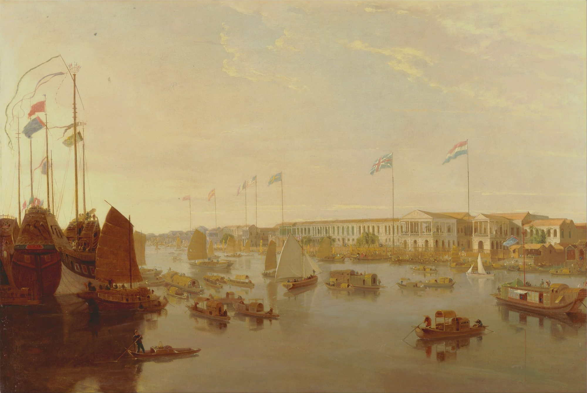
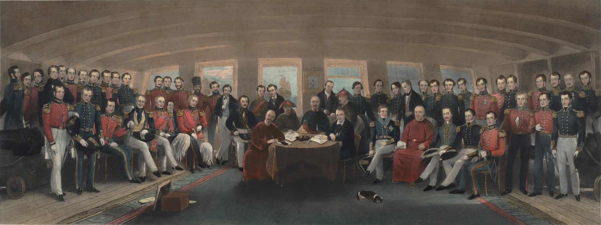
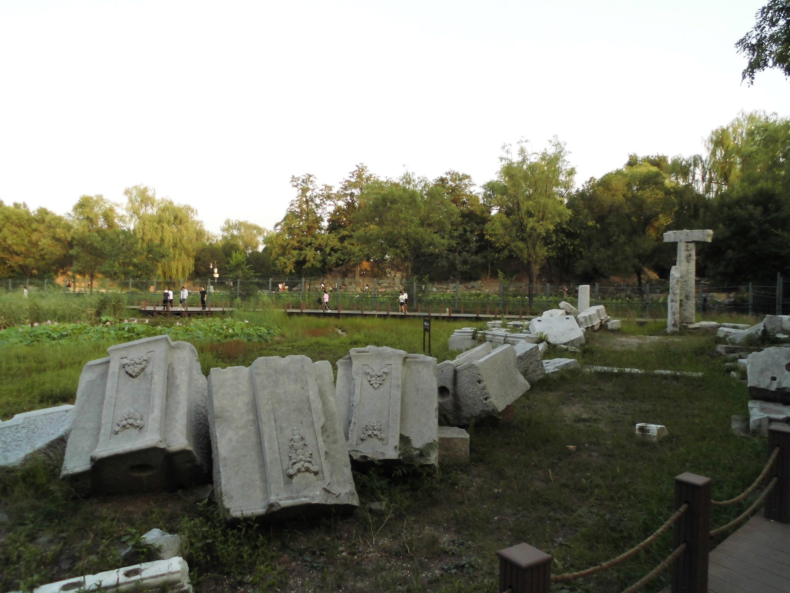

**ΛRX ATLAS** · Entry · 1757–1901 · Humen

# Opium, Trade and the Qing

*Of how Britain paid for its tea with Indian opium, went to war to keep selling it, and opened China to a century of foreign power.*

*Art: [Edward Duncan, “Destroying Chinese war junks, by E. Duncan (1843)”, Public domain, via Wikimedia Commons](https://commons.wikimedia.org/wiki/File:Destroying_Chinese_war_junks,_by_E._Duncan_(1843).jpg)*

**[Take the tour →](https://arxcortex.io/chronosphere.html#play/tour/opium-wars)**

In the summer of 1839 the imperial commissioner [Lin Zexu](https://en.wikipedia.org/wiki/Lin_Zexu) wrote an open letter to Queen Victoria. He had heard that opium was banned in Britain. Why, he asked, did her merchants sell it in China? Lin published the letter in Canton. By then he had already forced British dealers to surrender more than a thousand tonnes of opium, and on 3 June 1839 he began to destroy it in public on the beach at Humen. The work took 23 days. Britain answered with warships. This tour asks how a quarrel over tea and opium opened China to foreign power and helped bring down its last dynasty.

*Letter by Lin Zexu to Queen Victoria of the United Kingdom [Unknown author, “Letter by Lin Zexu to Queen Victoria of the United Kingdom”, Public domain, via Wikimedia Commons](https://commons.wikimedia.org/wiki/File:Letter_by_Lin_Zexu_to_Queen_Victoria_of_the_United_Kingdom.jpg)*

## One port

The story starts with a rule. In 1757 the [Qianlong Emperor](https://en.wikipedia.org/wiki/Qianlong_Emperor), wary of foreign influence, confined all Western sea trade to the single port of [Canton](https://en.wikipedia.org/wiki/Guangzhou). From 1760 a licensed guild of Chinese merchants, the Cohong, held a monopoly on dealing with foreigners. Britain wanted Chinese tea in great quantities. China wanted little from Britain except silver, and British silver drained east.

*The foreign factories at Canton, c. 1806. [William Daniell, “William Daniell - The European Factories, Canton - Google Art Project”, Public domain, via Wikimedia Commons](https://commons.wikimedia.org/wiki/File:William_Daniell_-_The_European_Factories,_Canton_-_Google_Art_Project.jpg)*

## The embassy

In 1793 London sent its first envoy, [Lord Macartney](https://en.wikipedia.org/wiki/George_Macartney,_1st_Earl_Macartney), to ask for more open trade. He met the Qianlong Emperor, who rejected every request. Diplomacy had failed. British traders turned to a commodity China did not make for itself.

## The drug

That commodity was opium from India. Its manufacture and export to China ran as a strict monopoly of the British [East India Company](https://en.wikipedia.org/wiki/East_India_Company). The Qing tried to stop it. Beijing banned the drug outright in 1796, and in 1799 the governor at Canton ordered the trade halted. Smuggling went on through private merchants.

## The commissioner

By the 1830s the [Daoguang Emperor](https://en.wikipedia.org/wiki/Daoguang_Emperor) had to choose. Some advisers wanted to legalize and tax opium. He refused, and in 1839 sent Lin Zexu to Canton. Lin arrived in March 1839, organized coastal defenses and soon forced British dealers to hand over their stocks. After Humen, Britain went to war, on what it called the principles of free trade and equal diplomacy.

## The treaty

The war ran from 1839 to 1842. With British warships poised to attack Nanjing, officials negotiated on board HMS Cornwallis in the Yangtze. On 29 August 1842 they signed the [Treaty of Nanking](https://en.wikipedia.org/wiki/Treaty_of_Nanking). China paid an indemnity, ceded the island of [Hong Kong](https://en.wikipedia.org/wiki/Hong_Kong) and opened five ports to trade, ending the Canton system. A treaty the next year gave British subjects extraterritoriality. The Chinese would later call these the "unequal treaties."

*The signing aboard HMS Cornwallis. [Painted by Captain John Platt, Bengal Volunteers. Engraved by John Burnet., “The Signing of the Treaty of Nanking”, Public domain, via Wikimedia Commons](https://commons.wikimedia.org/wiki/File:The_Signing_of_the_Treaty_of_Nanking.jpg)*

## The Heavenly Kingdom

Defeat weakened the dynasty at home. In 1850 [Hong Xiuquan](https://en.wikipedia.org/wiki/Hong_Xiuquan), a Hakka who after a series of visions proclaimed himself the younger brother of Jesus Christ, led the [Taiping Rebellion](https://en.wikipedia.org/wiki/Taiping_Rebellion). From Nanjing his Heavenly Kingdom ruled nearly 30 million people at its peak. It was one of the deadliest wars in history.

## The Arrow

While the Qing fought the Taiping, Britain and France pressed again. On 8 October 1856 Qing officials seized the [Arrow](https://en.wikipedia.org/wiki/Second_Opium_War), a British-registered ship, and arrested its Chinese crew. The British consul [Harry Parkes](https://en.wikipedia.org/wiki/Harry_Smith_Parkes) protested, and a second war began. In 1858 the allies stormed Tianjin and forced the Treaty of Tientsin.

## The palace burns

The peace broke down. In 1860 an Anglo-French army marched on Beijing. Envoys under a flag of truce, among them Parkes, were seized and held in the Board of Punishments, where they were tortured. Nineteen of the captives died. On 6 October allied troops took the [Old Summer Palace](https://en.wikipedia.org/wiki/Old_Summer_Palace) and looted it. On 18 October, in retaliation, [Lord Elgin](https://en.wikipedia.org/wiki/James_Bruce,_8th_Earl_of_Elgin) ordered it destroyed. The emperor fled north, and his brother [Prince Gong](https://en.wikipedia.org/wiki/Prince_Gong) stayed to make peace.

*The ruins today. [Leiem, “Ruins of Old Summer Palace (Yuanmingyuan) - 2019 - 02”, CC0, via Wikimedia Commons](https://commons.wikimedia.org/wiki/File:Ruins_of_Old_Summer_Palace_(Yuanmingyuan)_-_2019_-_02.jpg)*

## Learning from the enemy

The double disaster forced the court to admit a crisis. In 1861 Prince Gong took charge of the new [Zongli Yamen](https://en.wikipedia.org/wiki/Zongli_Yamen), in effect a foreign ministry. Provincial leaders such as [Zeng Guofan](https://en.wikipedia.org/wiki/Zeng_Guofan) built Western-style arsenals and schools. This [Self-Strengthening Movement](https://en.wikipedia.org/wiki/Self-Strengthening_Movement) lasted until China's defeat by Japan in 1895.

## The Boxers

Foreign pressure kept growing, and so did anger at it. From 1899, amid floods and drought, the Boxers spread across northern China, attacking railways, missionaries and Chinese Christians. In June 1900 they besieged the foreign legations in Beijing, and the [Empress Dowager Cixi](https://en.wikipedia.org/wiki/Empress_Dowager_Cixi) backed them. An Eight-Nation Alliance took the capital. The [Boxer Protocol](https://en.wikipedia.org/wiki/Boxer_Protocol) of 7 September 1901 imposed an indemnity larger than the government's annual tax revenue, to be paid over 39 years.

## Weighing the evidence

The British record speaks of free trade and diplomatic equality; the Chinese record speaks of law and poison. Twentieth-century nationalists named 1839 the start of a "century of humiliation," and many historians date modern Chinese history from it. Numbers are the weakest part. Estimates of the Taiping dead run from 20 million to 100 million. Clearer are the documents: the edicts limiting trade, the opium seized at Humen, the treaty terms and the indemnity schedules. They show trade, drugs and silver turning into war, and war into debt.

## The long view

How did a quarrel over tea become the opening of China? Britain's appetite for tea drained its silver. Opium, sold under a company monopoly, drained China's silver back out. When the Qing enforced their own law at Humen, Britain used force to keep the trade open and took ports, an island and legal privileges as the price of peace. Each defeat weakened the dynasty at home, and each rebellion invited more pressure from abroad. The reforms came too late. The Qing tried to save themselves and were overthrown in the [Xinhai Revolution](https://en.wikipedia.org/wiki/1911_Revolution) of 1911.

**[Take the tour →](https://arxcortex.io/chronosphere.html#play/tour/opium-wars)**

---

## Sources

**Ancient witnesses**
- Qianlong Emperor, edict to George III (1793).
- Lin Zexu, letter to Queen Victoria (1839).
- Treaty of Nanking (1842).
- Boxer Protocol (1901).

**Modern scholarship**
- "Boxer Rebellion." *Wikipedia*. Accessed October 28, 2026. https://en.wikipedia.org/wiki/Boxer_Rebellion.
- "Canton System." *Wikipedia*. Accessed October 28, 2026. https://en.wikipedia.org/wiki/Canton_System.
- "Destruction of opium at Humen." *Wikipedia*. Accessed October 28, 2026. https://en.wikipedia.org/wiki/Destruction_of_opium_at_Humen.
- "First Opium War." *Wikipedia*. Accessed October 28, 2026. https://en.wikipedia.org/wiki/First_Opium_War.
- "Lin Zexu." *Wikipedia*. Accessed October 28, 2026. https://en.wikipedia.org/wiki/Lin_Zexu.
- "Macartney Embassy." *Wikipedia*. Accessed October 28, 2026. https://en.wikipedia.org/wiki/Macartney_Embassy.
- "Old Summer Palace." *Wikipedia*. Accessed October 28, 2026. https://en.wikipedia.org/wiki/Old_Summer_Palace.
- "Opium trade." *Wikipedia*. Accessed October 28, 2026. https://en.wikipedia.org/wiki/Opium_trade.
- "Second Opium War." *Wikipedia*. Accessed October 28, 2026. https://en.wikipedia.org/wiki/Second_Opium_War.
- "Self-Strengthening Movement." *Wikipedia*. Accessed October 28, 2026. https://en.wikipedia.org/wiki/Self-Strengthening_Movement.
- "Taiping Rebellion." *Wikipedia*. Accessed October 28, 2026. https://en.wikipedia.org/wiki/Taiping_Rebellion.
- "Treaty of Nanking." *Wikipedia*. Accessed October 28, 2026. https://en.wikipedia.org/wiki/Treaty_of_Nanking.

*Entered in the ΛRX Atlas · arxcortex.io*
