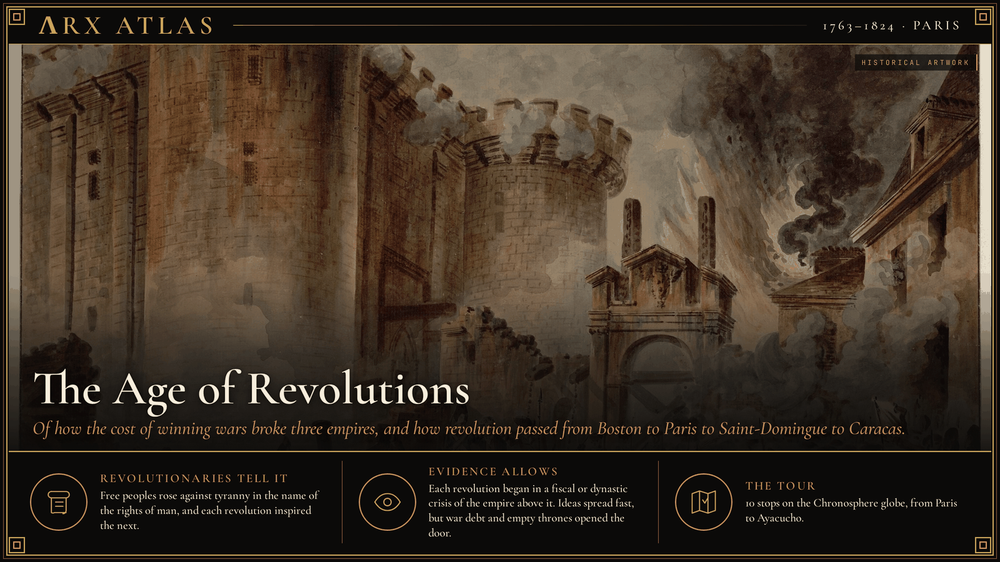
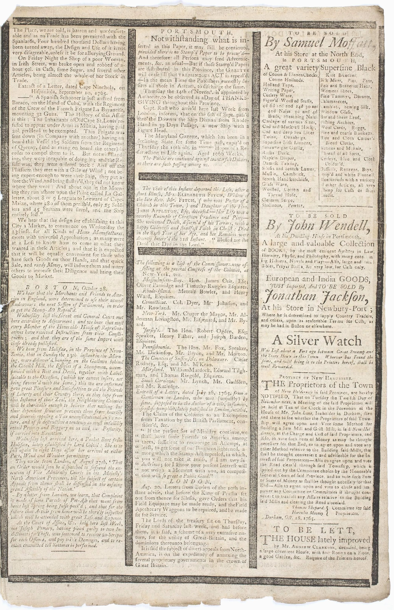
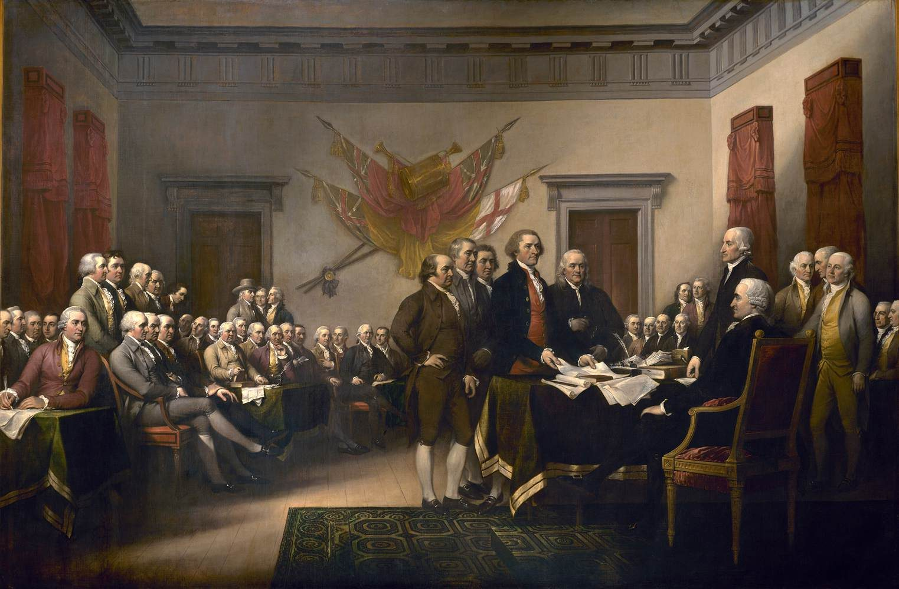
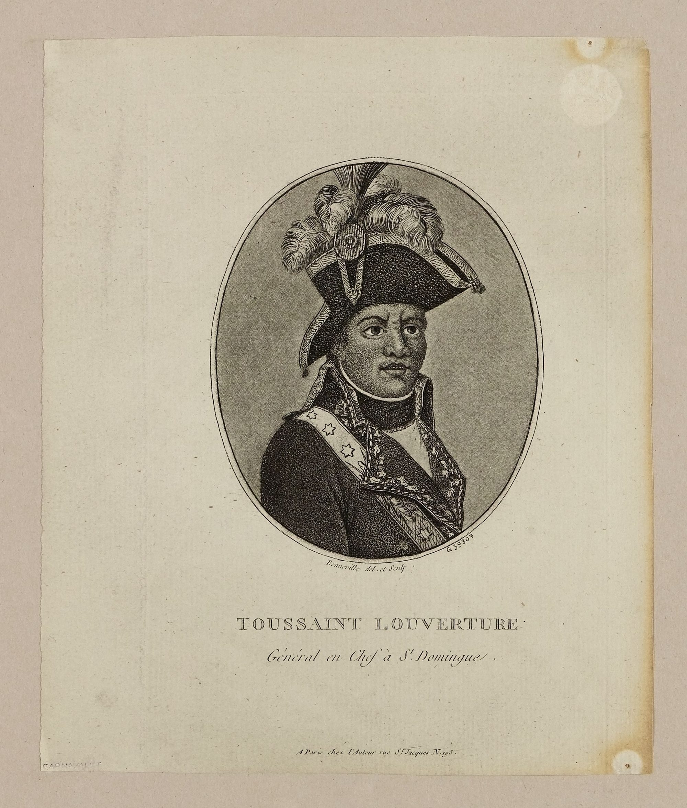
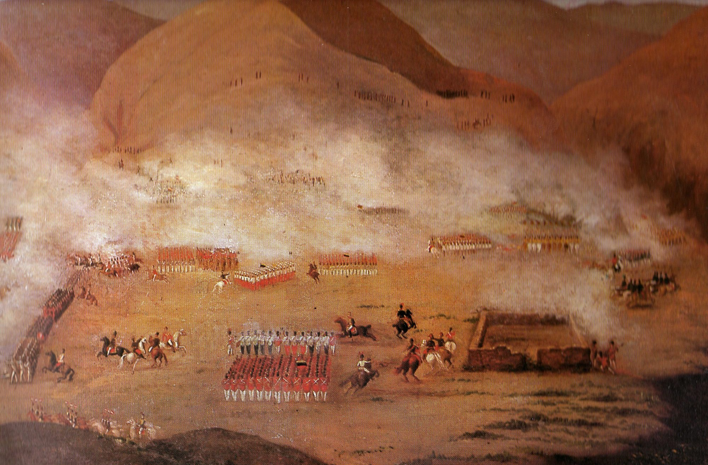

**ΛRX ATLAS** · Entry · 1763–1824 · Paris

# The Age of Revolutions

*Of how the cost of winning wars broke three empires, and how revolution passed from Boston to Paris to Saint-Domingue to Caracas.*

*Art: [Jean-Pierre Houël, “Prise de la Bastille”, Public domain, via Wikimedia Commons](https://commons.wikimedia.org/wiki/File:Prise_de_la_Bastille.jpg)*

**[Take the tour →](https://arxcortex.io/chronosphere.html#play/tour/age-of-revolutions)**

On the afternoon of 12 July 1789 news reached Paris that King [Louis XVI](https://en.wikipedia.org/wiki/Louis_XVI) had dismissed and banished his finance minister, [Jacques Necker](https://en.wikipedia.org/wiki/Jacques_Necker), who was sympathetic to the Third Estate. A large crowd was gathered at the [Palais-Royal](https://en.wikipedia.org/wiki/Palais-Royal). [Camille Desmoulins](https://en.wikipedia.org/wiki/Camille_Desmoulins) climbed onto a table, pistol in hand, and told them the dismissal was the signal for a massacre of patriots. Two days later the crowd took the Bastille. The fight that day was over a minister of finance, and that points to this tour's question. Why did the great empires of the eighteenth century, which kept winning wars, lose their colonies and even their thrones? The short answer is that they could not pay for their victories.

## The price of winning

On 10 February 1763 Britain, France and Spain signed the [Treaty of Paris](https://en.wikipedia.org/wiki/Treaty_of_Paris_(1763)), ending the [Seven Years' War](https://en.wikipedia.org/wiki/Seven_Years%27_War). Britain took Canada and a string of Caribbean islands from France. It had won at great cost. The national debt nearly doubled, from about £72 million in 1755 to almost £130 million by 1764, and London planned to keep an army in America.

## A tax on paper

To pay for those troops, Parliament passed the [Stamp Act](https://en.wikipedia.org/wiki/Stamp_Act_1765) in 1765, a tax on printed paper in the colonies. Colonists answered that Englishmen could only be taxed with their consent, which only their own assemblies could give: "No taxation without representation." A [Stamp Act Congress](https://en.wikipedia.org/wiki/Stamp_Act_Congress) met in New York, and merchants boycotted British goods. Parliament repealed the tax on 18 March 1766 but declared its power to legislate for the colonies "in all cases whatsoever." The principle was now in open dispute.

*A colonial newspaper page announcing the Stamp Act, 1765. [Daniel Fowle (printer), “New Hampshire Gazette, announcement of the Stamp Act, October 31, 1765, p3”, Public domain, via Wikimedia Commons](https://commons.wikimedia.org/wiki/File:New_Hampshire_Gazette,_announcement_of_the_Stamp_Act,_October_31,_1765,_p3.jpg)*

## Independence

A decade of taxes, protests and troops ended in war. On 4 July 1776 the [Second Continental Congress](https://en.wikipedia.org/wiki/Second_Continental_Congress), meeting in Philadelphia, adopted the [Declaration of Independence](https://en.wikipedia.org/wiki/United_States_Declaration_of_Independence), drafted largely by [Thomas Jefferson](https://en.wikipedia.org/wiki/Thomas_Jefferson). The rebels needed money and guns, and Britain's old enemy had both.

*Trumbull's later (1817-19) painting. [John Trumbull, “John Trumbull - Declaration of Independence - WGA23100”, Public domain, via Wikimedia Commons](https://commons.wikimedia.org/wiki/File:John_Trumbull_-_Declaration_of_Independence_-_WGA23100.jpg)*

## France pays

France still resented its losses of 1763. Its foreign minister, the comte de [Vergennes](https://en.wikipedia.org/wiki/Charles_Gravier,_comte_de_Vergennes), secretly sent arms through the playwright [Beaumarchais](https://en.wikipedia.org/wiki/Pierre_Beaumarchais). In 1778 France signed an alliance with the Americans and sent money, supplies and troops. On 3 September 1783 the [Treaty of Paris](https://en.wikipedia.org/wiki/Treaty_of_Paris_(1783)) recognized the United States as free and independent. France had its revenge. It also had more than a billion livres of new debt, and its government's failure to control spending helped bring on revolution six years later.

## Paris

Debt, poor harvests and failed ministers left the crown in crisis, and in 1789 it summoned the [Estates-General](https://en.wikipedia.org/wiki/Estates_General_of_1789). When the king dismissed Necker that July, Parisians took it as the start of a royal coup. On 14 July crowds stormed the [Bastille](https://en.wikipedia.org/wiki/Bastille). The revolution that followed spoke of the rights of man, and the words crossed the Atlantic to France's richest colony.

## Saint-Domingue

[Saint-Domingue](https://en.wikipedia.org/wiki/Saint-Domingue) produced much of the world's sugar with the labor of enslaved Africans, who died so fast that from 1787 the colony imported more than 30,000 a year. In 1791 free people of color pressed the revolutionary government in Paris for citizenship, setting off clashes with slave owners that destabilized the colony. On the night of 14 August 1791, enslaved leaders met in the woods near Le Cap at a ceremony led by [Dutty Boukman](https://en.wikipedia.org/wiki/Dutty_Boukman) and the priestess Cécile Fatiman. They planned a revolt. It broke out a week later.

## Haiti

The revolt became a war of independence, and [Toussaint Louverture](https://en.wikipedia.org/wiki/Toussaint_Louverture) became its leading general. In 1802 Napoleon sent his brother-in-law [Charles Leclerc](https://en.wikipedia.org/wiki/Charles_Leclerc_(general,_born_1772)) with an army under secret orders to restore slavery. The expedition failed. On 1 January 1804 at Gonaïves, [Jean-Jacques Dessalines](https://en.wikipedia.org/wiki/Jean-Jacques_Dessalines) declared Haiti independent. A state ruled by former slaves now existed in the Americas.

*A period engraving of Toussaint Louverture. [Bonneville, Nicolas de (en 1760 - en 1828), graveur, “Toussaint Louverture Général en Chef à S(t) Domingue. G.39307”, CC0, via Wikimedia Commons](https://commons.wikimedia.org/wiki/File:Toussaint_Louverture_G%C3%A9n%C3%A9ral_en_Chef_%C3%A0_S(t)_Domingue._G.39307.jpg)*

## An empty throne

The next blow fell on Spain, and it came from Europe. In March 1808 Prince Ferdinand forced his father, [Charles IV](https://en.wikipedia.org/wiki/Charles_IV_of_Spain), to abdicate. Napoleon, whose troops were already in Spain, summoned both to Bayonne and in May made them renounce the crown in his favor. He gave it to his brother [Joseph](https://en.wikipedia.org/wiki/Joseph_Bonaparte). Spaniards rose against the French.

## The juntas

With no lawful king, sovereignty, in the Spanish legal tradition, returned to the people and their town councils. Juntas formed in Spain, and then in America. Creole elites, long passed over for royal offices given to men born in Spain, now governed their own cities. From 1810 the attempts to rebuild the monarchy failed, and the quarrels turned into wars.

## Ayacucho

The wars lasted fourteen years. On 9 December 1824, on the plain of Ayacucho in the Peruvian Andes, [Antonio José de Sucre](https://en.wikipedia.org/wiki/Antonio_Jos%C3%A9_de_Sucre), lieutenant of [Simón Bolívar](https://en.wikipedia.org/wiki/Sim%C3%B3n_Bol%C3%ADvar), defeated the royalist army. The viceroy was wounded, and his second-in-command signed the surrender. Spain's mainland American empire was finished.

*An anonymous painting of about 1830. [anonymous, “Bataille d'Ayacucho 1”, Public domain, via Wikimedia Commons](https://commons.wikimedia.org/wiki/File:Bataille_d%27Ayacucho_1.jpg)*

## Weighing the evidence

Revolutions write their own histories, and these did so at once. The Declaration, the Haitian proclamation and the juntas' manifestos argued a case, and later national histories turned them into founding myths. Even the date of the Bois Caïman ceremony that began the Haitian revolt comes to us through a few accounts. The fiscal record is less stirring and more reliable. Britain's debt nearly doubled in the Seven Years' War. France's American war added more than a billion livres. Spain's crown was simply taken. In each case the crisis of the empire came first.

## The long view

Why did the winners lose? Britain won in 1763 and taxed its colonies to pay for it. France won in 1783 and went bankrupt doing it. Napoleon, heir to the French Revolution, emptied Spain's throne, and Spain's American subjects filled the gap themselves. The ideas of liberty spread from one revolution to the next, and they mattered. But each time they found their opening in a crisis of money or legitimacy at the top. Haiti stands apart: there the revolution came from below, from people who had been property, and it went further than any other.

**[Take the tour →](https://arxcortex.io/chronosphere.html#play/tour/age-of-revolutions)**

---

## Sources

**Ancient witnesses**
- The Stamp Act (1765) and the resolutions of the Stamp Act Congress.
- The Declaration of Independence (1776).
- The Haitian Declaration of Independence (1804).
- The Abdications of Bayonne (1808).

**Modern scholarship**
- "Abdications of Bayonne." *Wikipedia*. Accessed October 28, 2026. https://en.wikipedia.org/wiki/Abdications_of_Bayonne.
- "Battle of Ayacucho." *Wikipedia*. Accessed October 28, 2026. https://en.wikipedia.org/wiki/Battle_of_Ayacucho.
- "Bois Caïman." *Wikipedia*. Accessed October 28, 2026. https://en.wikipedia.org/wiki/Bois_Ca%C3%AFman.
- "France in the American Revolutionary War." *Wikipedia*. Accessed October 28, 2026. https://en.wikipedia.org/wiki/France_in_the_American_Revolutionary_War.
- "Haitian Declaration of Independence." *Wikipedia*. Accessed October 28, 2026. https://en.wikipedia.org/wiki/Haitian_Declaration_of_Independence.
- "Haitian Revolution." *Wikipedia*. Accessed October 28, 2026. https://en.wikipedia.org/wiki/Haitian_Revolution.
- "Spanish American wars of independence." *Wikipedia*. Accessed October 28, 2026. https://en.wikipedia.org/wiki/Spanish_American_wars_of_independence.
- "Stamp Act 1765." *Wikipedia*. Accessed October 28, 2026. https://en.wikipedia.org/wiki/Stamp_Act_1765.
- "Storming of the Bastille." *Wikipedia*. Accessed October 28, 2026. https://en.wikipedia.org/wiki/Storming_of_the_Bastille.
- "Treaty of Paris (1763)." *Wikipedia*. Accessed October 28, 2026. https://en.wikipedia.org/wiki/Treaty_of_Paris_(1763).
- "Treaty of Paris (1783)." *Wikipedia*. Accessed October 28, 2026. https://en.wikipedia.org/wiki/Treaty_of_Paris_(1783).
- "United States Declaration of Independence." *Wikipedia*. Accessed October 28, 2026. https://en.wikipedia.org/wiki/United_States_Declaration_of_Independence.

*Entered in the ΛRX Atlas · arxcortex.io*
