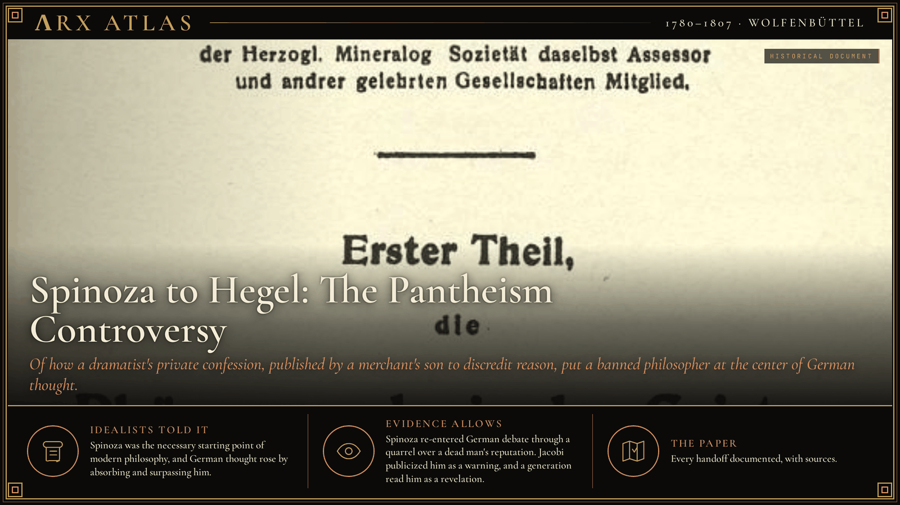
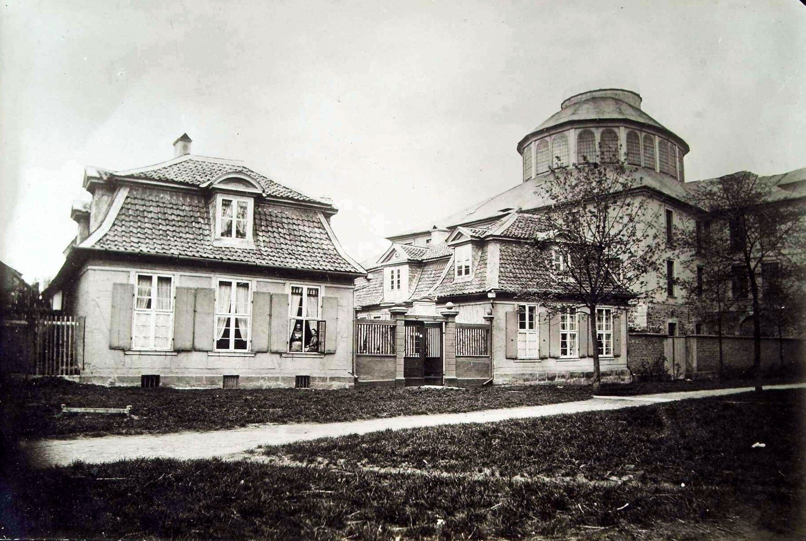
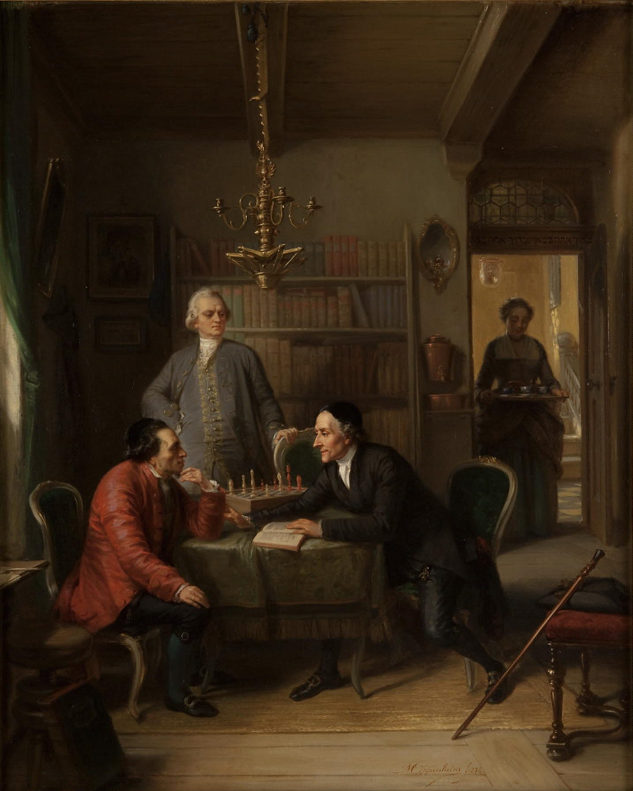
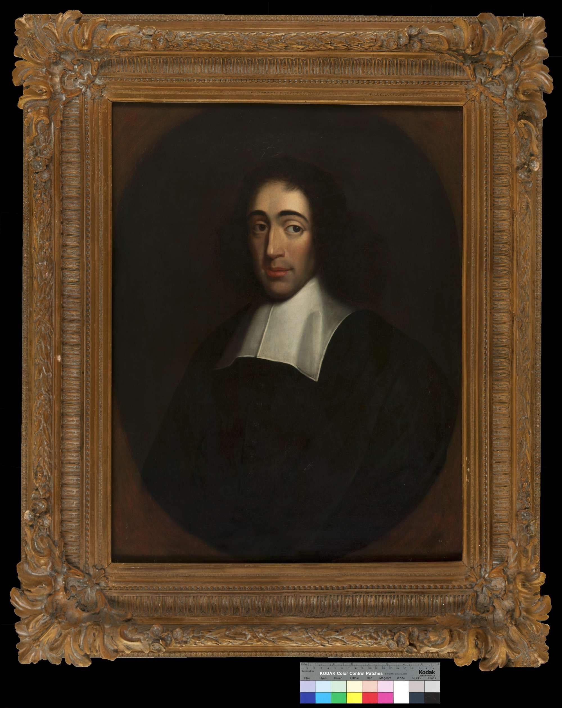
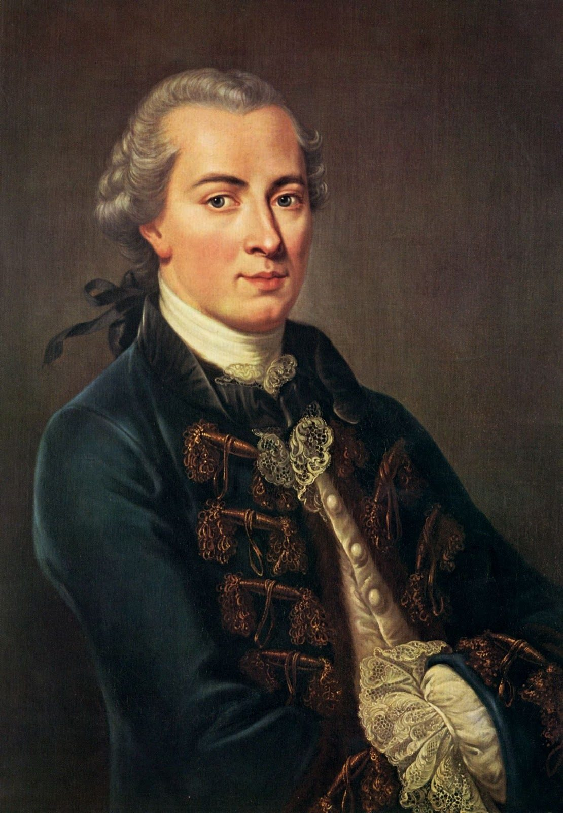
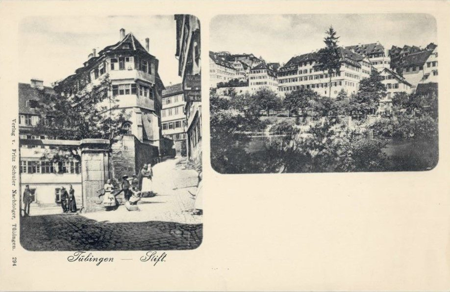
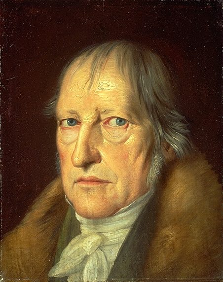

**ΛRX ATLAS** · Entry · 1780–1807 · Wolfenbüttel

# Spinoza to Hegel: The Pantheism Controversy

*Of how a dramatist's private confession, published by a merchant's son to discredit reason, put a banned philosopher at the center of German thought.*

*Art: [The original uploader was Nihil Kainer at German Wikipedia., "Phänomenologie des Geistes". Public domain, via Wikimedia Commons](https://commons.wikimedia.org/wiki/File:Ph%C3%A4nomenologie_des_Geistes.jpg)*

**[Explore Spinozism in the Memeplex →](https://arxcortex.io/memeplex.html)**

In 1780 Lessing told Jacobi he knew no philosophy save Spinozism. Jacobi published the confession in 1785 to discredit reason, and a banned philosopher moved to the center of German thought.

*the Wolfenbüttel library rotunda and Lessing's house, c. 1880. Image: [unknown / unbekannt, "Rotunde und Lessing-Haus Wolfenbüttel 1880". CC BY-SA 4.0, via Wikimedia Commons](https://commons.wikimedia.org/wiki/File:Rotunde_und_Lessing-Haus_Wolfenb%C3%BCttel_1880.jpg)*

*Oppenheim's 1856 painting of Lessing and Lavater visiting Mendelssohn. Image: [Moritz Daniel Oppenheim (1800-1882), "Moritz Daniel Oppenheim--Lavater and Lessing Visit Moses Mendelssohn--1856--Magnes Collection". Public domain, via Wikimedia Commons](https://commons.wikimedia.org/wiki/File:Moritz_Daniel_Oppenheim--Lavater_and_Lessing_Visit_Moses_Mendelssohn--1856--Magnes_Collection.jpg)*

On 5 July 1780 [Friedrich Heinrich Jacobi](https://en.wikipedia.org/wiki/Friedrich_Heinrich_Jacobi), the son of a wealthy Düsseldorf sugar merchant, called on [Gotthold Ephraim Lessing](https://en.wikipedia.org/wiki/Gotthold_Ephraim_Lessing) at [Wolfenbüttel](https://grokipedia.com/page/Pantheism_controversy), where Lessing kept the Duke of Brunswick's library. Lessing was the Enlightenment's leading dramatist and critic. Their talk turned to a pantheist poem by the young Goethe, "Prometheus." Then, by Jacobi's account, Lessing said something dangerous: "Hen kai pan! I know nothing else." One and all. There was, he said, "no other philosophy than the philosophy of Spinoza"; in another rendering, Lessing [knew no philosophy](https://en.wikipedia.org/wiki/Friedrich_Heinrich_Jacobi) "in the true sense of that word, save Spinozism." Seven months later Lessing was dead. This entry follows what Jacobi did with those words, and how they reached Hegel.

## The forbidden name

*anonymous portrait of Spinoza, c. 1665, Herzog August Bibliothek. Image: [anonymous, "Baruch Spinoza portrait HAB original". Public domain, via Wikimedia Commons](https://commons.wikimedia.org/wiki/File:Baruch_Spinoza_portrait_HAB_original.jpg)*

To name [Spinoza](https://plato.stanford.edu/entries/spinoza/) in 1780 was to accuse. His *Ethics* (1677) identified God with the one infinite substance of which everything is a mode. Catholic and Protestant authorities had [suppressed his works](https://grokipedia.com/page/Pantheism_controversy), and his posthumous *Opera* was banned by Dutch and church authorities. Pantheism and atheism were treated as the same charge. A Spinozist, in the vocabulary of the day, was an [atheist](https://en.wikipedia.org/wiki/Spinozism).

## The letters

*portrait of Jacobi. Image: [Unidentified painter, "Friedrich Heinrich Jacobi portrait". Public domain, via Wikimedia Commons](https://commons.wikimedia.org/wiki/File:Friedrich_Heinrich_Jacobi_portrait.jpg)*

Jacobi kept the conversation to himself until 1783. Then he took it up in letters with [Moses Mendelssohn](https://plato.stanford.edu/entries/mendelssohn/), Lessing's close friend and the leading philosopher of the Berlin Enlightenment. Mendelssohn insisted that Lessing was not the Spinozist Jacobi described. The two men, the [Wikipedia account](https://en.wikipedia.org/wiki/Moses_Mendelssohn) observes, had "hardly any common ground."

Jacobi's purpose was polemical. He held that Spinoza was the most consistent of rationalists, and that consistent rationalism ended in fatalism and [atheism](https://en.wikipedia.org/wiki/Pantheism_controversy). In Jacobi's framing, Lessing's confession proved the point: the Enlightenment's own champion, followed honestly, had arrived at Spinoza. The only escape was a leap of faith, *Glaube*. Jacobi later popularized a name for where he thought reason ended: [nihilism](https://en.wikipedia.org/wiki/Friedrich_Heinrich_Jacobi).

## The book

In 1785 Jacobi forced the quarrel into public. He printed the correspondence as *Über die Lehre des Spinoza in Briefen an Herrn Moses Mendelssohn*, "on the doctrine of Spinoza in letters to Mr. Moses Mendelssohn." Mendelssohn answered in his *Morgenstunden* (Morning Hours) and argued that a "purified" pantheism differed little from theism. He then wrote a second reply, *To Lessing's Friends*. On New Year's Eve he carried the manuscript to his publisher through the cold. He [died on 4 January 1786](https://en.wikipedia.org/wiki/Moses_Mendelssohn), and some held Jacobi responsible.

The scandal made Spinoza famous. Jacobi was mocked as a pietist and an "enemy of reason." But in exposing Spinoza he had also expounded him clearly, and a generation now read the *Ethics*. [Herder](https://grokipedia.com/page/Pantheism_controversy) published *God: Some Conversations* in 1787, presenting Spinoza as a living, poetic alternative to mechanism. [Kant](https://en.wikipedia.org/wiki/Pantheism_controversy) rejected the whole contest, holding that attempts to conceive transcendent reality end in antinomies. Jacobi reissued his book in 1789, much enlarged and with important appendices.

## The seminary

*the Tübinger Stift, postcard c. 1898. Image: [photographmedium QS:P186,Q125191 Unknown author Verlag / publisher: Fritz Schuler, "Tübinger Stift (AK 294 F Schuler um 1898)". Public domain, via Wikimedia Commons](https://commons.wikimedia.org/wiki/File:T%C3%BCbinger_Stift_(AK_294_F_Schuler_um_1898).jpg)*

In 1788, the year before that second edition, an eighteen-year-old [Georg Wilhelm Friedrich Hegel](https://en.wikipedia.org/wiki/Georg_Wilhelm_Friedrich_Hegel) entered the [Tübinger Stift](https://en.wikipedia.org/wiki/T%C3%BCbinger_Stift), the Protestant seminary attached to the University of Tübingen. His roommates were the poet [Friedrich Hölderlin](https://en.wikipedia.org/wiki/Friedrich_H%C3%B6lderlin) and the future philosopher Friedrich Schelling. The three became close friends and shaped one another's ideas. The seminary trained Lutheran clergy, but Hölderlin left the church for work as a tutor, and Hegel too took posts as a household tutor in Bern and Frankfurt. Hegel's mature project, the standard account of his life records, grew from his engagement with Fichte and Schelling and from his "attention to Spinoza and the [pantheism controversy](https://en.wikipedia.org/wiki/Georg_Wilhelm_Friedrich_Hegel)."

## The answer

Hegel answered in 1807. In the preface to the *Phenomenology of Spirit*, he set out his program: "everything depends on grasping and expressing the ultimate truth [not as Substance but as Subject as well](https://www.marxists.org/reference/archive/hegel/works/ph/phprefac.htm)." The sentence takes Spinoza's central term and asks that the absolute be thought as Subject too, a self-knowing process. In his lectures on the history of philosophy he made the debt explicit. Spinoza, he said, "is made a testing-point in modern philosophy, so that it may really be said: [You are either a Spinozist or not a philosopher at all](https://www.marxists.org/reference/archive/hegel/works/hp/hpspinoz.htm)." In the same lecture he named Jacobi as the man who had called Spinozism atheism, and answered that Spinoza's critics cared less about God than about "the finite — themselves."

## Weighing the evidence

Lessing's confession survives only in Jacobi's report, written by a man who wanted it to be damning. Mendelssohn [denied](https://plato.stanford.edu/entries/mendelssohn/) that it showed Lessing to be a Spinozist, and the question has never been settled. The link from the controversy to Hegel is documented in his own words. But Hegel's reading of Spinoza "cannot be identified with or reduced to" Spinoza's, as the [Stanford Encyclopedia](https://plato.stanford.edu/entries/hegel/) puts it, and Hegel inherited the Spinoza that Jacobi framed. One scholar, Willi Goetschel, argues that Jacobi's publication [shaped Spinoza's reception](https://en.wikipedia.org/wiki/Pantheism_controversy) for centuries and obscured the nuance of his work.

## The long view

*Hegel by Jakob Schlesinger, 1831. Image: [Jakob Schlesinger (1792-1855), "Hegel portrait by Schlesinger 1831". Public domain, via Wikimedia Commons](https://commons.wikimedia.org/wiki/File:Hegel_portrait_by_Schlesinger_1831.jpg)*

The pantheism controversy began as a contest over a reputation, the dead Lessing's, between two men who each claimed to be his true heir. Jacobi meant to discredit the Berlin Enlightenment by showing that its reason ended in Spinoza. He succeeded in showing the connection and failed to make it frightening. The seminarians of Tübingen took the forbidden system as a starting point. Within a generation the philosopher whose works had been banned stood, in Hegel's lectures, as the test every philosopher had to pass.

**[Explore Spinozism in the Memeplex →](https://arxcortex.io/memeplex.html)**

---

## Sources

**Primary witnesses**
- Hegel, G. W. F. *Lectures on the History of Philosophy*. "Spinoza." Translated by E. S. Haldane and Frances H. Simson. Marxists Internet Archive. Accessed October 29, 2026. https://www.marxists.org/reference/archive/hegel/works/hp/hpspinoz.htm.
- Hegel, G. W. F. *Phenomenology of Mind*. Preface. Translated by J. B. Baillie. Marxists Internet Archive. Accessed October 29, 2026. https://www.marxists.org/reference/archive/hegel/works/ph/phprefac.htm.
- Jacobi, Friedrich Heinrich. *Über die Lehre des Spinoza in Briefen an Herrn Moses Mendelssohn*. Breslau, 1785; 2nd ed., 1789.

**Modern scholarship**
- "Friedrich Heinrich Jacobi." *Wikipedia*. Accessed October 29, 2026. https://en.wikipedia.org/wiki/Friedrich_Heinrich_Jacobi.
- "Friedrich Hölderlin." *Wikipedia*. Accessed October 29, 2026. https://en.wikipedia.org/wiki/Friedrich_H%C3%B6lderlin.
- "Georg Wilhelm Friedrich Hegel." *Wikipedia*. Accessed October 29, 2026. https://en.wikipedia.org/wiki/Georg_Wilhelm_Friedrich_Hegel.
- "Gotthold Ephraim Lessing." *Wikipedia*. Accessed October 29, 2026. https://en.wikipedia.org/wiki/Gotthold_Ephraim_Lessing.
- "Hegel." *Stanford Encyclopedia of Philosophy*. Accessed October 29, 2026. https://plato.stanford.edu/entries/hegel/.
- "Moses Mendelssohn." *Stanford Encyclopedia of Philosophy*. Accessed October 29, 2026. https://plato.stanford.edu/entries/mendelssohn/.
- "Moses Mendelssohn." *Wikipedia*. Accessed October 29, 2026. https://en.wikipedia.org/wiki/Moses_Mendelssohn.
- "Pantheism controversy." *Grokipedia*. Accessed October 29, 2026. https://grokipedia.com/page/Pantheism_controversy.
- "Pantheism controversy." *Wikipedia*. Accessed October 29, 2026. https://en.wikipedia.org/wiki/Pantheism_controversy.
- "Spinoza." *Stanford Encyclopedia of Philosophy*. Accessed October 29, 2026. https://plato.stanford.edu/entries/spinoza/.
- "Spinozism." *Wikipedia*. Accessed October 29, 2026. https://en.wikipedia.org/wiki/Spinozism.

*Entered in the ΛRX Atlas · arxcortex.io*
