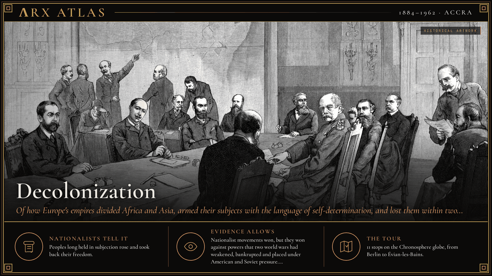
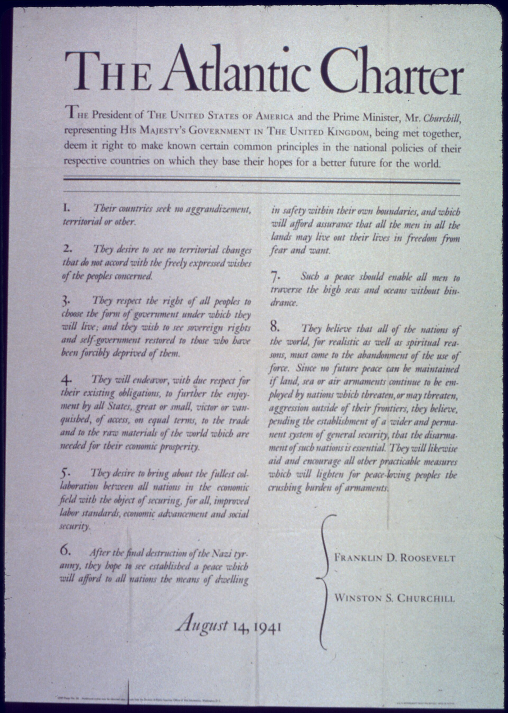
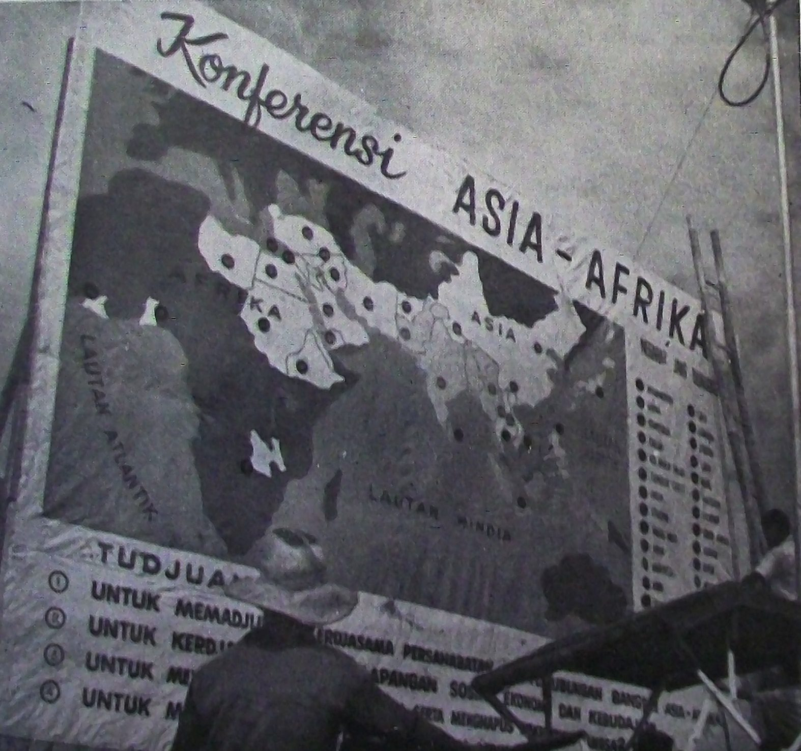
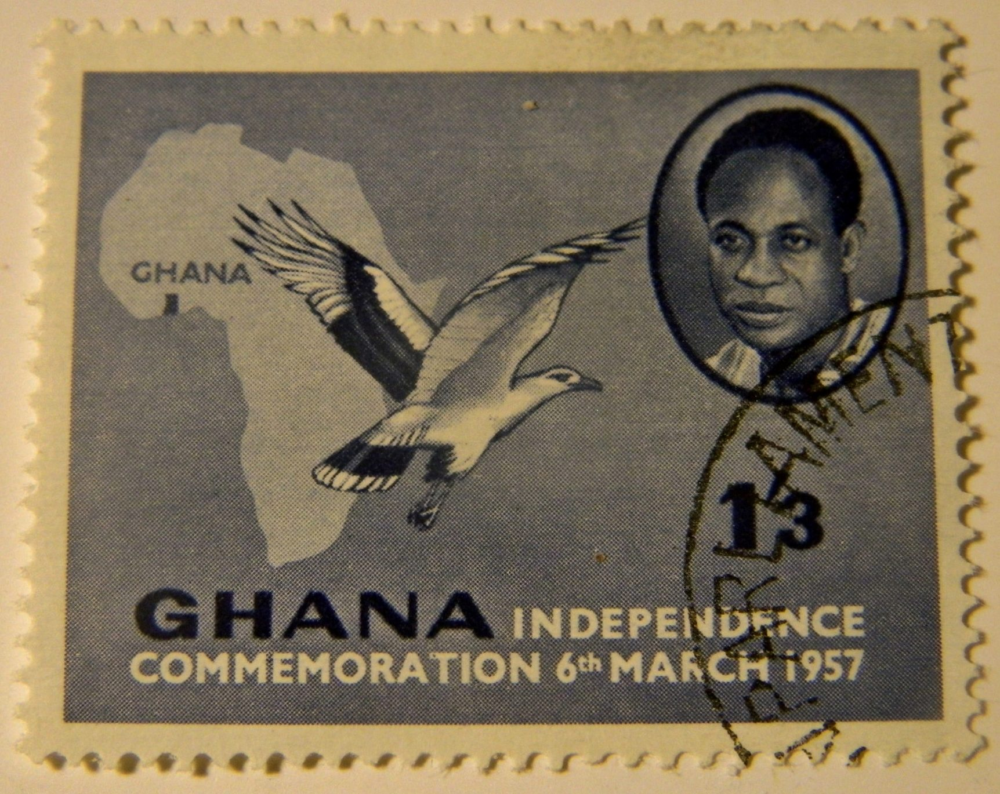
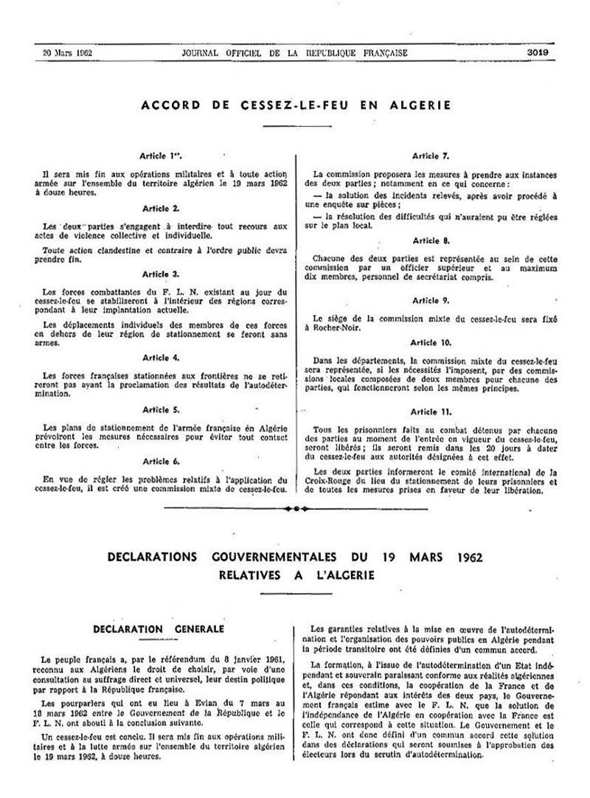

**ΛRX ATLAS** · Entry · 1884–1962 · Accra

# Decolonization

*Of how Europe's empires divided Africa and Asia, armed their subjects with the language of self-determination, and lost them within two generations.*

*Art: [Adalbert von Roessler, “Kongokonferenz”, Public domain, via Wikimedia Commons](https://commons.wikimedia.org/wiki/File:Kongokonferenz.jpg)*

**[Take the tour →](https://arxcortex.io/chronosphere.html#play/tour/decolonization)**

In 1919 a young Vietnamese man living in Paris, then calling himself [Nguyễn Ái Quốc](https://en.wikipedia.org/wiki/Ho_Chi_Minh), "Nguyễn the Patriot," joined a group that sent a petition to the victorious powers at Versailles. It asked only for civil rights for the Vietnamese of French Indochina. Nobody answered. Twenty-six years later, as Ho Chi Minh, he would write to President Truman for support for Vietnamese independence, citing the Atlantic Charter. Again nobody answered. This tour asks why the European empires, at the height of their reach in 1919, gave up most of their colonies within two generations.

## Dividing Africa

The story begins with a map. From 15 November 1884 to 26 February 1885, fourteen countries met in Berlin at a conference organized by [Otto von Bismarck](https://en.wikipedia.org/wiki/Otto_von_Bismarck) at the request of King [Leopold II](https://en.wikipedia.org/wiki/Leopold_II_of_Belgium) of Belgium. They agreed a framework for recognizing "effective occupation" of African territory. European claims multiplied after it. The new colonies' borders, and the colonial elites trained to run them, would later become the frame of independent states.

## Self-determination for whom?

The First World War left the victors speaking of [self-determination](https://en.wikipedia.org/wiki/Self-determination). At the [Paris Peace Conference](https://en.wikipedia.org/wiki/Paris_Peace_Conference_(1919%E2%80%931920)) the colonies kept their masters, and petitions like Nguyễn's went unheard. The lesson for colonial nationalists was that they would have to organize rather than ask.

## The charter

On 14 August 1941, before the United States had entered the war, [Franklin Roosevelt](https://en.wikipedia.org/wiki/Franklin_D._Roosevelt) and [Winston Churchill](https://en.wikipedia.org/wiki/Winston_Churchill) issued the [Atlantic Charter](https://en.wikipedia.org/wiki/Atlantic_Charter) from Placentia Bay, Newfoundland. It promised no territorial changes against the wishes of the people concerned and the restoration of self-government to those deprived of it. Churchill needed American help. The price was a document that colonial leaders would quote back at Britain.

*The Atlantic Charter text from the US National Archives. [Unknown author, “"The Atlantic Charter" - NARA - 513885”, Public domain, via Wikimedia Commons](https://commons.wikimedia.org/wiki/File:%22The_Atlantic_Charter%22_-_NARA_-_513885.tif)*

## India

Britain came out of the Second World War victorious and exhausted. At midnight on 14–15 August 1947, India and Pakistan became independent. Partition displaced between 12 and 20 million people. Estimates of the dead still range from two hundred thousand to two million. The largest colony in the world was gone, and with it the heart of the British Empire.

## Indonesia

In Southeast Asia, nationalists had declared independence when Japan surrendered. Indonesian youth groups pressed [Sukarno](https://en.wikipedia.org/wiki/Sukarno) and Hatta to proclaim the republic on 17 August 1945. Dutch forces retook the cities but not the countryside. By 1949 international pressure, including an American threat to cut off economic aid, forced the Netherlands to transfer sovereignty. Washington's money had decided a colonial war.

## Dien Bien Phu

France tried to hold Indochina. From 13 March to 7 May 1954 the Viet Minh besieged and took the French base at [Dien Bien Phu](https://en.wikipedia.org/wiki/Battle_of_Dien_Bien_Phu), where Algerian and Moroccan colonial troops fought for France. The Geneva Accords ten weeks later led to French withdrawal. On 1 November 1954 the Algerian [FLN](https://en.wikipedia.org/wiki/National_Liberation_Front_(Algeria)) opened its own war.

## Bandung

From 18 to 24 April 1955, twenty-nine mostly new states met at [Bandung](https://en.wikipedia.org/wiki/Asian%E2%80%93African_Conference) in Indonesia. Sukarno and India's [Jawaharlal Nehru](https://en.wikipedia.org/wiki/Jawaharlal_Nehru) led the way, and the meeting was a step toward the [Non-Aligned Movement](https://en.wikipedia.org/wiki/Non-Aligned_Movement). The former colonies now had a bloc and a voice.

*The official 1955 conference poster. [Foreign Ministry of the Republic of Indonesia, “Bandung poster”, Public domain, via Wikimedia Commons](https://commons.wikimedia.org/wiki/File:Bandung_poster.png)*

## Suez

Egypt's president [Gamal Abdel Nasser](https://en.wikipedia.org/wiki/Gamal_Abdel_Nasser) nationalized the Suez Canal in 1956. Britain and France, with Israel, invaded to regain it and depose him. Heavy pressure from the United States, the Soviet Union and the United Nations forced them out. British ministers were warned that without American support Britain's gold reserves would disappear and the sterling area would break apart. The old powers could no longer fight a colonial war that Washington opposed.

## Ghana

On 6 March 1957 the [Gold Coast](https://en.wikipedia.org/wiki/Gold_Coast_(British_colony)) became independent as Ghana, under [Kwame Nkrumah](https://en.wikipedia.org/wiki/Kwame_Nkrumah). In January 1960 the British prime minister, [Harold Macmillan](https://en.wikipedia.org/wiki/Harold_Macmillan), first gave in Accra the speech he repeated in Cape Town on 3 February: the "wind of change" was blowing through Africa. It signaled that his government would no longer impede independence.

*A postage stamp commemorating independence day, 6 March 1957. [Paasikivi, “KwameNkrumahOnGhanianIndependenceDay6March1957PostageStamp”, CC BY-SA 4.0, via Wikimedia Commons](https://commons.wikimedia.org/wiki/File:KwameNkrumahOnGhanianIndependenceDay6March1957PostageStamp.JPG)*

## The year of Africa

In 1960 seventeen African colonies became independent, fourteen of them French. On 14 December the UN General Assembly adopted [Resolution 1514](https://en.wikipedia.org/wiki/Declaration_on_the_Granting_of_Independence_to_Colonial_Countries_and_Peoples), declaring colonialism a denial of human rights. Eighty-nine states voted for it and none against. Nine abstained, among them Britain, France and the United States.

## Évian

Algeria remained. The war brought down France's Fourth Republic and returned [Charles de Gaulle](https://en.wikipedia.org/wiki/Charles_de_Gaulle) to power. In 1959 he accepted the principle of self-determination for Algeria. On 18 March 1962 at Évian-les-Bains his government and the Algerian provisional government signed the [Évian Accords](https://en.wikipedia.org/wiki/%C3%89vian_Accords), and a ceasefire followed the next day.

*The accords as published in France's Journal officiel, 20 March 1962. [JORF, “JORF-20-03-1962-p3019-Accords d'Evian”, Licence Ouverte, via Wikimedia Commons](https://commons.wikimedia.org/wiki/File:JORF-20-03-1962-p3019-Accords_d%27Evian.jpg)*

## Weighing the evidence

Each nation tells its independence as its own victory, and each former empire tells it as a managed handover. Neither story is complete. The record of conferences, votes and treaties is solid. The human cost is not: estimates of the dead of Partition still range from 200,000 to two million, and figures for the Algerian war remain disputed. Whether Bandung or Suez mattered more, or whether Macmillan's speech led policy or followed it, are matters of emphasis on which historians differ.

## The long view

Why did the empires fall so fast? The nationalist movements were real and determined. But they won against powers that two world wars had drained of money and will. The victors' own wartime language, from Wilson's self-determination to the Atlantic Charter, gave colonial leaders arguments their rulers could not easily refuse. And the new superpowers, for their own reasons, would not underwrite European empire. The moment at Suez, when fear for the pound decided policy, showed where power had moved. Nguyễn's unanswered petition of 1919 was answered, in the end, by events.

**[Take the tour →](https://arxcortex.io/chronosphere.html#play/tour/decolonization)**

---

## Sources

**Ancient witnesses**
- General Act of the Berlin Conference (1885).
- Nguyễn Ái Quốc and others, petition to the Versailles conference (1919).
- The Atlantic Charter (1941).
- UN General Assembly Resolution 1514 (1960).
- Évian Accords (1962).

**Modern scholarship**
- "Algerian War." *Wikipedia*. Accessed October 28, 2026. https://en.wikipedia.org/wiki/Algerian_War.
- "Asian–African Conference." *Wikipedia*. Accessed October 28, 2026. https://en.wikipedia.org/wiki/Asian%E2%80%93African_Conference.
- "Atlantic Charter." *Wikipedia*. Accessed October 28, 2026. https://en.wikipedia.org/wiki/Atlantic_Charter.
- "Battle of Dien Bien Phu." *Wikipedia*. Accessed October 28, 2026. https://en.wikipedia.org/wiki/Battle_of_Dien_Bien_Phu.
- "Berlin Conference." *Wikipedia*. Accessed October 28, 2026. https://en.wikipedia.org/wiki/Berlin_Conference.
- "Declaration on the Granting of Independence to Colonial Countries and Peoples." *Wikipedia*. Accessed October 28, 2026. https://en.wikipedia.org/wiki/Declaration_on_the_Granting_of_Independence_to_Colonial_Countries_and_Peoples.
- "Gold Coast (British colony)." *Wikipedia*. Accessed October 28, 2026. https://en.wikipedia.org/wiki/Gold_Coast_(British_colony).
- "Ho Chi Minh." *Wikipedia*. Accessed October 28, 2026. https://en.wikipedia.org/wiki/Ho_Chi_Minh.
- "Indonesian National Revolution." *Wikipedia*. Accessed October 28, 2026. https://en.wikipedia.org/wiki/Indonesian_National_Revolution.
- "Partition of India." *Wikipedia*. Accessed October 28, 2026. https://en.wikipedia.org/wiki/Partition_of_India.
- "Suez Crisis." *Wikipedia*. Accessed October 28, 2026. https://en.wikipedia.org/wiki/Suez_Crisis.
- "Wind of Change (speech)." *Wikipedia*. Accessed October 28, 2026. https://en.wikipedia.org/wiki/Wind_of_Change_(speech).
- "Year of Africa." *Wikipedia*. Accessed October 28, 2026. https://en.wikipedia.org/wiki/Year_of_Africa.
- "Évian Accords." *Wikipedia*. Accessed October 28, 2026. https://en.wikipedia.org/wiki/%C3%89vian_Accords.

*Entered in the ΛRX Atlas · arxcortex.io*
