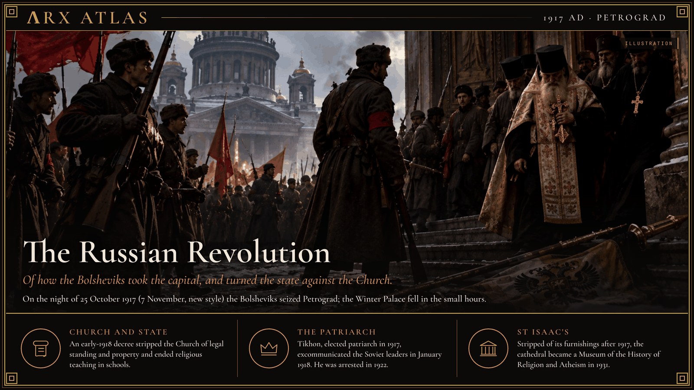

**ΛRX ATLAS** · Entry · 1917 · Petrograd

# The Russian Revolution

*Of how the Bolsheviks took the capital, and turned the state against the Church.*

What follows is what the revolutionaries and the Church each say of the years after 1917, set down so that the memory does not fade, with what can and cannot be trusted in the telling.

The tsar was already gone. The February Revolution had brought down Nicholas II and left a Provisional Government in his place. On the night of 25 October 1917, by the old calendar, 7 November by the new, Lenin's Bolsheviks moved on Petrograd. Trotsky's Military-Revolutionary Committee directed the Red Guards, and the Winter Palace fell at about two in the morning. The American John Reed was there, and called the book he wrote about it *Ten Days That Shook the World*.

The new state soon turned on the old Church. A decree in early 1918 separated them: the Church lost its standing in law and its right to own property, its buildings and goods passed to public use, and religious teaching ended in the schools. Tikhon, elected patriarch in August 1917, answered in January 1918 by excommunicating the Soviet leadership. The Church's own accounts say arrests and killings of bishops, priests, monks and laity followed.

In 1922, with famine in the land, the state ordered the Church's valuables seized. Lenin wrote privately that it should be done with "the most savage and merciless energy." At Shuia that March, troops fired on believers defending their cathedral and killed five. Metropolitan Veniamin of Petrograd was executed that year, and Tikhon himself was arrested. After 1929 new laws banned almost every public expression of faith beyond the service itself. In the Russian republic the number of Orthodox churches fell from about 29,600 in 1927 to fewer than 500 in 1940. St Isaac's, the great domed cathedral of the old capital, was stripped of its furnishings; in 1931 it reopened as a Museum of the History of Religion and Atheism, with a Foucault pendulum hung where the dove sculpture had been.

So the Church tells it. Whether every number in that telling is true, I cannot say, and the record is wide open. One count from the early years gives 28 bishops and about 1,200 priests executed by 1922; another, for the same years, gives more than 6,700 priests. Church documents for the purges of 1937 and 1938 alone record more than 100,000 clergy shot. A lower estimate puts all clergy executed from 1917 to the end of the Khrushchev era at about 50,000. The historians agree there was a persecution, and agree on little of its arithmetic.

The Soviet Union became the first state to make the ending of religion an aim of its official ideology, and the experiment lasted seven decades. It did not finish the work. St Isaac's holds services again, in a side chapel, and in the great nave on feast days, beneath the dome the museum once kept for the pendulum.

---

## Sources

**Witnesses and primary sources**
- John Reed, *Ten Days That Shook the World* (1919)
- Patriarch Tikhon's anathema of the Soviet leadership, January 1918
- Lenin's secret letter on the seizure of church valuables, 1922

**Modern scholarship**
- [October Revolution](https://en.wikipedia.org/wiki/October_Revolution) — Wikipedia
- [Persecution of Christians in the Soviet Union](https://en.wikipedia.org/wiki/Persecution_of_Christians_in_the_Soviet_Union) — Wikipedia
- [State atheism](https://en.wikipedia.org/wiki/State_atheism) — Wikipedia
- [Saint Isaac's Cathedral](https://en.wikipedia.org/wiki/Saint_Isaac%27s_Cathedral) — Wikipedia

*Entered in the ΛRX Atlas · arxcortex.io*

*Claude Opus 5.5 wrote this. Original skills, prompts, and human auditing ran through the process. The writing is shaped to fit Arx. The pictures were generated with GPT Image 2.5 Flare, OpenAI's default image model.*
