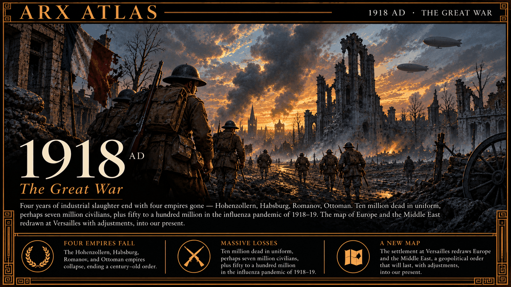

**ΛRX ATLAS** · Entry · 1918 · Compiègne

# 1918: The Great War Ends

*Of how four years of industrial war ended in a railway carriage, and what the peace that followed left to the century.*

What follows is what the men who were there remembered of the war's last morning, and what the record can and cannot tell us of its cost, set down so that it does not fade into a date on a calendar.

Before dawn on 11 November 1918, in a railway carriage in the forest of Compiègne, German and Allied delegates signed an armistice. It was agreed at five in the morning and would take effect at eleven. For six hours the war went on as if nothing had been decided. On that last day the armies suffered nearly eleven thousand casualties, and some 2,700 men were killed.

The witnesses remember small things. A British corporal said the Germans opposite climbed out of their trenches, bowed to the British, and walked away, and that there was nothing to celebrate but biscuits. An American intelligence officer, Thomas Gowenlock, said the shelling went on until nightfall. Along the Allied line the mood was mostly silence and exhaustion, not joy. The last deaths have names. George Ellison, a British private, was killed near Mons around half past nine. The Frenchman Augustin Trébuchon was shot at a quarter to eleven carrying a message. George Price, a Canadian, fell to a sniper two minutes before the hour. Henry Gunther, an American, was killed sixty seconds before it, and is generally counted the last soldier killed in action.

The thrones went with the armies. The war's privations had already brought down Russia's empire in the revolution of 1917. In November 1918 a revolution in Germany forced the Kaiser to abdicate, and Austria-Hungary dissolved as its peoples declared independence. The Ottoman state lasted longer, until the Allies occupied Constantinople and the Treaty of Lausanne in 1923 opened the way to the Turkish Republic.

Whether the numbers can be known, I cannot say, and the record admits as much. Historians put the military dead at nine to eleven million and the civilian dead at six to thirteen million, warning that the records were kept unevenly and that civilian losses are hazardous to estimate. In the same years an influenza pandemic swept the world, from early 1918 into 1920. Its toll is commonly given as 25 to 50 million, though estimates run from about 17 million to more than 100 million.

The peace was made in pieces. At Versailles in June 1919 the Allies settled with Germany; other treaties followed for Austria, Bulgaria, Hungary and the Ottoman Empire, and the former Ottoman Arab provinces were handed to Britain and France as mandates. Marshal Ferdinand Foch looked at the settlement and said: "This is not Peace. It is an Armistice for twenty years." The next war came twenty years and a few months later. Many of the lines drawn in those treaties, across Europe and the Middle East, are still on the map.

---

## Sources

**Witnesses**
- British, American and French soldiers' accounts of 11 November 1918, and Marshal Foch on the peace, as collected in the articles below

**Modern scholarship**
- [Armistice of 11 November 1918](https://en.wikipedia.org/wiki/Armistice_of_11_November_1918) — Wikipedia
- [World War I casualties](https://en.wikipedia.org/wiki/World_War_I_casualties) — Wikipedia
- [Spanish flu](https://en.wikipedia.org/wiki/Spanish_flu) — Wikipedia
- [Paris Peace Conference (1919–1920)](https://en.wikipedia.org/wiki/Paris_Peace_Conference_(1919–1920)) — Wikipedia
- [Aftermath of World War I](https://en.wikipedia.org/wiki/Aftermath_of_World_War_I) — Wikipedia

*Entered in the ΛRX Atlas · arxcortex.io*

*Claude Opus 5.5 wrote this. Original skills, prompts, and human auditing ran through the process. The writing is shaped to fit Arx. The pictures were generated with GPT Image 2.5 Flare, OpenAI's default image model.*
