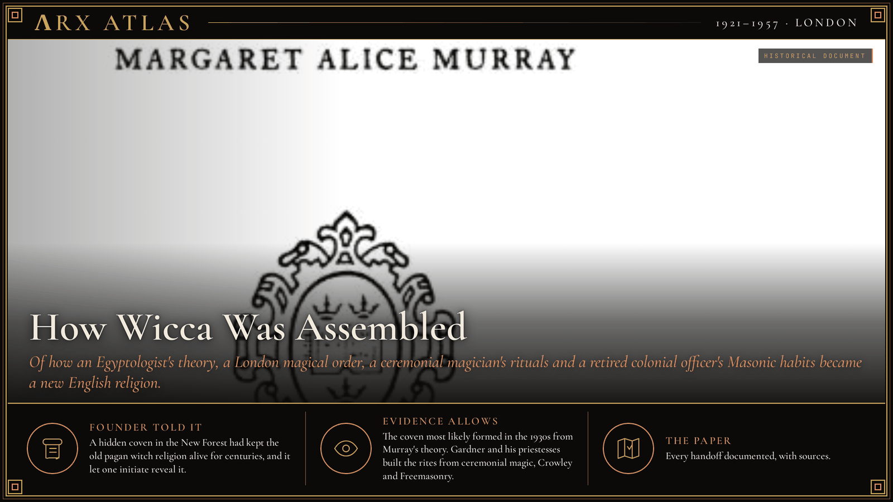
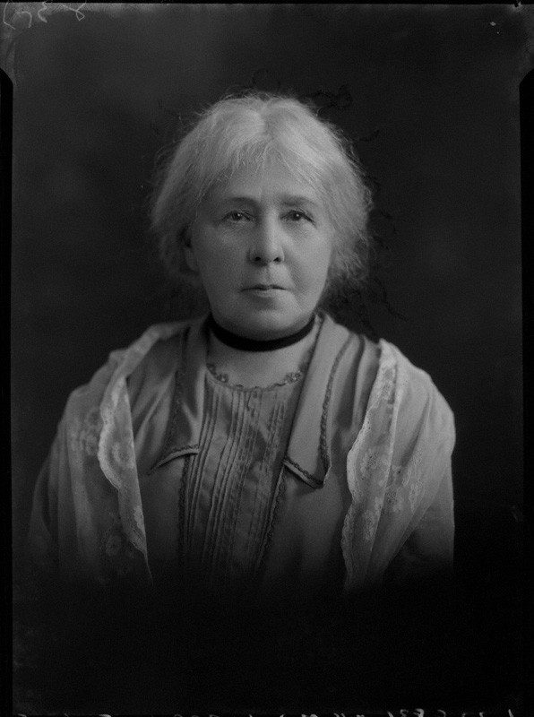
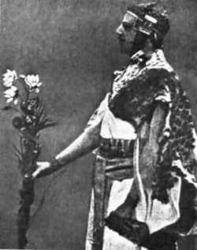
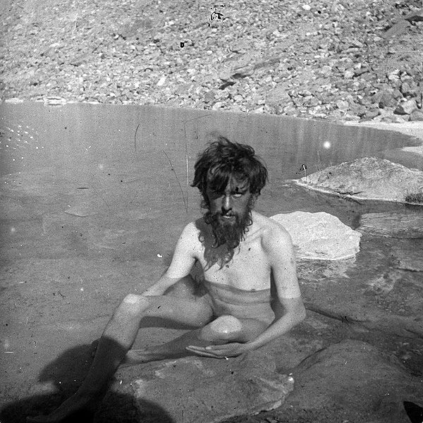
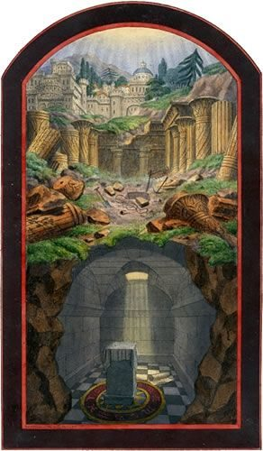
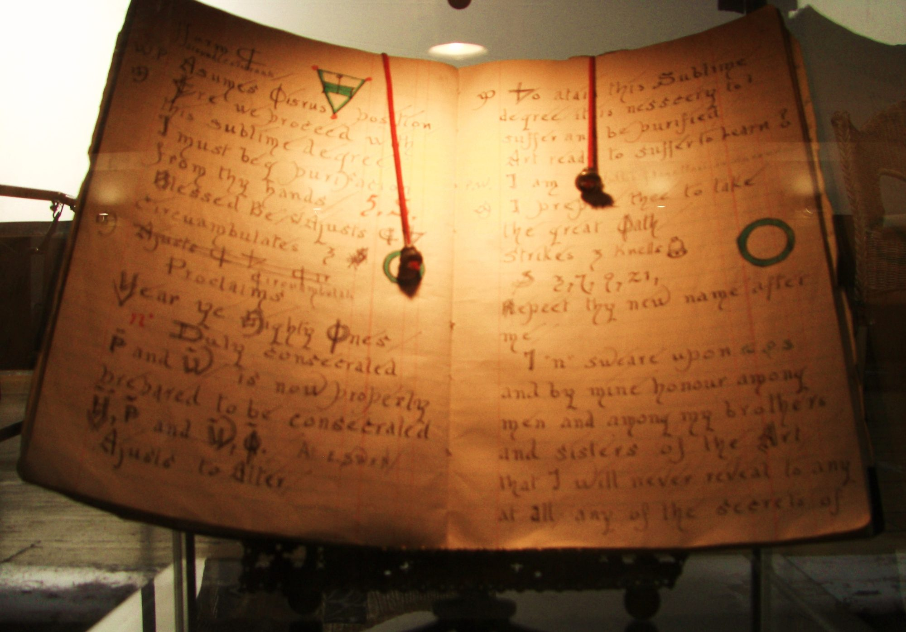

**ΛRX ATLAS** · Entry · 1921–1957 · London

# How Wicca Was Assembled

*Of how an Egyptologist's theory, a London magical order, a ceremonial magician's rituals and a retired colonial officer's Masonic habits became a new English religion.*

*Art: [Margaret Murray, "The Witch-Cult in Western Europe". Public domain, via Wikimedia Commons](https://commons.wikimedia.org/wiki/File:The_Witch-Cult_in_Western_Europe.png)*

**[Explore Wicca in the Memeplex →](https://arxcortex.io/memeplex.html)**

In 1954 a retired colonial civil servant said England's witches had survived in secret for centuries. Historians traced his rites to a 1921 theory, an 1888 London magical order and Aleister Crowley.

In 1954 a retired colonial civil servant named [Gerald Gardner](https://en.wikipedia.org/wiki/Gerald_Gardner) published *Witchcraft Today*. He claimed that witches still met in England, heirs of a pagan religion older than the Church. The book carried a preface by [Margaret Murray](https://en.wikipedia.org/wiki/Margaret_Murray), the scholar whose theory he was confirming. Gardner presented a survival. The historians who later traced his sources found an assembly. This entry follows its parts, one documented handoff at a time.

## The thesis

*Margaret Murray, photographed by Lafayette Ltd in 1928. Image: [Unknown (Lafayette Ltd), "Margaret Murray 1928". Public domain, via Wikimedia Commons](https://commons.wikimedia.org/wiki/File:Margaret_Murray_1928.jpg)*

Murray was an [Egyptologist](https://en.wikipedia.org/wiki/Margaret_Murray) at University College London, the first woman appointed a lecturer in archaeology in Britain. Turning to folklore, she argued in [*The Witch-Cult in Western Europe*](https://en.wikipedia.org/wiki/Witch-cult_hypothesis), published by Oxford University Press in 1921, that the people killed in the witch trials had belonged to an organized [pre-Christian fertility cult](https://grokipedia.com/page/Margaret_Murray) that worshipped a horned god. She restated the case in [*The God of the Witches*](https://en.wikipedia.org/wiki/Witch-cult_hypothesis) (1931). Her authority grew when the [*Encyclopædia Britannica*](https://en.wikipedia.org/wiki/Margaret_Murray) asked her to write its 1929 entry on witchcraft, and she used it to press her own theory without mentioning its rivals. The "Murrayite theory" proved popular with the public, but it was [never accepted](https://en.wikipedia.org/wiki/Witch-cult_hypothesis) by scholars of the witch trials, who took it apart in the 1960s and 1970s.

## The order

*Golden Dawn co-founder Mathers performing a ritual. Image: [The original uploader was Ihcoyc at English Wikipedia., "Samuel Liddell MacGregor Mathers in Egyptian getup". Public domain, via Wikimedia Commons](https://commons.wikimedia.org/wiki/File:Samuel_Liddell_MacGregor_Mathers_in_Egyptian_getup.jpg)*

The ritual machinery came from another source. On 1 March 1888 three Freemasons, [William Wynn Westcott](https://grokipedia.com/page/Hermetic_Order_of_the_Golden_Dawn), Samuel Liddell MacGregor Mathers and William Robert Woodman, chartered the Isis-Urania Temple of the [Hermetic Order of the Golden Dawn](https://en.wikipedia.org/wiki/Hermetic_Order_of_the_Golden_Dawn) in London. The order drew heavily on Rosicrucianism and was [inspired by Freemasonry](https://en.wikipedia.org/wiki/Hermetic_Order_of_the_Golden_Dawn). Like a lodge, it ran on hierarchy and initiation by grades, and it taught Hermetic doctrine and ceremonial magic.

## The magician

*Crowley on the 1902 K2 expedition. Image: [Jules Jacot Guillarmod (24 December 1868 – 5 June 1925), "Aleister Crowley 1902 K2". Public domain, via Wikimedia Commons](https://commons.wikimedia.org/wiki/File:Aleister_Crowley_1902_K2.jpg)*

On 18 November 1898 Mathers initiated a young poet and mountaineer, [Aleister Crowley](https://en.wikipedia.org/wiki/Aleister_Crowley), into the order's outer grade, and trained him in ceremonial magic. Crowley went on to found his own religion, Thelema, in 1904. He published widely on magic, and his texts were in print for later seekers to borrow.

## The collector

*a Masonic tracing board, the lodge tradition Gardner joined in 1910. Image: [John Harris, "Masonic Tracing Board". Public domain, via Wikimedia Commons](https://commons.wikimedia.org/wiki/File:Masonic_Tracing_Board.jpg)*

Gardner had spent his working life in Ceylon and Malaya, and he was [initiated a Freemason](https://en.wikipedia.org/wiki/Gerald_Gardner) in Ceylon in 1910. After retiring in 1936 he settled near the New Forest and joined the Rosicrucian Order Crotona Fellowship, an occult group. Through it, he said, he met a coven that [initiated him in 1939](https://en.wikipedia.org/wiki/Gerald_Gardner). He wrote that he already knew Murray's theory, and that "I then knew then that which I had thought burnt out hundreds of years ago still survived."

The rest of the chain came in person. On May Day 1947 a friend introduced Gardner to Crowley. Shortly before his death that year, Crowley raised Gardner to the IV° of the [Ordo Templi Orientis](https://en.wikipedia.org/wiki/Gerald_Gardner) and signed a charter, written in Gardner's own hand, allowing him to admit initiates. Gardner then [supplemented the coven's rituals](https://en.wikipedia.org/wiki/Gerald_Gardner) with ideas borrowed from Freemasonry, ceremonial magic and the writings of Crowley. He first published the material in fictional form in *High Magic's Aid* (1949).

## The opening

The law changed in his favor. In 1951 Parliament repealed the [Witchcraft Act 1735](https://en.wikipedia.org/wiki/Wicca), and Gardner and others began to publicize their versions of the Craft. *Witchcraft Today* followed in 1954, with Murray's preface. Gardner founded the Bricket Wood coven and installed a series of high priestesses, through whom the tradition spread across Britain and, by the early 1960s, to Australia and the United States.

## The priestess

*one of Gardner's Books of Shadows, later owned by Valiente. Image: [Midnightblueowl (talk), "Gardner's Book of Shadows front". CC BY-SA 3.0, via Wikimedia Commons](https://commons.wikimedia.org/wiki/File:Gardner%27s_Book_of_Shadows_front.JPG)*

One of those priestesses changed the texts. [Doreen Valiente](https://en.wikipedia.org/wiki/Doreen_Valiente), initiated in 1953, had read Crowley herself. She recognized how much of Gardner's *Book of Shadows* came from Crowley rather than from ancient sources. When she confronted him, Gardner said the coven's material had been fragmentary and he had filled the gaps from other sources. With his permission she rewrote much of it, cutting Crowley's passages, fearing that his reputation would sully the religion. Her rewrite of the [Charge of the Goddess](https://en.wikipedia.org/wiki/Doreen_Valiente) became, in the historian Ronald Hutton's words, "her greatest single contribution to Wicca." In 1957 she and her followers broke with Gardner.

## Weighing the evidence

The founding claim rests on Gardner's account. Research by Hutton and the biographer Philip Heselton concluded that the New Forest coven was [probably formed in the mid-1930s](https://en.wikipedia.org/wiki/Gerald_Gardner), drawing on Murray's work and on folk magic, and not inherited from the Middle Ages. Hutton's [*The Triumph of the Moon*](https://en.wikipedia.org/wiki/The_Triumph_of_the_Moon) (1999), the first academic study of the whole subject, argued that many of the claimed links to hidden pagan traditions were doubtful. The same book also argued for Wicca's importance as a genuine new religious movement. Most scholars now treat it as a 20th-century creation combining [Freemasonry and 19th-century occultism](https://en.wikipedia.org/wiki/Wicca). Who belonged to the original coven is itself a reconstruction: Heselton's list of names is a theory, and Gardner's explanation that the coven's material was fragmentary cannot be checked against the original.

## The long view

Each part of Wicca came through an institution. A university lecturer gave it a history, and an encyclopedia spread that history. A Masonic-style order supplied the ritual grades. Crowley handed on the texts and, in the end, a charter. Gardner's Masonic lodge and occult fellowship supplied the habits of initiation, and repealing a statute let him go public. Valiente edited the result into scripture. The theory that gave the religion its history collapsed. The religion did not. Hutton called it "[the only full-formed religion](https://en.wikipedia.org/wiki/Wicca) which England can be said to have given the world."

**[Explore Wicca in the Memeplex →](https://arxcortex.io/memeplex.html)**

---

## Sources

**Primary witnesses**
- Murray, Margaret. *The Witch-Cult in Western Europe*. Oxford: Clarendon Press, 1921.
- Gardner, Gerald. *Witchcraft Today*. London: Rider, 1954.

**Modern scholarship**
- "Aleister Crowley." *Wikipedia*. Accessed October 29, 2026. https://en.wikipedia.org/wiki/Aleister_Crowley.
- "Doreen Valiente." *Wikipedia*. Accessed October 29, 2026. https://en.wikipedia.org/wiki/Doreen_Valiente.
- "Gerald Gardner." *Grokipedia*. Accessed October 29, 2026. https://grokipedia.com/page/Gerald_Gardner.
- "Gerald Gardner." *Wikipedia*. Accessed October 29, 2026. https://en.wikipedia.org/wiki/Gerald_Gardner.
- "Hermetic Order of the Golden Dawn." *Grokipedia*. Accessed October 29, 2026. https://grokipedia.com/page/Hermetic_Order_of_the_Golden_Dawn.
- "Hermetic Order of the Golden Dawn." *Wikipedia*. Accessed October 29, 2026. https://en.wikipedia.org/wiki/Hermetic_Order_of_the_Golden_Dawn.
- "Margaret Murray." *Grokipedia*. Accessed October 29, 2026. https://grokipedia.com/page/Margaret_Murray.
- "Margaret Murray." *Wikipedia*. Accessed October 29, 2026. https://en.wikipedia.org/wiki/Margaret_Murray.
- "The Triumph of the Moon." *Wikipedia*. Accessed October 29, 2026. https://en.wikipedia.org/wiki/The_Triumph_of_the_Moon.
- "Wicca." *Wikipedia*. Accessed October 29, 2026. https://en.wikipedia.org/wiki/Wicca.
- "Witch-cult hypothesis." *Wikipedia*. Accessed October 29, 2026. https://en.wikipedia.org/wiki/Witch-cult_hypothesis.

*Entered in the ΛRX Atlas · arxcortex.io*
