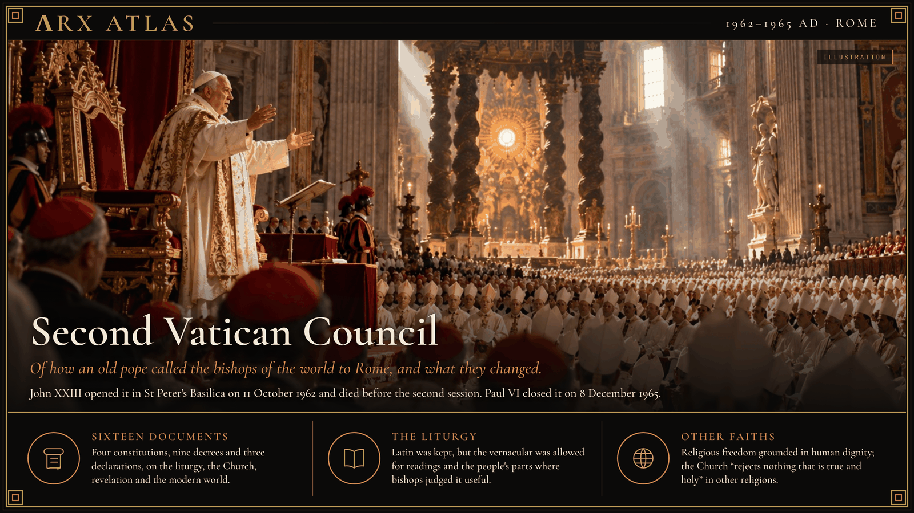

**ΛRX ATLAS** · Entry · 1962–1965 · Rome

# Second Vatican Council

*Of how an old pope called the bishops of the world to Rome, and what they changed.*

What follows is what the Church said of its own council, and what its interpreters have said since, set down so that the memory of it does not fade, with what can and cannot be trusted in the telling.

On 25 January 1959, in the Basilica of Saint Paul Outside the Walls, Pope John XXIII announced that he would call an ecumenical council. On 11 October 1962 the council opened in St Peter's Basilica. About 2,900 bishops and heads of religious orders had the right to attend, and nearly 2,500 came at one time or another, from every continent.

His opening address is remembered by its first words, *Gaudet Mater Ecclesia*, Mother Church rejoices. In it he set himself against the "prophets of doom" who saw only ruin in the modern age, and said the Church now preferred "the medicine of mercy" to the severity of condemnation. The word attached to him ever after was Italian, *aggiornamento*: bringing up to date. The saying most often put in his mouth, that he meant to open the windows of the Church and let in fresh air, is repeated everywhere, yet none of the accounts I checked gives a source for it; it may be the summary his admirers made of him.

He did not live to see the work done. John died on 3 June 1963, between the first and second sessions. Paul VI took the chair, carried the council through four sessions, and closed it on 8 December 1965. It left sixteen documents: four constitutions, nine decrees and three declarations. On the liturgy it kept Latin but allowed the vernacular for the readings and the people's parts where bishops found it useful; the priest facing the people and much else that Catholics came to associate with the council were later decisions. It declared that religious freedom rests on the dignity of the human person, the most contested text of all. It said the Church "rejects nothing that is true and holy" in other religions, repudiated the charge that the Jews as a people bore guilt for Christ's death, and named the unity of Christians a principal concern.

So the council tells it. What it meant is still argued. In 2005 Benedict XVI asked that it be read through a "hermeneutic of reform" and warned against a "hermeneutic of discontinuity and rupture." Archbishop Marcel Lefebvre, who voted against the declaration on religious freedom and still signed it, founded the Society of Saint Pius X in 1970; its members hold that three of the council's texts cannot be reconciled with earlier teaching, and Lefebvre was excommunicated in 1988. Others invoke a "spirit of Vatican II" that runs beyond its letter, and their critics answer that the bishops never voted for that spirit.

Whether the council ended an age of the Church, as some say, or renewed one, as others insist, I cannot settle. What is certain is that sixty years on, Catholics still sort themselves in part by how they read it.

---

## Sources

**Primary sources**
- John XXIII, *Gaudet Mater Ecclesia*, opening address, 11 October 1962
- The sixteen documents of the council, among them *Sacrosanctum Concilium*, *Lumen gentium*, *Dei verbum*, *Gaudium et spes*, *Dignitatis humanae*, *Nostra aetate* and *Unitatis redintegratio*
- Benedict XVI, address to the Roman Curia, 22 December 2005

**Modern scholarship and context**
- [Second Vatican Council](https://en.wikipedia.org/wiki/Second_Vatican_Council) — Wikipedia
- [U.S. Catholic on John XXIII](https://uscatholic.org/?p=71304) and [Religion News Service](https://religionnews.com/?p=26108), two examples of the windows saying quoted without a source

*Entered in the ΛRX Atlas · arxcortex.io*

*Claude Opus 5.5 wrote this. Original skills, prompts, and human auditing ran through the process. The writing is shaped to fit Arx. The pictures were generated with GPT Image 2.5 Flare, OpenAI's default image model.*
