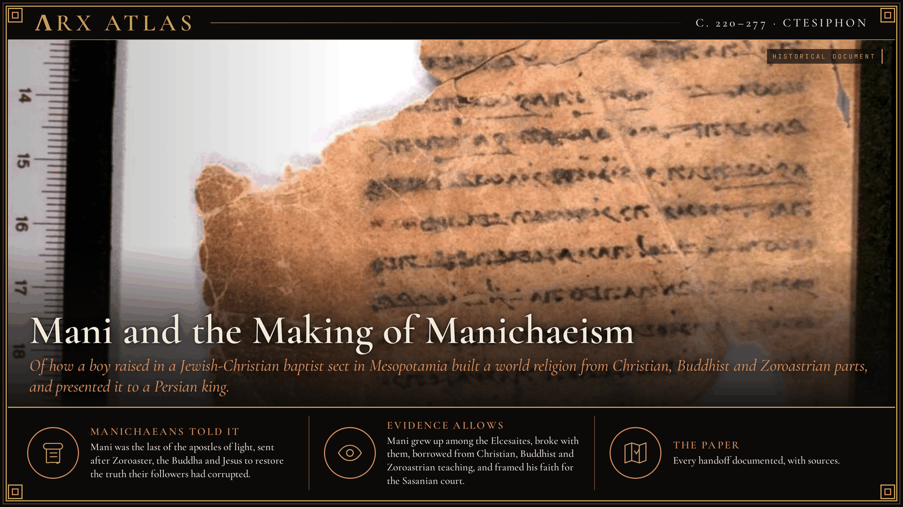
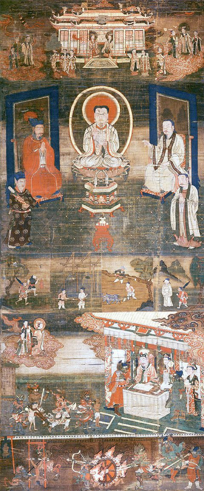
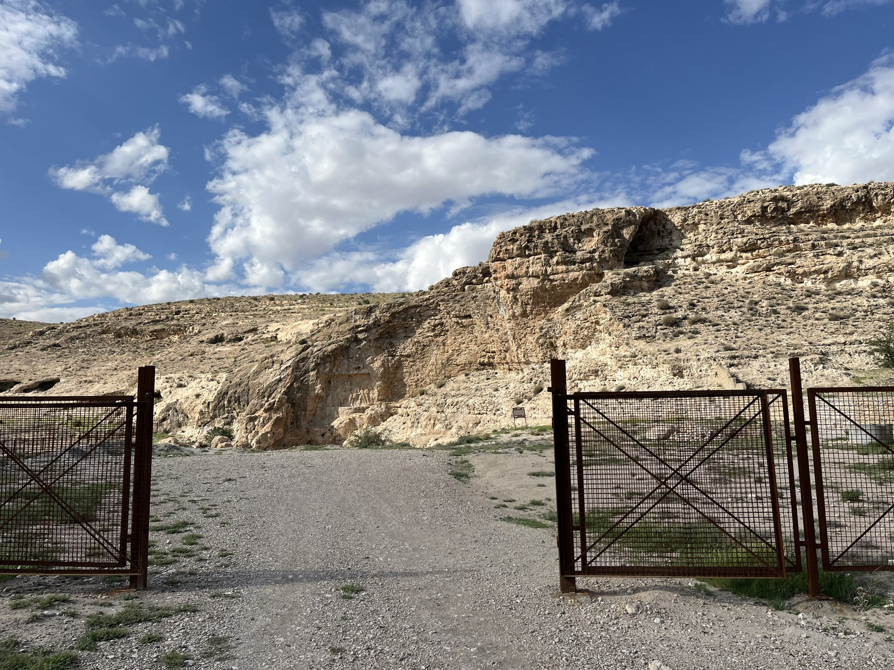
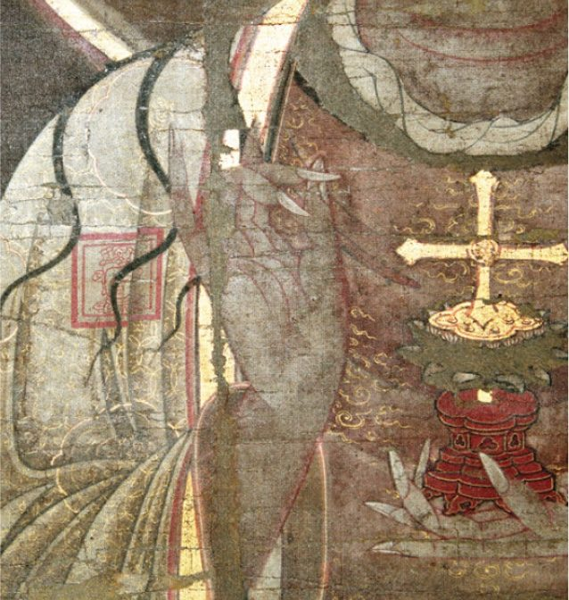
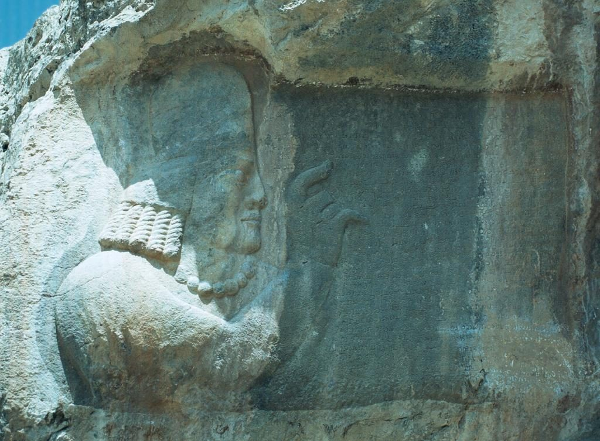
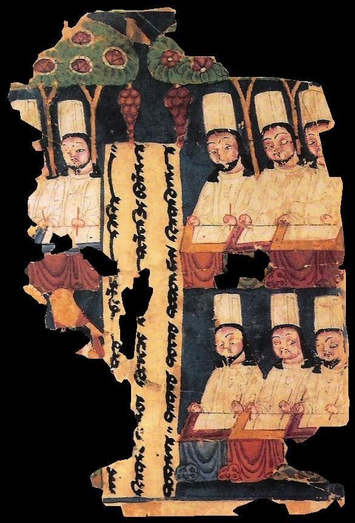

**ΛRX ATLAS** · Entry · c. 220–277 · Ctesiphon

# Mani and the Making of Manichaeism

*Of how a boy raised in a Jewish-Christian baptist sect in Mesopotamia built a world religion from Christian, Buddhist and Zoroastrian parts, and presented it to a Persian king.*

*Art: [Unknown author, "Manichaean text 1". Public domain, via Wikimedia Commons](https://commons.wikimedia.org/wiki/File:Manichaean_text_1.jpg)*

**[Explore Manichaeism in the Memeplex →](https://arxcortex.io/memeplex.html)**

A boy raised in a Jewish-Christian baptist sect in Mesopotamia built a world religion from Christian, Buddhist and Zoroastrian parts. Its prophets included Jesus, the Buddha and Zoroaster.

*13th-century Chinese Manichaean silk painting of a sermon on Mani's teaching. Image: [Unknown author, "Sermon on Mani's Teaching of Salvation. Cathayan Manichaean silk painting, 13th-century". Public domain, via Wikimedia Commons](https://commons.wikimedia.org/wiki/File:Sermon_on_Mani%27s_Teaching_of_Salvation._Cathayan_Manichaean_silk_painting,_13th-century.jpg)*

Around 242, a young preacher from Mesopotamia came before [Shapur I](https://en.wikipedia.org/wiki/Shapur_I), King of Kings of the new Sasanian empire, and handed him a book. It was written in Middle Persian, the court's language, and it was dedicated to the king. Its author, [Mani](https://en.wikipedia.org/wiki/Mani_(prophet)), wrote his other scriptures in Syriac, the language he grew up in. Shapur remained a Zoroastrian, but he favored the preacher and took him into his court. This entry follows how Mani assembled a religion from the faiths around him and carried it into the empire.

## The baptists

Mani was born in 216 near Seleucia-Ctesiphon, the Parthian capital in Mesopotamia. His father, Pattik, came from Ecbatana in Media. According to the Manichaean account, Pattik heard a voice in a temple at Ctesiphon tell him to give up meat, wine and sex, and he joined the [Elcesaites](https://en.wikipedia.org/wiki/Elcesaites), a Jewish-Christian sect. He took his son, then four years old, with him. The [Cologne Mani-Codex](https://en.wikipedia.org/wiki/Cologne_Mani_Codex), a tiny Greek parchment book found in Egypt, calls Mani's parents "followers of the prophet Alchasaios." In the sect's communities the boy lived by [repeated baptisms](https://grokipedia.com/page/Mani_(prophet)) and strict rules about food.

## The twin

The Elcesaites believed that heavenly apostles came again and again in new bodies, one of them a Christ who only seemed to suffer. Mani took that idea and applied it to himself. At twelve, and again at twenty-four, he had visions of a [heavenly twin](https://en.wikipedia.org/wiki/Mani_(prophet)), his *syzygos*, who called him to leave his father's sect and preach the true message of Jesus. He rejected the sect's ritual washings in favor of inner knowledge, and he either left or was expelled. The Christian strand in his thought may also owe something to Marcion and to Bardaisan, two Christian teachers of the century before him.

## The road east

Mani then went to India, to the [Sakas](https://en.wikipedia.org/wiki/Mani_(prophet)) in what is now Afghanistan, where he studied Hinduism and Buddhism. The later Manichaean scheme placed the Buddha among Mani's predecessors, alongside Zoroaster and Jesus, and Buddhist influences on his thought were [significant](https://en.wikipedia.org/wiki/Manichaeism). Transmigration of souls became a Manichaean belief. The community's division into monks, the Elect, and lay Hearers who supported them appears to be modeled on the Buddhist sangha. Centuries later, Chinese Manichaean texts used Pure Land terms such as "pure land" itself, Peter Bryder argued.

## The court

*Shapur I's rock relief at Darabgerd. Image: [HADI, "Relief of Shapur I in Darabgerd 01 by HADI". CC BY-SA 4.0, via Wikimedia Commons](https://commons.wikimedia.org/wiki/File:Relief_of_Shapur_I_in_Darabgerd_01_by_HADI.jpg)*

Mani returned in 242 and presented himself to Shapur with the book known as the [*Shabuhragan*](https://grokipedia.com/page/Mani_(prophet)), written for the king's elite. He knew his audience. He told the king, according to later accounts, that his religion should be seen as a [reform of Zoroaster's teachings](https://en.wikipedia.org/wiki/Manichaeism). The idea fitted Shapur's ambition to rule an empire of many peoples and creeds. Royal tolerance let Mani's missionaries spread through the Sasanian realm.

## The synthesis

*Jesus portrayed as a Buddha in a 13th-century Manichaean painting. Image: [Unknown author, "Manichaean Painting of the Buddha Jesus (Detail 1)". Public domain, via Wikimedia Commons](https://commons.wikimedia.org/wiki/File:Manichaean_Painting_of_the_Buddha_Jesus_(Detail_1).jpg)*

Mani described himself as the "[apostle of Jesus Christ](https://en.wikipedia.org/wiki/Manichaeism)," and claimed to be the Paraclete promised in the Gospel of John. He taught that the Buddha, Zoroaster and Jesus had each brought truth, and that their followers had corrupted it. His own revelation would be universal and written down. He wrote seven major works in Syriac, besides the Shabuhragan, and, according to the scholar Michel Tardieu, invented his own script for them. Behind all three teachers he set a dualist cosmology: a struggle between a good spiritual world of light and an evil material world of darkness, in which light trapped in matter is slowly released and returned to the divine.

## The fall

*Kartir's relief and inscription at Naqsh-e Rajab. Image: [Philippe Chavin (Simorg), "Naqsh-e Rajab - Kartir inscription". CC BY-SA 3.0, via Wikimedia Commons](https://commons.wikimedia.org/wiki/File:Naqsh-e_Rajab_-_Kartir_inscription.jpg)*

The patronage ended with the king. Shapur's son Hormizd I continued to protect Mani, but he also trusted the Zoroastrian priest [Kartir](https://en.wikipedia.org/wiki/Manichaeism). Hormizd's brother [Bahram I](https://en.wikipedia.org/wiki/Bahram_I) took the throne and held Kartir in high esteem. Under Kartir's influence the state backed Zoroastrian orthodoxy. Mani was imprisoned and died there. Kartir's own inscriptions record his persecution of the [*zandiks*](https://grokipedia.com/page/Mani_(prophet)), a term that covered the Manichaeans, alongside Christians, Jews and Mandaeans.

## The diaspora

The religion outlived its founder in both directions. In 302 the Roman emperor [Diocletian](https://en.wikipedia.org/wiki/Manichaeism) issued an edict against the Manichaeans, and Augustine of Hippo spent nine or ten years as a Manichaean Hearer before his conversion to Christianity in 387. In the East, trade and missions brought it to Tang China in the seventh century. It became the official religion of the Uyghur Khaganate until 840, and in China it was finally absorbed into Buddhism and Taoism by the end of the fourteenth century.

## Weighing the evidence

*leaf from a Manichaean book, Khocho, 8th/9th century. Image: [Unknown author, "Manicheans". Public domain, via Wikimedia Commons](https://commons.wikimedia.org/wiki/File:Manicheans.jpg)*

Most of Mani's story comes from his followers or his enemies. The Cologne codex, acquired by the University of Cologne in 1969, is now considered the most reliable source on his life, but it is hagiography, and scholars date it variously to the fourth or fifth century. Accounts by Muslim writers such as al-Biruni and Ibn al-Nadim come from the tenth and eleventh centuries. Even Mani's death is uncertain: sources give 274 or 276–77. The Christian influences of Marcion and Bardaisan are probable, and less certain than the Elcesaite upbringing. Buddhist influence shows clearly in Manichaean structure and later terms, but what Mani himself learned in India rests on the bare report of the journey, and al-Biruni's dating of it may conflate two trips.

## The long view

Mani built for empires. He grew up in a closed sect, and he designed his faith to cross borders, written in the court language for one king and in Syriac for everyone else. His prophets were chosen so that Christians, Zoroastrians and Buddhists could each find a familiar teacher in them. The strategy depended on patronage. When a new king turned to Kartir's priesthood, the religion lost its home. It survived as a persecuted minority in Rome and Persia, and as a state religion only on the Uyghur steppe.

**[Explore Manichaeism in the Memeplex →](https://arxcortex.io/memeplex.html)**

---

## Sources

**Primary witnesses**
- Cologne Mani-Codex (*Codex Manichaicus Coloniensis*). Greek parchment codex, Egypt, 4th–5th century. University of Cologne.
- Mani. *Shabuhragan*. Middle Persian fragments from Turfan.
- Kartir. Middle Persian inscriptions, Fars, late 3rd century.
- Ibn al-Nadim. *al-Fihrist*. 10th century.

**Modern scholarship**
- "Bahram I." *Wikipedia*. Accessed October 29, 2026. https://en.wikipedia.org/wiki/Bahram_I.
- "Cologne Mani Codex." *Wikipedia*. Accessed October 29, 2026. https://en.wikipedia.org/wiki/Cologne_Mani_Codex.
- "Elcesaites." *Wikipedia*. Accessed October 29, 2026. https://en.wikipedia.org/wiki/Elcesaites.
- "Mani (prophet)." *Grokipedia*. Accessed October 29, 2026. https://grokipedia.com/page/Mani_(prophet).
- "Mani (prophet)." *Wikipedia*. Accessed October 29, 2026. https://en.wikipedia.org/wiki/Mani_(prophet).
- "Manichaeism." *Wikipedia*. Accessed October 29, 2026. https://en.wikipedia.org/wiki/Manichaeism.
- "Shapur I." *Wikipedia*. Accessed October 29, 2026. https://en.wikipedia.org/wiki/Shapur_I.

*Entered in the ΛRX Atlas · arxcortex.io*
