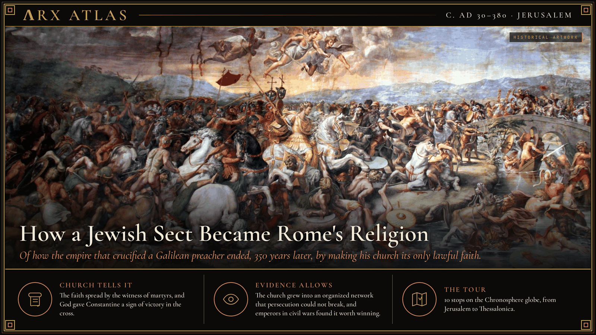
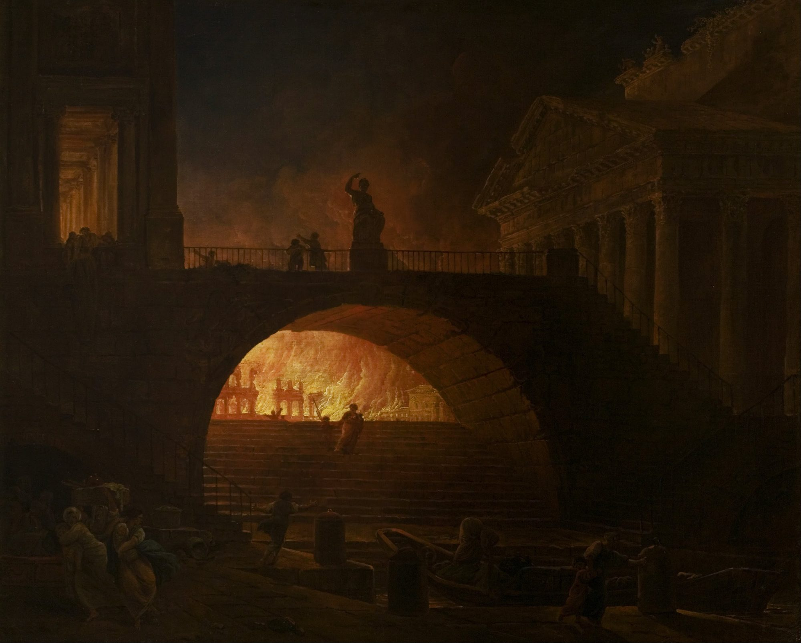
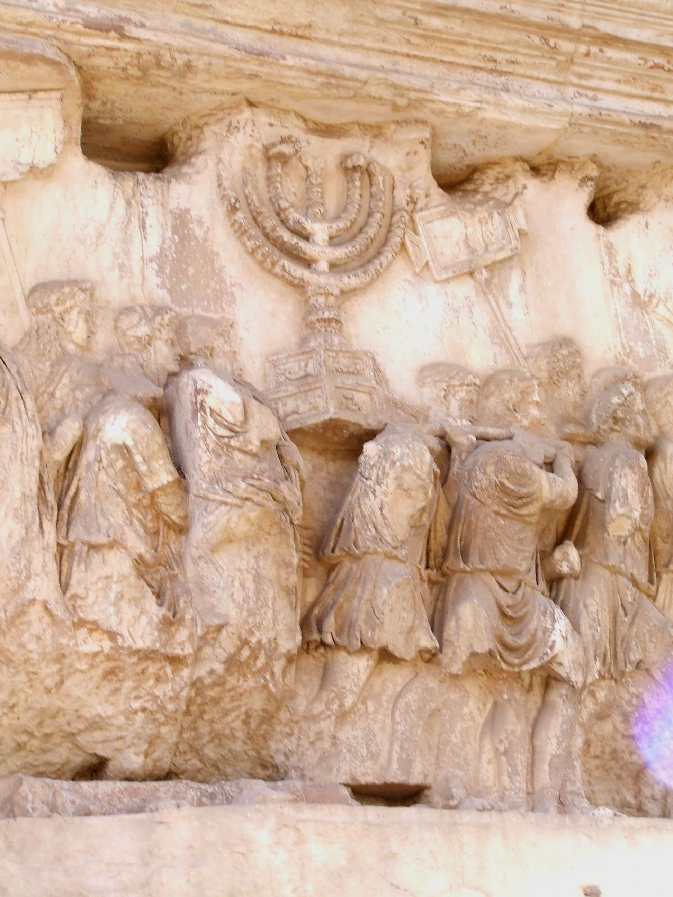
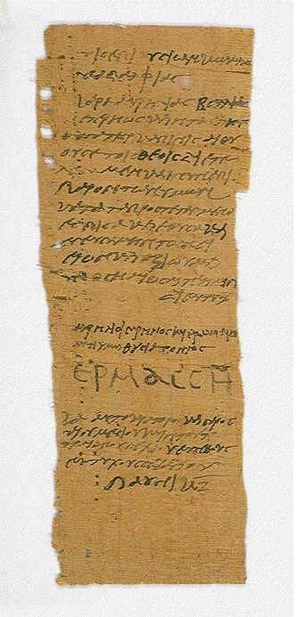
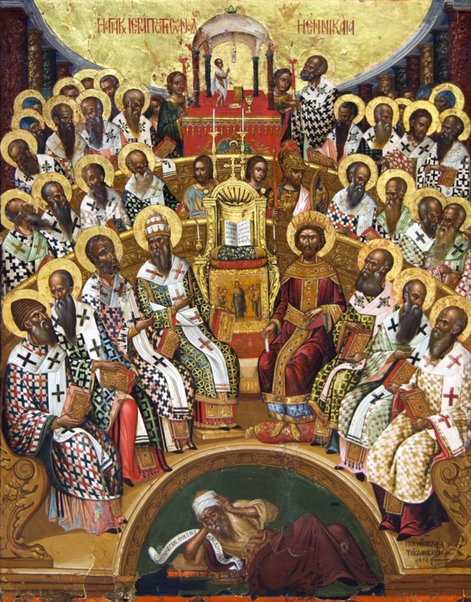
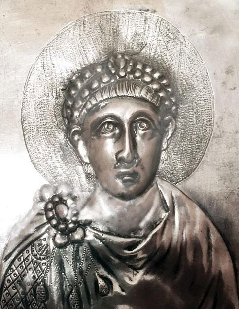

**ΛRX ATLAS** · Entry · c. AD 30–380 · Jerusalem

# How a Jewish Sect Became Rome's Religion

*Of how the empire that crucified a Galilean preacher ended, 350 years later, by making his church its only lawful faith.*

*Art: [Giulio Romano, “Battle of the Milvian Bridge by Giulio Romano, 1520-24”, Public domain, via Wikimedia Commons](https://commons.wikimedia.org/wiki/File:Battle_of_the_Milvian_Bridge_by_Giulio_Romano,_1520-24.jpg)*

**[Take the tour →](https://arxcortex.io/chronosphere.html#play/tour/rise-of-christianity)**

This tour asks one question. How did a movement whose founder Rome executed become, within three and a half centuries, the only faith Roman law allowed? The church's own answer is the blood of martyrs and the hand of God. The surviving evidence adds something the faithful seldom stressed: an organization that outlasted its persecutors, and emperors who needed it.

## A death in Judaea

Around AD 30 or 33, in Roman Judaea, the prefect [Pontius Pilate](https://en.wikipedia.org/wiki/Pontius_Pilate) sentenced a Galilean preacher, [Jesus of Nazareth](https://en.wikipedia.org/wiki/Jesus), to be scourged and crucified. To Rome it was a routine act of provincial order. His followers, however, proclaimed that he had risen, and they kept meeting in Jerusalem under [James](https://en.wikipedia.org/wiki/James,_brother_of_Jesus), the brother of Jesus.

## The door opened to Gentiles

The first crisis was not Roman. It was about who could belong. Gentiles were joining a movement whose founders were observant Jews. Did they need to be circumcised and keep the law of Moses? According to the [Acts of the Apostles](https://en.wikipedia.org/wiki/Acts_of_the_Apostles), a [council in Jerusalem](https://en.wikipedia.org/wiki/Council_of_Jerusalem), usually dated around AD 48–50, said no. Scholars still argue over whether Paul's letter to the Galatians describes the same meeting. The decision itself is not in doubt, and its effect was huge. Freed from the law, [Paul](https://en.wikipedia.org/wiki/Paul_the_Apostle) and other missionaries could plant churches in Greek cities from Asia Minor to Rome.

## Blamed for the fire

Their success made them visible. In AD 64 a fire burned much of Rome. According to the historian [Tacitus](https://en.wikipedia.org/wiki/Tacitus), Emperor [Nero](https://en.wikipedia.org/wiki/Nero) blamed the city's Christians and began the empire's first persecution of them. His account shows that by 64 Romans could already tell Christians apart from Jews, and that made them a target.

*An 18th-century imagining. [Hubert Robert, “Hubert Robert - The Fire of Rome - Google Art Project”, Public domain, via Wikimedia Commons](https://commons.wikimedia.org/wiki/File:Hubert_Robert_-_The_Fire_of_Rome_-_Google_Art_Project.jpg)*

## The temple falls

Six years later the line between the two communities hardened further. In AD 70 [Titus](https://en.wikipedia.org/wiki/Titus), son of Emperor [Vespasian](https://en.wikipedia.org/wiki/Vespasian), led at least 48,200 soldiers against rebel Jerusalem. They breached its walls, destroyed the [Second Temple](https://en.wikipedia.org/wiki/Second_Temple) and razed the city. With the Temple gone, both Judaism and the young church had to reorganize without it. The church's weight shifted to the Gentile cities where Paul had preached.

*The Arch of Titus relief of the Temple spoils. [Laurel Lodged, “Carrying off the Menorah from the Temple in Jerusalem depicted on a frieze on the Arch of Titus in the Forum Romanum”, Public domain, via Wikimedia Commons](https://commons.wikimedia.org/wiki/File:Carrying_off_the_Menorah_from_the_Temple_in_Jerusalem_depicted_on_a_frieze_on_the_Arch_of_Titus_in_the_Forum_Romanum.JPG)*

## The certificate test

For almost two centuries persecution was local and sporadic. Then in 250 Emperor [Decius](https://en.wikipedia.org/wiki/Decius), seeking to restore traditional Roman piety, ordered every inhabitant of the empire to sacrifice to the gods before a magistrate and obtain a signed certificate, a *[libellus](https://en.wikipedia.org/wiki/Libellus)*, as proof. Many such certificates survive from Egypt. Christians who refused risked death. Pope [Fabian](https://en.wikipedia.org/wiki/Pope_Fabian) was among the notable Christians killed.

*A surviving Egyptian sacrifice certificate of AD 250. [Unknown - Egyptian papyrus from 250 AD, “Libellus”, Public domain, via Wikimedia Commons](https://commons.wikimedia.org/wiki/File:Libellus.jpg)*

The test was meant to show who was loyal. It also showed something else: the church now ran as a network of bishops who could keep their communities together, and later re-admit those who had lapsed.

## The Great Persecution

By the late third century Christians no longer hid. Large churches stood in major cities. At [Nicomedia](https://en.wikipedia.org/wiki/Nicomedia), Diocletian's capital, the church sat on a hill overlooking the imperial palace. In the winter of 302 the junior emperor [Galerius](https://en.wikipedia.org/wiki/Galerius) urged [Diocletian](https://en.wikipedia.org/wiki/Diocletian) to strike. Diocletian hesitated and consulted the oracle of Apollo at Didyma. Its reply was read as approval, and on 23 February 303 the [Great Persecution](https://en.wikipedia.org/wiki/Diocletianic_Persecution) began. Edicts stripped Christians of their legal rights.

It was the most severe persecution Rome ever mounted, and it failed. Most Christians avoided punishment, and enforcement was weakest in the west. In 311 Galerius himself annulled the laws. The empire had tested the church at full strength and found it could not destroy it. The emperors who came next had to choose between continuing the war and making use of the church.

## A sign before battle

One of them made his choice on 28 October 312. [Constantine](https://en.wikipedia.org/wiki/Constantine_the_Great) faced his rival [Maxentius](https://en.wikipedia.org/wiki/Maxentius) at the [Milvian Bridge](https://en.wikipedia.org/wiki/Battle_of_the_Milvian_Bridge) over the Tiber. Maxentius drowned in the river, and Constantine took Rome. The Christian writers [Lactantius](https://en.wikipedia.org/wiki/Lactantius) and [Eusebius](https://en.wikipedia.org/wiki/Eusebius) say Constantine and his soldiers received a vision from the Christian God, a promise of victory if the [Chi-Rho](https://en.wikipedia.org/wiki/Chi_Rho) was painted on their shields.

## Toleration

What he did next is better attested. In February 313 Constantine met his fellow emperor [Licinius](https://en.wikipedia.org/wiki/Licinius) at Milan. They agreed to treat Christians benevolently and allow religious freedom more broadly. The so-called [Edict of Milan](https://en.wikipedia.org/wiki/Edict_of_Milan) survives as a letter from Licinius to his eastern governors, not as an edict, but its policy was real. The church was now lawful, and it was worth an emperor's patronage.

## The emperor's council

Patronage brought obligations. Since about 318–322 an Alexandrian priest, [Arius](https://en.wikipedia.org/wiki/Arius), had divided the churches over how the Son related to the Father. Constantine wanted one church, so in 325 he called the bishops to [Nicaea](https://en.wikipedia.org/wiki/First_Council_of_Nicaea) and attended himself. The council wrote the first part of the [Nicene Creed](https://en.wikipedia.org/wiki/Nicene_Creed), fixed a common date for Easter and issued early canon law. The dispute did not end there. For more than fifty years emperors, bishops and councils swung between the parties.

*A 1591 Cretan icon. [Michael Damaskinos, “First Council of Nicaea Michael Damaskinos”, Public domain, via Wikimedia Commons](https://commons.wikimedia.org/wiki/File:First_Council_of_Nicaea_Michael_Damaskinos.png)*

## Thessalonica

It ended by law. On 27 February 380 Emperor [Theodosius I](https://en.wikipedia.org/wiki/Theodosius_I) issued the [Edict of Thessalonica](https://en.wikipedia.org/wiki/Edict_of_Thessalonica). It made Nicene Christianity the state church of the empire and called other creeds, such as Arianism, the heresies of "foolish madmen."

## Weighing the evidence

Most of what we know comes from the winners. Acts is the church's own history. Tacitus, the main pagan witness to Nero's purge, was a child in 64, though he used public records. Constantine's vision reaches us through Lactantius and Eusebius, both close to the emperor; what he saw, if anything, the evidence cannot settle. The firmest evidence is the dullest: Decius's surviving certificates, the dated edicts and the council's canons. They show an empire legislating about a church it could neither ignore nor destroy.

## The long view

So how did the sect become the state's religion? It survived because it was organized: bishops, councils and networks that persecution could punish but not dissolve. It won because emperors fighting civil wars found in that organization a source of unity worth claiming. The cost of victory was that emperors now decided what orthodoxy meant. The church that began under a Roman sentence ended by asking Roman law to enforce its creed.

*Theodosius I on a silver dish of 388. [Unknown Roman artist, “Missorium of Theodosius I (detail)”, Public domain, via Wikimedia Commons](https://commons.wikimedia.org/wiki/File:Missorium_of_Theodosius_I_(detail).png)*

**[Take the tour →](https://arxcortex.io/chronosphere.html#play/tour/rise-of-christianity)**

---

## Sources

**Ancient witnesses**
- The Gospels and the Acts of the Apostles.
- Tacitus, Annals, Book 15.
- Libelli (sacrifice certificates), Egypt, AD 250.
- Lactantius, On the Deaths of the Persecutors.
- Eusebius of Caesarea, Life of Constantine.

**Modern scholarship**
- "Battle of the Milvian Bridge." *Wikipedia*. Accessed October 28, 2026. https://en.wikipedia.org/wiki/Battle_of_the_Milvian_Bridge.
- "Council of Jerusalem." *Wikipedia*. Accessed October 28, 2026. https://en.wikipedia.org/wiki/Council_of_Jerusalem.
- "Crucifixion of Jesus." *Wikipedia*. Accessed October 28, 2026. https://en.wikipedia.org/wiki/Crucifixion_of_Jesus.
- "Decian persecution." *Wikipedia*. Accessed October 28, 2026. https://en.wikipedia.org/wiki/Decian_persecution.
- "Diocletianic Persecution." *Wikipedia*. Accessed October 28, 2026. https://en.wikipedia.org/wiki/Diocletianic_Persecution.
- "Edict of Milan." *Wikipedia*. Accessed October 28, 2026. https://en.wikipedia.org/wiki/Edict_of_Milan.
- "Edict of Thessalonica." *Wikipedia*. Accessed October 28, 2026. https://en.wikipedia.org/wiki/Edict_of_Thessalonica.
- "First Council of Nicaea." *Wikipedia*. Accessed October 28, 2026. https://en.wikipedia.org/wiki/First_Council_of_Nicaea.
- "Great Fire of Rome." *Wikipedia*. Accessed October 28, 2026. https://en.wikipedia.org/wiki/Great_Fire_of_Rome.
- "Siege of Jerusalem (70 CE)." *Wikipedia*. Accessed October 28, 2026. https://en.wikipedia.org/wiki/Siege_of_Jerusalem_(70_CE).

*Entered in the ΛRX Atlas · arxcortex.io*
