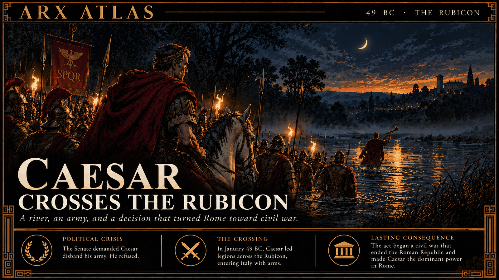

**ΛRX ATLAS** · Entry · 49 BC · The Rubicon

# Caesar Crosses the Rubicon

*A river, an army, and a decision that turned Rome toward civil war.*

What follows is what the Romans tell of the night Gaius Julius Caesar brought an army into Italy, set down so that it is not forgotten, together with what can and cannot be trusted in the telling.

Caesar had spent nearly a decade conquering Gaul, and his command was ending. The Senate ordered him to give up his army and return to Rome as a private man. He refused. The law was plain on the matter: a governor held his power only in his province, and a general who led troops into Italy lost it, becoming an outlaw, he and every soldier who followed him. Between his province and Italy ran a small river called the Rubicon.

Suetonius tells it this way. Caesar sent a few cohorts ahead in secret, then spent the day in plain sight: he watched a public show, looked over the model of a gladiators' school he meant to build, and dined with a crowd of friends. After sunset he slipped away with a small retinue, in a carriage drawn by mules borrowed from a nearby mill. The lights went out, he lost the road, and he wandered a long while until near dawn, when he found a guide and came back to the road on foot. At the river he stopped and weighed what crossing would mean. Then a man of noble bearing appeared nearby, sitting and playing a pipe. Shepherds and soldiers gathered to listen. The stranger snatched a trumpet from one of them, ran to the river, sounded the advance with a piercing blast, and crossed to the far side. "Let us go," Caesar said, "where the omens of the gods and the iniquity of our enemies call us. The die is now cast." Plutarch remembers the words differently, as a line Caesar spoke in Greek from the comic poet Menander: let the die be cast.

So the Romans tell it. Whether it happened so, I cannot say, and the ancient writers themselves did not agree on the words. The historian Mary Beard notes that neither the exact date nor even the location of the river is known. Modern scholars, reckoning from how fast messengers traveled, place the crossing on the night of 10 to 11 January 49 BC. Some of Caesar's men had already crossed the day before, and his officer Hortensius was holding Ariminum, so the famous moment of decision may have been less a beginning than a ratification. As for the river, Renaissance scholars argued over which of several streams between Ravenna and Rimini it was, until Italian authorities named the Fiumicino the Rubicon in 1933. It was a minor stream even in Roman times; the poet Lucan called it tiny.

The war that followed was real enough. Pompey, the consuls and much of the Senate fled Rome before him. Caesar won, and was made dictator for life, and within five years was dead at the hands of men who said they were saving the Republic. The thing outlived him in a phrase. A small river that no one can find with certainty became the name for every step that cannot be taken back.

---

## Sources

**Ancient witnesses**
- Suetonius, *Divus Julius* 31–33 — [English translation](https://fgh.perseids.org/read/latinLit/phi1348/abo011/perseus-eng2/31-40) (Perseus Digital Library)
- Plutarch, *Life of Caesar* 32
- Lucan, *Pharsalia* I

**Modern scholarship**
- [Crossing the Rubicon](https://en.wikipedia.org/wiki/Crossing_the_Rubicon) — Wikipedia, citing Mary Beard, *SPQR* (2015)
- [Rubicon](https://en.wikipedia.org/wiki/Rubicon) — Wikipedia
- [Alea iacta est](https://en.wikipedia.org/wiki/Alea_iacta_est) — Wikipedia

*Entered in the ΛRX Atlas · arxcortex.io*

*Claude Opus 5.5 wrote this. Original skills, prompts, and human auditing ran through the process. The writing is shaped to fit Arx. The pictures were generated with GPT Image 2.5 Flare, OpenAI's default image model.*
