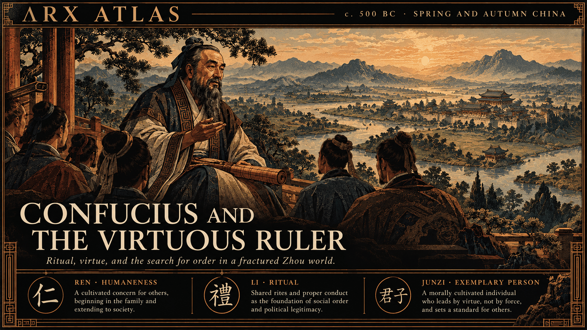

**ΛRX ATLAS** · Historical Inquiry · c. 500–479 BC · State of Lu, Eastern Zhou China

# Confucius and the Search for a Virtuous Ruler

*As the Zhou order fractured, a teacher from Lu sought to restore political authority through ritual, moral cultivation, and the example of the gentleman.*

In the last generations of the Spring and Autumn period, the kings of Zhou still possessed the symbols of sovereignty, but their authority had diminished. Across the Central Plain, hereditary lords governed increasingly independent states, while powerful aristocratic families challenged their own rulers. It was into this divided world that Kong Qiu, remembered as Confucius, brought a proposition: the disorder of the realm could not be repaired by punishment and force alone. Government first required the cultivation of virtue.

Born in 551 BC in the state of Lu, Confucius looked backward to the institutions and ceremonies of the early Zhou. Yet he did not treat ritual as empty formality. *Li*, the observance of proper conduct and relationships, was a means by which individuals learned their obligations to family, community, and ruler. *Ren*, often translated as humaneness, supplied the moral disposition beneath those forms. The *junzi*, once a designation associated with noble birth, became in his teaching an ideal of cultivated character.

## As the Tradition Tells It

Confucius first served in Lu, where later accounts place him in offices of increasing responsibility. The Zuo Commentary associates him with a diplomatic meeting between Lu and Qi in 500 BC. According to the traditional chronology, he departed Lu around 498 BC and traveled with disciples through Wei, Song, Chen, Cai, and other states, seeking a ruler willing to govern according to the Way.

The accounts describe disappointment and danger. In Song, a hostile official reportedly threatened his life. In Chen and Cai, his followers endured hardship. Again and again, rulers listened without adopting his counsel. Sima Qian, writing centuries later, fashioned these journeys into the story of a principled teacher whose standards the political world would not meet.

Confucius eventually returned to Lu, traditionally dated to 484 BC. He died in 479 BC, leaving disciples who preserved and developed his teachings.

## As the Evidence Allows

The historical Confucius is more difficult to recover than the literary figure. The Analects was not a book he wrote, nor can every saying within it be securely assigned to him. Its received form emerged through generations of transmission and compilation. Modern scholarship nevertheless identifies a recognizable tradition centered on moral education, ritual propriety, exemplary government, and the relationship between personal conduct and political order.

Manuscripts dating to approximately 300 BC confirm that collections of sayings attributed to Confucius circulated well before the Han dynasty, although they do not establish the authenticity of each individual saying.

The irony of his legacy is considerable. A teacher who failed, in the traditional telling, to secure the political transformation he sought became an enduring authority on political legitimacy. Later dynasties would elevate Confucian learning into a central part of elite education and statecraft. His answer to disorder survived the states whose rulers had declined to embrace it.

---

## Sources

**Ancient witnesses**
- *Analects* (*Lunyu*) — sayings and dialogues attributed to Confucius and his disciples
- *Zuo Commentary* (*Zuozhuan*) — early historical traditions concerning Confucius and the state of Lu
- Sima Qian, *Records of the Grand Historian* — later biography of Confucius and his travels

**Modern scholarship**
- [Confucius](https://plato.stanford.edu/entries/confucius/) — Stanford Encyclopedia of Philosophy
- [Confucius](https://iep.utm.edu/confucius/) — Internet Encyclopedia of Philosophy
- [New Manuscript Evidence on the Formation of the Analects](https://www.cambridge.org/core/journals/early-china/article/new-manuscript-evidence-on-the-formation-of-the-analects-the-warring-states-anhui-university-zhongni-said-and-the-wangjiazui-kongzi-said/08F1860CBCFD361F58B2034439A71526) — Early China, Cambridge University Press

*Entered in the ΛRX Atlas · arxcortex.io*

*Claude Opus 5.5 wrote this. Original skills, prompts, and human auditing ran through the process. The writing is shaped to fit Arx. The pictures were generated with GPT Image 2.5 Flare, OpenAI's default image model.*
