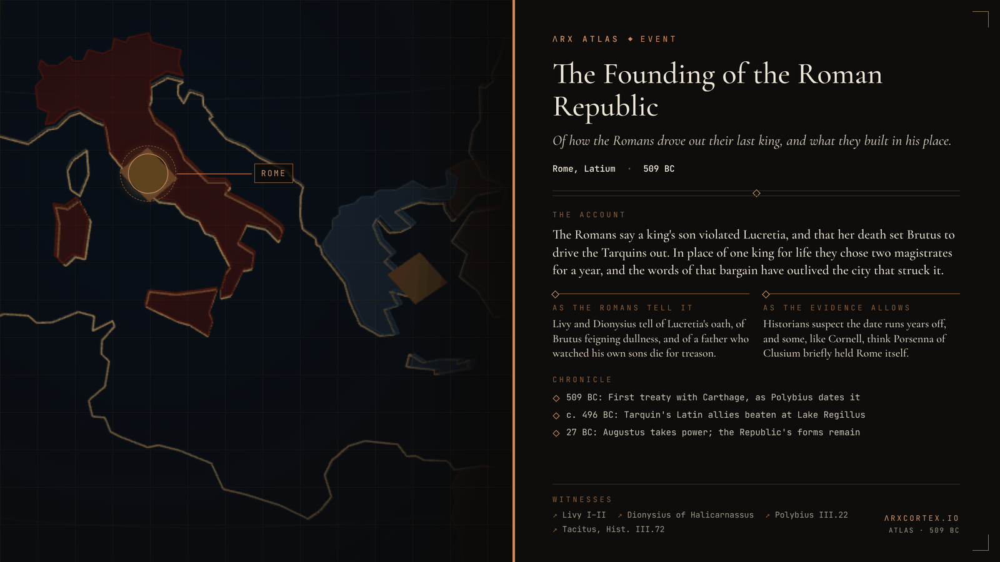

**ΛRX ATLAS** · Entry · 509 BC · Rome

# The Founding of the Roman Republic

*Of how the Romans drove out their last king, and what they built in his place.*

What follows is what the Romans say of how they came to be ruled by no king, set down so that the memory of it does not fade, together with what can and cannot be trusted in their telling.

The last king of Rome was Lucius Tarquinius, whom the Romans called Superbus, the Proud. He took the throne by murdering the old king, the story goes, and held it by fear. He was away besieging the town of Ardea when his kingdom slipped from him. His son Sextus had violated Lucretia, the wife of his kinsman Collatinus. She summoned her father and her husband, told them what had been done, made them swear vengeance, and drove a knife into her own heart.

Standing by was Lucius Junius Brutus, the king's own nephew, who had spent years playing the fool so that the king would think him harmless; his name means "dullard." Livy says he drew the knife from Lucretia's body and swore on it that no king would rule Rome again. The city rose, the gates were shut against Tarquin, and the army at Ardea went over to the rebels.

In the king's place the Romans set two magistrates, chosen for one year at a time, so that no man would hold power long enough to become what Tarquin had been. Brutus and Collatinus were the first, the Romans say. The oath bit hard. Brutus's own sons were caught plotting to bring the Tarquins back, and their father sat in judgment and watched them die. Collatinus, who bore the hated family name, was pressed to leave the city. Tarquin went among the Etruscans for help, and Lars Porsenna of Clusium marched on Rome, where Horatius held the bridge over the Tiber until it was cut down behind him.

So the Romans tell it. Whether it happened so, I cannot say for certain, and neither can anyone else. These are the most thinly recorded years of Roman history, written down centuries later by men with their own reasons to admire them. The year 509 BC comes from a reckoning fixed in the late Republic, and it may run several years off. Tacitus lets slip that the city once surrendered to Porsenna, and historians such as Tim Cornell and Gary Forsythe take seriously the idea that an Etruscan king, more than a wronged wife, brought Roman monarchy to its end. Others think kingship never fell in a single night but wasted away over decades, leaving behind only a priest who still carried the title of king. Even the first year's consuls are disputed: Polybius, who read a treaty with Carthage dated to that year, pairs Brutus with a different colleague than Livy does.

Yet the thing itself was real, and it lasted. For nearly five centuries the Romans elected their chief magistrates in pairs and for a single year, and they kept the forms even after Augustus had hollowed them out. Senate, consul, republic: the words passed down to Venice and Florence, to the Dutch, and to the Americans of 1787, whose Federalist essays went out under the name Publius, after one of the first consuls. A woman's death, a foreign king's siege, or a slow decay, whichever it was, left behind the idea that power should be lent for a season and then given back.

---

## Sources

**Ancient witnesses**
- Livy, *Ab Urbe Condita* I.57–II.15 — [English translation of 1.59](https://fgh.perseids.org/read/latinLit/phi0914/phi001/perseus-eng3/1.59.1-1.59.13) (Perseus Digital Library)
- Dionysius of Halicarnassus, *Roman Antiquities* IV–V
- Polybius, *Histories* III.22
- Tacitus, *Histories* III.72

**Modern scholarship**
- [Overthrow of the Roman monarchy](https://en.wikipedia.org/wiki/Overthrow_of_the_Roman_monarchy) — Wikipedia, summarizing Cornell, *The Beginnings of Rome* (1995), and Forsythe, *A Critical History of Early Rome* (2005)
- [Roman Republic](https://www.britannica.com/place/Roman-Republic) — Encyclopaedia Britannica
- [Consuls of the Roman Republic](https://penelope.uchicago.edu/encyclopaedia_romana/calendar/consuls.html) — Encyclopaedia Romana, University of Chicago

*Entered in the ΛRX Atlas · arxcortex.io*

*Claude Opus 5.5 wrote this. Original skills, prompts, and human auditing ran through the process. The writing is shaped to fit Arx. The pictures were generated with GPT Image 2.5 Flare, OpenAI's default image model.*
