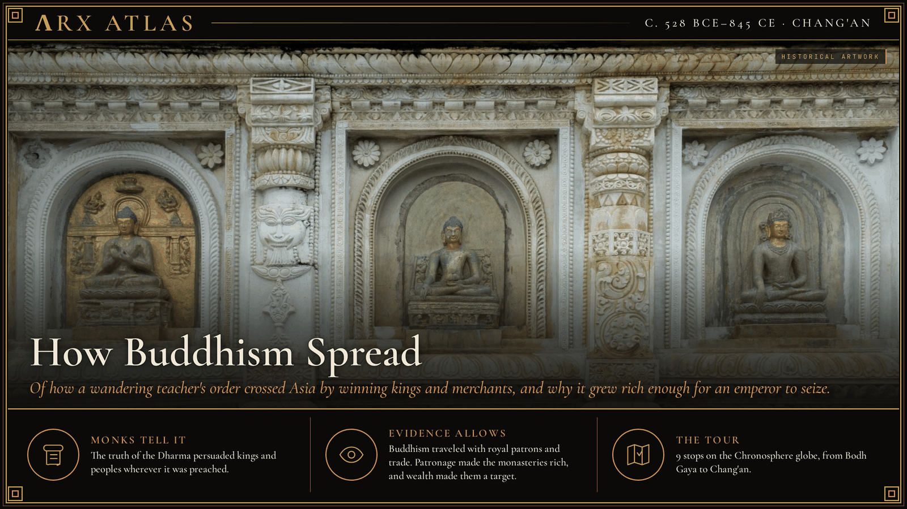
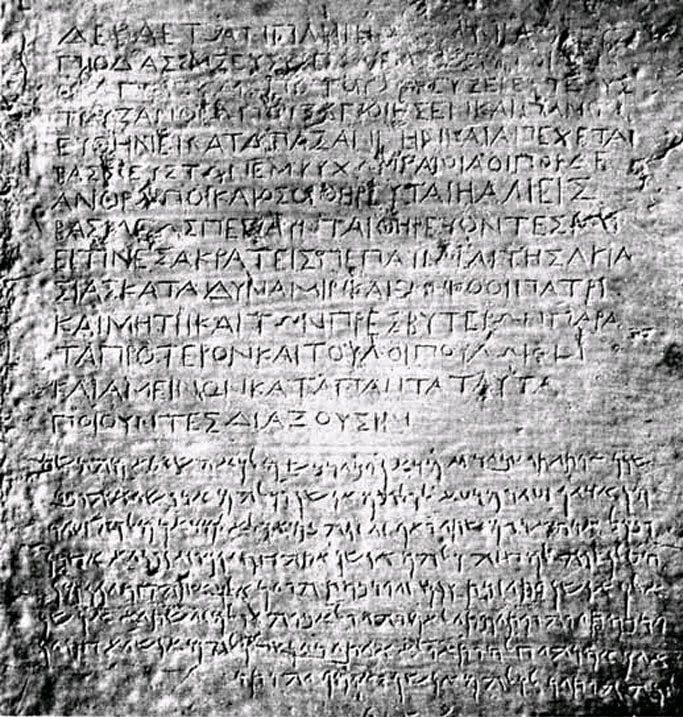
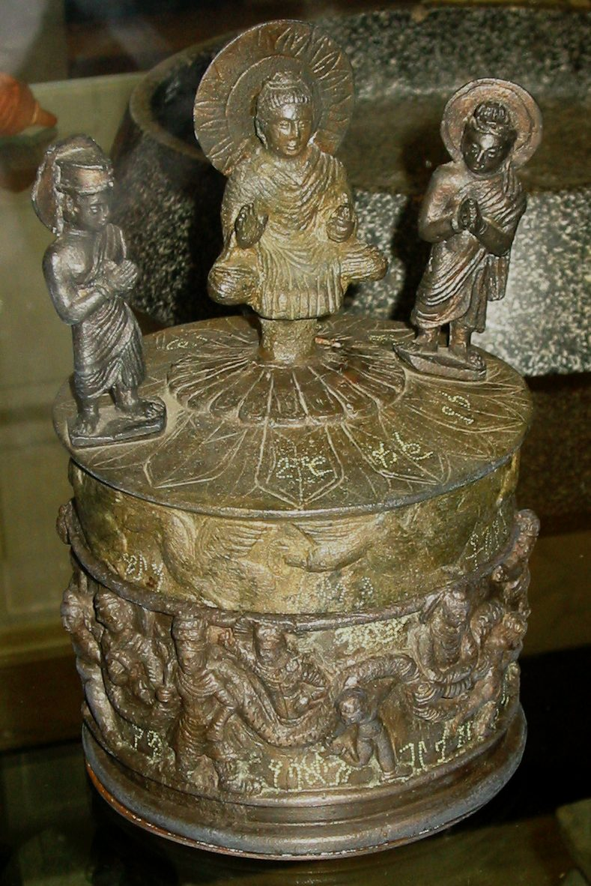
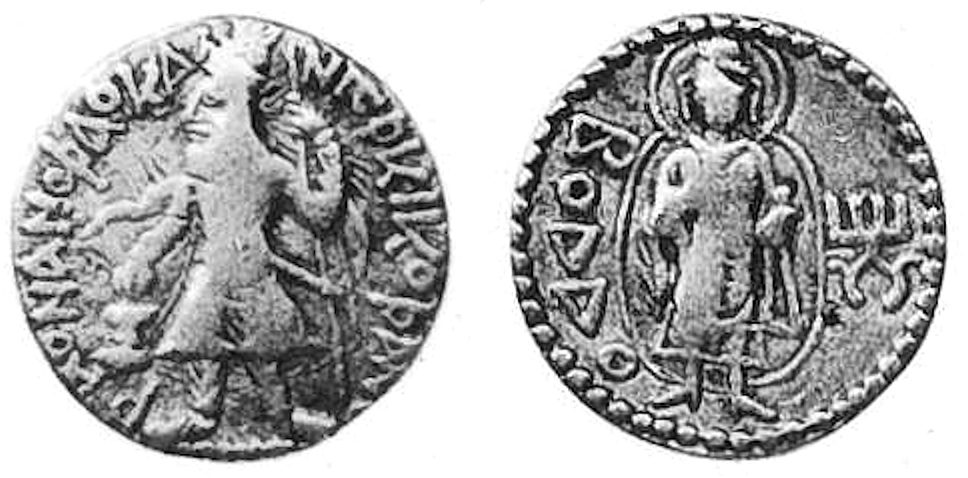
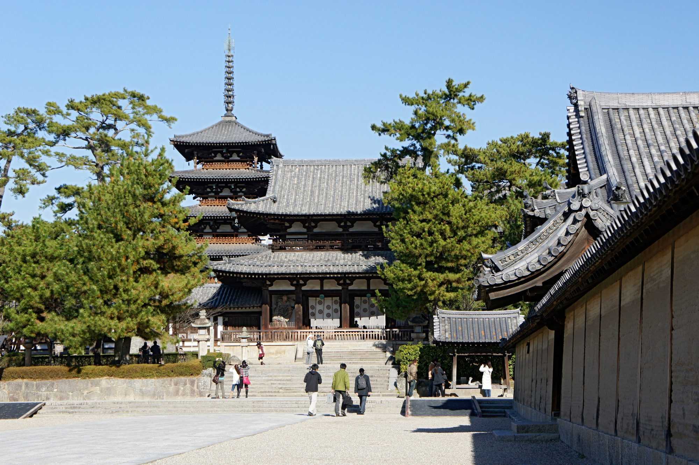
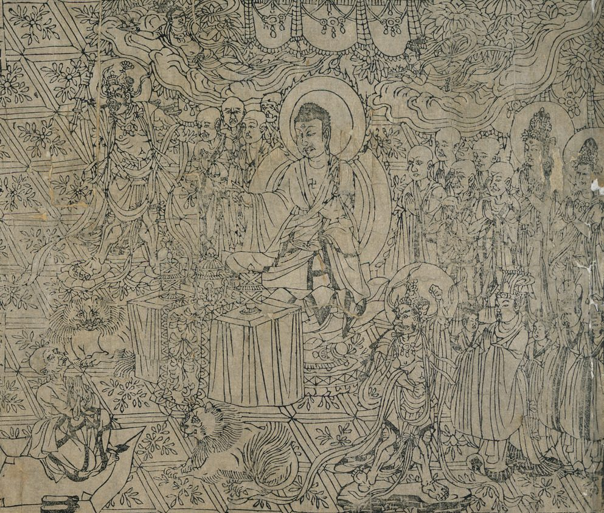

**ΛRX ATLAS** · Entry · c. 528 BCE–845 CE · Chang'an

# How Buddhism Spread

*Of how a wandering teacher's order crossed Asia by winning kings and merchants, and why it grew rich enough for an emperor to seize.*

*Art: [Sumitsurai, “Mahabodhi Temple South Wall (2)”, CC BY-SA 4.0, via Wikimedia Commons](https://commons.wikimedia.org/wiki/File:Mahabodhi_Temple_South_Wall_(2).jpg)*

**[Take the tour →](https://arxcortex.io/chronosphere.html#play/tour/buddhism-spreads)**

In 845 the Tang emperor [Wuzong](https://en.wikipedia.org/wiki/Emperor_Wuzong_of_Tang) issued an edict against the Buddhist church. His armies had beaten the Uyghurs at the cost of nearly bankrupting the state, and the monasteries were rich and exempt from tax. The edict boasted that more than 4,600 monasteries were destroyed and 260,500 monks and nuns returned "to the world" as "taxpaying householders." A religion born among wandering beggars had become one of China's great landowners. This tour asks how it got there, and why its wealth made it a target.

## The awakening

The story begins under a fig tree at [Bodh Gaya](https://en.wikipedia.org/wiki/Mahabodhi_Temple). There, tradition says, Siddhartha Gautama attained awakening, then wandered the Ganges plain teaching and building a monastic order. The tour's date of 528 BCE follows the older chronology, which put his life at 563–483 BCE. It is a convention, not a fact.

## The council of monks

Tradition says he died at [Kushinagar](https://en.wikipedia.org/wiki/Kushinagar) at about eighty, naming no successor. The order kept the teaching together by holding councils, though scholars doubt how much of their recorded history is true. Its fortunes depended on the kings and merchants who gave it land and alms.

## The repentant king

The greatest patron came from war. In about 261 BCE the Mauryan emperor [Ashoka](https://en.wikipedia.org/wiki/Ashoka) conquered Kalinga. His own edict counts 150,000 deported and 100,000 killed, and says he "feels deep remorse." He turned to promoting the Dharma. Theravada sources say he convened a Third Council at his capital, Pataliputra, which sent missionaries abroad. An empire's reach became the religion's reach.

*Ashoka's bilingual Greek-Aramaic rock edict at Kandahar, showing how far his edicts reached (the Kalinga confession itself is Rock Edict XIII). [पाटलिपुत्र (Patna), “AsokaKandahar”, Public domain, via Wikimedia Commons](https://commons.wikimedia.org/wiki/File:AsokaKandahar.jpg)*

## The Kushan emperor

Four centuries later, Buddhism had a patron astride the [Silk Road](https://en.wikipedia.org/wiki/Silk_Road). [Kanishka](https://en.wikipedia.org/wiki/Kanishka), who probably took the Kushan throne about 127 CE, ruled from Peshawar to the Ganges. His patronage helped carry Mahayana Buddhism from Gandhara across the Karakoram to China.

*The relic casket found at the site of Kanishka's stupa near Peshawar. [Personal photograph, “KanishkaCasket”, CC BY-SA 3.0, via Wikimedia Commons](https://commons.wikimedia.org/wiki/File:KanishkaCasket.JPG)*

*A coin of Kanishka bearing the Buddha. [Author: Alexander Cunnigham in 1879, “Ahin Posh, coin of Kanishka with the Buddha”, Public domain, via Wikimedia Commons](https://commons.wikimedia.org/wiki/File:Ahin_Posh,_coin_of_Kanishka_with_the_Buddha.jpg)*

## The translator

One who made that journey was [Lokaksema](https://en.wikipedia.org/wiki/Lokaksema_(Buddhist_monk)), a monk traditionally called a Kushan. He reached the Han capital, Luoyang, near the end of Emperor Huan's reign, and between 178 and 189 translated Mahayana texts into Chinese. He was among the first known to do so. Huan died in January 168, so the arrival cannot have been later than that. Chinese Buddhism would grow from such translations.

## The Korean court

Chinese states then passed the religion on as a gift of diplomacy. In 372 the northern state of Former Qin sent the monk Sundo with images and scriptures to King [Sosurim](https://en.wikipedia.org/wiki/Sosurim_of_Goguryeo) of Goguryeo, who built temples to house the monks. Baekje received Buddhism in 384, Silla in 528.

## The Japanese quarrel

Baekje sent it on. According to the [Nihon Shoki](https://en.wikipedia.org/wiki/Nihon_Shoki), in 552 King Seong sent the Japanese court a Buddha image and sutras; other sources say 538, and both dates are thought unreliable. The court split. Soga no Iname favored the new worship; the Mononobe and Nakatomi feared the anger of Japan's own gods. The emperor let only the Soga worship the Buddha, as a test. Faith had become a factional weapon. When the quarrel came to open war, the Soga won and promoted Buddhism with the court's support.

*Horyu-ji, the temple tradition links to Prince Shotoku and the Soga-era court. [663highland, “Horyu-ji10s3200”, CC BY 2.5, via Wikimedia Commons](https://commons.wikimedia.org/wiki/File:Horyu-ji10s3200.jpg)*

## Weighing the evidence

Two dates on this tour are conventions, not facts. The first stop's 528 BCE follows the older chronology that put the Buddha's life at 563–483 BCE and his awakening at about 35. Many scholars now place his death within twenty years of 400 BCE, which would move every early date by about eighty years. The second, Lokaksema's arrival in Luoyang, is dated only to the end of Emperor Huan's reign, which closed in January 168; the tour's stop uses 178, when his translations begin. The Third Council is known only from later Theravada sources, and Japan's 552 is disputed against 538.

## The long view

How did a beggars' order become rich, and why did that ruin it? Buddhism spread by winning rulers: an emperor repenting a massacre, a Kushan king on the trade routes, Chinese states trading gifts with Korean courts, a Japanese clan seeking an edge. Each patron gave land, temples and tax exemptions. Over centuries that wealth piled up in the monasteries, and in 845 an emperor with empty coffers and a taste for Daoism took it back. The patronage that carried Buddhism across Asia also made it worth seizing.

*The Diamond Sutra printed in 868, two decades after the purge, in Chinese translation. [Unknown author, “Diamond Sutra of 868 AD - The Diamond Sutra (868), frontispiece and text - BL Or. 8210-P.2 (cropped)”, CC0, via Wikimedia Commons](https://commons.wikimedia.org/wiki/File:Diamond_Sutra_of_868_AD_-_The_Diamond_Sutra_(868),_frontispiece_and_text_-_BL_Or._8210-P.2_(cropped).jpg)*

**[Take the tour →](https://arxcortex.io/chronosphere.html#play/tour/buddhism-spreads)**

---

## Sources

**Ancient witnesses**
- Edicts of Ashoka, Rock Edict XIII.
- Pali chronicles (Dipavamsa, Mahavamsa).
- Nihon Shoki (720).
- Edict of Emperor Wuzong (845).

**Modern scholarship**
- "Buddhism in Japan." *Wikipedia*. Accessed October 28, 2026. https://en.wikipedia.org/wiki/Buddhism_in_Japan.
- "Emperor Huan of Han." *Wikipedia*. Accessed October 28, 2026. https://en.wikipedia.org/wiki/Emperor_Huan_of_Han.
- "Gautama Buddha." *Wikipedia*. Accessed October 28, 2026. https://en.wikipedia.org/wiki/Gautama_Buddha.
- "Great Anti-Buddhist Persecution." *Wikipedia*. Accessed October 28, 2026. https://en.wikipedia.org/wiki/Great_Anti-Buddhist_Persecution.
- "Kalinga War." *Wikipedia*. Accessed October 28, 2026. https://en.wikipedia.org/wiki/Kalinga_War.
- "Kanishka." *Wikipedia*. Accessed October 28, 2026. https://en.wikipedia.org/wiki/Kanishka.
- "Korean Buddhism." *Wikipedia*. Accessed October 28, 2026. https://en.wikipedia.org/wiki/Korean_Buddhism.
- "Lokaksema (Buddhist monk)." *Wikipedia*. Accessed October 28, 2026. https://en.wikipedia.org/wiki/Lokaksema_(Buddhist_monk).
- "Sosurim of Goguryeo." *Wikipedia*. Accessed October 28, 2026. https://en.wikipedia.org/wiki/Sosurim_of_Goguryeo.
- "Third Buddhist council." *Wikipedia*. Accessed October 28, 2026. https://en.wikipedia.org/wiki/Third_Buddhist_council.

*Entered in the ΛRX Atlas · arxcortex.io*
