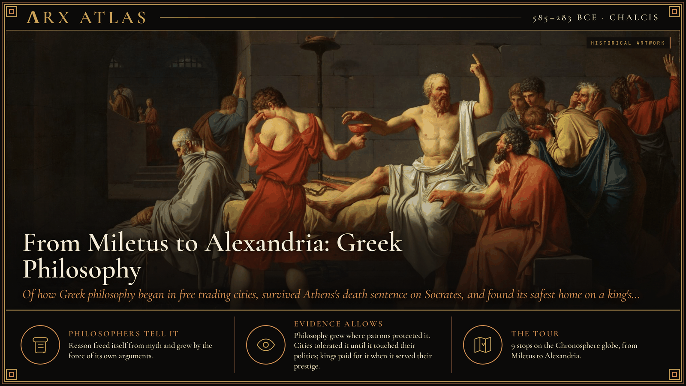
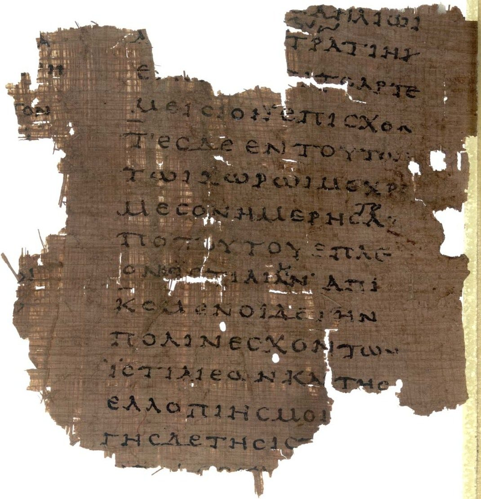
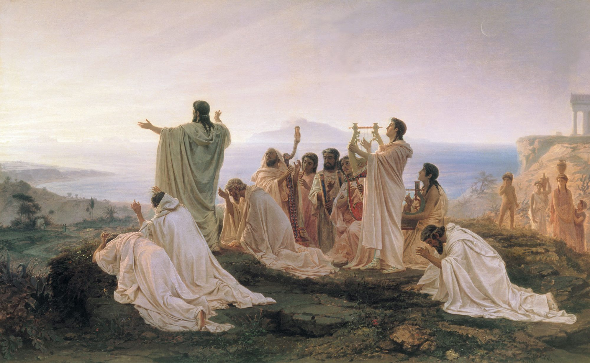
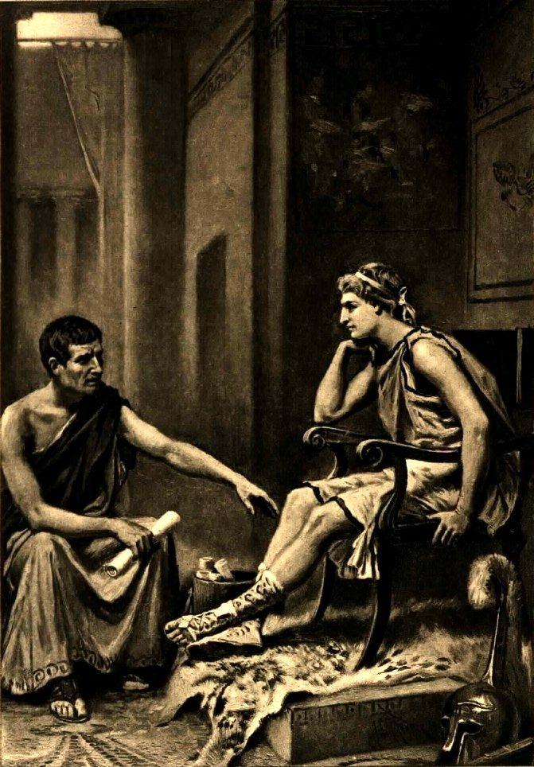
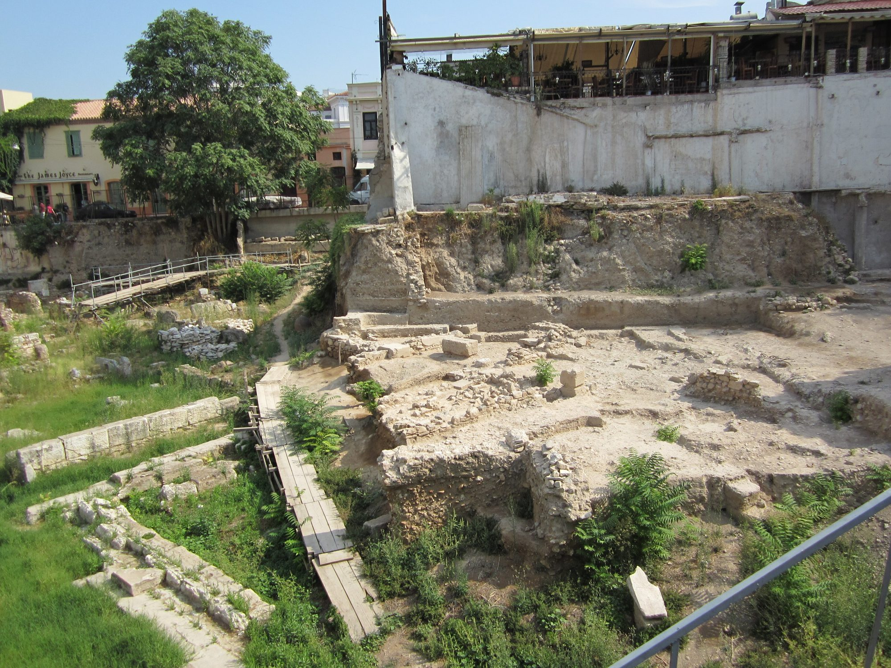

**ΛRX ATLAS** · Entry · 585–283 BCE · Chalcis

# From Miletus to Alexandria: Greek Philosophy

*Of how Greek philosophy began in free trading cities, survived Athens's death sentence on Socrates, and found its safest home on a king's payroll.*

*Art: [Jacques-Louis David, “David - The Death of Socrates”, Public domain, via Wikimedia Commons](https://commons.wikimedia.org/wiki/File:David_-_The_Death_of_Socrates.jpg)*

**[Take the tour →](https://arxcortex.io/chronosphere.html#play/tour/greek-philosophy)**

In 323 BCE news reached Athens that [Alexander the Great](https://en.wikipedia.org/wiki/Alexander_the_Great) was dead. Athens had been under Macedonian rule, and [Aristotle](https://en.wikipedia.org/wiki/Aristotle), Alexander's old tutor and a man with Macedonian ties, was denounced for impiety. He left for his mother's family estate at [Chalcis](https://en.wikipedia.org/wiki/Chalcis) on Euboea, saying, the story goes, that he would not let the Athenians "sin twice against philosophy." He died there the next year. The first sin was the death of [Socrates](https://en.wikipedia.org/wiki/Socrates) in 399. This tour asks how Greek philosophy, born in free trading cities, came to depend on the protection of kings.

## The eclipse

It begins in [Miletus](https://en.wikipedia.org/wiki/Miletus), a rich Ionian port. According to [Herodotus](https://en.wikipedia.org/wiki/Herodotus), writing about 150 years later, [Thales](https://en.wikipedia.org/wiki/Thales_of_Miletus) predicted a solar eclipse that halted a battle between the Medes and the Lydians. The only eclipse that fits is that of 28 May 585 BCE. Modern scholars doubt the prediction. What Thales did attempt was to explain nature without myth. He held that everything came from a single substance, water.

*An early 2nd-century CE papyrus of Herodotus (Book VIII; the eclipse story is in Book I), showing how his text survived. [Unknown, “POxy v0017 n2099 a 01 hires - cropped”, Public domain, via Wikimedia Commons](https://commons.wikimedia.org/wiki/File:POxy_v0017_n2099_a_01_hires_-_cropped.jpg)*

## The brotherhood

The question traveled west with Greek colonists. [Pythagoras](https://en.wikipedia.org/wiki/Pythagoras), from Samos, settled around 530 BCE at Croton in southern Italy and founded a school whose initiates were said to be sworn to secrecy. Philosophy here was also a way of life and a political club. After about 510 his followers clashed with supporters of democracy, and their meeting houses were burned.

*Bronnikov's 1869 painting of Pythagoreans hailing the sunrise. [Fyodor Bronnikov, “Bronnikov gimnpifagoreizev”, Public domain, via Wikimedia Commons](https://commons.wikimedia.org/wiki/File:Bronnikov_gimnpifagoreizev.jpg)*

## The one

Up the coast at Elea, [Parmenides](https://en.wikipedia.org/wiki/Parmenides), from a wealthy family, argued that change is an illusion and only reason grasps what truly is. Plato later imagined him visiting Athens at 65, when Socrates was young. Whether or not they met, the argument about being and change reached Athens.

## The hemlock

Athens was the richest Greek city and the most dangerous for a philosopher. In 404, after defeat by Sparta, an oligarchy known as the [Thirty Tyrants](https://en.wikipedia.org/wiki/Thirty_Tyrants) briefly ruled by terror. One of its leaders, [Critias](https://en.wikipedia.org/wiki/Critias), had been an associate of Socrates. In 399 a jury of citizens convicted Socrates of impiety and corrupting the young. He was sentenced to drink hemlock. The charges were religious. The resentment may have been political.

## The grove

His student [Plato](https://en.wikipedia.org/wiki/Plato) drew a lesson. In about 387 he founded the [Academy](https://en.wikipedia.org/wiki/Platonic_Academy) in a sacred olive grove outside the city walls. Aristotle studied there for twenty years. A school with property and a line of heads could outlast any one teacher's enemies.

## The tutor

Power soon came looking for philosophers. In 343 [Philip II of Macedon](https://en.wikipedia.org/wiki/Philip_II_of_Macedon) invited Aristotle to tutor his thirteen-year-old son, Alexander, at Mieza near the royal capital. Aristotle's father had been physician to Philip's father, and the family ties may explain the choice. Philosophy was now attached to the court that would conquer Greece.

*Ferris's 1895 imagining of Aristotle teaching Alexander. [Jean Leon Gerome Ferris, “Aristotle tutoring Alexander by J L G Ferris 1895”, Public domain, via Wikimedia Commons](https://commons.wikimedia.org/wiki/File:Aristotle_tutoring_Alexander_by_J_L_G_Ferris_1895.jpg)*

## The Lyceum

In 335, with Athens under Macedonian rule, Aristotle returned and set up a school at the [Lyceum](https://en.wikipedia.org/wiki/Lyceum_(classical)), with a library. He organized research by subject, from biology to politics. When Alexander died and Athens turned on him, he passed the school to [Theophrastus](https://en.wikipedia.org/wiki/Theophrastus) and fled.

## The porch

In the uncertain world of Alexander's successors, a shipwrecked merchant, [Zeno of Citium](https://en.wikipedia.org/wiki/Zeno_of_Citium), came to Athens, studied with the Cynic [Crates](https://en.wikipedia.org/wiki/Crates_of_Thebes), and from about 300 taught in the Painted Stoa. Stoicism taught how to live well whatever kings did.

*The excavated site of the Painted Stoa in Athens. [Tomisti, “Stoa Poikile 1”, CC BY-SA 4.0, via Wikimedia Commons](https://commons.wikimedia.org/wiki/File:Stoa_Poikile_1.jpg)*

## The Museum

Kings offered philosophers something better than a porch. In Alexandria, [Demetrius of Phalerum](https://en.wikipedia.org/wiki/Demetrius_of_Phalerum), an exiled Athenian statesman and a student in Aristotle's line, may have proposed a great library to [Ptolemy I](https://en.wikipedia.org/wiki/Ptolemy_I_Soter), who died about 283. It was probably built under his son. Scholars at the attached [Museum](https://en.wikipedia.org/wiki/Musaeum) were salaried by the state, paid no taxes, and received free room and board. Eratosthenes measured the earth there.

## Weighing the evidence

Almost everything here comes through later writers. Herodotus told the eclipse story some 150 years after it, and modern scholars doubt that Thales could have predicted it. The dates for Pythagoras at Croton and for Parmenides are approximate, and Plato's account of a meeting between Parmenides and the young Socrates may be invention. Whether politics, beyond the formal charges, drove the trial of Socrates is argued from circumstance. The Library's founding by Ptolemy I or by his son is uncertain.

## The long view

How did philosophy come to depend on kings? Each free city offered room to think, and each, under strain, punished thinkers who seemed to threaten it. The Pythagoreans were burned out in Croton; Socrates was executed in Athens, and Aristotle fled it. Schools with property gave some protection. Royal money gave more. Alexander's tutor founded a research school, and an Athenian exile helped build the Ptolemies' library. Patrons protect what serves them: in 145 BCE [Ptolemy VIII](https://en.wikipedia.org/wiki/Ptolemy_VIII_Physcon) purged Alexandria's intellectuals, and its scholars scattered.

**[Take the tour →](https://arxcortex.io/chronosphere.html#play/tour/greek-philosophy)**

---

## Sources

**Ancient witnesses**
- Herodotus, Histories 1.74.
- Plato, Apology.
- Diogenes Laertius, Lives of the Eminent Philosophers.
- Strabo, Geography 17.1.8.

**Modern scholarship**
- "Aristotle." *Wikipedia*. Accessed October 28, 2026. https://en.wikipedia.org/wiki/Aristotle.
- "Eclipse of Thales." *Wikipedia*. Accessed October 28, 2026. https://en.wikipedia.org/wiki/Eclipse_of_Thales.
- "Library of Alexandria." *Wikipedia*. Accessed October 28, 2026. https://en.wikipedia.org/wiki/Library_of_Alexandria.
- "Lyceum (classical)." *Wikipedia*. Accessed October 28, 2026. https://en.wikipedia.org/wiki/Lyceum_(classical).
- "Musaeum." *Wikipedia*. Accessed October 28, 2026. https://en.wikipedia.org/wiki/Musaeum.
- "Parmenides." *Wikipedia*. Accessed October 28, 2026. https://en.wikipedia.org/wiki/Parmenides.
- "Platonic Academy." *Wikipedia*. Accessed October 28, 2026. https://en.wikipedia.org/wiki/Platonic_Academy.
- "Pythagoras." *Wikipedia*. Accessed October 28, 2026. https://en.wikipedia.org/wiki/Pythagoras.
- "Thales of Miletus." *Wikipedia*. Accessed October 28, 2026. https://en.wikipedia.org/wiki/Thales_of_Miletus.
- "Trial of Socrates." *Wikipedia*. Accessed October 28, 2026. https://en.wikipedia.org/wiki/Trial_of_Socrates.
- "Zeno of Citium." *Wikipedia*. Accessed October 28, 2026. https://en.wikipedia.org/wiki/Zeno_of_Citium.

*Entered in the ΛRX Atlas · arxcortex.io*
