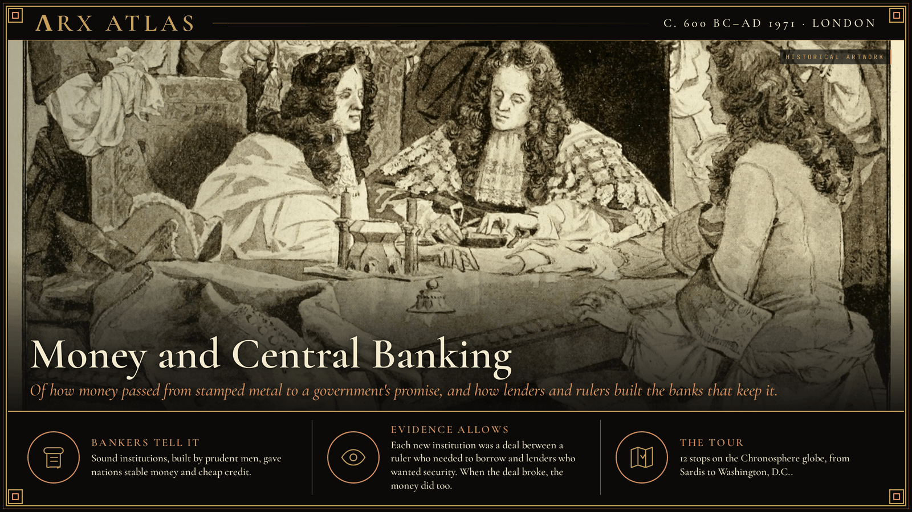
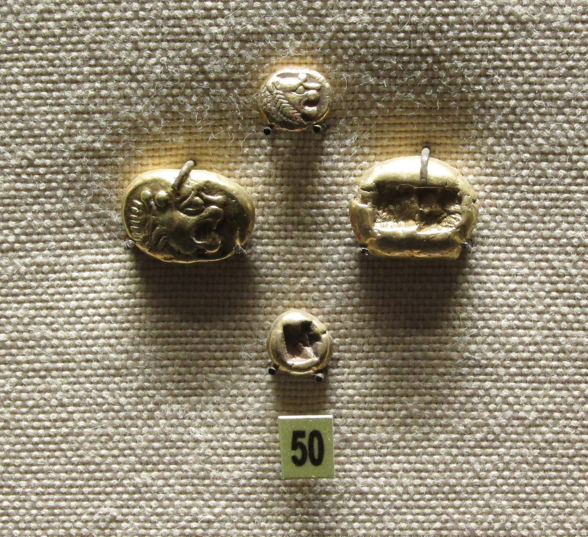
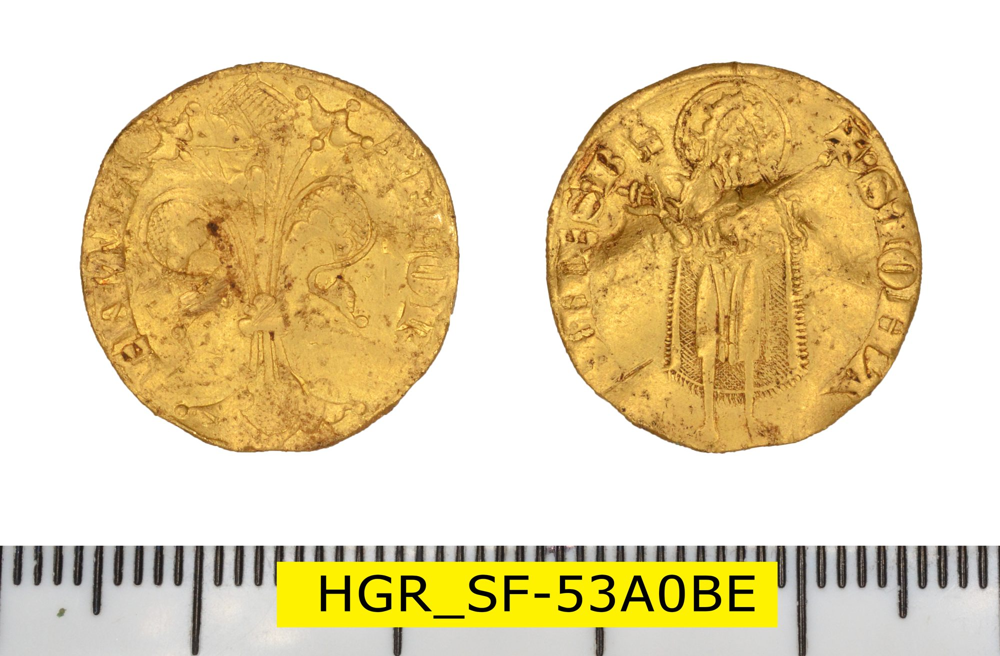
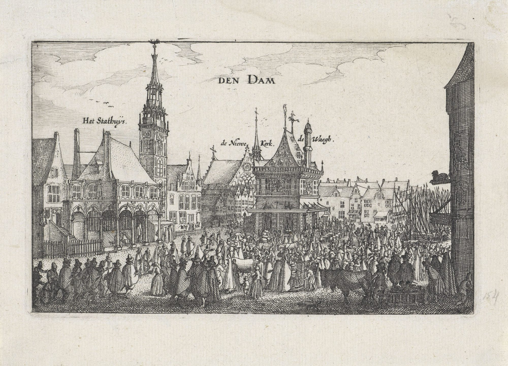
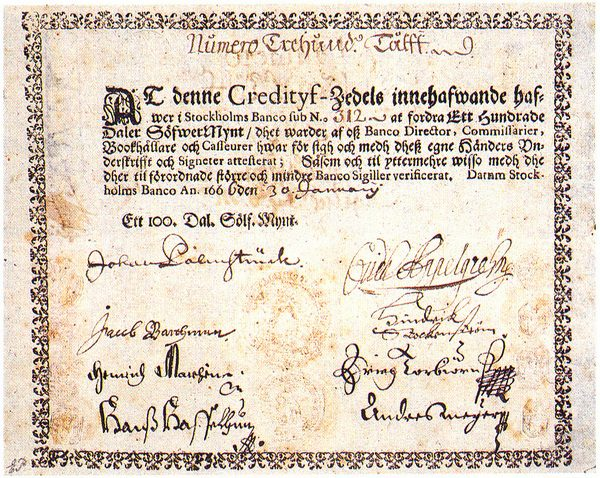
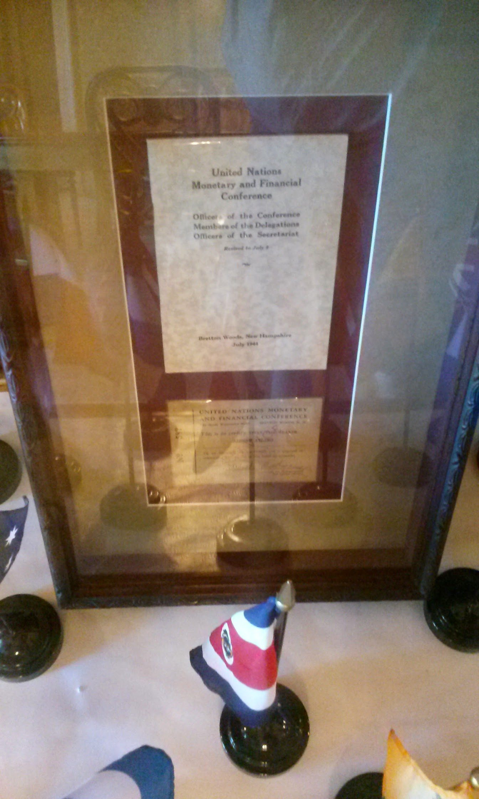

**ΛRX ATLAS** · Entry · c. 600 BC–AD 1971 · London

# Money and Central Banking

*Of how money passed from stamped metal to a government's promise, and how lenders and rulers built the banks that keep it.*

*Art: [Lady Jane Lindsay, “Bank of England Charter sealing 1694”, Public domain, via Wikimedia Commons](https://commons.wikimedia.org/wiki/File:Bank_of_England_Charter_sealing_1694.jpg)*

**[Take the tour →](https://arxcortex.io/chronosphere.html#play/tour/money-and-central-banking)**

In 1690 a French fleet beat the Royal Navy off [Beachy Head](https://en.wikipedia.org/wiki/Battle_of_Beachy_Head_(1690)), and England's new king, [William III](https://en.wikipedia.org/wiki/William_III_of_England), needed a navy he could not afford. In 1694 Parliament offered a deal. Subscribers would lend the government up to £1.2 million and in return become a chartered company, the Governor and Company of the [Bank of England](https://en.wikipedia.org/wiki/Bank_of_England). The money was raised in twelve days. 1,268 people subscribed. That fortnight in London is the center of this tour, which asks one question. How did money pass from stamped metal to a government's promise, and who built the institutions that make the promise good?

## Stamped metal

The first coins known were struck in [Lydia](https://en.wikipedia.org/wiki/Lydia), in western Anatolia, in the seventh century BC. They were lumps of [electrum](https://en.wikipedia.org/wiki/Electrum), a natural alloy of gold and silver, stamped by the state. A ruler's mark told the user what the metal was worth. For nearly two thousand years money in the West meant coin. Our tour jumps from here to medieval Italy. The jump is chronological, not causal.

*Lydian electrum coins with the lion's head. [brewbooks from near Seattle, USA, “Lydian electrum Lion coins - Flickr - brewbooks”, CC BY-SA 2.0, via Wikimedia Commons](https://commons.wikimedia.org/wiki/File:Lydian_electrum_Lion_coins_-_Flickr_-_brewbooks.jpg)*

## Arithmetic for merchants

In 1202 [Leonardo of Pisa](https://en.wikipedia.org/wiki/Fibonacci), later called Fibonacci, published the *[Liber Abaci](https://en.wikipedia.org/wiki/Liber_Abaci)*. His father had been an official at the customs house for Pisan merchants in Bugia, in North Africa, and Leonardo learned there the Hindu-Arabic numerals that his book taught to the West. Italian merchants now had a better way to keep accounts, convert currencies and calculate interest. They also needed a coin they could trust.

## The florin

In 1252 Florence struck the gold [florin](https://en.wikipedia.org/wiki/Florin), with about 3.5 grams of fine gold. It kept the same design and standard until 1533. When the Fourth Crusade disrupted Byzantine gold coinage, the florin took the place the Byzantine solidus had held and was accepted across Europe. Florentine merchants carried a trusted currency, and the trust turned them into bankers.

*A Florentine florin found in England. [Suffolk County Council, Riccardo Caravello, 2019-11-08 12:44:26, “Medieval coin, florin of the Republic of Florence. (FindID 979201)”, CC BY 2.0, via Wikimedia Commons](https://commons.wikimedia.org/wiki/File:Medieval_coin,_florin_of_the_Republic_of_Florence._(FindID_979201).jpg)*

## The pope's bankers

In 1397 [Giovanni di Bicci de' Medici](https://en.wikipedia.org/wiki/Giovanni_di_Bicci_de%27_Medici) founded the [Medici Bank](https://en.wikipedia.org/wiki/Medici_Bank) in Florence. It became the largest and most respected bank in Europe. Its most important client was the papacy. The bank handled papal revenues as fiscal agent of the Holy See, and in 1427 the Rome branch held about 100,000 florins in papal deposits, four times the capital of the whole bank. Lending to rulers brought power. It also tied the bank to their fortunes, and the bank failed in 1494.

## The creditors take charge

Genoa tried a different arrangement. Wars with Venice had swollen its public debt, and on 23 April 1407 the republic set up the [Bank of Saint George](https://en.wikipedia.org/wiki/Bank_of_Saint_George) to consolidate it. The state's creditors ran the bank, and in time the bank governed Genoa's overseas territories, including Corsica. Here the lenders did not merely lend to the state. They held part of it.

## Bank money

In the north, on 31 January 1609, Amsterdam founded the [Bank of Amsterdam](https://en.wikipedia.org/wiki/Bank_of_Amsterdam), vouched for by the city. It was the first public bank to offer accounts not directly convertible to coin: its money existed in its books, and it kept that money stable. The Dutch guilder became a de facto reserve currency in seventeenth- and eighteenth-century Europe. Money had begun to detach from metal.

*The Dam in Amsterdam with the Wisselbank, a 1611 print. [Rijksmuseum, “Gezicht op het Oude Stadhuis, de Wisselbank, de Nieuwe Kerk en de Waag op de Dam te Amsterdam Den Dam (titel op object) Vier gebouwen in Amsterdam (serietitel), RP-P-1880-A-3843”, CC0, via Wikimedia Commons](https://commons.wikimedia.org/wiki/File:Gezicht_op_het_Oude_Stadhuis,_de_Wisselbank,_de_Nieuwe_Kerk_en_de_Waag_op_de_Dam_te_Amsterdam_Den_Dam_(titel_op_object)_Vier_gebouwen_in_Amsterdam_(serietitel),_RP-P-1880-A-3843.jpg)*

## Paper and its risks

Sweden took the next step, and stumbled. [Stockholms Banco](https://en.wikipedia.org/wiki/Stockholms_Banco), founded by Johan Palmstruch, printed Europe's first banknotes in 1661. It ran into trouble and was liquidated in 1667. In 1668 the Swedish parliament, the Riksdag, took over its privilege and founded the bank of the Estates, today the [Riksbank](https://en.wikipedia.org/wiki/Sveriges_Riksbank), the oldest surviving central bank. Paper money worked only if a public authority stood behind it.

*A 17th-century Stockholms Banco credit note, among Europe's first banknotes. [Unknown author, “Sweden-Credityf-Zedels”, Public domain, via Wikimedia Commons](https://commons.wikimedia.org/wiki/File:Sweden-Credityf-Zedels.jpg)*

## Parliament's bank

That was the lesson England applied in 1694. The Bank of England was private, owned by its stockholders, but it served as the government's banker and debt manager, and it became the model for most modern central banks. A parliament that controlled taxes now guaranteed the debt.

## The bubble

France tried to leap ahead. The Scottish financier [John Law](https://en.wikipedia.org/wiki/John_Law_(economist)) founded a company in 1717, popularly called the Mississippi Company, and in February 1720 it took over his bank, France's first central bank. Later that year its shares collapsed. Britain's own [South Sea Bubble](https://en.wikipedia.org/wiki/South_Sea_Company) burst the same year. Britain kept its central bank. France's experiment ended.

## The American system

The United States resisted a central bank for most of the nineteenth century. Then came the [Panic of 1907](https://en.wikipedia.org/wiki/Panic_of_1907), which might have been far worse if [J. P. Morgan](https://en.wikipedia.org/wiki/J._P._Morgan) had not pledged his own money and rallied other bankers. A private banker had acted as lender of last resort. On 23 December 1913 President [Woodrow Wilson](https://en.wikipedia.org/wiki/Woodrow_Wilson) signed the [Federal Reserve Act](https://en.wikipedia.org/wiki/Federal_Reserve_Act) so that a public system would do it instead.

## The dollar and gold

In July 1944, 730 delegates from 44 Allied nations met at [Bretton Woods](https://en.wikipedia.org/wiki/Bretton_Woods_Conference), New Hampshire, to plan the postwar money system, largely on the ideas of [John Maynard Keynes](https://en.wikipedia.org/wiki/John_Maynard_Keynes) and [Harry Dexter White](https://en.wikipedia.org/wiki/Harry_Dexter_White). Other currencies were pegged to the dollar, and the dollar was convertible to gold at $35 an ounce. The United States, holding over half the world's official gold, seemed able to keep the promise. Spending on the Vietnam War and inflation made the dollar overvalued.

*The Gold Room at the Mount Washington Hotel, where the agreements were signed. [Barry Livingstone, “Gold Room Bretton Woods Documents”, CC BY-SA 3.0, via Wikimedia Commons](https://commons.wikimedia.org/wiki/File:Gold_Room_Bretton_Woods_Documents.jpg)*

## Weighing the evidence

Banks keep good records, and that makes this tour unusually well documented: subscription lists, charters, deposit ledgers and statutes survive. The gaps lie in the links between institutions. Lydia's coins and Fibonacci's arithmetic are 1,800 years apart, and this tour jumps between them; it does not claim one led to the other. That Genoa's creditor-run bank shaped Amsterdam's is plausible but not documented. Where the record speaks plainly is in the sequence of crises, a lost sea battle, a burst bubble, a bank panic, that forced each new arrangement into being.

## The long view

On 15 August 1971 [Richard Nixon](https://en.wikipedia.org/wiki/Richard_Nixon) ended the dollar's convertibility to gold. Money was now only a promise, kept by central banks. How did it come to that? Step by step, rulers who needed to borrow struck bargains with lenders who wanted security: the Medici with the popes, Genoa's creditors with their republic, London's subscribers with a king at war. Each bargain built an institution. The institutions lasted when a public authority with power to tax stood behind them, and failed when it did not.

**[Take the tour →](https://arxcortex.io/chronosphere.html#play/tour/money-and-central-banking)**

---

## Sources

**Ancient witnesses**
- Leonardo of Pisa, Liber Abaci (1202).
- Bank of England Act (1694).
- Federal Reserve Act (1913).
- Bretton Woods Agreements (1944).

**Modern scholarship**
- "Bank of Amsterdam." *Wikipedia*. Accessed October 28, 2026. https://en.wikipedia.org/wiki/Bank_of_Amsterdam.
- "Bank of England." *Wikipedia*. Accessed October 28, 2026. https://en.wikipedia.org/wiki/Bank_of_England.
- "Bank of Saint George." *Wikipedia*. Accessed October 28, 2026. https://en.wikipedia.org/wiki/Bank_of_Saint_George.
- "Bretton Woods Conference." *Wikipedia*. Accessed October 28, 2026. https://en.wikipedia.org/wiki/Bretton_Woods_Conference.
- "Electrum." *Wikipedia*. Accessed October 28, 2026. https://en.wikipedia.org/wiki/Electrum.
- "Federal Reserve Act." *Wikipedia*. Accessed October 28, 2026. https://en.wikipedia.org/wiki/Federal_Reserve_Act.
- "Florin." *Wikipedia*. Accessed October 28, 2026. https://en.wikipedia.org/wiki/Florin.
- "Liber Abaci." *Wikipedia*. Accessed October 28, 2026. https://en.wikipedia.org/wiki/Liber_Abaci.
- "Lydia." *Wikipedia*. Accessed October 28, 2026. https://en.wikipedia.org/wiki/Lydia.
- "Medici Bank." *Wikipedia*. Accessed October 28, 2026. https://en.wikipedia.org/wiki/Medici_Bank.
- "Mississippi Company." *Wikipedia*. Accessed October 28, 2026. https://en.wikipedia.org/wiki/Mississippi_Company.
- "Nixon shock." *Wikipedia*. Accessed October 28, 2026. https://en.wikipedia.org/wiki/Nixon_shock.
- "Panic of 1907." *Wikipedia*. Accessed October 28, 2026. https://en.wikipedia.org/wiki/Panic_of_1907.
- "Stockholms Banco." *Wikipedia*. Accessed October 28, 2026. https://en.wikipedia.org/wiki/Stockholms_Banco.
- "Sveriges Riksbank." *Wikipedia*. Accessed October 28, 2026. https://en.wikipedia.org/wiki/Sveriges_Riksbank.

*Entered in the ΛRX Atlas · arxcortex.io*
