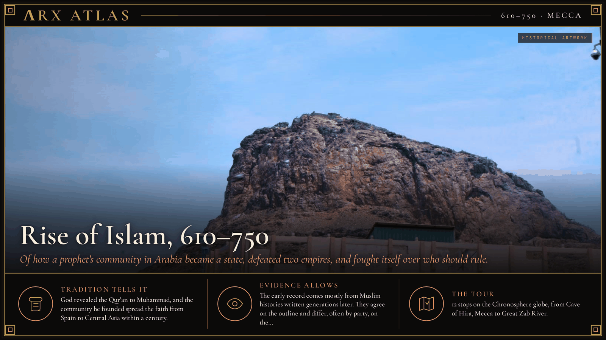
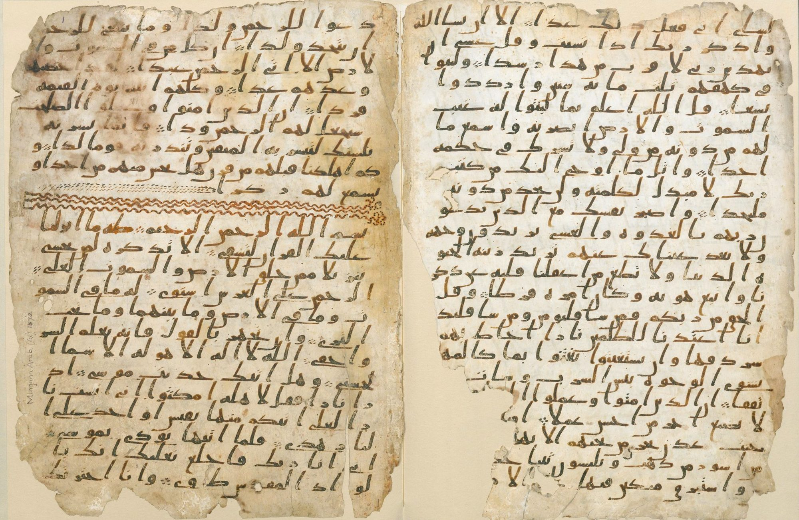
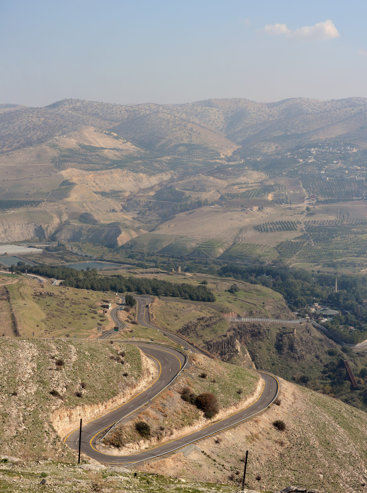
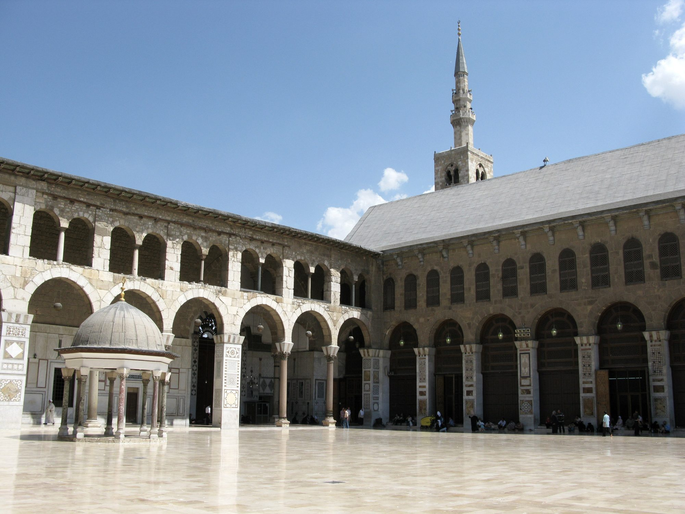
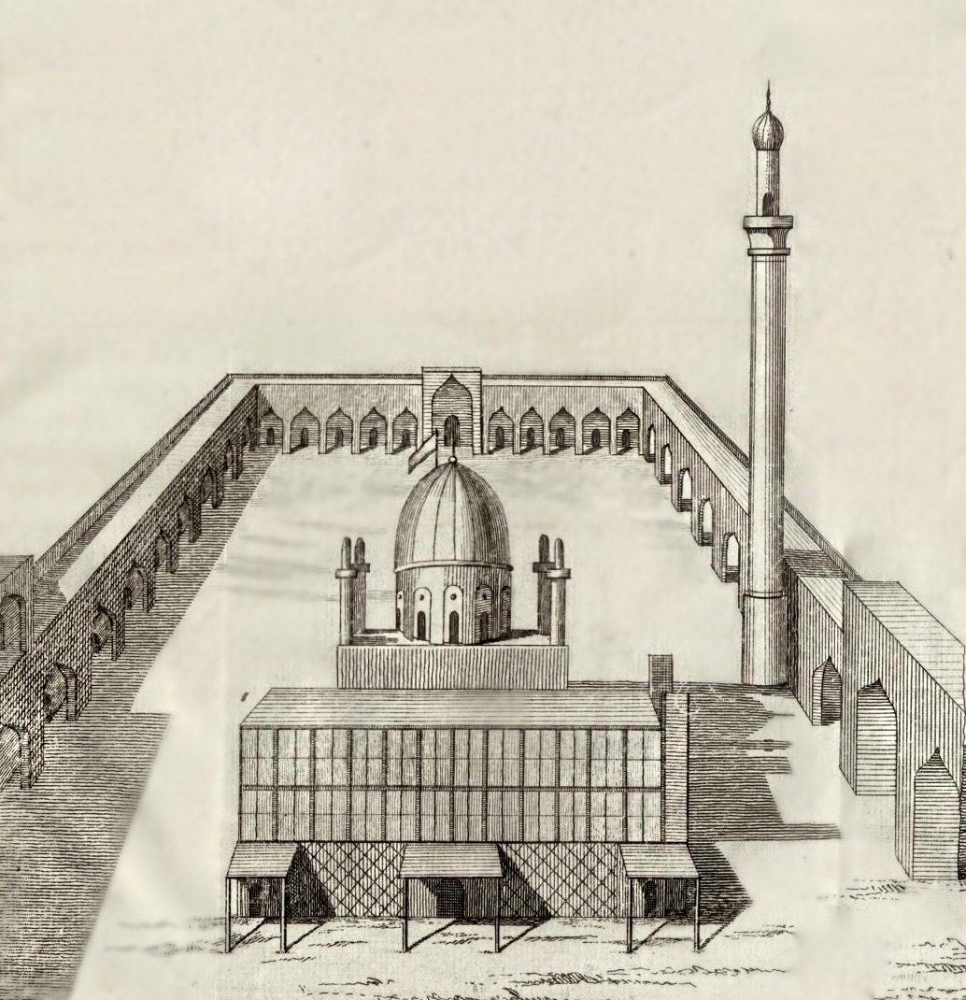

**ΛRX ATLAS** · Entry · 610–750 · Mecca

# Rise of Islam, 610–750

*Of how a prophet's community in Arabia became a state, defeated two empires, and fought itself over who should rule.*

*Art: [Sadath i, “Jabal al-Nour And cave Hira”, CC BY-SA 4.0, via Wikimedia Commons](https://commons.wikimedia.org/wiki/File:Jabal_al-Nour_And_cave_Hira.jpg)*

**[Take the tour →](https://arxcortex.io/chronosphere.html#play/tour/rise-of-islam)**

In the month of Ramadan, according to Muslim tradition, a merchant of Mecca named [Muhammad](https://en.wikipedia.org/wiki/Muhammad) was keeping a retreat in a cave on [Jabal al-Nour](https://en.wikipedia.org/wiki/Jabal_al-Nour), the Mountain of Light. There, the tradition says, the angel Gabriel appeared and commanded him to recite. Muslims generally place this first revelation in 610, though the exact date is disputed. Across the next 140 years, how did the community of a prophet in an Arabian trading town become a state stretching from Spain to Central Asia, and why did it fight itself over who should lead it?

## Flight to Medina

Muhammad's preaching against idols troubled the leaders of [Quraysh](https://en.wikipedia.org/wiki/Quraysh), the tribe that ran Mecca. While his uncle [Abu Talib](https://en.wikipedia.org/wiki/Abu_Talib_ibn_Abd_al-Muttalib) lived, he had protection. After Abu Talib died, the tradition reports, Mecca's leaders ordered him killed. In 622, after secret meetings with men of the Aws and Khazraj tribes of Yathrib, Muhammad slipped out of Mecca with his companion [Abu Bakr](https://en.wikipedia.org/wiki/Abu_Bakr). The emigration, the [Hijrah](https://en.wikipedia.org/wiki/Hijrah), became year one of the Islamic calendar. In Yathrib, soon called Medina, Muhammad was no longer only a preacher. The townspeople chose him as their leader, and his followers began raiding Meccan caravans.

*One of the oldest surviving Qur'an leaves; its parchment is radiocarbon-dated to the 7th century. [Unknown author, “Birmingham Quran manuscript”, Public domain, via Wikimedia Commons](https://commons.wikimedia.org/wiki/File:Birmingham_Quran_manuscript.jpg)*

## The caravan

Early in 624 a rich Quraysh caravan under [Abu Sufyan](https://en.wikipedia.org/wiki/Abu_Sufyan_ibn_Harb) was returning from the Levant. Muhammad set out to intercept it. Abu Sufyan changed course and sent to Mecca for help. On 13 March 624, near the wells of [Badr](https://en.wikipedia.org/wiki/Battle_of_Badr), the Medinans met the relief army and won. For the tribes of Arabia it showed that the exile from Mecca was now a power.

## Mecca opens its gates

In 628 the two sides signed the ten-year [Treaty of Hudaybiyyah](https://en.wikipedia.org/wiki/Treaty_of_Hudaybiyyah). When an ally of Quraysh attacked an ally of the Muslims, the treaty broke, and in December 629 or January 630 Muhammad's forces advanced on Mecca. The city fell with little fighting, ending the long war with Quraysh. Abu Sufyan, once Muhammad's chief opponent, joined the new order. His family, the Umayyads, would matter later: his son Mu'awiya opposed Muhammad alongside him and later governed Syria for their kinsman, Caliph Uthman.

## The question of succession

Muhammad died in 632 without a successor whom all accepted. While his cousin and son-in-law [Ali](https://en.wikipedia.org/wiki/Ali) and the family were still at the funeral, leaders met at the [Saqifah](https://en.wikipedia.org/wiki/Saqifah), a hall in Medina, and chose Abu Bakr as caliph. Sunni Muslims hold that Muhammad left the choice to the community. Shia Muslims hold that he had already designated Ali. The two readings of that afternoon would divide the faith for good.

## Two empires fall

Abu Bakr and his successor [Umar](https://en.wikipedia.org/wiki/Umar) turned the tribes' energy outward, against two empires that had exhausted each other in the war of 602–628. In August 636, near the [Yarmuk River](https://en.wikipedia.org/wiki/Battle_of_the_Yarmuk), an Arab army defeated a large Byzantine force sent by Emperor [Heraclius](https://en.wikipedia.org/wiki/Heraclius), ending Byzantine rule in Syria. In the east, Persian armies lost battle after battle. The last Sasanian king, [Yazdegerd III](https://en.wikipedia.org/wiki/Yazdegerd_III), fled east and in 651 was killed by a miller near [Merv](https://en.wikipedia.org/wiki/Merv), possibly at the urging of the local governor. The last pre-Islamic Iranian empire was gone.

*Yarmouk River Valley [Staselnik, “Yarmouk River Valley”, CC BY-SA 3.0, via Wikimedia Commons](https://commons.wikimedia.org/wiki/File:Yarmouk_River_Valley.jpg)*

## The first civil war

The conquests brought vast revenue, and the revenue raised the stakes of leadership. Umar's successor [Uthman](https://en.wikipedia.org/wiki/Uthman) was accused of favoring his kin and was killed by rebels in 656. Ali became caliph, but his rule was clouded by the unpunished murder. [Aisha](https://en.wikipedia.org/wiki/Aisha), Muhammad's widow, and the Companions Talha and Zubayr rose against him. So did Uthman's kinsman [Mu'awiya](https://en.wikipedia.org/wiki/Mu%27awiya_I), governor of Syria. After an arbitration at Siffin, some of Ali's own men broke away as the [Kharijites](https://en.wikipedia.org/wiki/Kharijites). In January 661 one of them killed Ali in the mosque at Kufa.

## A dynasty in Damascus

Mu'awiya, ruling from Syria, now held the caliphate. Before he died in 680 he named his son [Yazid](https://en.wikipedia.org/wiki/Yazid_I) as successor, making the office hereditary. The son of Abu Sufyan, Muhammad's old enemy, had founded the [Umayyad dynasty](https://en.wikipedia.org/wiki/Umayyad_Caliphate).

*The Umayyad Mosque, Damascus, Syria [Vyacheslav Argenberg, “The Umayyad Mosque, Damascus, Syria”, CC BY 4.0, via Wikimedia Commons](https://commons.wikimedia.org/wiki/File:The_Umayyad_Mosque,_Damascus,_Syria.jpg)*

## Karbala

Ali's son [Husayn](https://en.wikipedia.org/wiki/Husayn_ibn_Ali), the Prophet's grandson, refused to swear allegiance to Yazid. Letters from Kufa promised him support. He set out with a small band. On 10 October 680, the tenth of Muharram, Umayyad forces surrounded and killed him and his companions at [Karbala](https://en.wikipedia.org/wiki/Battle_of_Karbala) in Iraq. Shia Muslims mourn the day as Ashura. For them Karbala became the founding sacrifice of their faith, and a charge against Umayyad legitimacy that never faded.

*Carsten Niebuhr's 1765 drawing of the shrine of Husayn. [Carsten Niebuhr, “Husayn Mosque, Karbala, Iraq 1765”, Public domain, via Wikimedia Commons](https://commons.wikimedia.org/wiki/File:Husayn_Mosque,_Karbala,_Iraq_1765.jpg)*

## To the edge of Europe

The dynasty itself grew stronger. In 711, under Caliph [al-Walid I](https://en.wikipedia.org/wiki/Al-Walid_I), the commander [Tariq ibn Ziyad](https://en.wikipedia.org/wiki/Tariq_ibn_Ziyad) crossed from North Africa and defeated the Visigothic king [Roderic](https://en.wikipedia.org/wiki/Roderic) that July. The caliphate now reached into western Europe.

## The black banners

Size bred resentment. Converts who were not Arabs, the *[mawali](https://en.wikipedia.org/wiki/Mawla)*, often still paid the poll tax levied on non-Muslims and remained second-class, and even many Arabs resented Umayyad rule. A succession crisis in 744 set off a third civil war. A movement in Khurasan, organized by [Abu Muslim](https://en.wikipedia.org/wiki/Abu_Muslim), rose in the name of the [Abbasids](https://en.wikipedia.org/wiki/Abbasid_Caliphate), descendants of Muhammad's uncle al-Abbas. On 25 January 750, on the Great Zab River in Iraq, they defeated the last Umayyad caliph, [Marwan II](https://en.wikipedia.org/wiki/Marwan_II).

## Weighing the evidence

Almost everything here comes from Muslim histories written a century or more after the events, by authors who knew how the succession quarrels had turned out. The date of the first revelation is a matter of belief and calculation, not record. Accounts of the Saqifah survive in Sunni and Shia versions that serve their own claims, and early compilers such as Ibn Sa'd have been read as shaping the story to protect the Companions' reputations. The firmer markers are battles with fixed dates, and the end of the Sasanian line.

## The long view

How did a prophet's community become an empire, and why did it fight itself? The conquests came from a movement that united Arabia's tribes and turned them against two worn-out empires. The fighting came from the same success. Every caliph after Muhammad ruled more land and more money than the one before, and each disputed succession, at the Saqifah, after Uthman's murder, at Karbala, mattered more than the last. The Abbasids won by claiming the Prophet's family. They moved the center of power east, toward Persia, and the question of who should lead was never settled.

**[Take the tour →](https://arxcortex.io/chronosphere.html#play/tour/rise-of-islam)**

---

## Sources

**Ancient witnesses**
- The Qur'an.
- Ibn Ishaq, Life of the Messenger of God (as edited by Ibn Hisham).
- Al-Tabari, History of the Prophets and Kings.

**Modern scholarship**
- "Abbasid Revolution." *Wikipedia*. Accessed October 28, 2026. https://en.wikipedia.org/wiki/Abbasid_Revolution.
- "Battle of Badr." *Wikipedia*. Accessed October 28, 2026. https://en.wikipedia.org/wiki/Battle_of_Badr.
- "Battle of Karbala." *Wikipedia*. Accessed October 28, 2026. https://en.wikipedia.org/wiki/Battle_of_Karbala.
- "Battle of the Yarmuk." *Wikipedia*. Accessed October 28, 2026. https://en.wikipedia.org/wiki/Battle_of_the_Yarmuk.
- "Battle of the Zab." *Wikipedia*. Accessed October 28, 2026. https://en.wikipedia.org/wiki/Battle_of_the_Zab.
- "Byzantine–Sasanian War of 602–628." *Wikipedia*. Accessed October 28, 2026. https://en.wikipedia.org/wiki/Byzantine%E2%80%93Sasanian_War_of_602%E2%80%93628.
- "Conquest of Mecca." *Wikipedia*. Accessed October 28, 2026. https://en.wikipedia.org/wiki/Conquest_of_Mecca.
- "First Fitna." *Wikipedia*. Accessed October 28, 2026. https://en.wikipedia.org/wiki/First_Fitna.
- "Hijrah." *Wikipedia*. Accessed October 28, 2026. https://en.wikipedia.org/wiki/Hijrah.
- "Mu'awiya I." *Wikipedia*. Accessed October 28, 2026. https://en.wikipedia.org/wiki/Mu'awiya_I.
- "Muhammad's first revelation." *Wikipedia*. Accessed October 28, 2026. https://en.wikipedia.org/wiki/Muhammad's_first_revelation.
- "Saqifah." *Wikipedia*. Accessed October 28, 2026. https://en.wikipedia.org/wiki/Saqifah.
- "Umayyad conquest of Hispania." *Wikipedia*. Accessed October 28, 2026. https://en.wikipedia.org/wiki/Umayyad_conquest_of_Hispania.
- "Yazdegerd III." *Wikipedia*. Accessed October 28, 2026. https://en.wikipedia.org/wiki/Yazdegerd_III.

*Entered in the ΛRX Atlas · arxcortex.io*
