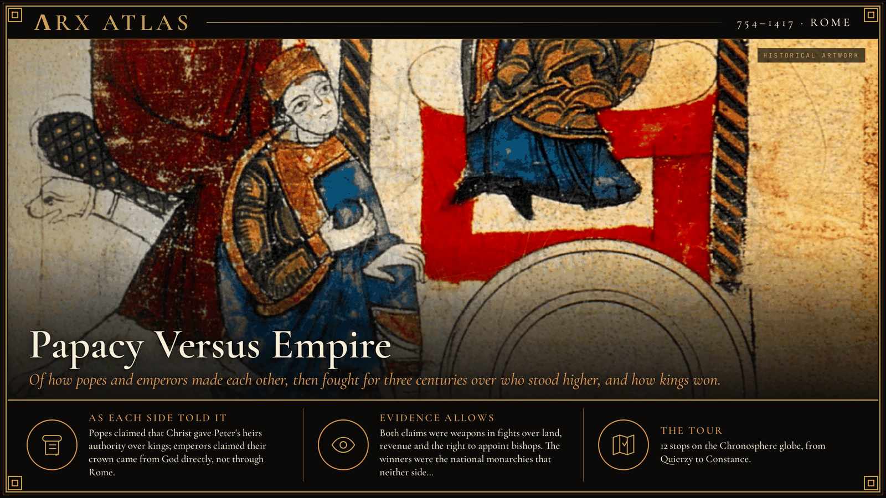
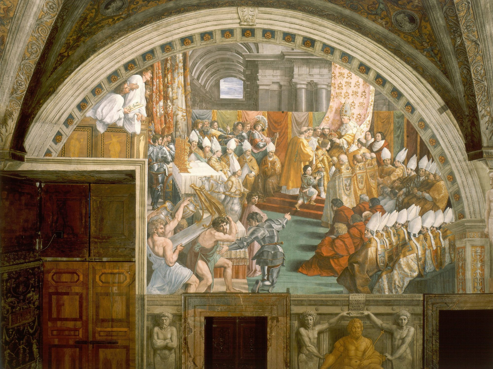
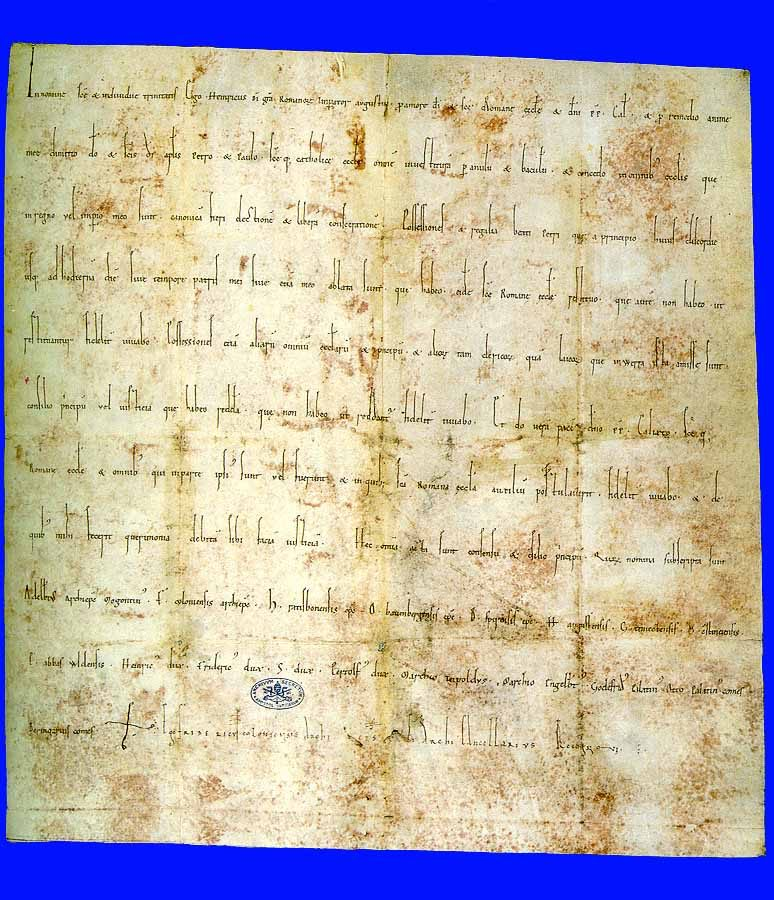
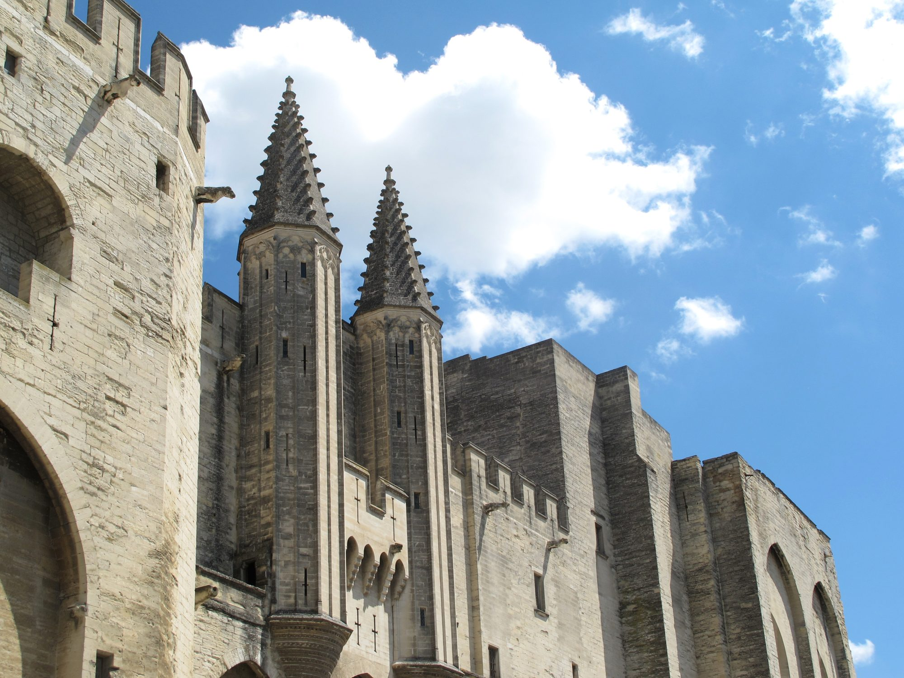
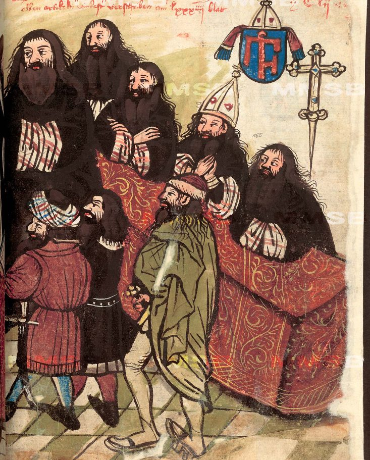

**ΛRX ATLAS** · Entry · 754–1417 · Rome

# Papacy Versus Empire

*Of how popes and emperors made each other, then fought for three centuries over who stood higher, and how kings won.*

*Art: [Donizo, “Mathilde und Hugo von Cluny als Fürsprecher Heinrichs IV.”, Public domain, via Wikimedia Commons](https://commons.wikimedia.org/wiki/File:Mathilde_und_Hugo_von_Cluny_als_F%C3%BCrsprecher_Heinrichs_IV..jpg)*

**[Take the tour →](https://arxcortex.io/chronosphere.html#play/tour/papacy-vs-empire)**

On 25 January 1077 a king stood at the gate of a castle in the northern Apennines. [Henry IV](https://en.wikipedia.org/wiki/Henry_IV,_Holy_Roman_Emperor), ruler of Germany and heir to the empire, had crossed the Alps in midwinter. Inside the castle of [Canossa](https://en.wikipedia.org/wiki/Road_to_Canossa), as guest of [Matilda of Tuscany](https://en.wikipedia.org/wiki/Matilda_of_Tuscany), sat [Pope Gregory VII](https://en.wikipedia.org/wiki/Pope_Gregory_VII), who had excommunicated him. Contemporary sources say Henry waited three days and nights in a hair shirt, perhaps barefoot, while a blizzard blew, until the pope lifted the ban. The scene poses this tour's question. Who stood higher in Christendom, the pope or the emperor? The two offices had created each other, and they spent three centuries fighting over the answer.

## A pope needs a protector

The story begins with a pope in danger. In 751 the Lombards took [Ravenna](https://en.wikipedia.org/wiki/Ravenna), the Byzantine capital in Italy, and with it went any imperial protection for Rome. In April 754, at Quierzy in France, [Pope Stephen II](https://en.wikipedia.org/wiki/Pope_Stephen_II) won a promise of Italian lands from the Frankish king [Pepin the Short](https://en.wikipedia.org/wiki/Pepin_the_Short). Pepin beat the Lombards and in 756 handed the territory to the pope. The [Donation of Pepin](https://en.wikipedia.org/wiki/Donation_of_Pepin) made the pope a territorial ruler, founding the [Papal States](https://en.wikipedia.org/wiki/Papal_States). It also made him dependent on Frankish swords.

## Making an emperor

In 800 [Pope Leo III](https://en.wikipedia.org/wiki/Pope_Leo_III), accused of crimes by Roman enemies, crowned [Charlemagne](https://en.wikipedia.org/wiki/Charlemagne) emperor in Rome. Historians still debate what the coronation meant. To later popes it meant that the papacy made emperors. To later emperors it meant that the West had a Roman emperor again.

*A 1514-15 Renaissance imagining by Raphael's workshop. [Raphael, “Raphael - Coronation of Charlemagne”, Public domain, via Wikimedia Commons](https://commons.wikimedia.org/wiki/File:Raphael_-_Coronation_of_Charlemagne.jpg)*

In 962 a German king revived the title. [Otto I](https://en.wikipedia.org/wiki/Otto_I), fresh from his victory over the Magyars at the Lechfeld, followed Charlemagne's example and was crowned emperor by [Pope John XII](https://en.wikipedia.org/wiki/Pope_John_XII). Otto and his heirs governed partly through bishops and abbots whom they chose and invested. Those churchmen held land, troops and revenue. Control over who appointed them was control over much of the empire.

## The pope's claims

A reform movement in the eleventh-century church set out to take that control back. Its sharpest statement is the *[Dictatus papae](https://en.wikipedia.org/wiki/Dictatus_papae)*, twenty-seven claims entered in Gregory VII's register under the year 1075. One of them reads, "That it may be permitted to him to depose emperors." Henry IV refused to give up investing bishops, and in 1076 the struggle broke into the open. Gregory excommunicated him. At Trebur that October, German princes swore not to recognize Henry unless the ban was lifted within a year, and they threatened to elect a new king. That is why he went to Canossa.

## The compromise

Canossa settled nothing. Henry was absolved, then fought on, and the [Investiture Controversy](https://en.wikipedia.org/wiki/Investiture_Controversy) outlived both men. It ended on 23 September 1122, when [Pope Callixtus II](https://en.wikipedia.org/wiki/Pope_Callixtus_II) and Emperor [Henry V](https://en.wikipedia.org/wiki/Henry_V,_Holy_Roman_Emperor) signed the [Concordat of Worms](https://en.wikipedia.org/wiki/Concordat_of_Worms). The emperor gave up investing bishops with ring and crosier, the signs of spiritual office, and allowed church elections. He kept a separate ceremony with a scepter for the lands that came with the office. Each side kept something. Neither got supremacy.

*The imperial charter of the Concordat of Worms. [Unknown author, “Urkunde Wormser Konkordat”, Public domain, via Wikimedia Commons](https://commons.wikimedia.org/wiki/File:Urkunde_Wormser_Konkordat.jpg)*

## The cities and the pope

Emperors now looked south, to the rich cities of Lombardy. [Frederick Barbarossa](https://en.wikipedia.org/wiki/Frederick_Barbarossa) backed rival popes against [Alexander III](https://en.wikipedia.org/wiki/Pope_Alexander_III), which tied his fight with the cities to a wider church dispute. On 29 May 1176, near [Legnano](https://en.wikipedia.org/wiki/Battle_of_Legnano), the [Lombard League](https://en.wikipedia.org/wiki/Lombard_League) defeated him. The Peace of Venice in 1177 reconciled him with Alexander. The pope had won by allying with the cities.

## The wonder of the world

Barbarossa's grandson [Frederick II](https://en.wikipedia.org/wiki/Frederick_II,_Holy_Roman_Emperor) held Germany, Italy and Sicily. His lands boxed the Papal States in from north and south, and popes excommunicated him four times between 1227 and his death on 13 December 1250. The pope's party chronicles vilified him. Others called him *Stupor mundi*, the "Wonder of the World." The papacy outlasted him and his dynasty. But the victory left it reliant on another protector: France.

## The king strikes back

France took its own measure of the papacy. [Philip IV](https://en.wikipedia.org/wiki/Philip_IV_of_France) taxed the French clergy at half their annual income, and [Pope Boniface VIII](https://en.wikipedia.org/wiki/Pope_Boniface_VIII) resisted. On 18 November 1302 Boniface issued *[Unam sanctam](https://en.wikipedia.org/wiki/Unam_sanctam)*, declaring that submission to the pope was necessary for salvation and that spiritual power stood above secular power. In 1303 Philip's adviser [Guillaume de Nogaret](https://en.wikipedia.org/wiki/Guillaume_de_Nogaret) and [Sciarra Colonna](https://en.wikipedia.org/wiki/Sciarra_Colonna) attacked the pope at Anagni with some 1,600 men and held him prisoner. The pope who claimed power over kings had been seized by a king's men.

## Popes in France

Philip then pressed a deadlocked conclave to elect the archbishop of Bordeaux as [Clement V](https://en.wikipedia.org/wiki/Pope_Clement_V). In 1309 Clement moved his court to [Avignon](https://en.wikipedia.org/wiki/Avignon_Papacy). Its seven popes were all French and all under the influence of the French crown. Gregory XI returned to Rome in 1377 and died the next year.

*Palais-des-Papes-Avignon-June-2012 [Acediscovery, “Palais-des-Papes-Avignon-June-2012”, CC BY 4.0, via Wikimedia Commons](https://commons.wikimedia.org/wiki/File:Palais-des-Papes-Avignon-June-2012.jpg)*

## Two popes, then three

The election after his death split the church. In September 1378 French cardinals declared [Urban VI](https://en.wikipedia.org/wiki/Pope_Urban_VI) invalidly elected under intimidation and chose [Clement VII](https://en.wikipedia.org/wiki/Antipope_Clement_VII), whose line ruled from Avignon. From 1409 a third line of claimants sat at Pisa. Kingdoms chose their pope by political alliance.

## Weighing the evidence

Papal registers, imperial charters and partisan chronicles tell this story, and each was written to win an argument. The Canossa scene comes from sources hostile to Henry; whether he went barefoot is "alleged." Pro-papal chronicles vilify Frederick II, while others call him a "wonder of the world." The documents themselves, the Dictatus, the Concordat, Unam sanctam and Haec sancta, are firmer ground. They record what each side claimed, which was always more than it could enforce.

## The long view at Constance

The emperor had one more role to play. [Sigismund](https://en.wikipedia.org/wiki/Sigismund,_Holy_Roman_Emperor), King of the Romans, pressed for a council and arrived at [Constance](https://en.wikipedia.org/wiki/Council_of_Constance) on Christmas Eve 1414. The council removed the rival claimants and in 1417 elected [Martin V](https://en.wikipedia.org/wiki/Pope_Martin_V). Its decree *Haec sancta* asserted that a general council stood above a pope, at least in some cases.

*A page from Ulrich von Richental's chronicle of the council. [Ulrich von Richental (died in c. 1438), “Metropolitan of Kyiv Gregory Tsamblak participating in the Council of Constance from 1414 to 1418 (Prague manuscript)”, Public domain, via Wikimedia Commons](https://commons.wikimedia.org/wiki/File:Metropolitan_of_Kyiv_Gregory_Tsamblak_participating_in_the_Council_of_Constance_from_1414_to_1418_(Prague_manuscript).png)*

So who stood higher? Neither, in the end. Gregory VII had claimed the right to depose emperors, and Boniface VIII had claimed authority over every soul. By 1417 a council had deposed popes, an emperor had helped convene it, and the papacy's real rival was no longer the emperor at all. It was the King of France, and the other kings who chose their popes as they chose their alliances.

**[Take the tour →](https://arxcortex.io/chronosphere.html#play/tour/papacy-vs-empire)**

---

## Sources

**Ancient witnesses**
- Dictatus papae, in the register of Gregory VII (1075).
- Concordat of Worms (1122).
- Boniface VIII, Unam sanctam (1302).
- Decree Haec sancta of the Council of Constance (1415).

**Modern scholarship**
- "Anagni." *Wikipedia*. Accessed October 28, 2026. https://en.wikipedia.org/wiki/Anagni.
- "Avignon Papacy." *Wikipedia*. Accessed October 28, 2026. https://en.wikipedia.org/wiki/Avignon_Papacy.
- "Battle of Legnano." *Wikipedia*. Accessed October 28, 2026. https://en.wikipedia.org/wiki/Battle_of_Legnano.
- "Charlemagne." *Wikipedia*. Accessed October 28, 2026. https://en.wikipedia.org/wiki/Charlemagne.
- "Concordat of Worms." *Wikipedia*. Accessed October 28, 2026. https://en.wikipedia.org/wiki/Concordat_of_Worms.
- "Council of Constance." *Wikipedia*. Accessed October 28, 2026. https://en.wikipedia.org/wiki/Council_of_Constance.
- "Dictatus papae." *Wikipedia*. Accessed October 28, 2026. https://en.wikipedia.org/wiki/Dictatus_papae.
- "Donation of Pepin." *Wikipedia*. Accessed October 28, 2026. https://en.wikipedia.org/wiki/Donation_of_Pepin.
- "Frederick II, Holy Roman Emperor." *Wikipedia*. Accessed October 28, 2026. https://en.wikipedia.org/wiki/Frederick_II,_Holy_Roman_Emperor.
- "Investiture Controversy." *Wikipedia*. Accessed October 28, 2026. https://en.wikipedia.org/wiki/Investiture_Controversy.
- "Otto I." *Wikipedia*. Accessed October 28, 2026. https://en.wikipedia.org/wiki/Otto_I.
- "Road to Canossa." *Wikipedia*. Accessed October 28, 2026. https://en.wikipedia.org/wiki/Road_to_Canossa.
- "Unam sanctam." *Wikipedia*. Accessed October 28, 2026. https://en.wikipedia.org/wiki/Unam_sanctam.
- "Western Schism." *Wikipedia*. Accessed October 28, 2026. https://en.wikipedia.org/wiki/Western_Schism.

*Entered in the ΛRX Atlas · arxcortex.io*
