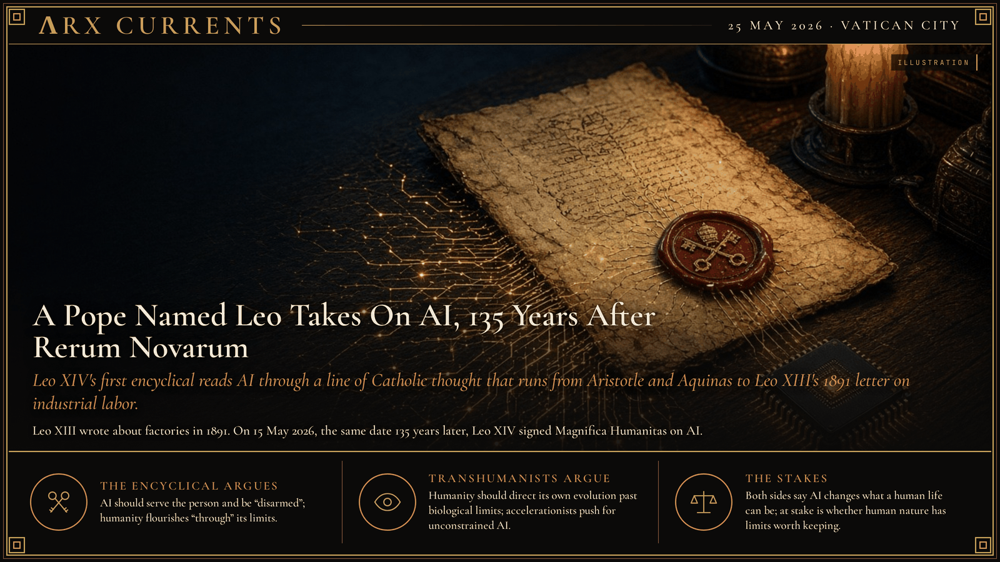

**ΛRX CURRENTS** · Current · 25 May 2026 · Vatican City

# A Pope Named Leo Takes On AI, 135 Years After Rerum Novarum

*Leo XIV's first encyclical reads AI through a line of Catholic thought that runs from Aristotle and Aquinas to Leo XIII's 1891 letter on industrial labor.*

In 1891 Pope Leo XIII wrote about factories.
On 15 May 2026, the same date 135 years later, Pope Leo XIV signed a letter about AI.
He set it against transhumanism.
The argument behind both runs back to Aristotle.

Leo XIV signed *Magnifica Humanitas*, his first encyclical, at Saint Peter's on 15 May 2026, and presented it in the Vatican Synod Hall on 25 May. Its subtitle is "on safeguarding the human person in the time of artificial intelligence."

## The first "new things"

On 15 May 1891 Pope Leo XIII issued *Rerum Novarum*, Latin for "of new things." The new things then were factories, crowded cities and hired labor. Leo XIII defended workers' rights to fair wages, safe conditions and their own associations. He also defended private property and criticized both socialism and unrestrained capitalism. Later popes built on that letter, including Pius XI in 1931, John XXIII in 1961 and John Paul II in 1991, and the body of teaching came to be called Catholic social teaching. The Second Vatican Council (1962–1965) carried it forward, and the first footnote of *Magnifica Humanitas* cites that council (see the [ΛRX Atlas entry on Vatican II](https://arxcortex.github.io/arxstories/atlas/1962-second-vatican-council/)).

Twelve years before *Rerum Novarum*, Leo XIII's *Aeterni Patris* (1879) had ordered a revival of Thomas Aquinas in Catholic seminaries. Aquinas, writing in the thirteenth century, joined Scripture to Aristotle's philosophy, in which each thing has a nature and a purpose it grows toward. In that tradition, natural law is what reason can learn about the good of human nature. That idea of a fixed human nature with built-in ends sits under both encyclicals.

## The new "new things"

Leo XIV ties his letter to that line in its opening paragraphs. "While Leo XIII spoke in his time of 'new things' (*rerum novarum*), today we cannot limit ourselves simply to repeating his insightful teachings," he writes. "Instead, we must ask God for the wisdom to interpret the great trends of our time, particularly technological advances."

He calls for regulation, accountability, independent oversight and user education. He asks that AI be "disarmed": "To disarm means discrediting the assumption that technical power automatically confers the right to govern. To disarm does not mean rejecting technology, but preventing it from dominating humanity."

He also names a rival current. He describes transhumanism and posthumanism as "an archipelago of conceptual 'islands'" and answers them with a claim about limits: "humanity flourishes not despite limitations, but often through them." He cites Aquinas on grace, which "surpasses every capability of created nature."

## The other side of the table

The biologist Julian Huxley coined the word transhumanism in a 1957 essay. He argued that humanity should consciously direct its own evolution and move past its biological limits. Present-day transhumanists set goals such as overcoming aging, disease and death. A newer current, effective accelerationism, argues in technology circles for unconstrained AI progress toward superintelligence. Its roots run back to the British philosopher Nick Land in the 1990s.

Both camps agree that AI changes what a human life can be. They disagree on whether human nature has limits worth keeping. Leo XIV says it does. Huxley's heirs say limits are there to be overcome.

## The long view

*Rerum Novarum* answered the machine age of steam. *Magnifica Humanitas* answers the machine age of code, with the same Aristotelian question underneath: what is a human being for? Which answer gains ground will show over the coming years, in seminaries and labs alike.

## Sources

**Original reporting**
- Leo XIV, [*Magnifica Humanitas*](https://www.vatican.va/content/leo-xiv/en/encyclicals/documents/20260515-magnifica-humanitas.html) (15 May 2026), The Holy See.
- Vatican News, ["Pope Leo's 'Magnifica humanitas': AI must serve humanity not concentrate power"](https://www.vaticannews.va/en/pope/news/2026-05/pope-leo-xiv-encyclical-magnifica-humanitas-ai.html) (25 May 2026).

**Context**
- ΛRX Atlas, [Second Vatican Council](https://arxcortex.github.io/arxstories/atlas/1962-second-vatican-council/).
- Grokipedia: [Magnifica Humanitas](https://grokipedia.com/page/Magnifica_Humanitas) · [Rerum novarum](https://grokipedia.com/page/Rerum_novarum) · [Catholic social teaching](https://grokipedia.com/page/Catholic_social_teaching) · [Second Vatican Council](https://grokipedia.com/page/Second_Vatican_Council) · [Thomism](https://grokipedia.com/page/Thomism)

**Framing**
- Grokipedia: [Transhumanism](https://grokipedia.com/page/Transhumanism) · [Julian Huxley](https://grokipedia.com/page/Julian_Huxley) · [Accelerationism](https://grokipedia.com/page/Accelerationism)

*Entered in ΛRX Currents · arxcortex.io*
