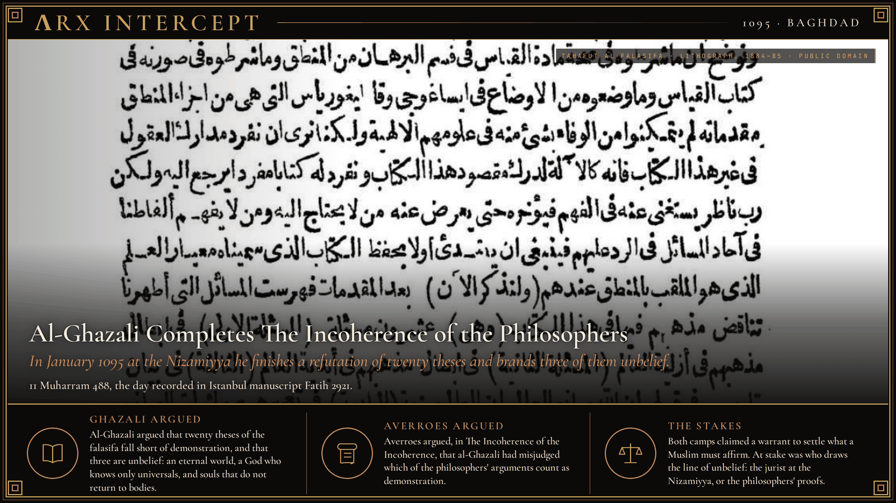
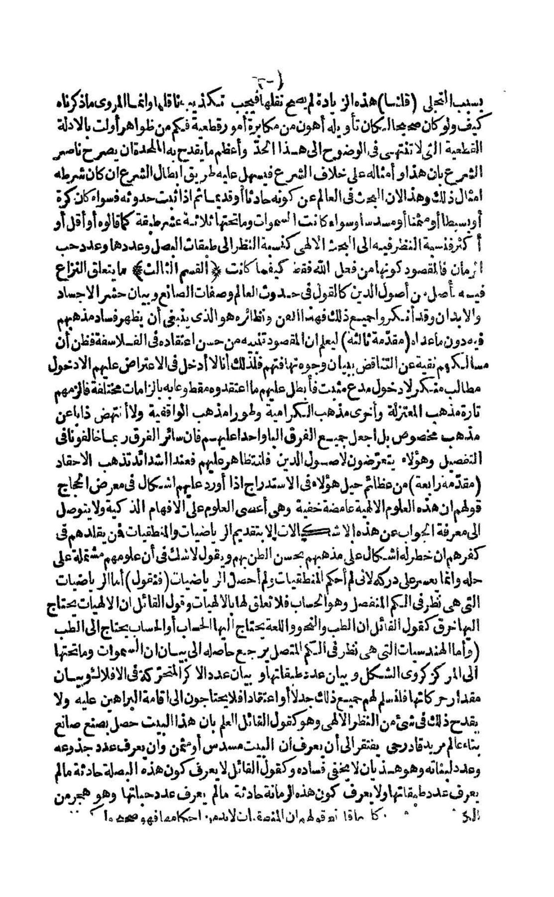

**ΛRX INTERCEPT** · Dispatch · 21 January 1095 · Baghdad

# Al-Ghazali Completes The Incoherence of the Philosophers

*In Muharram 488, January 1095, at the Nizamiyya in Baghdad, al-Ghazali finishes a refutation of twenty theses of the falasifa and brands three of them unbelief.*

On 21 January 1095 al-Ghazali completed *The Incoherence of the Philosophers* at the Nizamiyya in Baghdad, refuting twenty theses of the falasifa and branding three of them unbelief.

The day comes from one manuscript. Fatih 2921 in Istanbul, a copy finished in Shawwal 655 AH, records that *Tahafut al-falasifa* was completed on 11 Muharram 488. Maurice Bouyges did not find that date in the printed editions or in most of the copies he collated, and he accepted it from this one. George F. Hourani converts 11 Muharram 488 to 21 January 1095. The Encyclopaedia Iranica places the completion in the first fortnight of 488, January 1095, while al-Ghazali was professor at the Nizamiyya of Baghdad.

Nizam al-Mulk had appointed him to that chair in 484, July 1091, to teach Shafi'ite law. The Nizamiyya was one of the vizier's colleges, meant in part to train scholars against the claims of the Fatimid caliphs. Before the refutation, al-Ghazali set out the philosophers' system in *Maqasid al-falasifa*, The Aims of the Philosophers, and wrote that a reader had to know the doctrines before answering them. *Tahafut al-falasifa* is the answer. It takes up Abu Nasr al-Farabi and Ibn Sina, Avicenna. In *The Deliverer from Error* he later said he had studied the falasifa for two years at Baghdad and written the Incoherence in a third. Frank Griffel, in the Stanford Encyclopedia, treats that timetable as an apology, and writes that the book may have been decades in the making.

He did not write it against logic, mathematics, astronomy, or physics. The target is metaphysics. Of the twenty discussions, sixteen concern the philosophers' metaphysics and four their natural science. On some of them, Griffel writes, al-Ghazali grants that the thesis can be true and argues only that it has not been demonstrated. At the end he sorts the twenty by the religious law. Most, he says, are wrong and count as innovations. Three he holds to be unbelief: that the world had no beginning in time, that God knows only universals and not particular beings and their circumstances, and that human souls do not return to bodies. Iranica names the same three: the eternity of the world, the denial of God's knowledge of particulars, and the repudiation of bodily resurrection. Wikipedia counts seventeen of the twenty as heresy and the three as disbelief.

The seventeenth discussion is on causality. He writes, in Michael Marmura's translation: "The connection between what is habitually believed to be a cause and what is habitually believed to be an effect is not necessary, according to us." Observation, he argues, shows that cotton burns when fire touches it. It does not show that the fire is the cause. The agent of the burning, he writes, is God, either through the mediation of the angels or without mediation. The discussion presses the philosophers to grant that the miracles reported in the Qur'an are possible. They call such a break impossible. Frank Griffel reads the wording as leaving two accounts open. Occasionalism, in which God creates the fire and the burning side by side, fits it. So does a chain of secondary causes that still begins in God. What al-Ghazali refuses is the claim that the link is necessary in itself.

Later in 488 he left the chair. The book remained. Ibn Rushd, Averroes, who died in 1198, answered it with *Tahafut al-tahafut*, The Incoherence of the Incoherence, quoting al-Ghazali and replying in turn. He defended the philosophers' doctrines and criticized al-Ghazali's arguments. Griffel writes that Averroes accepted the rule that only a valid demonstration may set aside the outward sense of revelation, and rejected al-Ghazali's findings on what had been demonstrated.

Al-Ghazali argued that twenty theses of the falasifa fall short of demonstration, and that three are unbelief: an eternal world, a God who knows only universals, and souls that do not return to bodies. Averroes argued, in *The Incoherence of the Incoherence*, that al-Ghazali had misjudged which of the philosophers' arguments count as demonstration.

Both camps claimed a warrant to settle what a Muslim must affirm. At stake was who draws the line of unbelief: the jurist at the Nizamiyya, or the philosophers' proofs.

---

## Sources

**Original reporting**
- [Ḡazālī, i. Biography](https://www.iranicaonline.org/articles/gazali/gazali-i-biography/) — Encyclopaedia Iranica
- [A Revised Chronology of Ghazālī's Writings](https://www.ghazali.org/articles/gfh-gz.pdf) — George F. Hourani, Journal of the American Oriental Society 104.2 (1984)
- [Chronologie des œuvres d'Algazel, on the date of the Tahafut](https://www.ghazali.org/biblio/bouyges/essai/no16-21.pdf) — Maurice Bouyges

**Context**
- [Al-Ghazali](https://plato.stanford.edu/entries/al-ghazali/) — Stanford Encyclopedia of Philosophy
- [The Incoherence of the Philosophers](https://en.wikipedia.org/wiki/The_Incoherence_of_the_Philosophers) — Wikipedia

**Framing**
- [The Incoherence of the Philosophers, 17th discussion, trans. Michael E. Marmura (2000)](https://plato.stanford.edu/entries/al-ghazali/) — quoted in the Stanford Encyclopedia of Philosophy
- [The Incoherence of Philosophers, lithograph of 1884–85 (World Digital Library 7456)](https://commons.wikimedia.org/wiki/File:The_Incoherence_of_Philosophers_WDL7456.pdf) — Wikimedia Commons, Bibliotheca Alexandrina

*Filed by the ΛRX Intercept desk · arxcortex.io*

*Written on 6 Nov 2026 from the sources above, for the Chronosphere religion lens. Art: a page of Tahafut al-falasifa, lithographed 1884–85, Bibliotheca Alexandrina, World Digital Library 7456, via Wikimedia Commons (public domain). Plate: another page of the same copy, the opening of a numbered discussion (public domain). No portrait was used.*
