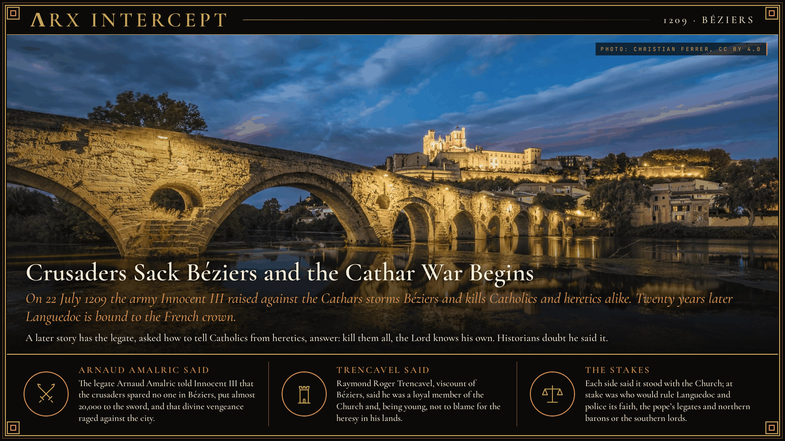
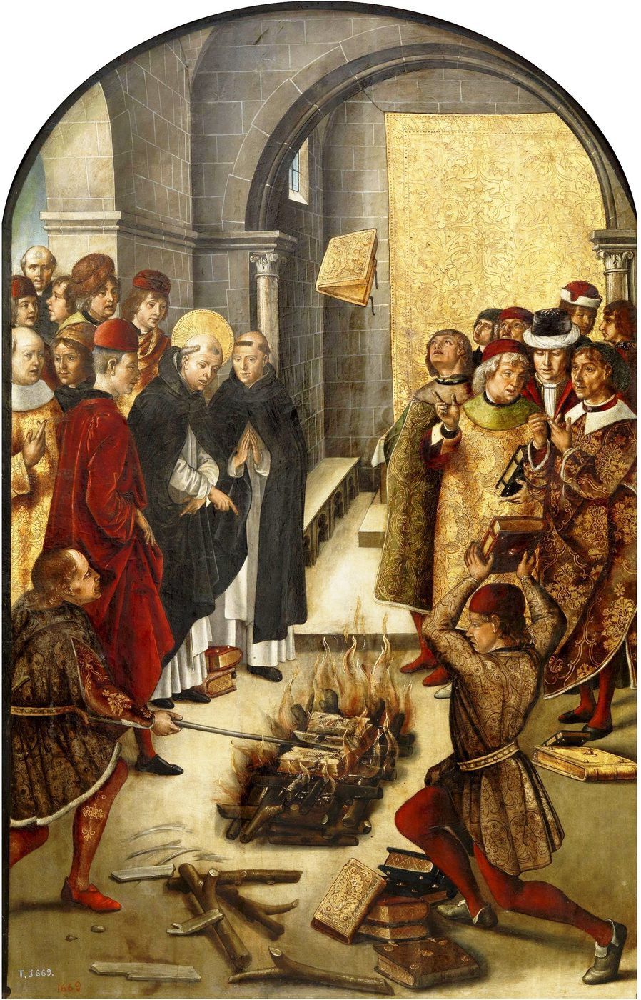

**ΛRX INTERCEPT** · Dispatch · 22 Jul 1209 · Béziers

# Crusaders Sack Béziers and the Cathar War Begins

*On 22 July 1209 the army Innocent III raised against the Cathars storms Béziers and kills Catholics and heretics alike. Twenty years later Languedoc is bound to the French crown.*

On 22 July 1209 crusaders called by Pope Innocent III stormed Béziers and killed Catholics and Cathars alike.

The papal legate told the pope almost 20,000 died. Historians count far fewer.

Twenty years of war bound the south to the French crown.

The Cathars of Languedoc taught that the material world was evil and that the Catholic clergy had strayed from the poverty of Christ. Church councils had condemned them since the eleventh century, the Third Lateran Council among them in 1179, and the lords of the south, Raymond VI of Toulouse first among them, let their preachers work. In January 1208 the papal legate Pierre de Castelnau was killed the morning after a quarrel with Raymond, allegedly by one of the count's knights. Innocent III declared a crusade, with the same indulgence as a journey to the Holy Land, and offered the heretics' lands to any noble who would take them.

By mid-1209 between 20,000 and 30,000 crusaders had gathered, most from northern France. Raymond VI made his peace with the Church in June and took the cross himself, so the army turned on his nephew and vassal, Raymond Roger Trencavel, viscount of Béziers and Carcassonne. Trencavel, 24, was not a Cathar, though his sister was one of their perfect. His offer of submission was refused, and he rode on to Carcassonne, taking some Cathars and the Jews of Béziers with him. Bishop Renaud de Montpeyroux brought the townspeople the crusaders' terms: hand over 222 named heretics, or let the Catholics leave. The town refused both, and most Catholics stayed.

On 22 July, the day after the army arrived, townsmen went out to taunt it. Mercenaries chased them back through the open gate, and the army followed. People who fled to the churches were killed inside them, priests included, and the cathedral of Saint-Nazaire burned. A decade later the Cistercian Caesarius of Heisterbach wrote that the legate Arnaud Amalric, asked how to tell Catholics from heretics, answered: kill them all, for the Lord knows his own. Christopher Tyerman judges the legate's own figure of almost 20,000 dead far too high, and Laurence Marvin calls the famous line apocryphal and notes that Béziers went on as a major town.

Carcassonne surrendered on 15 August, Trencavel died in prison that year, and Simon de Montfort took his lands. The Fourth Lateran Council confirmed Montfort as count of Toulouse in 1215, the southern lords won much of it back, and Louis VIII led a royal crusade in 1226. In the Treaty of Paris of 1229 Raymond VII agreed that Toulouse would pass to the king's brother; it went to the crown in 1271. Gregory IX set inquisitors on the remaining Cathars from 1234, and the Dominican order, founded by a preacher who had worked among them, grew up beside the inquisition.

Arnaud Amalric said the crusaders spared no one in Béziers and that divine vengeance raged against the city. Raymond Roger Trencavel said he was a loyal member of the Church and, being young, not to blame for the heresy in his lands.

The legate says the slaughter was God's vengeance on a city of heretics; the viscount says a loyal lord is not to blame for heresy in his lands. Each says he stands with the Church. At stake is who rules Languedoc and polices its faith: the pope's legates and the northern barons, or the southern lords.

---

## Sources

**Original reporting**
- [Massacre at Béziers](https://en.wikipedia.org/wiki/Massacre_at_B%C3%A9ziers) — Wikipedia
- [Albigensian Crusade](https://en.wikipedia.org/wiki/Albigensian_Crusade) — Wikipedia
- [Arnaud Amalric](https://en.wikipedia.org/wiki/Arnaud_Amalric) — Wikipedia
- [Raymond Roger Trencavel](https://en.wikipedia.org/wiki/Raymond_Roger_Trencavel) — Wikipedia

**Context**
- [Catharism](https://en.wikipedia.org/wiki/Catharism) — Wikipedia
- [Pierre de Castelnau](https://en.wikipedia.org/wiki/Pierre_de_Castelnau) — Wikipedia
- [The Occitan War: A Military and Political History of the Albigensian Crusade, 1209–1218](https://doi.org/10.1017/CBO9780511496561) — Laurence W. Marvin, Cambridge University Press
- [God's War: A New History of the Crusades](https://www.hup.harvard.edu/books/9780674023871) — Christopher Tyerman, Harvard University Press

**Framing**
- [Caesarius of Heisterbach: Medieval Heresies, the Albigensians](https://sourcebooks.fordham.edu/source/caesarius-heresies.asp) — Internet History Sourcebooks, Fordham University

*Filed by the ΛRX Intercept desk · arxcortex.io*

*Grok Bot wrote this on 30 Oct 2026 from the sources above, for the Chronosphere religion lens. Photograph: Pont Vieux et Cathédrale Saint-Nazaire, Christian Ferrer, Wikimedia Commons (CC BY 4.0). Painting: Saint Dominic and the Albigensians, Pedro Berruguete, c. 1493–1499, Museo del Prado, Wikimedia Commons (public domain).*
