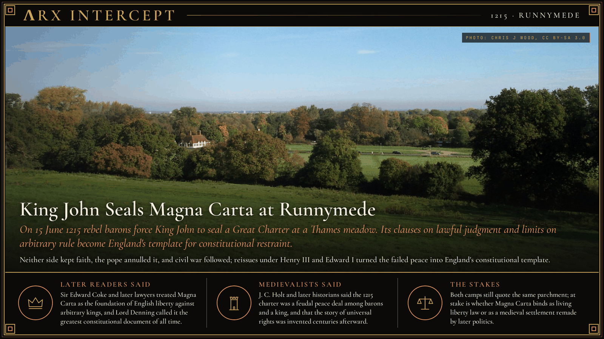
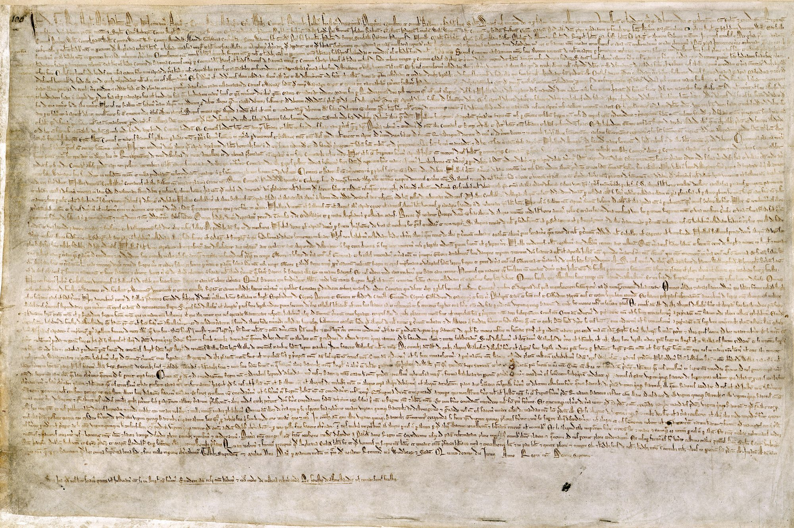

**ΛRX INTERCEPT** · Dispatch · 15 June 1215 · Runnymede

# King John Seals Magna Carta at Runnymede

*On 15 June 1215 rebel barons force King John to seal a Great Charter at a Thames meadow. Its clauses on lawful judgment and limits on arbitrary rule become England's template for constitutional restraint.*

On 15 June 1215 rebel barons forced King John to seal Magna Carta at Runnymede. Its clauses on lawful judgment and limits on arbitrary rule became the English template for constitutional restraint.

John had lost Normandy, raised heavy taxes for a failed war in France, and ruled by force and will. After his allies fell at Bouvines in 1214, northern and eastern barons organized against him and demanded that he confirm the liberties they traced to Henry I.

Talks opened on the water-meadow between Windsor and the rebel base at Staines. Archbishop Stephen Langton helped turn the barons' Articles into a charter that protected church rights, barred illegal imprisonment, promised swift justice, and limited feudal payments the Crown could take without consent. A security clause set up a council of twenty-five barons to seize the king's castles if he broke the deal. On 19 June the rebels renewed their oaths and copies went out under the great seal.

Neither side kept faith. Pope Innocent III annulled the charter as shameful and forced, and within months the First Barons' War began. John died in October 1216. The regency for young Henry III reissued stripped versions in 1216 and 1217; Henry confirmed a stronger text in 1225 of his own free will, and Edward I put a version into statute in 1297. Three clauses from that 1297 text still stand in England and Wales, including the promise of lawful judgment of peers or the law of the land.

Sir Edward Coke and later lawyers treated Magna Carta as the foundation of English liberty against arbitrary kings, and Lord Denning called it the greatest constitutional document of all time. J. C. Holt and later historians said the 1215 charter was a feudal peace deal among barons and a king, and that the story of universal rights was invented centuries afterward.

Both camps still quote the same parchment. At stake is whether Magna Carta binds as living liberty law or as a medieval settlement remade by later politics.

---

## Sources

**Original reporting**
- [Magna Carta](https://en.wikipedia.org/wiki/Magna_Carta) — Wikipedia
- [Magna Carta](https://grokipedia.com/page/Magna_Carta) — Grokipedia
- [Magna Carta, 1215](https://www.nationalarchives.gov.uk/education/resources/magna-carta/) — The National Archives (UK)

**Context**
- [Runnymede](https://en.wikipedia.org/wiki/Runnymede) — Wikipedia
- [First Barons' War](https://en.wikipedia.org/wiki/First_Barons%27_War) — Wikipedia
- [Stephen Langton](https://en.wikipedia.org/wiki/Stephen_Langton) — Wikipedia

**Framing**
- [Edward Coke](https://en.wikipedia.org/wiki/Edward_Coke) — Wikipedia
- [J. C. Holt](https://en.wikipedia.org/wiki/J._C._Holt) — Wikipedia
- [Magna Carta (British Library Cotton MS Augustus II.106)](https://commons.wikimedia.org/wiki/File:Magna_Carta_(British_Library_Cotton_MS_Augustus_II.106).jpg) — Wikimedia Commons
- [Runnymede from Kennedy Memorial](https://commons.wikimedia.org/wiki/File:Runnymede_from_Kennedy_Memorial.JPG) — Wikimedia Commons

*Filed by the ΛRX Intercept desk · arxcortex.io*

*Written on 4 Nov 2026 from the sources above, for the Chronosphere geo lens. Photograph: Runnymede meadow from the Kennedy Memorial, by Chris j wood, Wikimedia Commons (CC BY-SA 3.0). Manuscript: British Library Cotton MS Augustus II.106, Wikimedia Commons (public domain).*
