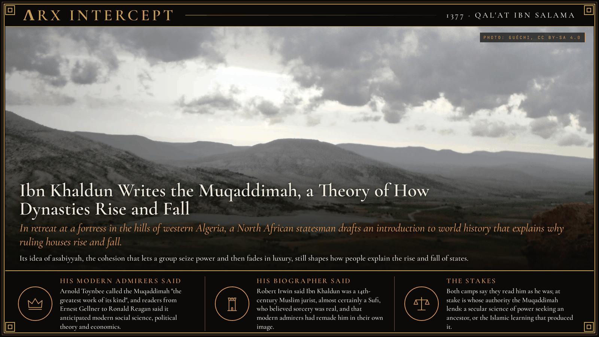
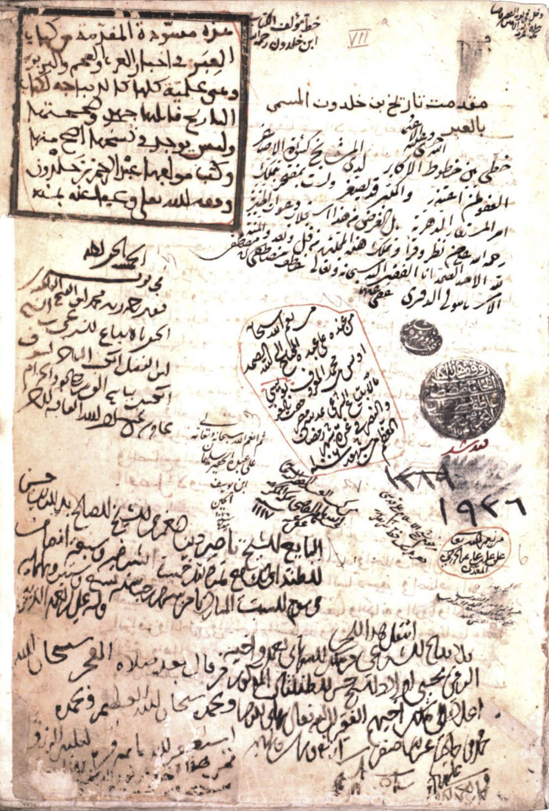

**ΛRX INTERCEPT** · Dispatch · 1377 · Qal'at Ibn Salama

# Ibn Khaldun Writes the Muqaddimah, a Theory of How Dynasties Rise and Fall

*In retreat at a fortress in the hills of western Algeria, a North African statesman drafts an introduction to world history that explains why ruling houses rise and fall.*

In 1377 Ibn Khaldun, who had served rulers from Granada to Bejaia, retreated to the fortress of Qal'at Ibn Salama in western Algeria and wrote the Muqaddimah. It argued that dynasties rise on group cohesion and decay in luxury.

He meant it as the opening book of a world history, the Kitab al-'Ibar, or Book of Lessons. Within his lifetime it was read as a work of its own.

Ibn Khaldun was born in Tunis in 1332 to a family that had left Seville a century earlier. From the age of twenty he worked in North African chanceries and courts, moving between Fez, Granada, Bejaia and Tlemcen as rulers rose and fell, and serving as prime minister in Bejaia. In 1375 Abu Hammu, the sultan of Tlemcen, sent him on a mission to the Arab tribes around Biskra. He turned aside instead to Qal'at Ibn Salama, a fortress on a rock spur about five kilometres south of Frenda, and stayed there more than three years under the protection of its tribal holders.

There, by his own account in his autobiography, he wrote the Muqaddimah in about six months. Its central term is asabiyyah, the solidarity of a kin group or tribe. In his telling, ruling houses arise on the edges of settled empires, where hardship keeps that solidarity strong; they take the cities, grow used to luxury, raise taxes as their cohesion weakens, and give way to a fresher group from the margins. He wrote that "injustice ruins civilization." The book also weighs how to test historical reports, why reporters exaggerate and how partisanship bends evidence. Lacking books at the fortress to finish the history, he returned to Tunis in 1378 and later moved to Cairo, where he taught and served as a judge. In 1401 he met Timur outside Damascus. He died in Cairo in 1406.

Ottoman historians such as Kâtip Çelebi and Mustafa Naima used the book to explain their own empire's growth and decline. Étienne-Marc Quatremère printed the Arabic text in Paris in 1858, William McGuckin de Slane translated it into French in 1863, and Franz Rosenthal published the full English translation in 1958.

Arnold Toynbee called the Muqaddimah "the greatest work of its kind", and readers from Ernest Gellner to Ronald Reagan said it anticipated modern social science, political theory and economics; Reagan cited its line on tax assessments in 1981. Robert Irwin, in his 2018 intellectual biography, said Ibn Khaldun was a 14th-century Muslim jurist, almost certainly a Sufi, who believed sorcery was real, and that modern admirers had remade him in their own image.

Both camps say they read the man as he was, and both quote the same pages. At stake is whose authority the Muqaddimah lends: a secular science of power that wants a medieval ancestor, or the Islamic learning that produced the book and its author.

---

## Sources

**Original reporting**
- [Muqaddimah](https://en.wikipedia.org/wiki/Muqaddimah) — Wikipedia
- [Muqaddimah](https://grokipedia.com/page/Muqaddimah) — Grokipedia
- [Ibn Khaldun](https://en.wikipedia.org/wiki/Ibn_Khaldun) — Wikipedia

**Context**
- [Qalʿat ibn Salâma](https://fr.wikipedia.org/wiki/Qal%CA%BFat_ibn_Sal%C3%A2ma) — Wikipédia
- [Le site préhistorique et protohistorique karstique « Grottes d'Ibn Khaldoun » dans la reculée de Taoughzout (Z. Chabane, 2024)](https://doi.org/10.1016/j.anthro.2024.103306) — L'Anthropologie

**Framing**
- [Review of Robert Irwin's 'Ibn Khaldun: An Intellectual Biography'](https://www.insidehighered.com/views/2018/04/13/review-robert-irwin%E2%80%99s-%E2%80%98ibn-khaldun-intellectual-biography%E2%80%99) — Inside Higher Ed
- [A Muslim Founder of the Social Sciences?](https://lareviewofbooks.org/article/a-muslim-founder-of-the-social-sciences/) — Los Angeles Review of Books
- [The Otherworldliness of Ibn Khaldun](https://www.nybooks.com/articles/2019/02/07/otherworldliness-ibn-khaldun/) — The New York Review of Books
- [Ibn Khaldūn autograph, al-Muqaddima, MS Atıf Efendi 1936, f. 7a](https://commons.wikimedia.org/wiki/File:Ibn_Khald%C5%ABn_autograph,_al-Muqaddima,_MS_At%C4%B1f_Efendi_1936,_f._7a.png) — Wikimedia Commons

*Filed by the ΛRX Intercept desk · arxcortex.io*

*Written on 4 Nov 2026 from the sources above, for the Chronosphere geo lens. Photograph: Taoughzout, near Frenda, Algeria, by Guéchi, Wikimedia Commons (CC BY-SA 4.0). Manuscript: Ibn Khaldūn autograph, al-Muqaddima, MS Atıf Efendi 1936, f. 7a, Wikimedia Commons (public domain).*
