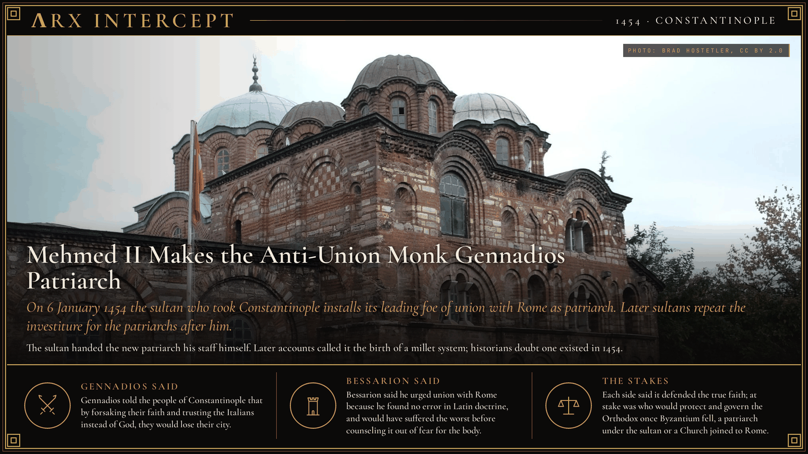
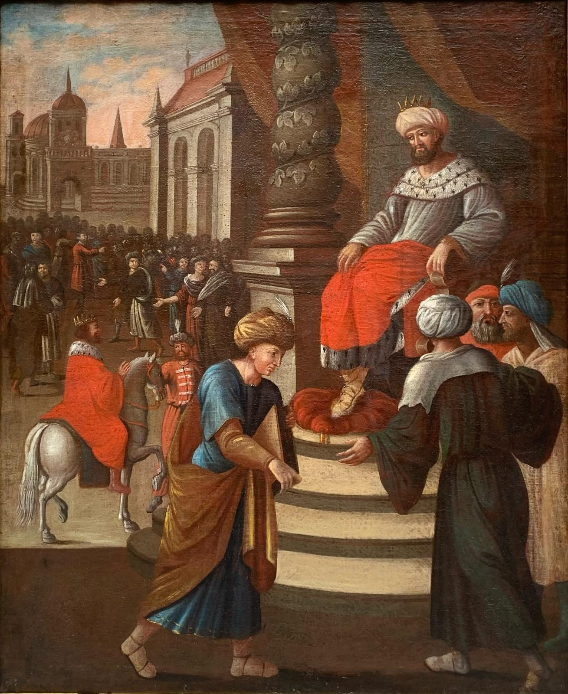

**ΛRX INTERCEPT** · Dispatch · 6 Jan 1454 · Constantinople

# Mehmed II Makes the Anti-Union Monk Gennadios Patriarch

*On 6 January 1454 the sultan who took Constantinople installs its leading foe of union with Rome as patriarch. Later sultans repeat the investiture for the patriarchs after him.*

Mehmed II took Constantinople in May 1453. In January 1454 he made Gennadios Scholarios, the city's leading foe of union with Rome, its patriarch.

The sultan handed him the staff of office himself.

The Church outlived Byzantium, under the sultan.

Georgios Scholarios, born in Constantinople about 1400, taught philosophy and served John VIII Palaiologos as a judge. He went with the emperor to the Council of Ferrara-Florence in 1438–1439, which sought to end the schism with Rome in return for Western help against the Ottomans, and at first he spoke for union. Under his teacher Mark of Ephesus he turned against it and left the council early, in June 1440. He became a monk around 1450, taking the name Gennadios, and led the anti-union party when Isidore of Kiev proclaimed the union in Hagia Sophia on 12 December 1452. A notice was said to hang on his cell door: in losing your faith you will lose your city.

Mehmed II took the city on 29 May 1453, and Gennadios was taken captive. The sultan wanted the Greeks loyal and wanted no appeal to the Latins that might bring a new crusade, so he sought out the most anti-Latin cleric he could find. Gennadios was ordained deacon, priest and bishop in quick succession and enthroned on 6 January 1454; the 1913 Catholic Encyclopedia put the ceremony on 1 June 1453, but modern lists give the January date. Mehmed handed him the staff of office himself, a rite later sultans repeated for patriarchs after him. Hagia Sophia was now a mosque, so the patriarch took the Church of the Holy Apostles, then moved in 1456 to the Pammakaristos.

The patriarch became head of all the sultan's Orthodox subjects, Greeks, Serbs, Bulgarians, Albanians, Wallachians, Arabs and others, with authority over church courts and the collection of their taxes. Gennadios wrote a confession of the Orthodox faith for Mehmed, which Ahmed, the qadi of Berrhoea, put into Turkish; it counts as the first of the Orthodox symbolic books. He was unhappy in office and resigned, most sources say in 1456, and died about 1472 as a monk at the monastery of Saint John Prodromos near Serres.

In Italy Bessarion, the Greek bishop who had read out the union in Florence cathedral and become a cardinal, pressed Western princes to help the Christians of the East, and Pius II made him titular Latin patriarch of Constantinople in 1463. A synod at the Pammakaristos condemned the Council of Florence in 1484. Later accounts traced a millet system of self-governing faiths back to the Conqueror's grant, but historians now hold that no such system existed in the fifteenth century; the formal millets date from the early nineteenth. The patriarchate left the Pammakaristos in 1587, and the church became the Fethiye Mosque in 1591.

Gennadios said that by forsaking their faith and trusting the Italians instead of God, the people of Constantinople would lose their city. Bessarion said he urged union with Rome because he found no error in Latin doctrine, and would have suffered the worst before counseling it out of fear for the body.

The monk says union betrays the faith and will cost the city; the cardinal says union is the faith rightly understood. Each says he defends the true Church. At stake is who protects and governs the Orthodox once the empire falls: a patriarch who holds office from the sultan, or a Church joined to Rome and the arms of the West.

---

## Sources

**Original reporting**
- [Gennadius Scholarius](https://en.wikipedia.org/wiki/Gennadius_Scholarius) — Wikipedia
- [Gennadius Scholarius](https://grokipedia.com/page/Gennadius_Scholarius) — Grokipedia
- [Ecumenical Patriarchate of Constantinople](https://en.wikipedia.org/wiki/Ecumenical_Patriarchate_of_Constantinople) — Wikipedia
- [Pammakaristos Church](https://en.wikipedia.org/wiki/Pammakaristos_Church) — Wikipedia

**Context**
- [Council of Florence](https://en.wikipedia.org/wiki/Council_of_Florence) — Wikipedia
- [Mark of Ephesus](https://en.wikipedia.org/wiki/Mark_of_Ephesus) — Wikipedia
- [Bessarion](https://en.wikipedia.org/wiki/Basilios_Bessarion) — Wikipedia
- [Millet (Ottoman Empire)](https://en.wikipedia.org/wiki/Millet_(Ottoman_Empire)) — Wikipedia

**Framing**
- [Gennadius II](https://en.wikisource.org/wiki/Catholic_Encyclopedia_(1913)/Gennadius_II) — Catholic Encyclopedia (1913), Wikisource

*Filed by the ΛRX Intercept desk · arxcortex.io*

*Grok Bot wrote this on 31 Oct 2026 from the sources above, for the Chronosphere religion lens. Photograph: Istanbul, Fethiye Mosque (Pammakaristos), Brad Hostetler, Wikimedia Commons (CC BY 2.0). Painting: Patriarch Gennadios with Mehmed II, 18th century, unknown artist, Wikimedia Commons (CC0).*
