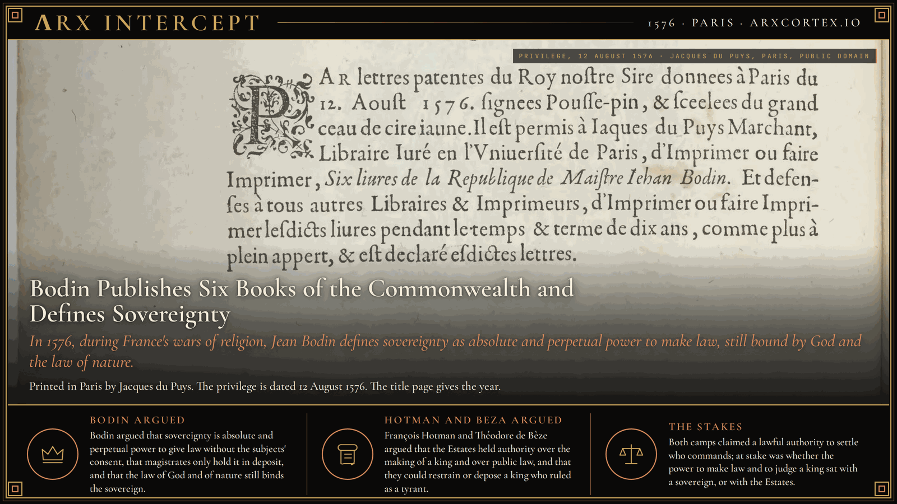
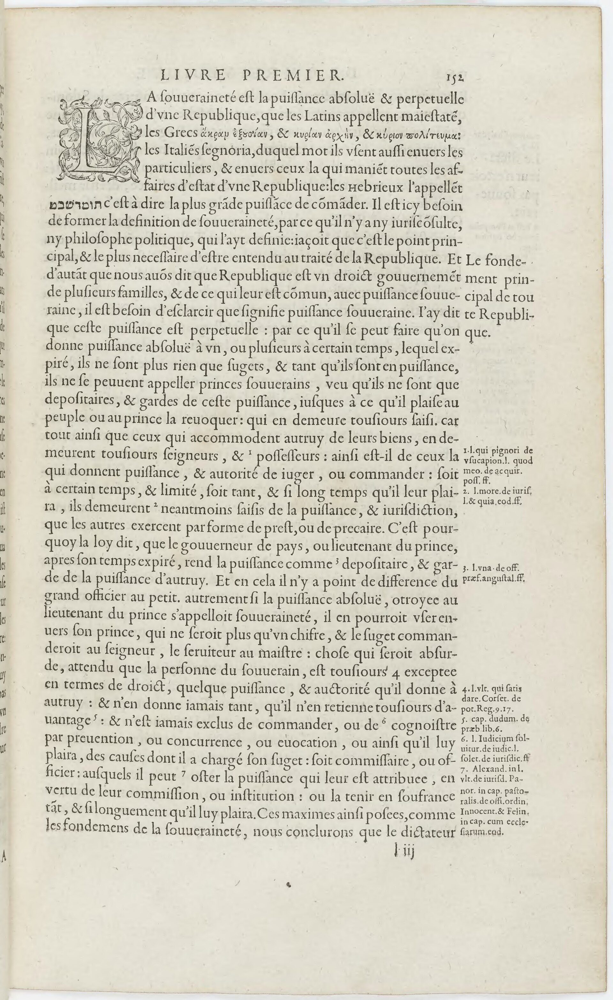

**ΛRX INTERCEPT** · Dispatch · 1576 · Paris

# Bodin Publishes Six Books of the Commonwealth and Defines Sovereignty

*In 1576, during France's wars of religion, Jean Bodin publishes Six Books of the Commonwealth in Paris and defines sovereignty as absolute and perpetual power to make law, still bound by God and the law of nature.*

In 1576 Jean Bodin published *Les six livres de la Republique* in Paris. On the page the first edition numbers 152, in the chapter "De la souveraineté," he wrote: "La souveraineté est la puissance absoluë & perpetuelle d'une Republique."

The book appeared while France was still in the wars of religion that followed the killings of Huguenots in Paris on 24 August 1572, St Bartholomew's Day, and in other towns in the weeks after.

The title page names the author as I. Bodin, Angevin, dedicates the book to Guy du Faur, seigneur de Pibrac, a counsellor of the king in his privy council, and gives the imprint "A Paris, Chez Iacques du Puys, Libraire Iuré, à la Samaritaine," with the year 1576 and the king's privilege. The privilege leaf prints letters patent given at Paris on 12 August 1576, sealed with the great seal in yellow wax, allowing Jacques du Puys, a sworn bookseller of the University of Paris, to print *Six livres de la Republique* of Maistre Iehan Bodin for ten years, and forbidding other booksellers to do so. The title page carries the year 1576. The privilege dates the king's permission to print.

In the preface to Pibrac, Bodin wrote that the conservation of kingdoms and empires depends, after God, on good princes and wise governors, and that each person should help them keep their power, carry out their laws, and bend their subjects toward the common good. He then described the ship of "nostre Republique" as having left a fair wind for a storm in which the master and the pilots were worn out, and the passengers had to take the sails, the ropes, and the anchor.

He built the definition by separating the holder of sovereignty from everyone who merely exercises it. A power given for a time, however absolute while it lasts, makes the holder a depositary. When the term ends he is a subject again. The person who granted the power, whether prince or people, remains seized of it, as an owner remains owner of goods he has lent. On that rule Bodin excluded the Roman dictator, the regent of a kingdom, and any commissioner or magistrate whose charge expires. He treated sovereignty as unlimited in extent, in charge, and in duration. The sovereign, on his definition, recognizes nothing greater than himself after God, and accounts for his command to God alone.

Later in the same chapter he put lawmaking at the center of that power. He located the principal mark of sovereign majesty in the power "à donner loy aux sugets en general sans leur consentement," to give law to subjects in general without their consent. Custom, he wrote, grows by long use. Law comes from the one who has the power to command, and the sovereign can turn a custom aside by edict. He cited French kings who had abolished general customs without calling the Estates.

He placed the limit on that power in the law of God and of nature. If a prince forbids killing on pain of death, Bodin asked, is the prince obliged by his own law? He answered that this law is "la loy de Dieu, & de nature," by which the prince is more strictly obliged than any subject, and that neither the senate nor the people can dispense him from it. He remains answerable to the judgment of God. He cited Marcus Aurelius for the order of judgment: magistrates over private persons, princes over magistrates, and God over princes. He recorded Antigonus answering a flatterer who said that all things are just for kings: that was true, Antigonus said, of barbarian kings and tyrants.

The same book separates who holds sovereignty from how the commonwealth is governed. The 1576 table of contents gives Book II to the kinds of commonwealth: seigneurial, royal, and tyrannical monarchy, then the aristocratic state and the popular state. Mario Turchetti, in the Stanford Encyclopedia, reads Bodin as defining monarchy, aristocracy, and democracy by who holds the sovereignty, one or a few or the people, and then allowing the filling of offices to cut across that line. A monarch can open magistracies to everyone, or reserve them to the noble, the rich, or the virtuous. Sovereignty can sit with a prince, with a minority, or with the people, according to the form of the state. In France he placed it in the king. In Book II, chapter 5, on whether one may attack the person of a tyrant, he held that where the prince is an absolute sovereign, as he took the kings of France to be, subjects may not proceed against his life or honor by law or by arms, however evil his deeds. A tyrant who has seized power by an unjust war stood, for him, in a different case from a legitimate sovereign.

Those pages answer books already in print. In 1573 François Hotman published *Francogallia*. His French version, *La Gaule françoise* (1574), argued from chronicles that the kings of France had anciently been established by the consent and will of the people rather than by hereditary right, and that "le peuple a eu plein pouvoir et souveraine authorité de les deposer quand ils l'avoyent desservy." Kings, he wrote, were chosen under laws and conditions, "non point comme tyrans avec une puissance absolue, excessive et infinie." In the chapter on the assembly of the Estates he listed what that assembly decided: the election or the deposition of a king, peace and war, public laws, and the great offices, and he wrote that an affair touching the state of the commonwealth was to be decided in the assembly of the Estates.

In 1574 Théodore de Bèze set out a different resistance in *Du droit des magistrats*. Private persons, he argued, may not on their own authority meet a lawful ruler who has become a tyrant with violence. The orders or estates, placed as a bridle on the supreme magistrate, can and should resist him in every way when he degenerates into a tyrant. The people, he argued, existed before there was a magistrate, and magistrates were made for the people. Bodin, in the chapter on sovereignty, wrote that those who had treated the duties of magistrates, and similar books, were wrong to set the Estates of the people above the prince, and he called those notions absurd and incompatible.

The same year the king called the kingdom into the argument in person. On 6 May 1576 Henri III issued the Edict of Beaulieu, the Peace of Monsieur, conceding terms to the reformed party. He summoned the Estates General to Blois for 15 November 1576. Bodin went as deputy for Vermandois and kept a journal, the *Recueil* of 1577. By the middle of February 1577 he was presiding over the Third Estate. He refused the clergy and the nobility a review of the cahiers that would have left the Third Estate in the minority, and he opposed two royal requests for subsidies and the perpetual alienation of crown domain, which he treated as the property of the people. With the majority of that estate he supported a request that the king unite his subjects in the Catholic, apostolic, and Roman religion by holy and legitimate means, without war. On 6 January 1577 Henri III revoked the Edict of Beaulieu.

Bodin argued that sovereignty is absolute and perpetual power to give law without the subjects' consent, that magistrates only hold it in deposit, and that the law of God and of nature still binds the sovereign. François Hotman and Théodore de Bèze argued that the Estates held authority over the making of a king and over public law, and that they could restrain or depose a king who ruled as a tyrant.

Both camps claimed a lawful authority to settle who commands. At stake was whether the power to make law and to judge a king sat with a sovereign, or with the Estates.

---

## Sources

**Original reporting**
- [Les Six Livres de la République (1576), Book I, De la souveraineté](https://fr.wikisource.org/wiki/Les_Six_Livres_de_la_R%C3%A9publique/19) — Wikisource, from the Bibliothèque nationale de France copy
- [Les six livres de la Republique (1576), digital facsimile](https://gallica.bnf.fr/ark:/12148/btv1b86268103) — Gallica, Bibliothèque nationale de France
- [Jean Bodin](https://plato.stanford.edu/entries/bodin/) — Stanford Encyclopedia of Philosophy

**Context**
- [La Gaule françoise (1574 French text of Francogallia)](https://corpus.ataruq.fr/hotman-gaule-francaise) — Corpus des œuvres de philosophie en langue française
- [Jean Bodin on Sovereignty](https://shc.stanford.edu/arcade/publications/rofl/issues/volume-2-issue-2/jean-bodin-sovereignty) — Edward Andrew, Republics of Letters
- [St. Bartholomew's Day Massacre](https://en.wikipedia.org/wiki/St._Bartholomew%27s_Day_massacre) — Wikipedia

**Framing**
- [On the Rights of Magistrates (English translation of the 1574 treatise)](https://www.uecf.net/books/33/Beza%20-%20Rights%20of%20Magistrates.pdf) — Henry-Louis Gonin
- [Bodin, Les Six Livres de la République, 1576 (privilege and sovereignty pages)](https://commons.wikimedia.org/wiki/File:Bodin_-_Les_Six_Livres_de_la_R%C3%A9publique,_1576.djvu) — Wikimedia Commons, from Gallica / Bibliothèque nationale de France

*Filed by the ΛRX Intercept desk · arxcortex.io*

*Written on 5 Nov 2026 from the sources above, for the Chronosphere geo lens. Art: privilege leaf of Les six livres de la Republique, Paris, Jacques du Puys, 12 August 1576, Bibliothèque nationale de France, Gallica, via Wikimedia Commons (public domain). Page: Book I, the chapter De la souveraineté, page 152 of the same copy (public domain). The printer's device on the title page, which shows figures, was not used.*
