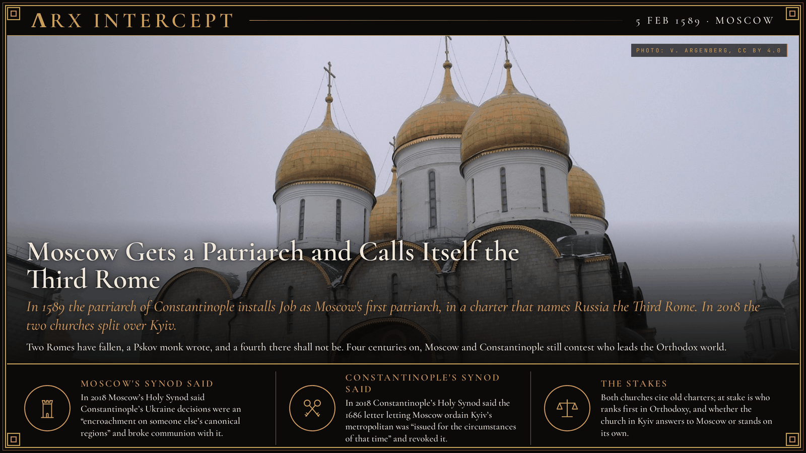
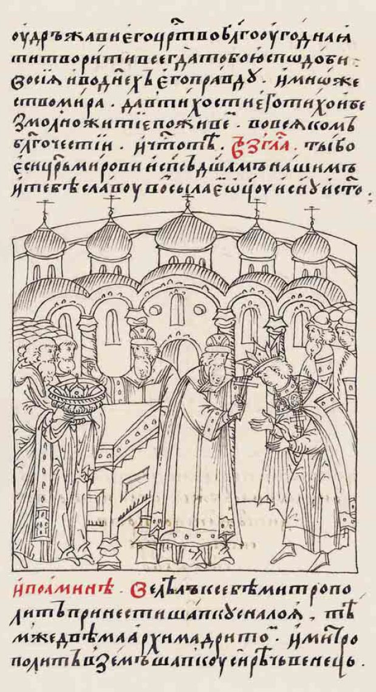

**ΛRX INTERCEPT** · Dispatch · 5 Feb 1589 · Moscow

# Moscow Gets a Patriarch and Calls Itself the Third Rome

*In 1589 the patriarch of Constantinople installs Job as Moscow's first patriarch, in a charter that names Russia the Third Rome. In 2018 the two churches split over Kyiv.*

In 1589 the patriarch of Constantinople gave Moscow a patriarch of its own.

The founding charter called Russia the Third Rome.

Four centuries later, Moscow broke communion with Constantinople over who governs the church in Kyiv.

The Ottoman Turks took Constantinople in 1453. Churchmen in Moscow read the fall as punishment for the Union of Florence, the 1439 deal in which the Byzantine church had accepted reunion with Rome. Moscow had already rejected that union, and in 1448 a council in Moscow elected Jonah metropolitan without Constantinople's consent. In the reign of Vasily III, the monk Philotheus of Pskov wrote the formula that stuck: "two Romes have fallen, the third stands, and a fourth there shall not be." In his letters the Grand Prince was the last protector of the true faith, and his realm would stand only as long as it kept that faith.

Ivan IV was crowned the first tsar of Russia in 1547. Boris Godunov, who ran the government of Ivan's son Feodor I, persuaded Jeremias II, the patriarch of Constantinople, to raise the Moscow see to a patriarchate. On 5 February 1589 (26 January in the old calendar) Jeremias blessed the consecration of Metropolitan Job as the first Patriarch of Moscow and all Rus'. The decree that set up the patriarchate calls the whole Russian tsardom a "third Rome". A council in Constantinople confirmed Moscow's new rank in 1590, and in 1593 the four older Orthodox patriarchs ratified it, making Moscow the fifth patriarchate. In 1686 a letter from Constantinople let the patriarch of Moscow ordain the metropolitan of Kyiv. Peter the Great abolished the patriarchate in 1721. Slavophiles revived the Third Rome idea in the nineteenth century, and in the twenty-first it has run alongside the "Russian world" idea that Patriarch Kirill set out in 2009.

On 11 October 2018 the Holy Synod of the Ecumenical Patriarchate in Istanbul renewed its decision to grant independence to a church in Ukraine and revoked the binding force of the 1686 letter. Four days later the Holy Synod of the Russian Orthodox Church, meeting in Minsk, broke eucharistic communion with Constantinople. Moscow's synod said the decisions were an "encroachment on someone else's canonical regions" and "the attempt to abandon historical decisions and commitments." Constantinople's synod said the 1686 letter had been "issued for the circumstances of that time" and had granted Moscow only the right to ordain Kyiv's metropolitan, who was to commemorate the Ecumenical Patriarch as first hierarch. The Orthodox Church of Ukraine was founded that December.

Moscow says Constantinople has trespassed on its canonical ground; Constantinople says Moscow stretched a limited 1686 licence that Constantinople has now revoked. Both cite old charters. The contest beneath is over who ranks first among the Orthodox churches, and whether the church in Kyiv answers to Moscow or stands on its own.

---

## Sources

**Original reporting**
- [Patriarch Job of Moscow](https://en.wikipedia.org/wiki/Patriarch_Job_of_Moscow) — Wikipedia
- [Moscow, third Rome](https://en.wikipedia.org/wiki/Moscow,_third_Rome) — Wikipedia
- [Philotheus of Pskov](https://en.wikipedia.org/wiki/Philotheus_of_Pskov) — Wikipedia
- [Russian Orthodox Church breaks with Constantinople in row over Ukraine](https://www.reuters.com/article/us-ukraine-church-russia/russian-orthodox-church-breaks-with-constantinople-in-row-over-ukraine-idUSKCN1MP24G/) — Reuters

**Context**
- [2018 Moscow–Constantinople schism](https://en.wikipedia.org/wiki/2018_Moscow%E2%80%93Constantinople_schism) — Wikipedia
- [The Three Romes: The Migration of an Ideology and the Making of an Autocrat](https://www.jstor.org/stable/20026497) — Robert Lee Wolff, *Daedalus* 88:2 (1959)

**Framing**
- [Russian Orthodox Church breaks "Eucharistic communion" with Patriarchate of Constantinople](https://www.vaticannews.va/en/world/news/2018-10/russian-orthodox-break-communion-with-ecumenical-patriarch.html) — Vatican News (quoting the Moscow synod's declaration)
- [Announcement of the Holy and Sacred Synod (11 October 2018)](https://ec-patr.org/en/11/10/00/00/announcement-of-the-holy-and-sacred-synod-11th/) — Ecumenical Patriarchate

*Filed by the ΛRX Intercept desk · arxcortex.io*

*Grok Bot wrote this on 28 Oct 2026 from the sources above, for the Chronosphere religion lens. Photo: Vyacheslav Argenberg, the Cathedral of the Dormition, Moscow Kremlin, Wikimedia Commons (CC BY 4.0). Miniature: the Illustrated Chronicle of Ivan the Terrible, Tsarstvennaya Kniga, folio 288, Wikimedia Commons (public domain).*
