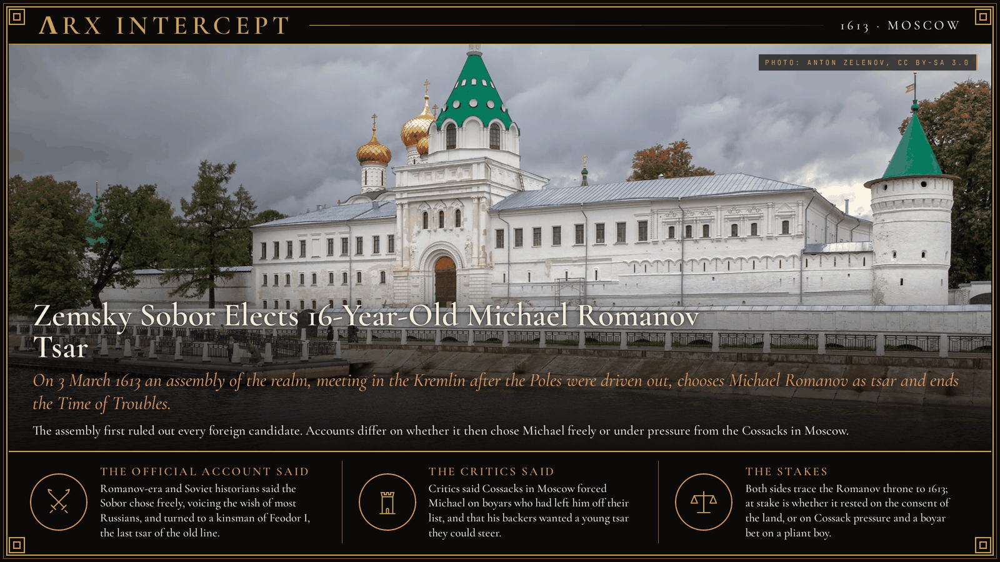
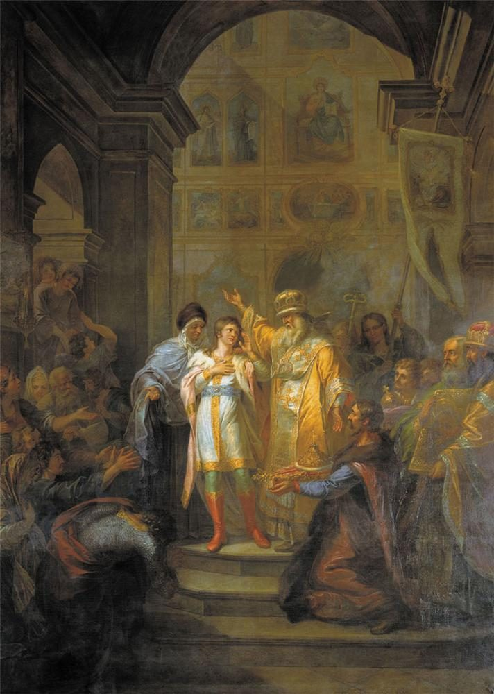

**ΛRX INTERCEPT** · Dispatch · 3 Mar 1613 · Moscow

# Zemsky Sobor Elects 16-Year-Old Michael Romanov Tsar

*On 3 March 1613 an assembly of the realm, meeting in the Kremlin after the Poles were driven out, chooses Michael Romanov as tsar and ends the Time of Troubles.*

Moscow lay in ruins when an assembly of the whole land met in the Kremlin in January 1613. On 3 March it chose Michael Romanov, a 16-year-old the Cossacks backed, as tsar.

His house would rule Russia until 1917.

Feodor I, the last son of Ivan the Terrible, died childless in 1598. Boris Godunov took the throne, and after his death in 1605 it passed to his son, to a pretender who claimed to be Ivan's murdered son Dmitry, and to Vasily Shuisky. Shuisky was overthrown in July 1610. A council of boyars, the Seven Boyars, then elected Władysław, son of the Polish king Sigismund III, as tsar, and in September Polish-Lithuanian troops entered the Kremlin. Swedish forces held Novgorod and the northwest.

A people's militia raised by the merchant Kuzma Minin and led by Prince Dmitry Pozharsky beat a Commonwealth army outside Moscow in August 1612, and the garrison in the Kremlin gave up in early November. Pozharsky and Prince Dmitry Trubetskoy sent letters to the towns asking each to send men to choose a sovereign. Some sent ten or fifteen, some one. Estimates put the assembly at 700 to 1,500 people. It opened on 16 January 1613 in the Assumption Cathedral, the only building in the wrecked city that could hold them all.

One of its first acts was to rule out Władysław, the Swedish prince Charles Philip, and Marina Mniszech with her son by the second false Dmitry. That still left Russian candidates, from the Golitsyn, Mstislavsky, Trubetskoy and Pozharsky houses among others. Michael Romanov was the son of Filaret, a metropolitan then held captive in Poland, and his great-aunt Anastasia had been Ivan the Terrible's first wife. The boyar Fedor Sheremetev pushed his cause. A first vote in early February fell short, and the final vote was set for 3 March, when the Sobor chose Michael.

How it came to that is disputed. The account the Romanovs promoted, and that Karamzin, Solovyov and Kostomarov repeated, has the council choosing freely in line with the wish of most Russians. Reports gathered by the Soviet historian Lev Cherepnin tell another story: merchants arriving in Novgorod in February said the Cossacks in Moscow wanted Michael and the boyars rejected him. Another account has hundreds of Cossacks breaking into the Krutitsy metropolitan's yard to demand a tsar, then naming Michael when the boyars offered a list of eight without him. One later historian quotes Sheremetev urging Michael's election because he was young and would be used to them.

An embassy found Michael and his mother at the Ipatiev Monastery near Kostroma. By the official account they first refused, and Michael reached Moscow on 12 May and was crowned that July. Peace with Sweden at Stolbovo in 1617 and the Truce of Deulino with Poland in 1618 confirmed his rule, and Deulino brought Filaret home to govern beside his son. Michael reigned until his death in 1645, and his house ruled Russia until 1917.

Romanov-era and Soviet historians said the Sobor chose freely, voicing the wish of most Russians, and turned to a kinsman of Feodor I, the last tsar of the old line. Critics said Cossacks in Moscow forced Michael on boyars who had left him off their list, and that his backers wanted a young tsar they could steer.

Both accounts agree that a dynasty began in that cathedral. They disagree on who made it. At stake is whether the Romanov throne rested on the consent of the land, or on Cossack pressure and a boyar bet on a pliant boy.

---

## Sources

**Original reporting**
- [Zemsky Sobor of 1613](https://en.wikipedia.org/wiki/Zemsky_Sobor_of_1613) — Wikipedia
- [Michael of Russia](https://en.wikipedia.org/wiki/Michael_of_Russia) — Wikipedia
- [Michael of Russia](https://grokipedia.com/page/Michael_of_Russia) — Grokipedia

**Context**
- [Time of Troubles](https://en.wikipedia.org/wiki/Time_of_Troubles) — Wikipedia
- [Seven Boyars](https://en.wikipedia.org/wiki/Seven_Boyars) — Wikipedia
- [Kuzma Minin](https://en.wikipedia.org/wiki/Kuzma_Minin) — Wikipedia
- [Dmitry Pozharsky](https://en.wikipedia.org/wiki/Dmitry_Pozharsky) — Wikipedia
- [Ipatiev Monastery](https://en.wikipedia.org/wiki/Ipatiev_Monastery) — Wikipedia

**Framing**
- [Approved Charter on the Election of Mikhail Fedorovich Romanov (Belokurov, 1906)](https://ru.wikisource.org/wiki/Утверженная_грамота_(Белокуров_1906)) — Wikisource (Russian)

*Filed by the ΛRX Intercept desk · arxcortex.io*

*Written on 1 Nov 2026 from the sources above, for the Chronosphere geo lens. Photograph: Ipatiev Monastery from the Volga, Anton Zelenov, Wikimedia Commons (CC BY-SA 3.0). Painting: The Vocation of Mikhail Romanov, Grigory Ugryumov, Wikimedia Commons (public domain).*
