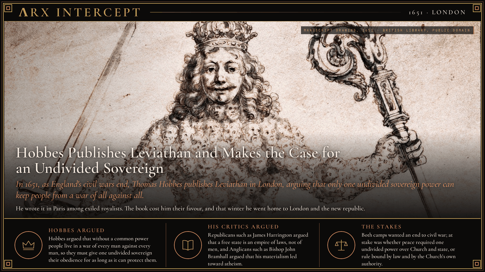
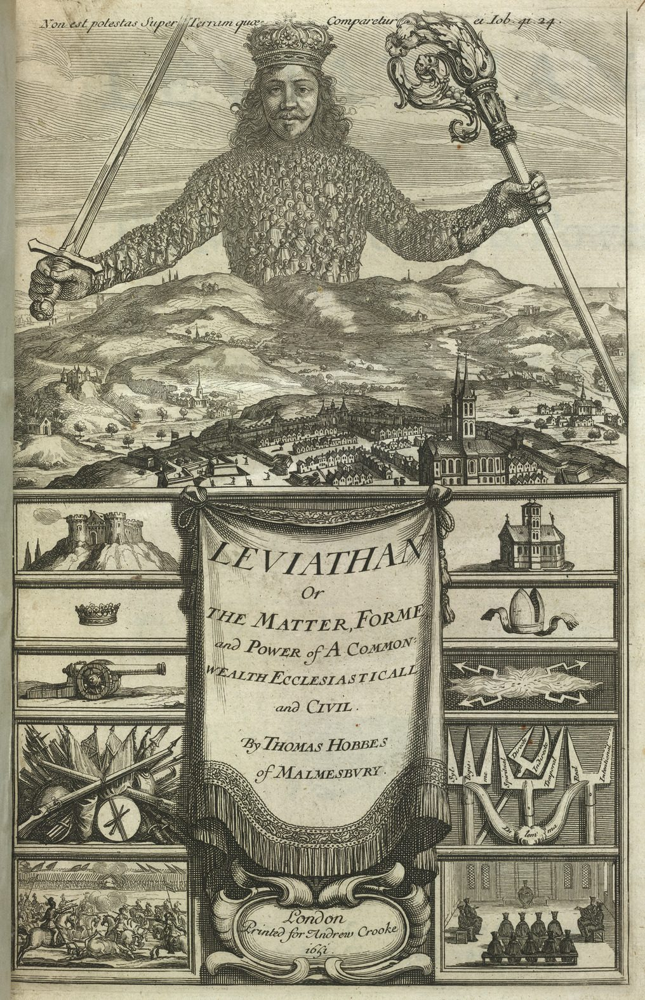

**ΛRX INTERCEPT** · Dispatch · 1651 · London

# Hobbes Publishes Leviathan and Makes the Case for an Undivided Sovereign

*In 1651, as England's civil wars end, Thomas Hobbes publishes Leviathan in London, arguing that only one undivided sovereign power can keep people from a war of all against all.*

In 1651, as England's civil wars ended, Thomas Hobbes published Leviathan. Without a common power to keep them in awe, he argued, people live in a war of every man against every man, and life is "solitary, poor, nasty, brutish, and short".

Leviathan is one of the earliest and most influential statements of social contract theory, and its picture of life without a common power still shapes how realist scholars of international relations think about states.

Hobbes, born in 1588, fled to Paris in November 1640 as the Long Parliament met, fearing he was in disfavour over a treatise he had circulated in manuscript. He stayed 11 years. When the royalist cause began to fail in 1644, exiled royalists gathered in Paris, and in 1647 and 1648 Hobbes taught mathematics to the young Charles, Prince of Wales. In their company he wrote Leviathan, completing it by 1650. It appeared in mid-1651, printed in London for Andrew Crooke at the Green Dragon in St Paul's Churchyard, two years after the execution of Charles I.

Its title page, etched by the Parisian Abraham Bosse after long discussion with Hobbes, shows a crowned giant rising over a town, his body made of more than three hundred people, holding a sword in one hand and a bishop's crosier in the other. Above him runs a line from the Book of Job: "There is no power on earth to be compared to him."

Hobbes built his case from human nature. Where no common power holds people in awe, he wrote, there is no industry, no arts, no letters and no society, only "continual fear, and danger of violent death". To escape it, each person covenants with the others to give up the right of governing himself to one man or one assembly. That sovereign could not be divided, and Christian kings, he wrote, remain "the supreme pastors of their people". Hobbes also set a limit: "The obligation of subjects to the sovereign is understood to last as long, and no longer, than the power lasteth, by which he is able to protect them."

That limit landed in the middle of the Engagement controversy, the 1649 to 1652 debate over whether the English could transfer their allegiance from the executed king to the new republic. The book cost Hobbes his standing with the exiled royalists, and its secular spirit angered both Anglicans and French Catholics. In the winter of 1651 he returned to London, submitted to the Council of State and settled into private life.

Critics answered from several sides. Bishop John Bramhall, an Anglican who had debated free will with Hobbes in Paris, charged in The Catching of Leviathan that his teaching could lead to atheism. In The Commonwealth of Oceana in 1656, James Harrington took on Hobbes's claim that the word LIBERTAS on the turrets of Lucca gave its citizens no more freedom than subjects had in Constantinople. Harrington replied that a landholding citizen of Lucca answered only to laws its citizens framed, while even the greatest pasha held his head and his estate at his lord's will. In 1666 a Commons committee on a bill against atheism was told to examine Leviathan by name, and Hobbes's revised Latin edition of 1668 was printed in Amsterdam.

Hobbes argued that without a common power people live in a war of every man against every man, so they must give one undivided sovereign their obedience for as long as it can protect them. Republicans such as Harrington argued that a free state is an empire of laws, not of men, and Anglicans such as Bramhall argued that his materialism led toward atheism.

Both camps wanted an end to nearly a decade of civil war. At stake was whether peace required one undivided power over Church and state, or rule bound by law and by the Church's own authority.

---

## Sources

**Original reporting**
- [Leviathan (Hobbes book)](https://en.wikipedia.org/wiki/Leviathan_(Hobbes_book)) — Wikipedia
- [Thomas Hobbes](https://en.wikipedia.org/wiki/Thomas_Hobbes) — Wikipedia
- [Leviathan (Hobbes book)](https://grokipedia.com/page/Leviathan_(Hobbes_book)) — Grokipedia

**Context**
- [Engagement controversy](https://en.wikipedia.org/wiki/Engagement_controversy) — Wikipedia
- [The Commonwealth of Oceana](https://en.wikipedia.org/wiki/The_Commonwealth_of_Oceana) — Wikipedia
- [John Bramhall](https://en.wikipedia.org/wiki/John_Bramhall) — Wikipedia

**Framing**
- [Leviathan, by Thomas Hobbes (full text)](https://www.gutenberg.org/ebooks/3207) — Project Gutenberg
- [The Commonwealth of Oceana, by James Harrington (full text)](https://www.gutenberg.org/ebooks/2801) — Project Gutenberg

*Filed by the ΛRX Intercept desk · arxcortex.io*

*Written on 3 Nov 2026 from the sources above, for the Chronosphere geo lens. Art: frontispiece drawing from the manuscript of Leviathan presented to Charles II, British Library Egerton MS 1910, Wikimedia Commons (public domain). Title page: Leviathan, 1651, British Library, Wikimedia Commons (public domain).*
