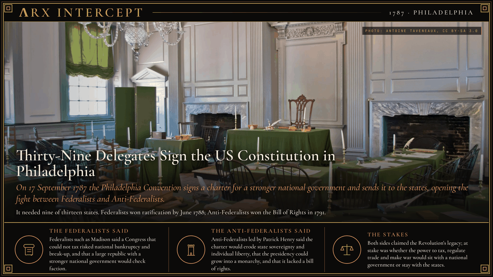
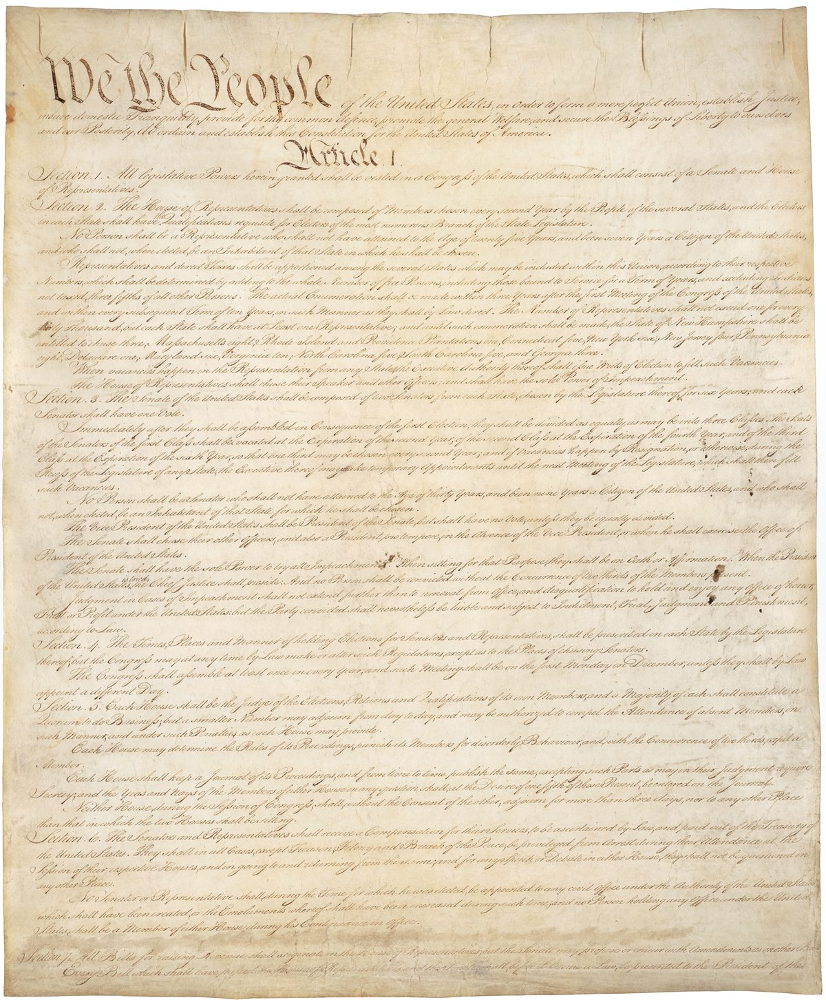

**ΛRX INTERCEPT** · Dispatch · 17 Sep 1787 · Philadelphia

# Thirty-Nine Delegates Sign the US Constitution in Philadelphia

*On 17 September 1787 the Philadelphia Convention signs a charter for a stronger national government and sends it to the states, opening the fight between Federalists and Anti-Federalists.*

In Philadelphia on 17 September 1787, 39 delegates signed a new charter for the United States. It gave a national Congress the power to tax, and it would take effect once nine of the thirteen states ratified it.

It took effect in 1789 and is the oldest written national constitution still in force.

Under the Articles of Confederation the states kept their sovereignty, and Congress depended on them for money. It had no power of its own to tax and could not raise enough to meet its expenses or service the debts of the Revolutionary War. Twelve state legislatures sent delegates to Philadelphia in May 1787; Rhode Island sent none. Of the 74 delegates named, 55 attended. They met from 25 May in the Pennsylvania State House, now Independence Hall.

On 29 May Edmund Randolph of Virginia put forward the Virginia Plan, a national government with seats apportioned by population. Delegates from smaller states backed the New Jersey Plan, which kept one equal vote for each state. The Connecticut Compromise joined the two: the House by population, the Senate by state. On slavery the delegates adopted the existing federal ratio, counting three-fifths of enslaved people when apportioning House seats.

On the last day 39 signed. Three who stayed to the end refused: George Mason, who named the lack of a bill of rights among his main objections, his fellow Virginian Randolph, and Elbridge Gerry of Massachusetts. Benjamin Franklin told the hall: "There are several parts of this Constitution which I do not at present approve, but I am not sure I shall never approve them."

Article VII required conventions in nine states. The argument moved into the newspapers. Brutus, an Anti-Federalist writing to "the Citizens of the State of New York", began his 16 essays on 18 October. Alexander Hamilton's Federalist No. 1 followed on 27 October, the first of 85 essays he, James Madison and John Jay wrote as Publius. Delaware ratified first, unanimously, on 7 December 1787. Massachusetts ratified on 6 February 1788 with recommended amendments, and Federalists in Virginia and New York won by the same device. New Hampshire became the ninth state on 21 June 1788, and New York ratified on 26 July.

The new government began on 4 March 1789 with eleven states. North Carolina waited until Congress had passed a bill of rights, and Rhode Island ratified only after a threatened trade embargo. Madison introduced the amendments in the First Congress, and the states ratified the Bill of Rights in 1791.

Federalists such as Madison said a Congress that could not tax risked national bankruptcy and break-up, and that a large republic with a stronger national government would check faction. Anti-Federalists led by Patrick Henry said the charter would erode state sovereignty and individual liberty, that the presidency could grow into a monarchy, and that it lacked a bill of rights.

Both camps claimed the Revolution's legacy, and both left their mark: the Federalists won ratification, and the Anti-Federalists won the Bill of Rights. At stake was whether the power to tax, regulate trade and make war would sit with a national government or stay with the states.

---

## Sources

**Original reporting**
- [Constitution of the United States](https://en.wikipedia.org/wiki/Constitution_of_the_United_States) — Wikipedia
- [History of the United States Constitution](https://en.wikipedia.org/wiki/History_of_the_United_States_Constitution) — Wikipedia
- [Constitution of the United States](https://grokipedia.com/page/Constitution_of_the_United_States) — Grokipedia

**Context**
- [Anti-Federalists](https://en.wikipedia.org/wiki/Anti-Federalism) — Wikipedia
- [The Federalist Papers](https://en.wikipedia.org/wiki/The_Federalist_Papers) — Wikipedia
- [Federalist No. 10](https://en.wikipedia.org/wiki/Federalist_No._10) — Wikipedia
- [Brutus (Antifederalist)](https://en.wikipedia.org/wiki/Brutus_(Antifederalist)) — Wikipedia
- [George Mason](https://en.wikipedia.org/wiki/George_Mason) — Wikipedia
- [Edmund Randolph](https://en.wikipedia.org/wiki/Edmund_Randolph) — Wikipedia

**Framing**
- [The Constitution of the United States: A Transcription](https://www.archives.gov/founding-docs/constitution-transcript) — US National Archives

*Filed by the ΛRX Intercept desk · arxcortex.io*

*Written on 2 Nov 2026 from the sources above, for the Chronosphere geo lens. Photograph: the Assembly Room, Independence Hall, Antoine Taveneaux, Wikimedia Commons (CC BY-SA 3.0). Document: page one of the Constitution, US National Archives, Wikimedia Commons (public domain).*
