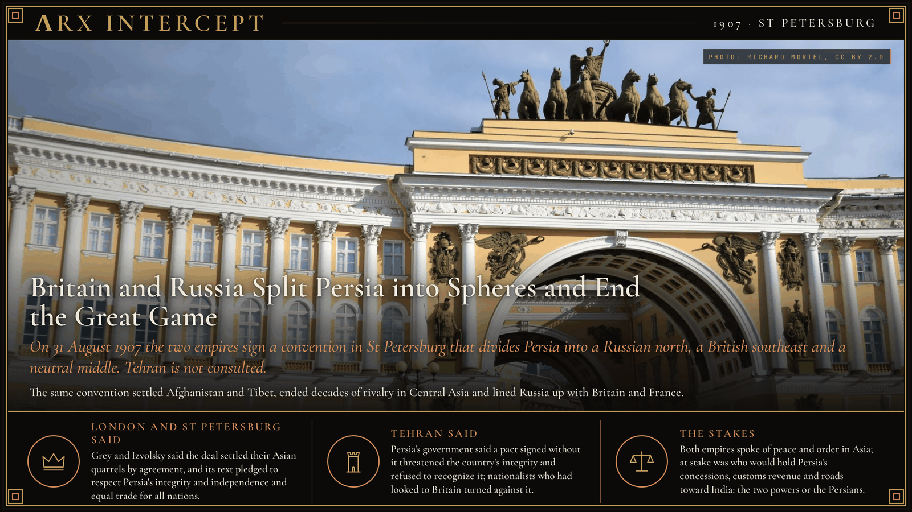
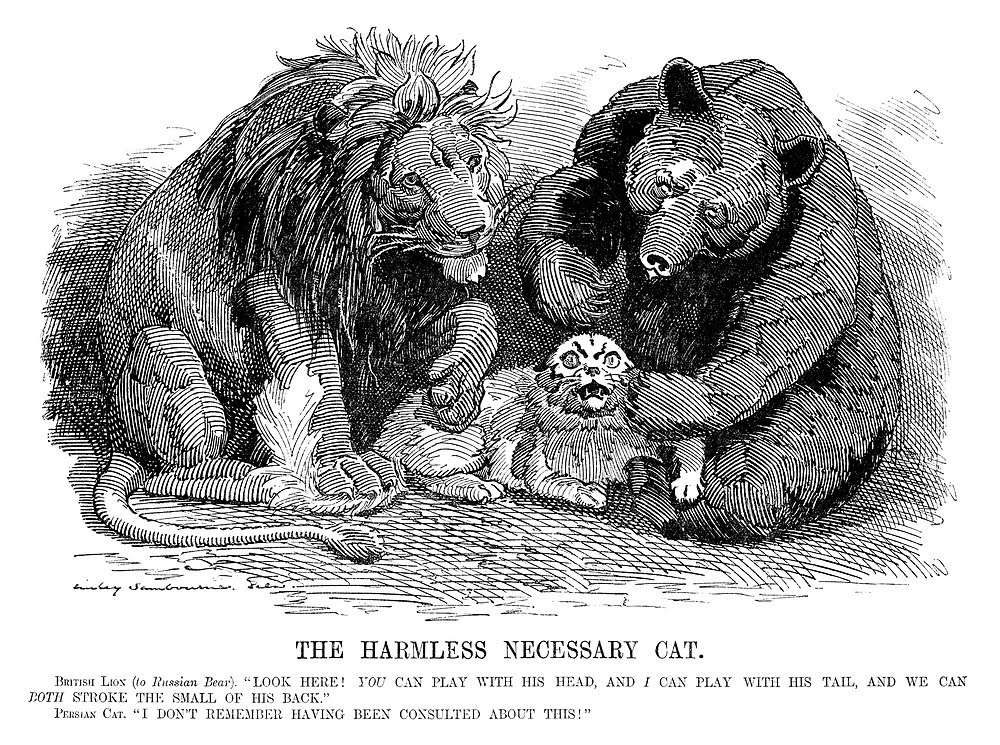

**ΛRX INTERCEPT** · Dispatch · 31 Aug 1907 · Saint Petersburg

# Britain and Russia Split Persia into Spheres and End the Great Game

*On 31 August 1907 the two empires sign a convention in St Petersburg that divides Persia into a Russian north, a British southeast and a neutral middle. Tehran is not consulted.*

On 31 August 1907 Britain and Russia signed a convention in St Petersburg that split Persia into a Russian north, a British southeast and a neutral middle. No one in Tehran had been asked.

The same text settled Afghanistan and Tibet and ended the rivalry the British called the Great Game.

For most of the nineteenth century the two empires competed across Central Asia, a contest a British officer, Arthur Conolly, named the Great Game in 1840. Russia's advance south and Britain's hold on India met in three buffer states: Persia, Afghanistan and Tibet. In Persia each side pressed the shah to shut the other out, and the rivalry blocked every railway scheme at the end of the century.

Two shocks changed the arithmetic. Russia lost its war with Japan in 1905, and Germany, allied with Austria-Hungary and Italy since 1882, was courting the Ottoman Empire with a railway toward Baghdad. Sir Edward Grey, Britain's foreign secretary, wanted a settlement in Asia. Alexander Izvolsky, Russia's foreign minister from 1906, wanted an ally besides France. In Persia itself a constitutional revolution had forced Mozaffar ad-Din Shah to accept an elected parliament, the Majlis, which first met in October 1906.

The British ambassador, Sir Arthur Nicolson, and Izvolsky signed the convention. Britain promised to seek no concessions, for railways, banks, telegraphs, roads or anything else, beyond a line from Qasr-e Shirin through Isfahan and Yazd to the Afghan border. Russia made the same promise for the region beyond a line from the Afghan frontier through Birjand and Kerman to Bandar Abbas. The land between was left open to both. Persia's customs revenues stayed pledged to loans from the Russian Banque d'Escompte and the British Imperial Bank of Persia, and if payments faltered each power could move to control the revenues in its own zone. Britain kept Afghanistan in its sphere and promised not to change its political status, while Russia won equal trade there. Both recognized Chinese suzerainty over Tibet and agreed to deal with it only through China.

The Persian government learned the terms after the signing and refused to recognize them. Habibullah Khan, the emir of Afghanistan, had not been told of the talks either and was outraged by what he read. In May 1908 a British venture struck oil at Masjed Soleyman, in the southwest the convention had left neutral. That year Mohammad Ali Shah abolished the constitution and bombarded the parliament, with Russian and British support. In December 1911, under Russian and British pressure, the regent expelled the Majlis's American treasurer-general, Morgan Shuster, who called his account The Strangling of Persia. Soviet Russia renounced the convention in 1918.

Sir Edward Grey and Alexander Izvolsky said the deal settled their Asian quarrels by agreement, and its text pledged to respect Persia's integrity and independence and equal trade for all nations. Persia's government said a pact signed without it threatened the country's integrity and refused to recognize it; nationalists who had looked to Britain as a model turned against it.

Both empires spoke of peace and order in Asia, and they worked together in Persia until revolution ended one of them. At stake was who would hold Persia's concessions, its customs revenue and the roads toward India: the two powers that drew the lines, or the Persians who lived inside them.

---

## Sources

**Original reporting**
- [Anglo-Russian Convention](https://en.wikipedia.org/wiki/Anglo-Russian_Convention) — Wikipedia
- [Anglo-Russian Convention](https://grokipedia.com/page/Anglo-Russian_Convention) — Grokipedia
- [Convention between the United Kingdom and Russia relating to Persia, Afghanistan, and Thibet (1907)](https://en.wikisource.org/wiki/Anglo-Russian_Convention) — Wikisource

**Context**
- [The Great Game](https://en.wikipedia.org/wiki/The_Great_Game) — Wikipedia
- [Persian Constitutional Revolution](https://en.wikipedia.org/wiki/Persian_Constitutional_Revolution) — Wikipedia
- [Alexander Izvolsky](https://en.wikipedia.org/wiki/Alexander_Izvolsky) — Wikipedia
- [Masjed Soleyman](https://en.wikipedia.org/wiki/Masjed_Soleyman) — Wikipedia
- [Morgan Shuster](https://en.wikipedia.org/wiki/Morgan_Shuster) — Wikipedia

**Framing**
- [The Harmless Necessary Cat (Punch, 1907)](https://commons.wikimedia.org/wiki/File:The_Harmless_Necessary_Cat.jpg) — Wikimedia Commons

*Filed by the ΛRX Intercept desk · arxcortex.io*

*Written on 3 Nov 2026 from the sources above, for the Chronosphere geo lens. Photograph: General Staff Building, Palace Square, St Petersburg, Richard Mortel, Wikimedia Commons (CC BY 2.0). Cartoon: The Harmless Necessary Cat, Edward Linley Sambourne, Punch, 1907, Wikimedia Commons (public domain).*
