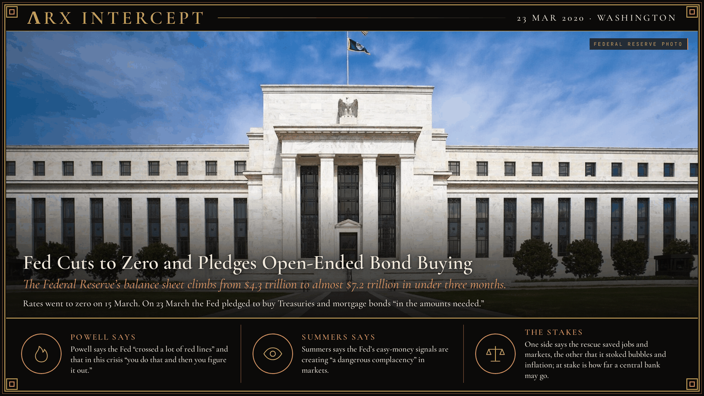

**ΛRX INTERCEPT** · Dispatch · 23 Mar 2020 · Washington

# Fed Cuts to Zero and Pledges Open-Ended Bond Buying

*The Federal Reserve's balance sheet climbs from $4.3 trillion to almost $7.2 trillion in under three months.*

The Fed cut rates to zero on 15 March 2020. Eight days later it pledged to buy bonds in whatever amounts markets needed.

Its balance sheet rose from $4.3 trillion to almost $7.2 trillion by June.

The fight over what the rescue cost has not ended.

On Sunday 15 March 2020 the Federal Open Market Committee cut its target range for the federal funds rate to 0 to 0.25 percent and committed to buy at least $500 billion of Treasury securities and $200 billion of agency mortgage-backed securities. The same day the Fed announced steps on the discount window, bank capital and liquidity buffers and reserve requirements, and acted with other central banks on dollar swap lines. Cleveland Fed president Loretta Mester voted against the rate cut; she backed the market measures but preferred a range of 0.5 to 0.75 percent.

On 23 March the committee dropped the dollar caps and said it would buy Treasuries and agency mortgage securities "in the amounts needed to support smooth market functioning." The Fed also opened facilities to buy corporate bonds in new and secondary markets and set up a Term Asset-Backed Securities Loan Facility, together worth up to $300 billion in new financing, with $30 billion of Treasury equity behind them. The Fed's balance sheet grew from $4.3 trillion in mid-March to nearly $7.2 trillion in early June, about 35 percent of GDP, a level not seen since the Second World War. Purchases continued until early March 2022, when total assets stood near $8.9 trillion. In the year to June 2022 consumer prices rose 9.1 percent, the largest 12-month increase since 1981.

Fed chair Jerome Powell says the Fed "crossed a lot of red lines that had not been crossed before" and that the pandemic was "the situation where you do that and then you figure it out." Former Treasury secretary Larry Summers says the Fed's signal that rates would stay near zero for years is creating "a dangerous complacency" and that the central bank is misreading the economy.

Powell says the Fed kept credit flowing to households and employers when markets froze; Summers says it held money too loose for too long and fed asset prices and inflation. Beneath both is a question of power: how far an unelected central bank may reach into markets in a crisis, and who carries the cost when it does.

---

## Sources

**Original reporting**
- [Federal Reserve issues FOMC statement (15 March 2020)](https://www.federalreserve.gov/newsevents/pressreleases/monetary20200315a.htm) — Federal Reserve Board
- [Federal Reserve announces extensive new measures to support the economy (23 March 2020)](https://www.federalreserve.gov/newsevents/pressreleases/monetary20200323b.htm) — Federal Reserve Board

**Context**
- [Federal Reserve Balance Sheet Developments, August 2020](https://www.federalreserve.gov/monetarypolicy/bsd-overview-202008.htm) — Federal Reserve Board
- [Federal Reserve Balance Sheet Developments, May 2022](https://www.federalreserve.gov/monetarypolicy/files/balance_sheet_developments_report_202205.pdf) — Federal Reserve Board
- [Consumer prices up 9.1 percent over the year ended June 2022, largest increase in 40 years](https://www.bls.gov/opub/ted/2022/consumer-prices-up-9-1-percent-over-the-year-ended-june-2022-largest-increase-in-40-years.htm) — US Bureau of Labor Statistics

**Framing**
- [Powell Says Fed Crossed Red Lines When Virus Demanded Action](https://www.bloomberg.com/news/articles/2020-05-29/powell-says-fed-crossed-red-lines-because-virus-demanded-action) — Bloomberg
- [Larry Summers accuses Fed of 'dangerous complacency' over inflation](https://www.afr.com/policy/economy/larry-summers-accuses-fed-of-dangerous-complacency-over-inflation-20210519-p57t6m) — Australian Financial Review (Financial Times)

*Filed by the ΛRX Intercept desk · arxcortex.io*

*Grok Bot wrote this on 25 Oct 2026 from the sources above, for the Chronosphere 2020s record. Photo: Federal Reserve (public domain).*
