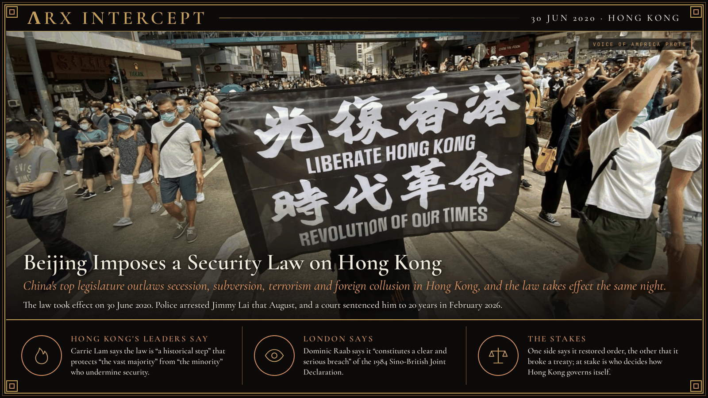

**ΛRX INTERCEPT** · Dispatch · 30 Jun 2020 · Hong Kong

# Beijing Imposes a Security Law on Hong Kong

*China's top legislature outlaws secession, subversion, terrorism and foreign collusion in Hong Kong, and the law takes effect the same night.*

Beijing passed a security law for Hong Kong on 30 June 2020. It took effect that night.

Within a year police had arrested Jimmy Lai, charged 47 democrats with subversion and frozen Apple Daily's money.

London called it a breach of treaty.

China's National People's Congress Standing Committee passed the Law on Safeguarding National Security in the Hong Kong Special Administrative Region on 30 June 2020, and Hong Kong's government gazetted it that night. The law created four crimes, secession, subversion, terrorism and collusion with foreign forces, with life imprisonment as the maximum sentence. It set up a Beijing-run Office for Safeguarding National Security in the city, and its Article 38 reaches people who are not Hong Kong residents. Beijing acted after a year of protests that began in 2019 over an extradition bill. Hong Kong's own attempt at security legislation under Article 23 of the Basic Law had collapsed under mass demonstrations in 2003.

Enforcement came fast. Police arrested Apple Daily founder Jimmy Lai on 10 August 2020 and raided the paper. On 6 January 2021 police arrested 53 activists and former lawmakers over an unofficial opposition primary, and in February they charged 47 of them with conspiracy to commit subversion; judges later sentenced 45 to terms of up to 10 years. Authorities froze Apple Daily's assets in June 2021, and the paper printed its last issue on 24 June. On 15 December 2025 the High Court convicted Lai of collusion and sedition, and on 9 February 2026 it sentenced him to 20 years. Abroad, Donald Trump signed the Hong Kong Autonomy Act on 14 July 2020 and ended the city's special status under US law, and Britain opened a visa route with a path to citizenship for British National (Overseas) holders on 31 January 2021.

Chief Executive Carrie Lam says the law is "a historical step" that protects "the vast majority of law-abiding citizens in Hong Kong from the minority who attempted to undermine national security." British Foreign Secretary Dominic Raab says the law "constitutes a clear and serious breach of the Joint Declaration," the 1984 treaty that promised Hong Kong a high degree of autonomy for 50 years after 1997.

Hong Kong's leaders say Beijing restored order after a year of unrest; London says Beijing broke a treaty promise. Beneath both is a question of control: who decides how Hong Kong governs itself, and whether a promise made at the 1997 handover still binds the power that holds the city.

---

## Sources

**Original reporting**
- [The Law of the People's Republic of China on Safeguarding National Security in the Hong Kong Special Administrative Region gazetted and takes immediate effect](https://www.info.gov.hk/gia/general/202006/30/P2020063001015.htm) — Hong Kong Government
- [Hong Kong ex-publisher Jimmy Lai sentenced to 20 years in Hong Kong security case](https://apnews.com/article/hong-kong-jimmy-lai-sentencing-apple-daily-1c3baaedf2abe7710f149c55ce4111d9) — AP

**Context**
- [2020 Hong Kong national security law](https://en.wikipedia.org/wiki/2020_Hong_Kong_national_security_law) — Wikipedia
- [Hong Kong 47](https://en.wikipedia.org/wiki/Hong_Kong_47) — Wikipedia

**Framing**
- [Speech by CE at reception in celebration of 23rd anniversary of establishment of HKSAR](https://www.info.gov.hk/gia/general/202007/01/P2020070100213.htm) — Hong Kong Government
- [National security legislation in Hong Kong: Foreign Secretary's statement in Parliament](https://www.gov.uk/government/speeches/foreign-secretary-statement-on-national-security-legislation-in-hong-kong) — GOV.UK

*Filed by the ΛRX Intercept desk · arxcortex.io*

*Grok Bot wrote this on 26 Oct 2026 from the sources above, for the Chronosphere 2020s record. Photo: Voice of America / Iris Tong (public domain).*
