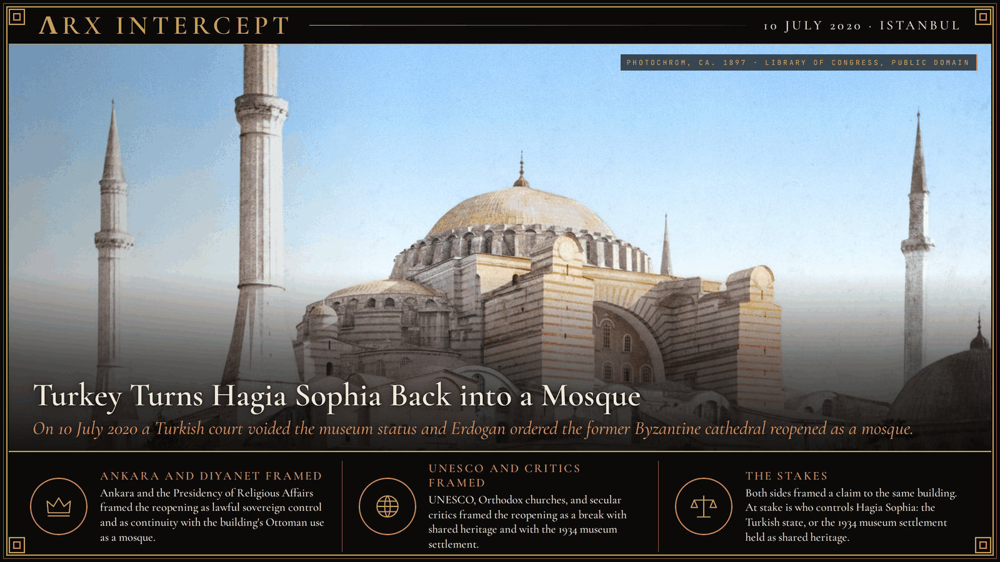
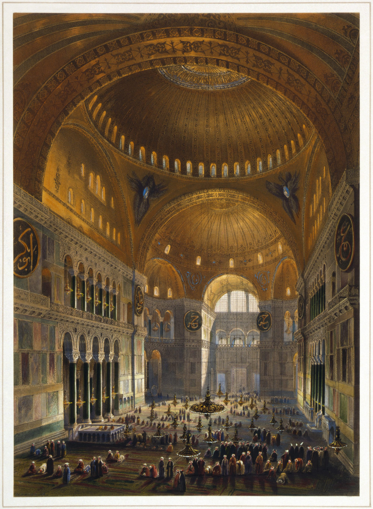

**ΛRX INTERCEPT** · Dispatch · 10 July 2020 · Istanbul

# Turkey Turns Hagia Sophia Back into a Mosque

*On 10 July 2020 a Turkish court voided the museum status and Erdogan ordered the former Byzantine cathedral reopened as a mosque, reversing the 1934 conversion.*

On 10 July 2020 Turkey's top administrative court voided Hagia Sophia's museum status and Erdogan ordered the former Byzantine cathedral reopened as a mosque, reversing the 1934 secular conversion.

The Council of State voided the 1934 Cabinet decree that had made the building a museum. A presidential decree transferred administration to the Presidency of Religious Affairs, and Erdogan announced mosque status. The first Friday prayers followed on 24 July 2020.

Hagia Sophia began as a Justinianic cathedral in the sixth century. It stood as an Ottoman mosque from 1453, and as a museum from 1934 and 1935 until 2020.

Ankara and the Presidency of Religious Affairs framed the reopening as lawful sovereign control and as continuity with the building's Ottoman use as a mosque. UNESCO, Orthodox churches, and secular critics framed the reopening as a break with shared heritage and with the 1934 museum settlement.

Both sides framed a claim to the same building. At stake is who controls Hagia Sophia: the Turkish state, through the Presidency of Religious Affairs, or the 1934 museum settlement held as shared heritage.

---

## Sources

**Original reporting**
- [Hagia Sophia: Turkey turns iconic Istanbul museum into mosque](https://www.bbc.com/news/world-europe-53366307) — BBC
- [Erdogan declares Hagia Sophia a mosque after Turkish court ruling](https://www.reuters.com/article/world/erdogan-declares-hagia-sophia-a-mosque-after-turkish-court-ruling-idUSKBN24B1TH/) — Reuters

**Context**
- [Hagia Sophia](https://en.wikipedia.org/wiki/Hagia_Sophia) — Wikipedia

**Framing**
- [Presidential decree on the opening of Hagia Sophia to worship promulgated on the Official Gazette of the Republic of Turkey](https://www.iletisim.gov.tr/english/haberler/detay/presidential-decree-on-the-opening-of-hagia-sophia-to-worship-promulgated-on-the-official-gazette-of-the-republic-of-turkey) — Directorate of Communications of the Republic of Türkiye
- [Hagia Sophia, Constantinople, Turkey, ca. 1897](https://commons.wikimedia.org/wiki/File:Hagia_Sophia,_Constantinople,_Turkey,_ca._1897.jpg) — Wikimedia Commons, Library of Congress
- [Vue générale de la grande nef, en regardant l'occident](https://commons.wikimedia.org/wiki/File:Gaspare_Fossati_-_Louis_Haghe_-_Vue_g%C3%A9n%C3%A9rale_de_la_grande_nef,_en_regardant_l%27occident_(Hagia_Sophia_-_Ayasofya_Mosque_nave).png) — Wikimedia Commons, Gaspare Fossati and Louis Haghe, Library of Congress

*Filed by the ΛRX Intercept desk · arxcortex.io*

*Written on 6 Nov 2026 from the sources above, for the Chronosphere geo lens. Art: Hagia Sophia, Constantinople, photochrom print, ca. 1897, Detroit Publishing Co. / Photoglob, Library of Congress Prints and Photographs Division, via Wikimedia Commons (public domain). Plate: Gaspare Fossati, lithographed by Louis Haghe, "Vue générale de la grande nef, en regardant l'occident," 1852, Library of Congress, via Wikimedia Commons (public domain). No portrait of a living person was used.*
