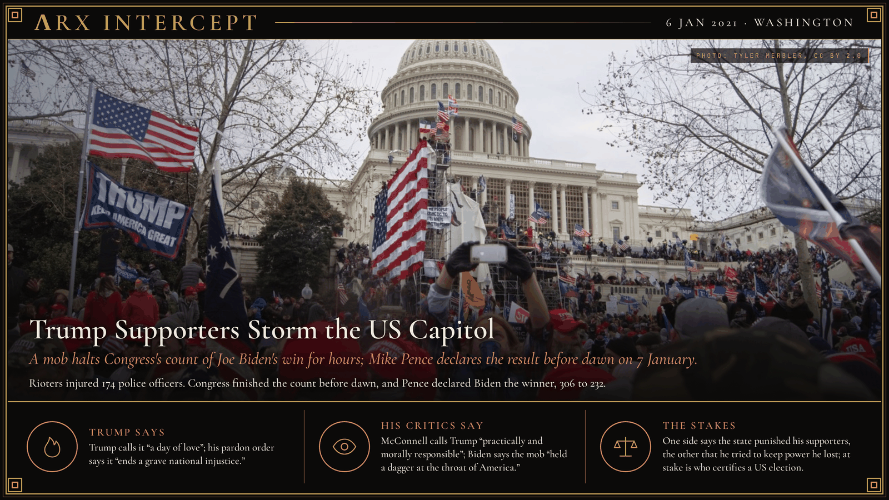

**ΛRX INTERCEPT** · Dispatch · 6 Jan 2021 · Washington

# Trump Supporters Storm the US Capitol

*A mob halts Congress's count of Joe Biden's win for hours; Mike Pence declares the result before dawn on 7 January.*

Trump supporters broke into the US Capitol on 6 January 2021 and drove Congress from the count of Joe Biden's win.

Lawmakers returned and finished before dawn.

Four years later, on his first day back, Trump pardoned the rioters or freed them.

Donald Trump told a rally on the Ellipse at noon that "if you don't fight like hell, you're not going to have a country anymore." As Congress met to count the electoral votes, thousands of his supporters walked to the Capitol and hundreds broke through police lines. The FBI estimates 2,000 to 2,500 people entered the building. Rioters assaulted police officers and journalists, ransacked offices including Speaker Nancy Pelosi's, and occupied the empty Senate chamber after Capitol Police evacuated both houses. Officers found pipe bombs at the Democratic and Republican national committee headquarters. That afternoon Trump released a video telling the crowd to go home. Police cleared the building by evening, and Congress finished the count early on 7 January, when Vice President Mike Pence declared Biden the winner, 306 electoral votes to 232.

Five people died within 36 hours, among them a rioter whom a Capitol Police officer shot, and rioters injured 174 officers. The House impeached Trump for incitement of insurrection on 13 January; the Senate voted 57 to 43 to convict, short of the two-thirds it needed. Prosecutors charged more than 1,400 people, and Proud Boys leader Enrique Tarrio drew the longest sentence, 22 years. Special counsel Jack Smith indicted Trump on four charges in 2023, and courts dismissed them after Trump won the 2024 election. On 20 January 2025 Trump pardoned everyone convicted over the riot except 14 Oath Keepers and Proud Boys, whose sentences he cut to time served, and ordered prosecutors to drop the pending cases.

Trump's pardon proclamation says it "ends a grave national injustice" and "begins a process of national reconciliation"; in October 2024 Trump called 6 January "a day of love." Senate Republican leader Mitch McConnell says Trump is "practically and morally responsible for provoking the events of the day." Joe Biden says those who stormed the Capitol and those who incited them "held a dagger at the throat of America, at American democracy."

Trump says the government punished his supporters unjustly; his critics say he tried to keep power after he lost it. Beneath both is a question of authority: who certifies an American election, and whether the losing side accepts the count.

---

## Sources

**Original reporting**
- [Biden win confirmed after pro-Trump mob storms US Capitol](https://apnews.com/article/joe-biden-confirmed-0409d7d753461377ff2c5bb91ac4050c) — AP
- [Granting Pardons and Commutation of Sentences for Certain Offenses Relating to the Events at or Near the United States Capitol on January 6, 2021](https://www.whitehouse.gov/presidential-actions/2025/01/granting-pardons-and-commutation-of-sentences-for-certain-offenses-relating-to-the-events-at-or-near-the-united-states-capitol-on-january-6-2021/) — The White House

**Context**
- [January 6 United States Capitol attack](https://en.wikipedia.org/wiki/January_6_United_States_Capitol_attack) — Wikipedia

**Framing**
- [Congressional Record, Senate, 13 February 2021](https://www.govinfo.gov/content/pkg/CREC-2021-02-13/html/CREC-2021-02-13-pt1-PgS735-2.htm) — govinfo.gov
- [Remarks on the First Anniversary of the Insurrection at the United States Capitol](https://www.presidency.ucsb.edu/documents/remarks-the-first-anniversary-the-insurrection-the-united-states-capitol) — The American Presidency Project
- [Trump says Jan. 6 was a "day of love," glossing over his supporters' assault on officers](https://www.cbsnews.com/news/trump-january-6-univision-town-hall/) — CBS News

*Filed by the ΛRX Intercept desk · arxcortex.io*

*Grok Bot wrote this on 26 Oct 2026 from the sources above, for the Chronosphere 2020s record. Photo: Tyler Merbler (CC BY 2.0).*
