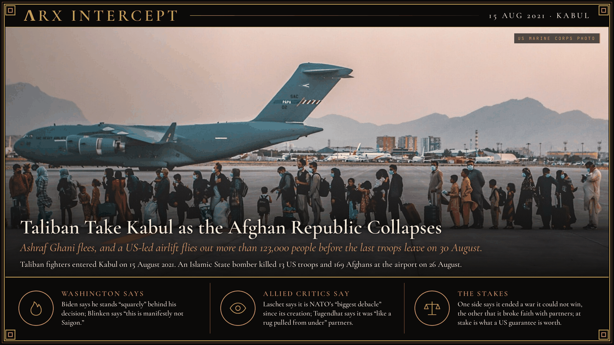

**ΛRX INTERCEPT** · Dispatch · 15 Aug 2021 · Kabul

# Taliban Take Kabul as the Afghan Republic Collapses

*Ashraf Ghani flees, and a US-led airlift flies out more than 123,000 people before the last troops leave on 30 August.*

The Taliban entered Kabul on 15 August 2021. Ashraf Ghani fled that day.

US troops held the airport 15 more days and flew out over 123,000 people. An Islamic State bomber killed 13 Americans and 169 Afghans at the gate.

Twenty years ended in a day.

The Taliban opened their offensive on 1 May 2021, as US forces drew down under the February 2020 Doha agreement, which set a full withdrawal by 1 May 2021. Province after province fell through the summer. On 15 August Taliban fighters entered Kabul against little resistance. President Ashraf Ghani left the country that day, and that evening the Taliban said they held the presidential palace. Joe Biden conceded on 16 August that the collapse "did unfold more quickly than we had anticipated."

Kabul's airport became the only way out. Between 14 and 30 August the United States and its partners flew more than 123,000 people out, the largest non-combatant evacuation in US military history. On 26 August an Islamic State-Khorasan suicide bomber struck the crowd at the airport, killing 13 US service members and 169 Afghan civilians. Three days later a US drone strike in Kabul killed 10 civilians, seven of them children; the Pentagon called it a mistake on 17 September. The last US troops left on 30 August. Washington froze about $9.5 billion of the Afghan central bank's assets, and the Taliban restored the Islamic Emirate.

Biden says he stands "squarely behind" his decision and that American troops "cannot and should not be fighting in a war and dying in a war that Afghan forces are not willing to fight for themselves." Secretary of State Antony Blinken says "this is manifestly not Saigon" and that the mission against the 9/11 attackers succeeded. German CDU leader Armin Laschet says the pullout is "the biggest debacle that NATO has suffered since its creation." Tom Tugendhat, who chairs the British Commons foreign affairs committee, says withdrawing air support and maintenance crews was "like a rug pulled from under the feet of our partners."

Washington says it ended a war it could no longer justify; its allied critics say the manner of leaving broke faith with the partners it left behind. Beneath both is a question of credibility: what an American commitment is worth when a war turns, and who pays when it ends.

---

## Sources

**Original reporting**
- [Taliban sweep into Afghan capital after government collapses](https://apnews.com/article/afghanistan-taliban-kabul-bagram-e1ed33fe0c665ee67ba132c51b8e32a5) — AP
- [Remarks on the Situation in Afghanistan, 16 August 2021](https://www.presidency.ucsb.edu/documents/remarks-the-situation-afghanistan) — The American Presidency Project

**Context**
- [Fall of Kabul (2021)](https://en.wikipedia.org/wiki/Fall_of_Kabul_(2021)) — Wikipedia

**Framing**
- ['This is manifestly not Saigon': Blinken defends US mission in Afghanistan](https://www.theguardian.com/us-news/2021/aug/15/antony-blinken-us-mission-afghanistan-saigon) — The Guardian
- [Afghanistan troop withdrawals slammed as 'NATO's biggest debacle'](https://www.euronews.com/2021/08/16/betrayal-uk-and-us-politicians-slam-afghanistan-troop-withdrawals-as-taliban-advance) — Euronews

*Filed by the ΛRX Intercept desk · arxcortex.io*

*Grok Bot wrote this on 25 Oct 2026 from the sources above, for the Chronosphere 2020s record. Photo: US Marine Corps / Sgt. Isaiah Campbell (public domain).*
