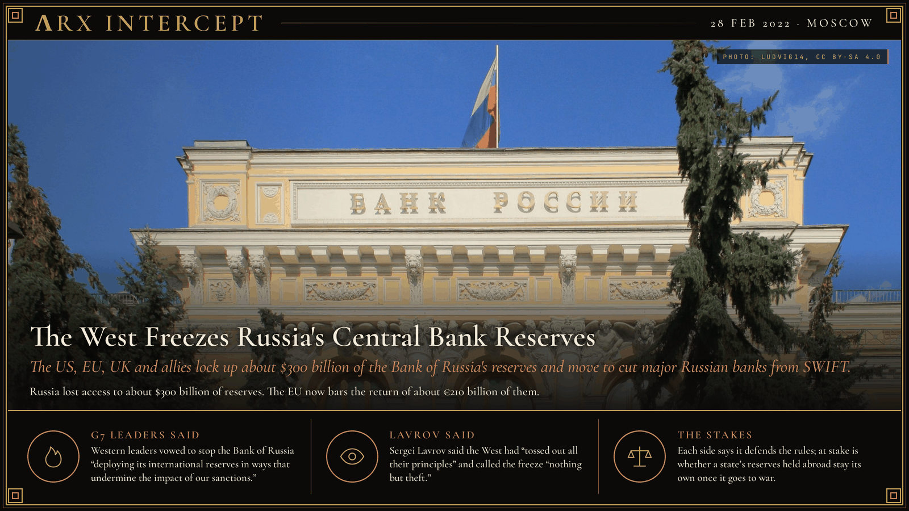

**ΛRX INTERCEPT** · Dispatch · 28 Feb 2022 · Moscow

# The West Freezes Russia's Central Bank Reserves

*The US, EU, UK and allies lock up about $300 billion of the Bank of Russia's reserves and move to cut major Russian banks from SWIFT.*

On 28 February 2022 the West froze about $300 billion of Russia's central bank reserves. Lavrov called it theft.

Central banks rushed into gold.

In October 2026 a Moscow court upheld a €200 billion award against Euroclear, which holds most of the money.

Russia's army crossed into Ukraine on 24 February 2022. Two days later the leaders of the European Commission, France, Germany, Italy, the United Kingdom, Canada and the United States pledged to remove selected Russian banks from SWIFT and to stop the Bank of Russia from using its reserves to blunt sanctions. On 28 February the US Treasury barred Americans from dealing with the Russian central bank, and Japan and Switzerland joined in. Finance Minister Anton Siluanov later put the frozen sum at about $300 billion of Russia's roughly $640 billion in gold and foreign-currency reserves. That Monday the rouble hit a record low of about 120 to the dollar offshore, and the Bank of Russia raised its key rate from 9.5% to 20%. On 2 March the EU cut seven banks, among them VTB and VEB, from SWIFT from 12 March. Former deputy finance minister Sergei Aleksashenko called the package "a kind of financial nuclear bomb."

Most of the money sits in Belgium, at the securities depository Euroclear. Central banks bought more than 1,000 tonnes of gold in each of 2022, 2023 and 2024, by the World Gold Council's count. In October 2024 the G7 finalised a $50 billion loan to Ukraine to be repaid from the interest the frozen assets earn. On 12 December 2025 the EU used an emergency treaty article to bar the return of about €210 billion of the assets to Russia, replacing six-monthly renewals that needed every member's consent. A week later EU leaders failed to agree on lending the principal to Ukraine and borrowed €90 billion on the markets instead. The Bank of Russia sued Euroclear in Moscow for €200.1 billion; a Moscow court granted the claim in May 2026, and on 22 October 2026 a cassation court rejected Euroclear's appeal. Euroclear says it does not recognise the court's jurisdiction.

Western leaders said their measures would "prevent the Russian Central Bank from deploying its international reserves in ways that undermine the impact of our sanctions." Foreign Minister Sergei Lavrov said the West had "simply tossed out all their principles" and that the freeze was "nothing but theft." After the Moscow ruling, Euroclear's lawyer Sergei Savelyev said "Euroclear's right to fair litigation was clearly violated."

The West says it froze the money to keep Russia from spending it on the war; Moscow says the West took what belongs to Russia. The fight is over ownership: whether a state's reserves held abroad stay its own once it goes to war, and who decides when they come back.

---

## Sources

**Original reporting**
- [Russian central bank hikes rate to 20% in emergency move, tells firms to sell FX](https://www.reuters.com/business/finance/russia-hikes-key-rate-20-tells-companies-sell-fx-2022-02-28/) — Reuters
- [Sanctions have frozen around $300 bln of Russian reserves, FinMin says](https://www.reuters.com/article/markets/currencies/sanctions-have-frozen-around-300-bln-of-russian-reserves-finmin-says-idUSL5N2VG0BU/) — Reuters
- [EU bans certain Russian banks from SWIFT system and introduces further restrictions](https://www.consilium.europa.eu/en/press/press-releases/2022/03/02/russia-s-military-aggression-against-ukraine-eu-bans-certain-russian-banks-from-swift-system-and-introduces-further-restrictions/) — Council of the EU
- [Council decides to prohibit transfers of immobilised Central Bank of Russia assets back to Russia](https://www.consilium.europa.eu/en/press/press-releases/2025/12/12/council-decides-to-prohibit-transfers-of-immobilised-central-bank-of-russia-assets-back-to-russia/) — Council of the EU
- [EU leaders will loan 90 billion euros to Ukraine, but fail to agree to use frozen Russian assets](https://www.reuters.com/world/europe/eu-leaders-agree-ukraine-financing-2026-27-belgiums-approval-key-2025-12-18/) — Reuters
- [Euroclear appeals Russian ruling on €200.1 billion claim, with hearing on 22 October](https://www.theglobalbanker.com/euroclear-appeals-russian-ruling-on-eur200-1-billion-claim-with-hearing-on-22-october/) — The Global Banker
- [Court rejects Euroclear's cassation appeal on €200 billion claim by the Bank of Russia (in Russian)](https://rapsinews.ru/judicial_news/20261022/312310072.html) — RAPSI

**Context**
- [International sanctions during the Russian invasion of Ukraine](https://en.wikipedia.org/wiki/International_sanctions_during_the_Russian_invasion_of_Ukraine) — Wikipedia
- [Gold Demand Trends Full Year 2024: Central banks](https://www.gold.org/goldhub/research/gold-demand-trends/gold-demand-trends-full-year-2024/central-banks) — World Gold Council

**Framing**
- [Joint Statement on further restrictive economic measures, 26 February 2022](https://www.pm.gc.ca/en/news/statements/2022/02/26/joint-statement-further-restrictive-economic-measures) — Prime Minister of Canada
- [Lavrov describes West's freeze on Russian Central Bank's assets as theft](https://interfax.com/newsroom/top-stories/75126/) — Interfax

*Filed by the ΛRX Intercept desk · arxcortex.io*

*Grok Bot wrote this on 27 Oct 2026 from the sources above, for the Chronosphere 2020s record. Photo: Ludvig14, Bank of Russia headquarters, Wikimedia Commons (CC BY-SA 4.0).*
