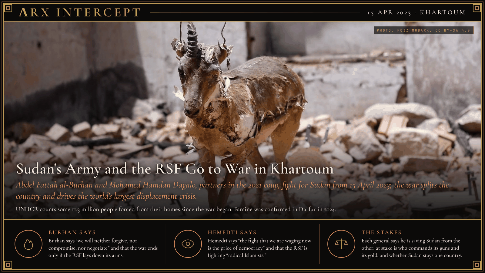
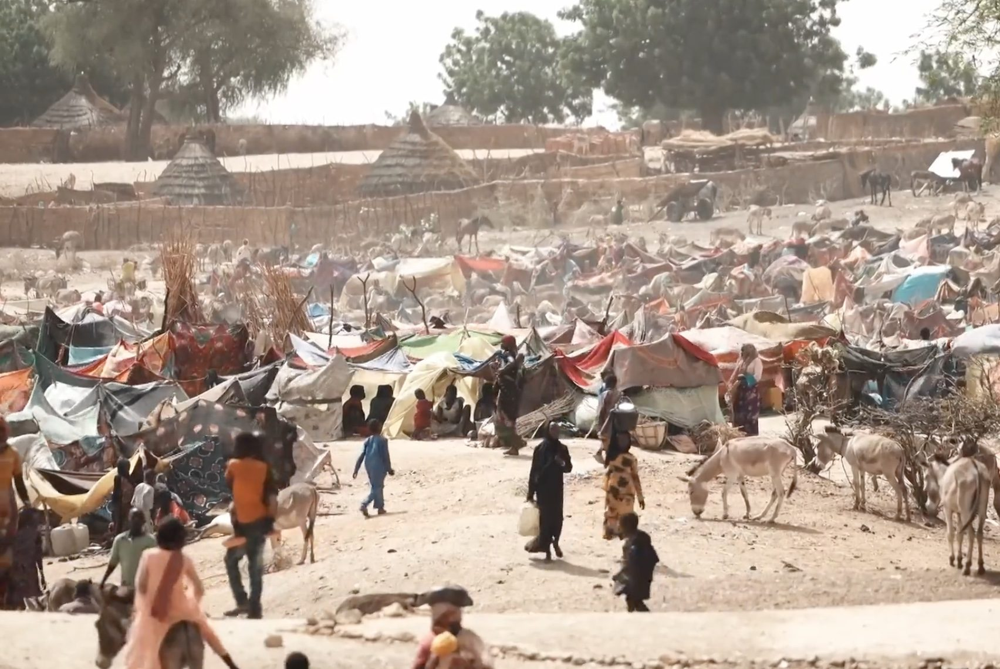

**ΛRX INTERCEPT** · Dispatch · 15 Apr 2023 · Khartoum

# Sudan's Army and the RSF Go to War in Khartoum

*Abdel Fattah al-Burhan and Mohamed Hamdan Dagalo, partners in the 2021 coup, fight for Sudan from 15 April 2023; the war splits the country and drives the world's largest displacement crisis.*

Sudan's army and the Rapid Support Forces, partners in the 2021 coup, turned their guns on each other in Khartoum on 15 April 2023.

The war has since split the country in two.

UNHCR calls it the world's largest displacement crisis.

Abdel Fattah al-Burhan's army and Mohamed Hamdan Dagalo's Rapid Support Forces removed Omar al-Bashir together in April 2019, and in October 2021 they seized power together again, ending a transition led by a civilian prime minister. The RSF grew out of the Janjaweed militias that Bashir's government used in Darfur; in 2013 Bashir reorganized them under Dagalo, known as Hemedti. In early 2023 the two generals fell out over a plan to fold the RSF into the army, with Hemedti pressing for a ten-year timetable and the army for a far shorter one. On 15 April 2023 fighting broke out at army and RSF bases across Sudan. The RSF claimed the presidential palace, and a doctors' union counted at least 25 dead by that night.

The army moved its government to Port Sudan on the Red Sea, while the RSF took most of Darfur and much of the capital. In August 2024 the Famine Review Committee confirmed famine in Zamzam camp near El Fasher. On 7 January 2025 US Secretary of State Antony Blinken determined that members of the RSF and allied militias had committed genocide, and Washington sanctioned Hemedti; Blinken had found in 2023 that members of both forces committed war crimes. The army retook the presidential palace in Khartoum in March 2025. In August 2025 Hemedti was sworn in at Nyala as head of a rival government, and on 26 October 2025 the RSF took El Fasher, the army's last stronghold in Darfur, after a siege of 18 months. An escapee's account obtained by Reuters said RSF fighters beat and shot men fleeing the city.

By October 2026 UNHCR counted some 11.3 million people forced from their homes since the war began, 6.4 million of them inside Sudan. The UN aid office says almost 34 million Sudanese need help. Mediators met in Geneva on 21 October 2026 to look for a path to a ceasefire; neither the government nor the RSF took part.

Burhan says the RSF is a rebel militia: "We will neither forgive, nor compromise, nor negotiate," he said after the army retook Khartoum, and victory will come when "the last rebel has been eradicated from the last corner of Sudan." Hemedti says he is fighting the Islamists of Bashir's old regime: "The fight that we are waging now is the price of democracy," he wrote two days into the war, and "we are fighting against radical Islamists who hope to keep Sudan isolated and in the dark." Blinken said the United States "does not support either side of this war."

Burhan says he defends the state against a mutinous militia; Hemedti says he defends a democratic Sudan against the old regime. Each says he is saving Sudan from the other. Beneath both claims lies a contest over who commands Sudan's guns and its gold, and whether Sudan stays one country or splits along the front line.

---

## Sources

**Original reporting**
- [Sudan clashes kill at least 25 in power struggle between army, paramilitaries](https://www.reuters.com/world/africa/heavy-gunfire-heard-south-sudanese-capital-khartoum-witnesses-2023-04-15/) — Reuters
- [Insight: How Sudan's military factions set path to war as mediation stalled](https://www.reuters.com/world/africa/how-sudans-military-factions-set-path-war-mediation-stalled-2023-04-28/) — Reuters
- [Famine now prevalent in parts of war-torn Sudan](https://news.un.org/en/story/2024/08/1152736) — UN News
- [Genocide Determination in Sudan and Imposing Accountability Measures](https://2021-2025.state.gov/genocide-determination-in-sudan-and-imposing-accountability-measures/) — US Department of State
- [Sudan's RSF chief Gen Mohamed Dagalo sworn in as head of parallel Darfur-based government](https://www.thenationalnews.com/news/mena/2025/08/31/sudans-rsf-chief-gen-mohamed-dagalo-sworn-in-as-head-of-parallel-darfur-based-government/) — The National
- [Escapee describes summary killings after Darfur city's fall](https://www.reuters.com/world/africa/escapee-describes-summary-killings-after-darfur-citys-fall-2025-10-28/) — Reuters
- [Sudan conflict: Peace efforts resume to end 'drone war' fuelling humanitarian crisis](https://news.un.org/en/story/2026/10/1168638) — UN News

**Context**
- [Sudanese civil war (2023–present)](https://en.wikipedia.org/wiki/Sudanese_civil_war_(2023%E2%80%93present)) — Wikipedia
- [Sudan situation](https://data.unhcr.org/en/situations/sudansituation) — UNHCR Operational Data Portal

**Framing**
- [Sudan army chief says war will not end until RSF lays down its arms](https://www.france24.com/en/live-news/20250329-sudan-army-chief-says-war-will-not-end-until-rsf-lays-down-its-arms) — France 24 (AFP)
- [Hemedti manoeuvres to brand war against Sudan army as fight against former regime Islamists](https://www.dabangasudan.org/en/all-news/article/hemeti-manoeuvres-to-brand-war-against-sudan-army-as-fight-against-former-regime-islamists) — Dabanga
- [Sudan fighting: No talks until bombing stops, Hemedti tells BBC](https://www.bbc.com/news/world-africa-65426892) — BBC News

*Filed by the ΛRX Intercept desk · arxcortex.io*

*Grok Bot wrote this on 29 Oct 2026 from the sources above, for the Chronosphere 2020s record. Photo: Moiz mubark, a stuffed gazelle in the ruins of the natural history museum in Khartoum, 2025, Wikimedia Commons (CC BY-SA 4.0). Camp: Henry Wilkins/VOA, eastern Chad, May 2023, Wikimedia Commons (public domain).*
