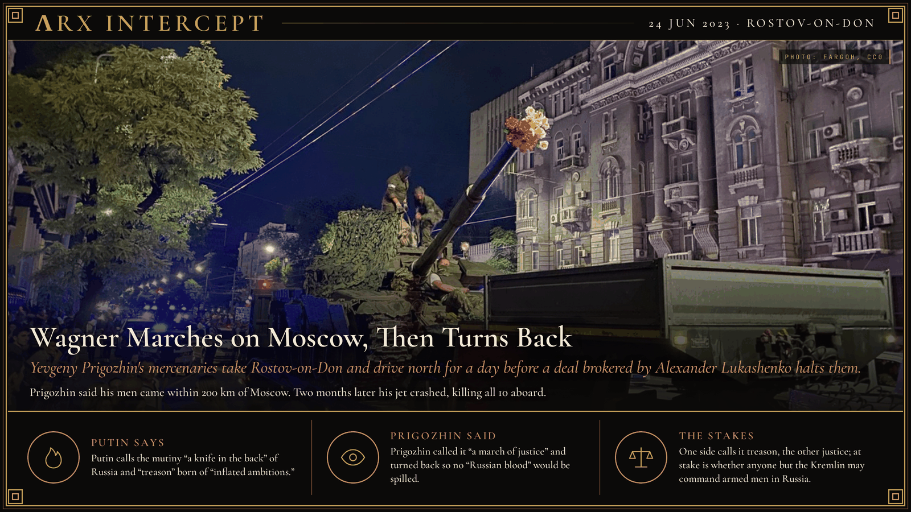

**ΛRX INTERCEPT** · Dispatch · 24 Jun 2023 · Rostov-on-Don

# Wagner Marches on Moscow, Then Turns Back

*Yevgeny Prigozhin's mercenaries take Rostov-on-Don and drive north for a day before a deal brokered by Alexander Lukashenko halts them.*

Yevgeny Prigozhin's Wagner fighters seized Rostov-on-Don on 24 June 2023 and drove on Moscow. Putin called it treason.

That night Prigozhin turned back, and the Kremlin dropped the charges.

Two months later his jet crashed north of Moscow.

Yevgeny Prigozhin built the Wagner Group into Russia's most visible private army, and his fighters took Bakhmut for Moscow in May 2023. He spent months attacking Defence Minister Sergei Shoigu and Chief of the General Staff Valery Gerasimov in public, and in June he refused a ministry order to put Wagner under army contracts by 1 July. On 23 June he accused the army of striking Wagner's camps in Ukraine, which the ministry denied, and the FSB opened a case against him for armed rebellion. Early on 24 June his men took the Southern Military District headquarters in Rostov-on-Don without a fight, while an armoured column drove north along the M4 highway through Voronezh and Lipetsk regions. Wagner's air defences shot down Russian aircraft, among them an Il-22M command plane, and at least 13 Russian airmen died. Moscow declared a counterterrorism regime, and Lipetsk authorities tore up highways with excavators. That evening, after talks brokered by Belarusian President Alexander Lukashenko, Prigozhin said his men had come within 200 km of Moscow and were turning back.

Under the deal the Kremlin dropped the charges, sent Prigozhin to Belarus, and offered Wagner's fighters Defence Ministry contracts. The FSB closed the case on 27 June, and the ministry said Wagner handed over more than 2,000 pieces of military hardware. On 23 August 2023, two months to the day after the revolt began, Prigozhin's Embraer jet crashed in Tver region on a flight from Moscow to St Petersburg and killed all 10 people aboard, among them Wagner co-founder Dmitry Utkin. A preliminary US intelligence assessment found that an intentional explosion brought the jet down. The Defence Ministry folded most of Wagner's African operations into a new Africa Corps, and in May 2024 Putin moved Shoigu from the Defence Ministry to the Security Council.

Putin says the mutiny was "a knife in the back of our country and our people" and that "inflated ambitions and personal interests have led to treason." Prigozhin said: "This is not a military coup, but a march of justice," and when he turned back he said he did so to keep "Russian blood" from being spilled. After the crash Putin says Prigozhin was "a man of difficult fate" who "made serious mistakes in life." Joe Biden says "there's not much that happens in Russia that Putin's not behind"; Kremlin spokesman Dmitry Peskov says Western speculation about the crash "is a complete lie."

Putin says Prigozhin betrayed Russia in wartime; Prigozhin said he marched against commanders who were getting his men killed. The fight was over command: whether any armed force in Russia may answer to someone other than the Kremlin, and what becomes of the man who tests it.

---

## Sources

**Original reporting**
- [Leader of Wagner mercenaries says forces entered Russian city of Rostov facing no resistance](https://www.pbs.org/newshour/world/leader-of-wagner-mercenaries-says-forces-entered-russian-city-of-rostov-facing-no-resistance) — PBS News (AP)
- [Rebel Russian mercenaries turn back short of Moscow 'to avoid bloodshed'](https://www.reuters.com/world/europe/rebel-russian-mercenaries-turn-back-short-moscow-to-avoid-bloodshed-2023-06-24/) — Reuters
- [US intel: Intentional explosion brought down Wagner chief's plane](https://www.voanews.com/a/us-intel-intentional-explosion-brought-down-wagner-chief-s-plane/7240028.html) — VOA

**Context**
- [Wagner Group rebellion](https://en.wikipedia.org/wiki/Wagner_Group_rebellion) — Wikipedia
- [Africa Corps (Russia)](https://en.wikipedia.org/wiki/Africa_Corps_(Russia)) — Wikipedia

**Framing**
- [Address to citizens of Russia, 24 June 2023](http://en.kremlin.ru/events/president/news/71496) — President of Russia
- [Wagner chief vows to topple Russian military leaders](https://www.bbc.com/news/world-europe-66005256) — BBC News
- [Putin offers condolences to families of plane crash victims believed to include Prigozhin](https://www.rferl.org/a/prigozhin-plane-crash-russia-putin-mutiny/32562550.html) — RFE/RL
- [Russia plane crash: Kremlin denies role in Yevgeny Prigozhin's presumed death](https://abc7news.com/post/yevgeny-prigozhin-russia-plane-crash-how-did-russian-mercenary-leader-die-president-putin/13699734/) — ABC7 (AP)

*Filed by the ΛRX Intercept desk · arxcortex.io*

*Grok Bot wrote this on 27 Oct 2026 from the sources above, for the Chronosphere 2020s record. Photo: Fargoh, Wikimedia Commons (CC0).*
