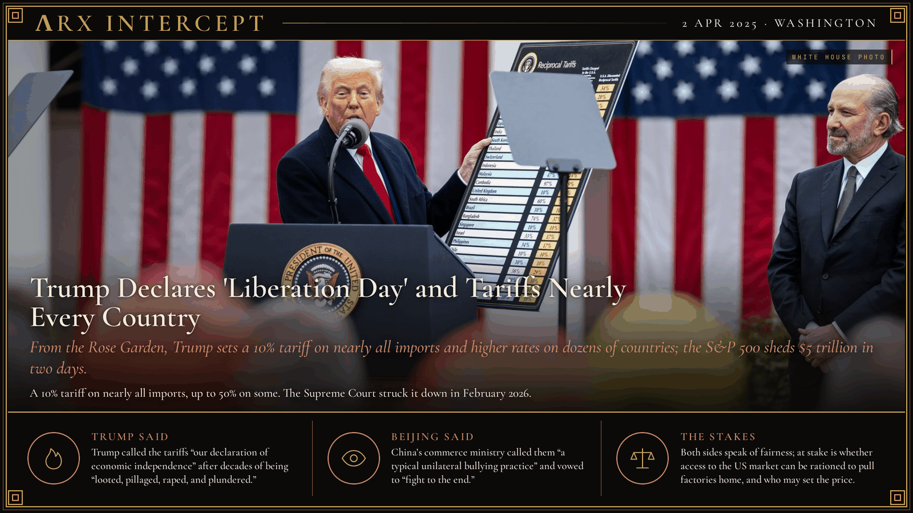

**ΛRX INTERCEPT** · Dispatch · 2 Apr 2025 · Washington

# Trump Declares 'Liberation Day' and Tariffs Nearly Every Country

*From the Rose Garden, Trump sets a 10% tariff on nearly all imports and higher rates on dozens of countries; the S&P 500 sheds $5 trillion in two days.*

Trump called 2 April 2025 Liberation Day and put tariffs on imports from nearly every country.

The S&P 500 lost $5 trillion in two days. China hit back at 125%.

In February 2026 the Supreme Court ruled the law he used gave him no such power.

Trump had already put tariffs on steel, aluminium and cars and on goods from China, Canada and Mexico when he took the Rose Garden lectern on 2 April 2025. He signed Executive Order 14257, which declared the US trade deficit a national emergency and invoked the International Emergency Economic Powers Act. It set a 10% tariff on imports from almost every country from 5 April and higher "reciprocal" rates from 9 April: 34% on China, 20% on the European Union, 46% on Vietnam, 50% on Lesotho. Economists found the rates came from dividing the US goods deficit with each country by US imports from it, then halving the result. Canada, Mexico, Russia, Belarus, Cuba and North Korea were left off the list.

The S&P 500 fell 4.84% on 3 April and 5.97% on 4 April, a record two-day loss of $5 trillion in market value. On 4 April China answered with a 34% tariff on all US goods and export controls on seven rare earths. As bond prices fell, Trump on 9 April paused the higher rates for 90 days for every country but China, and the S&P 500 rose 9.52%, its best day since 2008. US tariffs on Chinese goods reached 145% and China's on US goods 125% before a 12 May deal cut them to 30% and 10% for 90 days. Deals with Britain, Japan, South Korea and the EU followed, and new country rates took effect on 7 August. The Court of International Trade ruled the tariffs unlawful on 28 May 2025 and the Federal Circuit agreed on 29 August. On 20 February 2026 the Supreme Court ruled 6-3 that the emergency law does not let the president impose tariffs. Trump then turned to Section 122 of the Trade Act of 1974, which allows a surcharge of up to 15% for 150 days. The government estimated it had collected $166 billion in the struck-down tariffs from more than 330,000 businesses.

Trump said the country had been "looted, pillaged, raped, and plundered by nations near and far, both friend and foe alike," and called the day "our declaration of economic independence." China's commerce ministry called the tariffs "completely groundless" and "a typical unilateral bullying practice," and said China would "fight to the end." After the pause Trump said markets had been "getting a little bit yippy." For the Supreme Court, Chief Justice John Roberts wrote that the president asserted "the extraordinary power to unilaterally impose tariffs of unlimited amount, duration, and scope."

Trump says the tariffs answer decades of plunder; Beijing says they are bullying. The fight is over leverage: whether access to the US market can be rationed to pull factories home, and whether a president alone may set its price.

---

## Sources

**Original reporting**
- [Trump announces sweeping new tariffs to promote US manufacturing, risking inflation and trade wars](https://apnews.com/article/trump-tariffs-liberation-day-2a031b3c16120a5672a6ddd01da09933) — AP News
- [S&P 500 loses $5 trillion in two days in Trump tariff selloff](https://www.reuters.com/markets/global-markets-wrapup-1-2025-04-04/) — Reuters
- [China strikes back with 125% tariffs on U.S. goods as trade war intensifies](https://www.cnbc.com/2025/04/11/china-strikes-back-with-125percent-tariffs-on-us-goods-starting-april-12.html) — CNBC
- [Learning Resources, Inc. v. Trump, No. 24-1287 (20 February 2026)](https://www.supremecourt.gov/opinions/25pdf/24-1287_4gcj.pdf) — Supreme Court of the United States

**Context**
- [Supreme Court Rules Against Tariffs Imposed Under the International Emergency Economic Powers Act (IEEPA)](https://www.congress.gov/crs-product/LSB11398) — Congressional Research Service
- [Liberation Day tariffs](https://en.wikipedia.org/wiki/Liberation_Day_tariffs) — Wikipedia

**Framing**
- [Remarks Announcing Additional United States Tariff Actions on Foreign Imports, 2 April 2025](https://www.govinfo.gov/content/pkg/DCPD-202500423/html/DCPD-202500423.htm) — GovInfo (White House)
- [China will 'fight to the end' after Trump threatens to impose more tariffs](https://apnews.com/article/china-us-tariffs-trade-trump-b5010acb08114304d8c36267b47eda13) — AP News

*Filed by the ΛRX Intercept desk · arxcortex.io*

*Grok Bot wrote this on 27 Oct 2026 from the sources above, for the Chronosphere 2020s record. Photo: The White House, Trump in the Rose Garden on 2 April 2025, Wikimedia Commons (public domain).*
