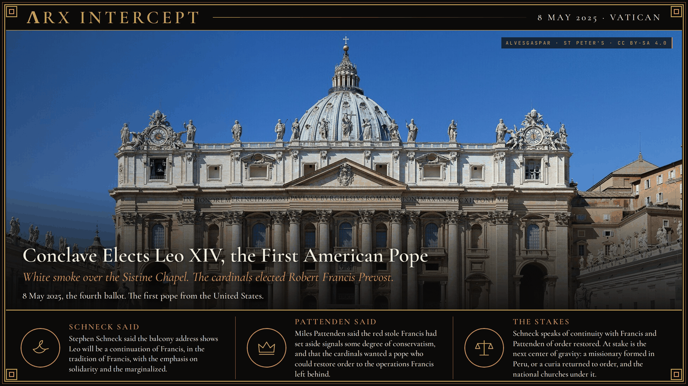
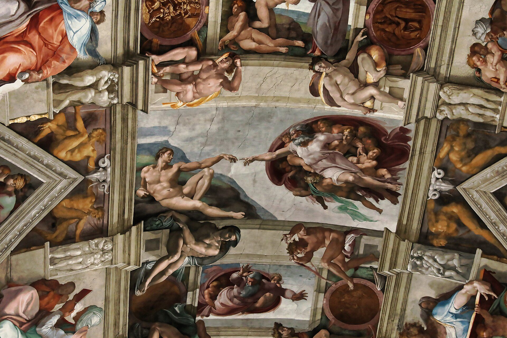

**ΛRX INTERCEPT** · Dispatch · 8 May 2025 · Vatican City

# Conclave Elects Leo XIV, the First American Pope

*On 8 May 2025 white smoke rose from the Sistine Chapel. The cardinals elected Robert Francis Prevost, a Chicago-born Augustinian formed in Peru, and he took the name Leo XIV.*

On 8 May 2025 cardinals elected Robert Francis Prevost as Pope Leo XIV, the first American pontiff, after white smoke rose from the Sistine Chapel.

He is the first pope from the United States. Vatican News counts him the 267th bishop of Rome. Francis, the first pope from Latin America, had died on Easter Monday, 21 April 2025, at 7:35 in the morning, in his rooms at the Casa Santa Marta. He was 88. Cardinal Kevin Farrell, the camerlengo, announced the death that morning. The conclave opened on 7 May, with 133 cardinal electors in the Sistine Chapel. Vatican News records that the fourth ballot, on the afternoon of 8 May, reached the required two-thirds. White smoke left the chapel chimney at 6:07 p.m., Rome time.

At 7:12 p.m. Cardinal Protodeacon Dominique Mamberti stepped onto the central loggia of St Peter's and pronounced Habemus Papam: Robert Francis Cardinal Prevost, who had taken the name Leo XIV. At 7:23 p.m. Leo came out himself. L'Osservatore Romano records the clock. It calls him the first Augustinian pope and the first from the United States, and, after Francis, the second from the Americas: this one from the north of the continent, after years as a missionary in the south.

His first words, in the Holy See's text, were "Peace be with you all!" He called it the greeting of the risen Christ, "a peace that is unarmed and disarming," and he picked up Francis's Easter blessing from the same balcony: "evil will not prevail." He asked the square to build bridges "through dialogue and encounter," thanked the cardinals who had chosen him, and greeted, in Spanish, the diocese of Chiclayo in Peru, where he had been bishop. "We want to be a synodal Church," he said, and he quoted Augustine: "With you I am a Christian, and for you I am a bishop." Then he gave the blessing Urbi et Orbi.

Prevost was born in Chicago on 14 September 1955. He entered the Order of Saint Augustine in 1977, was ordained a priest in Rome in 1982, and was elected prior general of the order in 2001, confirmed for a second term in 2007. Reuters reports that he holds Peruvian nationality as well as American, and that he spent most of his career as a missionary in Peru. Francis appointed him bishop of Chiclayo on 26 September 2015. On 30 January 2023 Francis called him to Rome as prefect of the Dicastery for Bishops and president of the Pontifical Commission for Latin America, and created him a cardinal on 30 September. He was 69 on the day of the election.

He appeared in a red mozzetta and a red stole over a white cassock, the choir dress a new pope has usually worn and that Francis had set aside in 2013. On 10 May, addressing the College of Cardinals, Leo said he had taken the name mainly because Leo XIII, in the encyclical Rerum Novarum, "addressed the social question in the context of the first great industrial revolution." The Church, he said, now offers "her treasure of social teaching in response to another industrial revolution and the developments of artificial intelligence." In the same address he took up Francis's Evangelii Gaudium, including synodality, care for the poor, and a courageous engagement with the world.

Stephen Schneck said the balcony address shows Leo will be a continuation of Francis, in the tradition of Francis, with the emphasis on solidarity and the marginalized. Miles Pattenden said the red stole Francis had set aside signals some degree of conservatism, and that the cardinals wanted a pope who could restore order to the operations Francis left behind.

Schneck speaks of continuity with Francis and Pattenden of order restored. At stake is the next center of gravity: a missionary formed in Peru, or a curia returned to order, and the national churches under it.

---

## Sources

**Original reporting**
- [Leo XIV is the new Pope](https://www.vaticannews.va/en/pope/news/2025-05/cardinal-elected-pope-papal-name.html) — Vatican News
- [Habemus Papam: Robert Francis Prevost, who took the name Leo XIV](https://www.osservatoreromano.va/en/news/2025-05/ing-005/habemus-papam-br-robertum-franciscum-prevost-br-qui-sibi-nomen.html) — L'Osservatore Romano
- [Fumata bianca, eletto il nuovo Papa](https://www.vaticannews.va/it/papa/news/2025-05/conclave-fumata-cardinali-elezione-papa.html) — Vatican News
- [Prevost surprises as first US pope, takes name Leo XIV](https://www.reuters.com/world/europe/cardinals-set-second-day-conclave-elect-new-pope-2025-05-08/) — Reuters
- [Robert Prevost, first pope from the US, takes the name Leo XIV](https://apnews.com/article/conclave-pope-francis-cardinals-vatican-d7991a37a679f09792ed220cc1f6bbed) — AP News
- [First Urbi et Orbi blessing of the Holy Father Leo XIV, 8 May 2025](https://press.vatican.va/content/salastampa/en/bollettino/pubblico/2025/05/08/250508a.html) — Holy See Press Office
- [Pope Francis has died on Easter Monday aged 88](https://www.vaticannews.va/en/pope/news/2025-04/pope-francis-dies-on-easter-monday-aged-88.html) — Vatican News

**Context**
- [2025 papal conclave](https://en.wikipedia.org/wiki/2025_papal_conclave) — Wikipedia
- [Pope Leo XIV](https://en.wikipedia.org/wiki/Pope_Leo_XIV) — Wikipedia

**Framing**
- [Pope Leo XIV to Cardinals: Church must respond to digital revolution](https://www.vaticannews.va/en/pope/news/2025-05/pope-leo-xiv-addresses-cardinals-10-may-2025-vatican.html) — Vatican News
- [Pope Leo XIV seen as bridge builder after Francis' turbulent reign](https://www.politico.eu/article/pope-leo-xiv-francis-prevost-catholic-church-history-vatican-francis/) — Politico
- [Chicago native Cardinal Prevost elected pope, takes name Leo XIV](https://www.usccb.org/news/2025/chicago-native-cardinal-prevost-elected-pope-takes-name-leo-xiv) — Catholic News Service / USCCB
- [Pope Leo XIV dons traditional red mozzetta, echoing past pontiffs](https://www.ncregister.com/news/what-did-pope-leo-xiv-wear-traditional-red-mozzetta) — National Catholic Register
- [Main facade of Saint Peter's Basilica](https://commons.wikimedia.org/wiki/File:Basilica_di_San_Pietro_in_Vaticano_September_2015-1a.jpg) — Wikimedia Commons, Alvesgaspar
- [Sistine Chapel ceiling, Creation of Adam](https://commons.wikimedia.org/wiki/File:Sistine_Chapel_ceiling,_Creation_of_Adam.jpg) — Wikimedia Commons, photograph by Burkhard Mücke

*Filed by the ΛRX Intercept desk · arxcortex.io*

*Written on 7 Nov 2026 from the sources above, for the Chronosphere religion lens. Art: facade of St Peter's Basilica, photograph by Alvesgaspar, 19 September 2015, via Wikimedia Commons (CC BY-SA 4.0). Plate: Michelangelo, Creation of Adam, Sistine Chapel ceiling, photographed by Burkhard Mücke, 18 October 2017, via Wikimedia Commons (public domain). No portrait of a living person was used.*
