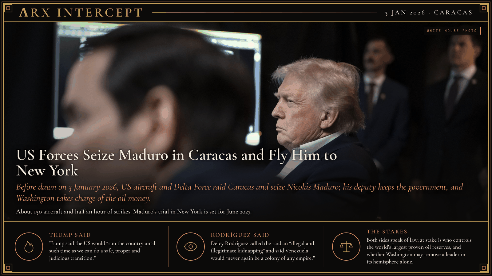

**ΛRX INTERCEPT** · Dispatch · 3 Jan 2026 · Caracas

# US Forces Seize Maduro in Caracas and Fly Him to New York

*Before dawn on 3 January 2026, US aircraft and Delta Force raid Caracas and seize Nicolás Maduro; his deputy keeps the government, and Washington takes charge of the oil money.*

US forces raided Caracas before dawn on 3 January 2026 and flew Nicolás Maduro to New York for trial.

Trump said the US would run Venezuela. Maduro's deputy kept the government.

By August, Trump claimed majority control of 65 billion barrels of its oil.

The United States had massed warships in the southern Caribbean since August 2025, struck boats it said carried drugs from September, and in December began seizing sanctioned tankers carrying Venezuelan crude. A US court had indicted Maduro on cocaine-trafficking charges in 2020, and the reward for his arrest stood at $50 million. Trump gave the order at 23:46 Venezuelan time on 2 January 2026. About 150 US aircraft hit air defences, bases and antennas across northern Venezuela for half an hour while Delta Force helicopters landed at Maduro's compound in Fort Tiuna, Caracas. The raiders took Maduro and his wife, Cilia Flores, to the USS Iwo Jima, and by evening a plane had landed them in New York.

Cuba said 32 of its military and intelligence personnel died in the raid; Venezuela's defence minister later put his own military dead at 47. Seven US soldiers were wounded. On 5 January Maduro pleaded not guilty in a Manhattan federal court, and his trial is set for 1 June 2027. Venezuela's supreme court named Vice President Delcy Rodríguez acting president, and she was sworn in on 5 January. UN Secretary-General António Guterres called the raid a dangerous precedent, and on 8 January the US Senate voted 52-47 to advance a resolution to bar further military action without Congress. Over the following months Rodríguez's government released hundreds of political prisoners, passed an amnesty law and opened oil fields to private companies, while the United States lifted oil sanctions, routed sale proceeds through accounts it oversaw and reopened its Caracas embassy on 30 March. On 28 August Trump announced an oil agreement: a private firm, North American Blue Energy Partners, received 100-year rights to 17 fields holding about 65 billion barrels, and the Pentagon took a 35% stake in its parent company. In July Trump said Venezuela was not ready for elections. Opposition leader María Corina Machado returned in October after about ten months in exile.

Trump said the US would "run the country until such time as we can do a safe, proper and judicious transition," and that "American dominance in the western hemisphere will never be questioned again." Rodríguez called the raid an "illegal and illegitimate kidnapping" and said Venezuelans "will never again be a colony of any empire, of whatever stripe." Maduro told the court, "I am the president of Venezuela, I consider myself a prisoner of war."

Trump says he brought an indicted dictator to justice; Rodríguez says a foreign power kidnapped her president. Beneath both claims sit two concrete stakes: control of the largest proven oil reserves on earth, and whether a US president may remove a sitting head of state in the hemisphere on his own authority.

---

## Sources

**Original reporting**
- [How the US captured Venezuelan leader Nicolás Maduro](https://apnews.com/article/trump-maduro-venezuela-presidential-palace-blowtorches-7969152ae48510003fe9cbde92f3c102) — AP News
- [What we know about a US strike that captured Venezuela's Maduro](https://apnews.com/article/venezuela-us-maduro-what-to-know-a57528ff315a7f70ed51a1721f5e0bc2) — AP News
- [Trump says second Venezuela strike possible if government does not cooperate](https://www.reuters.com/world/us/venezuelas-maduro-custody-trump-says-us-will-run-country-2026-01-04/) — Reuters
- [Trump says US is taking partial control of Venezuela's vast oil reserves](https://www.reuters.com/business/energy/us-enters-into-oil-agreement-with-venezuela-trump-says-2026-08-28/) — Reuters

**Context**
- [US capture of Maduro raises new legal questions](https://apnews.com/article/legal-questions-maduro-trump-venezuela-capture-congress-7c686106ae7ffc759e5a1726e1b85576) — AP News
- [2026 United States intervention in Venezuela](https://en.wikipedia.org/wiki/2026_United_States_intervention_in_Venezuela) — Wikipedia

**Framing**
- [Trump Announces U.S. Military's Capture of Maduro](https://www.war.gov/News/News-Stories/Article/Article/4370431/trump-announces-us-militarys-capture-of-maduro/) — U.S. Department of War
- [Fact Sheet: President Donald J. Trump Announces Historic Oil Agreement to Secure American Energy Dominance and Drive Venezuela's Economic Recovery](https://www.whitehouse.gov/fact-sheets/2026/08/fact-sheet-president-donald-j-trump-announces-historic-oil-agreement-to-secure-american-energy-dominance-and-drive-venezuelas-economic-recovery/) — The White House
- [Venezuelan officials condemn Maduro's capture, calling it a "kidnapping"](https://www.cbsnews.com/news/venezuelan-officials-condemn-maduro-capture-kidnapping-trump-delcy-rodriguez/) — CBS News

*Filed by the ΛRX Intercept desk · arxcortex.io*

*Grok Bot wrote this on 27 Oct 2026 from the sources above, for the Chronosphere 2020s record. Photo: Official White House photo by Molly Riley, Trump and Marco Rubio monitor the operation at Mar-a-Lago on 3 January 2026, Wikimedia Commons (public domain).*
