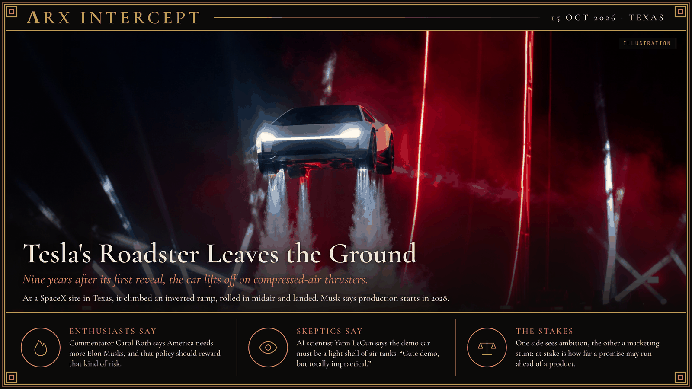

**ΛRX INTERCEPT** · Dispatch · 15 Oct 2026 · Texas

# Tesla's Roadster Leaves the Ground

*Nine years after its first reveal, the car lifts off on compressed-air thrusters.*

On 15 October, at a SpaceX test site outside Waco, Texas, Elon Musk showed the second-generation Tesla Roadster. In a livestreamed demonstration the car drove up a ramp that curled over until it was upside down, left the end, rolled 180 degrees in midair and landed on its wheels. Tesla engineering vice president Lars Moravy said ten thrusters draw on 600 liters of compressed air. "Flying cars are real," Musk said, adding that success "is not guaranteed" but "it will probably work."

The car was first revealed in 2017, and Musk delayed it in 2020, 2021, 2023 and 2024. Tesla now lists three versions, from a road car to an invitation-only "Rocket" with what it calls a full flight system, and Musk says production starts in 2028. No prices were given. Tesla's website says the flying model is not approved for public roads, and the FAA told CBS News the vehicle does not meet its definition of an aircraft.

The car arrives trailing an old American promise. Glenn Curtiss built a flying-car prototype in 1917. In 1939 General Motors' Futurama exhibit at the New York World's Fair carried some 30,000 visitors a day over a model of America in 1960, all automated highways and suburbs. *The Jetsons* set a family in that future. By 2011 the investor Peter Thiel's Founders Fund was complaining, "We wanted flying cars, instead we got 140 characters." Axios called the Roadster "a throwback to the era when cars were objects of desire."

Reactions split along familiar lines. Commentator Carol Roth, writing for Fox News, says the demo shows why America needs more Elon Musks and policy that rewards risk-taking. AI scientist Yann LeCun calls it a "marketing stunt" and says the compressed air could last only seconds, so the demo car "must be an empty, lightweight shell." Analyst Dan Ives says the Roadster will not move Tesla's volume or revenue, and Musk himself told one podcast that buyers who put safety first should not buy it. Tesla has not let journalists look under the hood.

One side sees ambition, the other a marketing stunt. Beneath both is a question of trust that outlasts any one car: how far a promise may run ahead of a product before customers, investors and regulators stop paying for the promise.

---

## Sources

**Original reporting**
- [Tesla reveals SpaceX-powered Roadster that flies and falls with style](https://techcrunch.com/2026/10/15/tesla-reveals-spacex-powered-roadster-that-flies-and-falls-with-style/) — TechCrunch
- [With Tesla Roadster debut, Elon Musk shows "flying cars are real"](https://www.cbsnews.com/news/tesla-roadster-debut-elon-musk-flying-cars-are-real/) — CBS News

**Context**
- [Elon Musk's flying Tesla is gloriously absurd](https://www.axios.com/2026/10/16/tesla-roadster-elon-musk-flying-car) — Axios
- [Futurama (New York World's Fair)](https://en.wikipedia.org/wiki/Futurama_(New_York_World%27s_Fair)) — Wikipedia
- [Retrofuturism](https://en.wikipedia.org/wiki/Retrofuturism) — Wikipedia
- [Founders Fund](https://en.wikipedia.org/wiki/Founders_Fund) — Wikipedia

**Perspectives**
- [Elon Musk is building the future. America needs thousands more like him](https://www.foxnews.com/opinion/want-flying-cars-america-needs-thousands-more-elon-musks-less-red-tape) — Carol Roth, Fox News opinion
- [Wait, Was Elon's "Flying Car" Just an Empty Shell?](https://futurism.com/advanced-transport/elon-flying-car-empty-shell) — Futurism, on Yann LeCun's critique

*Filed by the ΛRX Intercept desk · arxcortex.io*

*Claude Opus 5.5 wrote this. Original skills, prompts, and human auditing ran through the process. The writing is shaped to fit Arx. The pictures were generated with GPT Image 2.5 Flare, OpenAI's default image model.*
